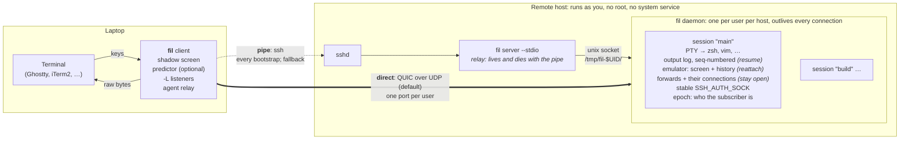

# fil — design

> **Status: draft for discussion, 2026-11-02.** Nothing is implemented yet.
> Items marked **(decided)** are the owner's decisions. Everything else is a proposal.

*fil* is French for thread or wire. *Reprendre le fil*: to pick up the thread where you left off.

## 1. What fil is

fil is a remote shell for development over SSH. It keeps your place when the network drops or your local terminal dies. It combines:

- **Eternal Terminal's reconnect and native scrollback.** Output reaches your terminal as raw bytes, so its own scrollback, search and copy keep working.
- **tmux's detach and reattach, and only that.** A session survives your laptop sleeping, your network changing and your local terminal crashing. You can pick it up from another machine. There are no panes or windows, because your terminal emulator already has them.
- **Port forwards that stay open** across reconnects, with a clear view of what each session holds.
- **mosh-style predictive local echo**, as an optional, pluggable component.

## 2. Goals and non-goals

**Goals**

1. Native scrollback. While connected, the screen is never redrawn from a model.
2. Reconnect without user action, resuming exactly where the stream stopped.
3. Named sessions that outlive the client. You can reattach after a local crash or take a session over from a second machine.
4. Port forwards (`-L`, `-R`) that belong to the session and survive reconnects. `fil ports` shows them with context.
5. No root and no system service on the remote host. Installing means putting one static binary in your home directory.
6. SSH is the root of trust. fil adds no accounts, no key registry and no new identity system.
7. Two first-class transports from the first release, with automatic fallback **(decided)**:
   - a pipe (ssh by default)
   - direct QUIC over UDP
8. Prediction sits behind a trait so it can be improved independently **(decided)**.

**Non-goals**

- Panes, windows, tabs or layouts **(decided)**.
- More than one attached client per session. A second client takes the session over **(decided)**.
- Wire compatibility with mosh or ET (see §3).
- Non-interactive use such as scp, rsync or git. Plain ssh already does that well.
- Windows, as a remote host or as a client **(decided)**. Windows users can run fil inside WSL, which is a Linux host.
- Runtime-loaded plugins (§8.4).

## 3. Prior art

| Tool | Reconnect | Native scrollback | Reattach after a client crash | Port forwarding | Notes |
|---|---|---|---|---|---|
| Eternal Terminal | ✅ | ✅ | ❌ session tied to the client process | ✅ | system-wide `etserver` service on TCP 2022 |
| mosh | ✅ roams over UDP | ❌ syncs screen state | ❌ the key lives only in the original client | ❌ | best on lossy links |
| tmux / screen | — | ❌ redraws the screen (except iTerm2's `tmux -CC`) | ✅ | — | |
| shpool, zmx | — | ✅ | ✅ | — | session persistence only |
| ET + shpool | ✅ | ✅ | ✅ | ✅ | covers the features today, as two tools |
| koh | ✅ | ✅ | numbered sessions per client key | ❌ | replaces SSH with iroh peer-to-peer QUIC; experimental |
| mosh-rs | ✅ | opt-in, with its own server | ❌ | ❌ | Rust mosh rewrite, pre-alpha |
| WezTerm multiplexer | ✅ | ✅ | ✅ | — | both ends must be WezTerm |

**Why not reuse `mosh-server` or `etserver`?** Neither of them holds sessions.

- mosh-server syncs screen state rather than a byte stream, so native scrollback is impossible. It also has no forwarding.
- etserver has no reattach and no screen model to restore from, and it is a system-wide service.

The daemon *is* the product. Ideas and libraries are reusable:

- mosh's prediction design
- the mosh-rs and `morsh_predict` prediction code, both GPL-3
- shpool's restore crates (license to check)

## 4. Architecture



fil is one static binary, used on both ends. The remote side runs as `fil server …`.

- **Client** (`fil HOST [SESSION]`) owns the local terminal (in raw mode), the shadow screen that prediction uses, the local `-L` listeners and the agent relay. It holds its per-attach key in memory only.
- **Daemon** runs once per user per host and holds the sessions. The first attach starts it, detached from the login session. It listens on a Unix socket and, when direct mode is enabled, on one UDP port.
- **Relay** (`fil server --stdio`) is what the pipe runs. It connects its stdin and stdout to the daemon's socket. It keeps no state and dies with the pipe. Its first exchange is the **bootstrap**: start the daemon if needed, check versions, register the client's key and hand back the direct-mode details.

### 4.1 Attach

1. The client runs the pipe command (by default `ssh -T HOST fil server --stdio`). This is the one SSH login per attach, and the only Touch ID prompt for keys guarded by Touch ID.
2. The relay connects to the daemon, starting it if needed, and the two sides compare versions.
3. The client sends:
   - the session name
   - its terminal size and `TERM`
   - its host label (shown to the previous subscriber on a takeover, §5.2)
   - its per-attach public key
   - when resuming, its last epoch and sequence number
4. The daemon finds or creates the session. If the session is attached elsewhere, it takes the session over (§5.2). It replies with:
   - the epoch
   - a snapshot or a resume point
   - its UDP port and certificate fingerprint
5. The terminal stream starts **over the pipe immediately**, with no extra round trips before the first screen.
6. In the background, the client dials QUIC. If that succeeds, it moves every channel to QUIC and closes the pipe. If UDP is blocked, it stays on the pipe and tries again periodically, for example after a network change.

### 4.2 Reconnect

- **Liveness:** both transports send heartbeats, by default every 1 s. A link counts as dead after 5 s of silence. Both values are tunable.
- **On QUIC:**
  - A path change, such as Wi-Fi to cellular or a new IP address, is absorbed by QUIC connection migration with no new handshake.
  - If the connection itself is gone (for example the laptop slept past the idle timeout), the client performs a new QUIC handshake with the same in-memory key. **No SSH is involved.**
- **Fallback:** if QUIC can't be re-established within a few seconds, the client re-runs the pipe, which means a new SSH login.
- **Which transport, when:** the choice is `fil_transport::path::PathManager`, a state machine with no IO (`docs/m1/quic-link.md`). Direct retries back off from 1 s to 2 min and the pipe's from 1 s to 30 s, with jitter. A link that dies within 10 s counts as a failure, so a flapping one slows down instead of cycling. A network-change hint tries direct at once, at most four times a minute. The pipe is closed only after the session has been moved to QUIC.
- **Resume:** either way, the client sends "resume session S, epoch E, from byte N", and the daemon continues from byte N (§6.2).
- **While disconnected:**
  - The client paints a status overlay, using the same erase-before-write mechanism as predictions (§9). It removes the overlay on reconnect, leaving the screen and the scrollback exactly as they were.
    - **Shown on** `Degraded` and `Down`, never before the first screen.
    - **Says** what is happening ("reconnecting over pipe", how long, which try), and on a second line how many bytes of input are held and how many were dropped.
    - **Drawn** in inverse video, at the edge of the screen farthest from the cursor, never on the cursor's row, and never over a wide character. If no place is safe, or the terminal is in the middle of an escape sequence, nothing is drawn; it comes back as soon as it is safe.
    - **Short and unpadded:** at most 40 columns a line, with a space of margin each side. A terminal that reflows on a width change re-wraps anything wider than the new width, and the erase cannot undo that; so if the window narrows at all while something is drawn (the rows under it are re-wrapped too), the screen can no longer be trusted and the next attach starts from a snapshot instead of a resume.
    - **The same overlay** carries the `~?` help and the questions the client asks (take the session back, confirm offline input, a replaced session), so none of them can corrupt the screen either.
  - Keystrokes typed while disconnected are handled as decided in §4.3.

### 4.3 Input while disconnected

The handling is configurable **(decided)**:

- **Buffer:** keystrokes are buffered in client memory up to a configurable cap (proposed default: 4 KiB). The status overlay shows how much is buffered, and how much was dropped once the cap was reached. A cap of 0 drops all input while disconnected.
- **Send on resume, or ask:** by default the buffer is sent as soon as the session resumes. Optionally (`offline_input.confirm`), when the disconnect lasted longer than a threshold, the client shows what was typed and asks before sending it. A Ctrl-C typed during a long outage then can't land late by surprise.
- **Optional log:** `offline_input.log` keeps everything typed while disconnected, including anything over the cap, by appending it to a file or piping it to a command. It is **off by default**, because keystrokes can include passwords. See §11.

## 5. Sessions

### 5.1 Model

- **Name:** `[A-Za-z0-9._-]{1,64}`, default `main`. Both ends validate it.
- **Contents:**
  - the PTY and its child process
  - the output log and the emulator
  - the forwards
  - session environment such as `SSH_AUTH_SOCK`
  - the epoch, and the current subscriber (client ID, host label, attach time)
- **Lifetime:** a session lives until its shell exits or `fil kill` ends it. Detached sessions persist indefinitely; an idle reaper is available as an option.
- **Process grouping:**
  - On systemd hosts **with lingering enabled**, each session runs in its own transient user scope (`systemd-run --user --scope`). That gives reliable port attribution (§7.4) and clean teardown.
  - Without lingering, the user manager stops at logout and would take the scopes with it. Those hosts fall back to the session's process tree.
  - Lingering is read from `loginctl show-user -p Linger` when the session is created. The child is a session leader, so its pid is also its process group id.
  - **Teardown (`fil kill`):** a hangup to the group and to every descendant, as closing a terminal would send; after a short grace, SIGKILL to what is left, and `systemctl --user kill` on the scope. In the tree fallback the session records the descendants every few seconds, so a background job that was orphaned or moved to its own group (job control) is still found. A process that double-forks and dies between two scans escapes; the scope has no such limit.
  - When the shell exits by itself, what it left running is sent the hangup but not killed (in a scope, `systemctl --user kill --signal=SIGHUP`).
  - **No usable scope:** with `auto`, a trial scope (`systemd-run --user --scope true`) must start before the session uses one; if lingering is on but the trial fails, the session falls back to the process tree and logs a warning. With `scope = "systemd"` set explicitly there is no fallback: creating the session fails with the reason.

### 5.2 One subscriber, with takeover

At most one client is attached to a session **(decided)**. Attaching to a session that is already attached takes it over:

1. The daemon increments the epoch. It tells the old subscriber "taken over by `<host label>` at `<time>`", revokes that client's key and drops its transport.
2. The new subscriber receives a snapshot sized to its terminal, and the PTY is resized (SIGWINCH).

A client that resumes with a stale epoch is refused with the takeover message and asked whether to take the session back. A laptop waking up in a bag never steals the session silently.

**Detach:** type `~.` after Enter (like ssh) or run `fil detach`. Detaching also revokes the client's key.

### 5.3 Daemon location and lifecycle

- **Socket location:** the directory `/tmp/fil-$UID/` (mode 0700) holds the socket.
  - The daemon refuses to start if that directory exists with the wrong owner or mode. This defends against another user creating it first, as tmux does.
  - The socket is deliberately not in `$XDG_RUNTIME_DIR`. systemd-logind deletes that directory when your last login ends, which would strand a live daemon.
- **Logout cleanup:** hosts with `KillUserProcesses=yes` need `loginctl enable-linger`. The bootstrap detects this and warns.
- **Peer check:** the daemon verifies every connection's peer UID (`SO_PEERCRED` on Linux, `getpeereid` on macOS) and refuses mismatches.
- **Upgrades:** the socket path includes the protocol major version, so daemons of different versions can run side by side.
  - New sessions go to the newest daemon.
  - Old sessions stay on their daemon until they end.
  - `fil ls` asks every daemon.
  - Live upgrade by passing PTY file descriptors to the new daemon is a possible later step (§16).

## 6. The terminal stream

### 6.1 Output path

PTY output goes to three places:

1. the session's output log, a byte ring buffer (default 8 MiB) with a global sequence number
2. the daemon's terminal emulator
3. the subscriber, if one is attached

The client writes those bytes straight to the local terminal. That is why native scrollback, search, hyperlinks (OSC 8), clipboard writes (OSC 52) and graphics protocols behave exactly as they do over plain ssh.

### 6.2 Resume or snapshot

- **Resume** applies when the same client reconnects and its terminal is still open. The client acknowledges the bytes it has written. On reconnect it sends its last sequence number, and if that point is still in the log, the daemon sends the rest. Native scrollback has no gap.
- **Snapshot** applies to a new client, or when the log has wrapped. The daemon renders from its emulator:
  1. the last N history lines (default 1000), as text with SGR attributes, reflowed to the new width
  2. the current screen
  3. the terminal modes: alternate screen, cursor position and style, mouse, bracketed paste, focus and keypad modes, kitty keyboard flags, scroll region, title, tab stops (always cleared and set again, whatever the client's terminal had) and character sets (G0 to G3, the invoked one, and the ones the saved cursor holds)
- **Catch-up rule:** if the subscriber falls behind by more than a threshold (default 1 MiB or 2 s of output), the daemon jumps to a snapshot instead of replaying the backlog. On a slow link, `cat hugefile` followed by Ctrl-C stays responsive, which is mosh's main advantage. The cost is a gap in native scrollback. The gap is visible: a marker line such as `── fil: skipped 48 MB of output ──` goes into the scrollback.

Details the session implements (`fil-session`):

- **Snapshots are only taken between escape sequences.** Neither emulator exposes its parser state, so a snapshot taken mid-sequence would lose the pending bytes. The session holds back the unfinished end of the output (it is in the log, but neither the emulator nor any subscriber sees it) until the sequence completes; a tail longer than 1 MiB is let through as it is. Every snapshot is therefore exact for the offset it announces.
- **The daemon writes the marker**, as the first thing in the snapshot, together with what is needed to put it in the scrollback: leave an alternate screen, reset the scroll region and mouse and kitty keyboard state, then scroll the screen contents and the marker line above the visible area. The client must not add a marker of its own. A new client (`skipped` is 0) gets no marker.
- **The rule is looked at between sends**, so a link that blocks the sender is judged when it unblocks. It does not fire when everything has already been sent and only the acknowledgements are late: a snapshot would rewrite what the client has.

### 6.3 Terminal queries

Programs ask the terminal questions: cursor position, device attributes, colors, kitty keyboard support.

- While a client is attached, queries pass through to the real terminal, and its replies come back as input.
- While detached, the daemon's emulator answers, so programs don't hang waiting for a reply. "Detached" includes a subscriber whose transport has died and not yet resumed. The emulator answers `CSI 18 t` (the text area in characters) but not the color queries (OSC 10, 11, 12 and 4) or the pixel sizes (`CSI 14 t`, `16 t`), so the session answers those: from the colors and cell size the last attached terminal reported (it watches the replies pass through as input), or dark-theme defaults. The text area in pixels is the cell size times the current grid, so it follows a resize.
- Output that holds a query the daemon answered cannot be replayed to a client that missed it, because its terminal would answer a second time and the answer would arrive as keystrokes. That client gets a snapshot instead of a resume.

**A takeover between a query and its reply** (§16 item 4): the query went to the old terminal, so its reply is lost. The old subscriber's input is ignored from the moment of the takeover, and the new terminal never sees the query (it gets a snapshot, which contains none). The program waits until its own timeout. This is the simplest behavior that cannot inject a stray reply into the new client's session.

### 6.4 `TERM`

A session's `TERM` is fixed when the session is created, from the first client, and kept for the session's life **(decided)**. Taking over from a different terminal emulator can't change it for programs that are already running anyway. When the new client's `TERM` differs, fil warns once at attach.

### 6.5 Emulator

fil runs a headless emulator (no rendering) in two places: in the daemon, to answer terminal queries while detached (§6.3) and to render snapshots (§6.2), and in the client, as the prediction shadow screen (§9).

**Emulators are modular.** `fil-term` defines one interface, and each emulator is a backend behind it, compiled in under its own cargo feature and chosen by name at run time:

- **The `Emulator` trait:** feed bytes, resize, drain query replies, and report the current state.
- **A backend-neutral state model** (`TermState`): the lines with their cells and attributes, history, cursor, the modes of §6.2, and hyperlinks. Every backend converts its own grid into it.
- **One snapshot writer** turns any `TermState` into the bytes that recreate it, so a backend doesn't need its own serializer. The model also lets the fidelity suite compare backends cell by cell.
- **Capabilities:** each backend declares what it can report, such as reflow or kitty keyboard flags. The suite then scores a field a backend can't see as unsupported rather than wrong.

A session picks its backend when it is created and keeps it.

**The default backend is `alacritty_terminal` (decided).** The M0 restore-fidelity comparison (`docs/spikes/emulator.md`) chose it. Two backends are built in:

- `alacritty_terminal` (Apache-2.0), the default. It is the only candidate with reflow, OSC 8 hyperlinks, underline styles and replies to terminal queries, and it parses about 1.9x faster than `vt100`. The costs are about 30% more memory per session and glue around an API that wasn't built for this use, so every upgrade re-runs `just fidelity`.
- `vt100` (MIT), the light alternative. It tracks fewer fields: no reflow, no query replies, and no saved cursor or origin mode.

libghostty-vt (C ABI, used by zmx) was not evaluated: it needs a Zig toolchain, and the default already meets the bar. It can be added later behind its own feature.

## 7. Port forwarding

### 7.1 Kinds

- `-L [bind:]port:host:hostport` listens on the client machine and connects out from the remote.
- `-R [bind:]port:host:hostport` listens on the remote and connects out from the client machine.

v1 is TCP only. Unix-socket forwards, dynamic SOCKS (`-D`) and UDP are open questions (§16). Both ends bind to loopback by default; anything wider needs an explicit address.

### 7.2 Ownership and persistence

Forwards must stay open across reconnects **(decided)**.

- **Ownership:** forwards belong to the **session**, not to a connection.
  - The list of forward specs persists.
  - `-R` listeners live in the daemon and never close during a disconnect.
  - `-L` listeners live in the client process and stay bound for as long as it runs.
- **Open connections:** each forwarded connection is its own channel, with sequence numbers and acknowledgements like the terminal stream. A disconnect pauses it and the reconnect resumes it. No data is dropped.
- **Bounded buffers:** each connection has a bounded buffer (default 1 MiB). When it fills, fil stops reading from the socket, and ordinary TCP flow control pauses the application.
- **New connections during a disconnect** are accepted and wait, with a time limit, for the reconnect.
- **Long disconnects:** after a configurable timeout (proposed default: 10 min), open connections close. The listeners stay.
- **Takeover:**
  - `-R` listeners stay and route to the new subscriber.
  - `-L` connections that started on the old machine end, because their applications live there.
  - The new client recreates the session's `-L` listeners, warning about any port already in use locally.

### 7.3 Managing forwards

- At attach time: `fil orin -L 5173 -R 9000`
- Afterwards: `fil forward -L 5173`, `fil forward -R 9000`, `fil forward --rm 5173`

These commands work from the client machine or from inside the session. Inside, `$FIL_SESSION` names the session and the command talks to the daemon over its socket.

### 7.4 `fil ports`

`fil ports` shows as much context as possible **(decided)**:

```
$ fil ports
SESSION main on orin — attached from laptop since 09:12

FORWARDED
  DIR  LAPTOP            REMOTE          OWNER                      CONNS  ↓ / ↑           LAST
  -L   localhost:5173 →  127.0.0.1:5173  vite (pid 41872, ~/app)    2      14 MB / 220 KB  now
       http://localhost:5173 · HTTP 200 "Vite + React"
  -R   localhost:9000 ←  127.0.0.1:9000  your laptop                0      —               10:40
       detached: 1 connection waiting

LISTENING IN THIS SESSION, NOT FORWARDED
  8000  0.0.0.0 ⚠  python -m http.server (pid 42110, ~/tmp)  since 10:03  HTTP 200 "Directory listing for /"
        ⚠ reachable by the whole network, not just through fil  →  fil forward 8000

OTHER LISTENERS YOU OWN ON THIS HOST
  5432  127.0.0.1  postgres (pid 1201), not started from a fil session
```

- **For every forward:** direction, both endpoints, the process that owns the target, open connections, traffic in each direction, last activity and state.
- **Unforwarded listeners:** ports started inside the session that aren't forwarded yet, each with the one command that would forward it. Other listeners you own on the host are listed separately.
- **Exposure warnings** for anything bound beyond loopback.
- **Protocol probe:** a light probe labels what is listening (TLS handshake, HTTP `HEAD`, a Postgres or Redis greeting), with clickable URLs for HTTP. It can be turned off.
- **Client side:** whether a local port is already taken.
- **`--json`** for scripting.
- **Where the data comes from:**
  - Linux: `/proc/net/{tcp,tcp6,udp,udp6}` and `/proc/<pid>/fd`
  - macOS: libproc
  - Ports are attributed to a session through its scope (§5.1), or through the process tree as a fallback.
- **Caveats:** container ports show up as `docker-proxy`, and listeners owned by root show no owner.
- **Notifications:** new listeners can raise a desktop notification (OSC 9 / OSC 777, which iTerm2 and Ghostty support). This is opt-in. fil never prints inline text, which would corrupt full-screen programs.

## 8. Transports

### 8.1 The trait

A transport provides one reliable, ordered, encrypted connection that carries many channels:

- control
- terminal
- agent
- one per forwarded connection

It also reports liveness, round-trip time and path changes. Resume logic, sequence numbers and channel semantics all live above the transport, so they behave the same on every transport.

The trait is `fil_transport::Link`: one live connection, which carries fil-proto payloads on numbered channels (§8.5).

```rust
trait Link {
    fn kind(&self) -> LinkKind;                                    // Pipe | Direct
    async fn send(&self, channel: ChannelId, payload: Bytes) -> Result<(), LinkError>;
    async fn recv(&self) -> Result<(ChannelId, Bytes), LinkError>;
    fn status(&self) -> watch::Receiver<LinkStatus>;               // Up | Degraded | Down(reason), RTT, path changes
    fn close(&self);
}
```

What every link must do:

- **Order and backpressure per channel.** A full forward channel never delays control or terminal.
- **Liveness.** A link detects a dead path itself and goes `Down` within `dead_after` (default 5 s). It reports `Degraded` after `degraded_after` (default 2 s) of silence, which drives the status line (§4.2). The pipe needs fil's own heartbeats: ssh never notices a silent black hole by itself (`docs/m1/realnet.md`).
- **`Up` means the peer has proven itself.** On the pipe, that is after the preamble and the first frame; on QUIC, after the daemon's first frame (§8.3).
- **A link does not survive a disconnect.** The layer above opens a new one and resumes (§8.5). `fil_transport::link::mem` is an in-memory pair for testing those layers.

The trait is not object-safe. A client that switches between the pipe and QUIC holds an enum of the two.

### 8.2 Pipe (ssh by default)

- **What it runs:** a command whose stdin and stdout reach `fil server --stdio` on the remote. The default is `ssh -T HOST fil server --stdio`. Using the system `ssh` means everything in `~/.ssh/config` applies: ProxyJump, certificates, agents and ControlMaster.
- **Fixed remote command:** the remote command is always exactly `fil server --stdio`. It is never assembled from user input, because ssh hands its command line to the remote shell as a string. Session names and everything else travel inside the protocol.
- **Configurable per host:** for example `kubectl exec -i`, `docker exec -i`, `aws ssm start-session` or `tailscale ssh`. This is fil's runtime extension point (§8.4).
- **Multiplexing:** all channels share one byte stream with fil's own framing.
  - The scheduler sends terminal and control frames ahead of forward data.
  - Forward frames are capped at 16 KiB, so a large transfer through a forward can't delay keystrokes.
- **Keepalive backstop:** when the program is `ssh`, fil adds `-o ServerAliveInterval=N -o ServerAliveCountMax=3`, unless the command line already sets them. `N` is `dead_after / 3` rounded up to whole seconds (2 s by default), so ssh gives up after between `N x 3` and `N x 4` of silence (6 to 8 s by default; measured 7.5 s) and never before `dead_after`. fil's heartbeat (§8.5) is the fast detector and kills the ssh process the moment it declares the link dead; the backstop is for a fil process that is gone while a black-holed ssh would linger for the TCP retry limit. A command that is not `ssh` runs untouched.
- **Process handling:** ssh's stderr stays attached to the user's terminal, so Touch ID and password prompts and errors remain visible. When the command exits, the link reports `Down(Io)` with its exit status. Closing the link closes the command's stdin, gives it a second to exit, then kills and reaps it. The default command is `ssh -T -- HOST fil server --stdio`; the host name is checked against an allowlist (letters, digits and `. _ @ : % [ ] -`, not starting with `-`) before it reaches the command line, because `~/.ssh/config` may expand it in `ProxyCommand` or `Match exec`.
- **Reconnect:** re-run the command.

### 8.3 Direct: QUIC over UDP

Direct mode is first-class **(decided)**.

- **Libraries:** `quinn` and `rustls` (TLS 1.3). Each channel is a QUIC stream, so forwards and the terminal never block each other.
- **Mutual authentication, set up during the bootstrap:**
  - **Daemon to client:** the daemon's certificate fingerprint arrives over the pipe and is pinned. Nothing is trusted on first use.
  - **Client to daemon:** the client generates a key pair in memory for each attach. Only the public half is sent, over the pipe, and the daemon accepts only that key.
  - Keys are revoked on detach and on takeover, and nothing is written to disk.
- **Port:** one UDP port per user, not per session. The default range is 60000–61000, the same range mosh uses, so hosts already opened for mosh work unchanged. Both the range and the bind address are configurable, for example to bind only to the LAN or tailnet interface.
- **Address:** the client dials the same host name it used for the pipe, resolved locally, unless the host config sets `direct.address`. Hosts reached through a jump host usually aren't directly reachable, so they stay on the pipe.
- **Roaming:** QUIC connection migration covers both client IP changes and NAT rebinding (a router changing the outside port).
- **Fallback and upgrade** work as in §4.1–4.2. Transport choice per host: `auto` (default), `pipe` or `direct`.
- **Exposure before authentication** is limited to handshake parsing in quinn and rustls. Stateless retry and handshake rate limiting blunt floods:
  - **Retry:** the first packet from an address that has not been validated gets a stateless Retry and nothing else. No handshake state is kept and no crypto is done until the client answers it, so forged source addresses cost one small packet each.
  - **Rate limits:** only validated addresses are counted, so a spoofed flood cannot spend a real client's allowance. Each source address has a token bucket (default burst 8, one a second) and the port has one (burst 100, 50 a second). Over the source limit the handshake is refused with a short close; over the global limit the packet is dropped silently. At most 128 handshakes are in progress at once.
  - **Revocation:** a revoked key's live connections are closed, not just refused at the next handshake (`QuicListener::revoke`; a sweep every 500 ms catches a registry change made directly).

### 8.4 Extensibility is compile-time, not runtime

Transports and predictors are Rust traits. Their implementations are compiled in, with optional ones behind cargo features. There are no dynamically loaded plugins, for two reasons:

- Rust has no stable ABI.
- A loadable transport would be arbitrary code running inside the process that holds your shells.

The pipe command is the runtime extension point, in the Unix tradition of ssh's `ProxyCommand`.

### 8.5 Frames and channels (proposal)

This is the byte-level contract implemented by `fil-proto`. It is a proposal, not decided, except for the postcard encoding (§13). It applies to the pipe. On QUIC each channel is a stream, and the same data segments and control messages are used within it.

**Preamble (pipe only).** Before any frame, `fil server --stdio` writes one magic line: `ESC "FIL-CONNECT " <major, decimal> LF`, for example `\x1bFIL-CONNECT 1\n`. Anything the remote shell prints on stdout before fil starts (a banner, an `echo` in an rc file) would otherwise be read as a frame length. The client discards everything before the magic and hands the skipped text back so it can warn the user ("your shell printed this before fil started; check your shell's startup files"). The client must strip control characters from that text before showing it, because it is untrusted. The magic must start within the first 64 KiB; otherwise the client fails with a clear error (and still shows what it read, since that is probably the reason fil did not start). Frames begin right after the LF. The scanner is pure logic in `fil-proto`. QUIC streams have no preamble.

**Frame.** Everything on the pipe is a frame:

| Field | Encoding |
|---|---|
| `len` | `u32`, big endian: the size of the body in bytes (1 to 16 416) |
| body: channel | postcard varint `u32` |
| body: payload | the remaining bytes |

**Channels.**

| Id | Use | Scheduling |
|---|---|---|
| 0 | control messages (`ControlMsg`, one postcard value per frame, at most 4 KiB) | first |
| 1 | terminal: PTY output to the client, keystrokes to the daemon | interactive |
| 2 | snapshot bytes | interactive |
| 3 | agent relay (M2) | interactive |
| 4 to 15 | reserved | interactive |
| 16 and up | forwarded connections (M2) | forward, round-robin |

Interactive frames keep the order they were queued in, so a snapshot and the output after it stay in order. Control frames are strictly first. Forwards have a guaranteed share: while forward data waits, one forward frame is sent after every N interactive frames (N is configurable, default 8), so a terminal that never goes idle cannot stall them. Forward channels take turns, one frame each.

**Data segment** (payload on every channel except 0): a postcard varint `u64` giving the offset of the first byte in that channel's byte stream, then 1 to 16 384 data bytes. Offsets are explicit even though the pipe is ordered, so a receiver can detect a gap or an overlap instead of silently corrupting a stream. On the terminal channel the offset is the output log's global sequence number (§6.1).

**Limits.** The decoder refuses any `len` above 16 416 (16 KiB of data plus 32 bytes of slack; a channel id and an offset need at most 15) before allocating, and allocates only as bytes arrive. Session names are `[A-Za-z0-9._-]{1,64}`, `TERM` is `[A-Za-z0-9._+-]{1,64}`, host labels have no control characters, and opaque keys and fingerprints are at most 256 and 64 bytes. All of these are checked while decoding, so an invalid value cannot exist in memory.

**Versioning.** `Hello { major, minor, agent }` is the first message each side sends; its layout and variant index (0) never change, so even a peer of another major can read it and report the mismatch. Majors must match. Minor versions only add control-message variants at the end of the enum; postcard identifies variants by index, so variants and fields are never reordered or removed. The major version is also part of the daemon's socket path (§5.3) and of the preamble.

**Acks.** `Ack { channel, upto }` is cumulative: the sender has consumed every byte below `upto`. A receiver sends one after 32 KiB of unacknowledged data, or 100 ms after the first unacknowledged byte, whichever comes first. A sender keeps every unacknowledged byte, up to a bound: 1 MiB per forwarded connection (§7.2), and on the terminal channel the output log (8 MiB) in place of a per-subscriber buffer.

**Reconnect.** After a new transport comes up:

1. Each side sends `Hello`.
2. Each side sends `Resume { channel, received }` for every channel it receives on. For the terminal channel's output direction the attach request carries it (§4.1), and the daemon answers with a start point. For its keystroke direction the daemon sends `Resume { channel: 1, received }` after the `AttachReply`; the client sends no keystroke on a resumed attach before it arrives.
3. A sender sends on a channel only after the peer's `Resume` for it has arrived. It restarts exactly at `received`.
4. If `received` is older than the oldest byte the sender still holds, the channel cannot resume: the sender answers with `Reset { channel, code: ResumeGone }`. The terminal channel never ends this way, because the daemon sends a snapshot instead (below). A forwarded connection closes.

Frames still queued on the old transport are discarded. The send buffers rebuild them.

**Snapshots.** The daemon decides between replay and snapshot from the client's position, the log's range and the catch-up threshold (§6.2), as a pure function. A snapshot is announced in `AttachReply.start` (or, for a mid-stream catch-up jump, in `ControlMsg::Snapshot`), which gives its byte length, the sequence number `at` where the terminal channel continues, and how many bytes were skipped for the marker line. The snapshot bytes then travel on channel 2. The snapshot channel is not resumable: if the link dies mid-snapshot the client reattaches without resume state and gets a new one.

**Catch-up rule.** Snapshot when the subscriber is more than 1 MiB behind, or when output has waited unacknowledged for more than 2 s and at least 16 KiB is outstanding. The size floor on the time rule stops a quiet shell on a slow link from triggering a snapshot. These are the §16 item 7 defaults, still to be tuned.

**Epoch rules.** A fresh attach (no resume state) increments the epoch, tells the old subscriber it was taken over, revokes its key and drops its transport. Detach increments the epoch and revokes. The attach request also carries a host label (§5.2), which the old subscriber sees in the takeover message.

**Resume rules.** Epochs are small per-session counters that restart at 1 whenever a session is created, so a resume is checked in this order:

1. **Incarnation.** The daemon picks a random 128-bit incarnation id when it creates a session (`fil-proto` has no randomness; the daemon passes it in). It is in `AttachReply`, and the client echoes it in its resume request. A mismatch means the session was killed and recreated, or the daemon restarted: refused with `SessionReplaced`, whatever the epoch says. The client tells the user it is a different session and offers a fresh attach.
2. **Epoch.** An epoch from the future is `BadResume`. Nobody attached (the session was detached) is `Detached`. An older epoch is refused with `TakenOver` carrying the current subscriber's host label and attach time. The client asks whether to take the session back.
3. **Key.** A resume with the current epoch must present the current subscriber's key. The client keeps its per-attach key in memory across reconnects (§4.2), on QUIC and on a re-run pipe, so a legitimate resume always has the same key. A different key is `WrongKey`: nothing changes and no effects are produced. Keys are never swapped on resume; only a fresh attach installs a new one.

An accepted resume keeps the epoch and drops the subscriber's previous transport. **On the direct transport the daemon must also require the connection's authenticated key (`fil_transport::auth::peer_key`) to equal the key in the attach request**, so the attach cannot claim a key the connection did not authenticate with. The epoch is a fence, not a secret.

**Messages for the terminal and prediction.**
- `AttachReply.term` carries the session's `TERM` (§6.4).
- `PtyMode { canonical, echo, at }` reports a change in the PTY's line discipline at terminal offset `at`, so the client applies it in order with the output. A password prompt is `canonical && !echo`. The daemon reads `ICANON` and `ECHO` after every read of output (a change is positioned at the first byte of that read), after the PTY has taken input, and every 50 ms while a client is attached, because `read -s` changes the mode with no output at all. The mode in force is stated again after every `AttachReply` and after every snapshot, the attach-time one and the mid-stream catch-up, since a snapshot resets the client's picture, an open password prompt included. The message is sent once the output below `at` has been.
- `EchoAck { input_upto, output_at }` is mosh's echo acknowledgement. Every keystroke byte below `input_upto` was taken by the PTY (written, not merely queued: a child that is not reading holds the writer back) at least the echo window (50 ms) ago, and any output it caused is below `output_at`. `input_upto` counts the subscriber's input stream, which starts at 0 for a fresh attach and continues on a resume (the daemon sends `Resume { TERMINAL, received }` after the attach reply, and the client sends its input from there). The message is sent once the output below `output_at` has been.
- **A connection that lost the session is not read again.** On a takeover or detach the daemon stops reading the old link at once (QUIC returns what it had already received), and ignores input from any connection but the live one. Input queued in front of a child that is not reading is bounded: acks stop at 64 KiB, and a connection that sends on past a hard limit (4 MiB by default) is cut off with `Error`.
- `Link::close` discards what is queued and the trait has no flush, so before dropping a transport the daemon sends the last message (`TakenOver`, `AttachRefused`, an error), waits up to 300 ms for the client to hang up, and only then closes.
- A session whose shell has exited ends: the daemon sends what is left, waits for it to be acknowledged, and closes the link. A later attach is refused with `SessionGone`. There is no message that carries the exit status to the client yet.

- `SessionExited { code, signal }` reports that the session's shell exited, after the last of its output. The link closes after it, so the client can say how the session ended.

**Session management.** `fil ls`, `fil kill` and `fil detach` reuse the fixed remote command. The client sends `Hello`, then one `Request` (`ListSessions`, `KillSession { name }` or `DetachSession { name }`) in place of an `Attach`. The daemon answers with one `Response`: `Sessions { list, truncated }`, `Done` or `NoSuchSession`. A session list is cut to fit one control message (4 KiB) and marked `truncated`.

Before v1 these changes are made in place, with no compatibility kept.

**Pipe heartbeats.** The pipe link sends `Heartbeat { reply: false }` on channel 0 after `heartbeat` (default 1 s) without sending anything else, and answers each one at once with `reply: true` and the same nonce. It measures RTT from the pairs, and consumes heartbeats itself without passing them to the layer above. Any bytes received count as proof of life (so a large frame crawling over a slow pipe is not silence). At most one reply (to the latest ping) and one ping of our own are ever pending, and they are written ahead of everything else, so a flood of pings costs nothing and stale pings do not pile up behind a stuck write. Received payloads wait for the layer above in a queue with a byte budget (2 MiB by default). Under the budget the link keeps reading, so a lagging consumer does not hide a dead peer; past it the link stops reading, freezes the silence clock and reports `Degraded` until the consumer has caught up to half the budget. `recv` still returns the payloads received before the link went down, then fails (a `TakenOver` sent just before the peer closed must not be lost). Each side sends a heartbeat as soon as the preamble is past (the daemon side: as soon as it accepts the stream), and the link is `Up` once the peer's first frame has arrived. The pipe has no goodbye frame: after `close()` the peer sees the stream end and reports `Down(Io)`, not `Down(Closed)`.

**QUIC stream mapping.**
- **Streams:** each channel uses one unidirectional stream per direction. The sender opens the stream when it first sends on that channel.
- **Stream layout:** a stream starts with the channel id (a postcard varint `u32`). It then carries payloads, each with a `u32` big-endian length prefix and the same limits as a pipe frame body.
- **Priority:** control streams have a higher quinn priority than everything else. Interactive and forwarded channels share one priority, so quinn takes turns between their streams. A forward therefore always gets a share of the link, however busy the terminal is, at the price of up to half the terminal's throughput while a bulk forward runs. The pipe's scheduler weights this 8:1 in the terminal's favor (above); on QUIC that exact ratio does not exist.
- **Liveness:** quinn's keep-alive is the heartbeat, and its idle timeout is `dead_after`. RTT comes from quinn. `Degraded` is reported after `degraded_after` without a datagram from the peer, and `Down(Dead)` after `dead_after` without one, whether or not the layer above is reading.
- **`Up`:** a connection the daemon accepts starts with one internal frame, a control-channel `Heartbeat { reply: true, nonce: 0 }` that the receiving link consumes and never passes up. The client's link is `Up` when it, or any other frame, has arrived. Without it the client would wait for the layer above on the daemon to speak first.
- **Limits:** a peer may open 1,024 unidirectional streams over the life of the link (a channel's stream is not given back until M2 adds channel close; `send` on a channel that cannot get a stream then fails with an `Io` error instead of waiting) and no bidirectional ones, and may not open a second stream for a channel. A payload length of 0 or over the frame body limit, or a bad channel id, ends the link. Datagrams are off. Unread received data is capped per channel (256 KiB) and for the connection (16 MiB, after which only channels holding more than 16 KiB are held back).
- **Across channels:** QUIC gives no order between streams. The link hands up control payloads first, then interactive ones in arrival order, with forwarded channels handed one payload in every nine while both wait (this only orders what has already arrived; the share on the wire is the priority rule above). Anything that must stay in order across channels, such as a snapshot and the output after it, is placed by its offsets.
- **Path changes:** `path_generation` counts changes of the peer's address that the link saw. The daemon sees every change of the client's source address; a client sees only a change of its own local IP, and only where the OS reports it to quinn.
- **No preamble.**

**Not specified yet:** channel open and close messages for forwards (M2), and the offline-input buffer (§4.3), which belongs to the client.

## 9. Prediction (optional, pluggable)

Prediction is pluggable **(decided)**.

**The core does these things, whatever predictor is in use:**

- It keeps a shadow screen in the client, fed only by the authoritative byte stream.
- It owns the overlay layer.
- **Erase before write:** before writing server bytes, the client restores every overlaid cell, and the cursor, from the shadow screen.

**The core enforces these rules on every predictor:**

- Never paint anything that would scroll the screen or wrap a line.
- Never predict while the daemon reports the PTY in canonical mode with echo off, which is what a password prompt looks like.
- Stay off on the alternate screen unless the predictor opts in.

**What a predictor sees and returns:** it receives keystrokes, a read-only view of the shadow screen, the RTT, and events that confirm or contradict its guesses. It returns overlay edits.

```rust
trait Predictor {
    fn on_key(&mut self, key: &KeyEvent, screen: &Screen, rtt: Duration) -> Vec<OverlayEdit>;
    fn on_output(&mut self, screen: &Screen) -> Vec<OverlayEdit>; // confirm or retract
    fn reset(&mut self);
}
```

**The default build** ships a conservative predictor modeled on mosh's:

- It predicts printable characters and backspace at the cursor, on the normal screen only.
- Unconfirmed predictions are underlined.
- It is adaptive, switching off below an RTT threshold that still needs tuning.

Prior work to learn from: mosh's prediction engine, mosh-rs, `morsh_predict` and WezTerm's local echo.

## 10. Agent forwarding (opt-in)

- **Stable path:** the session's `SSH_AUTH_SOCK` is `/tmp/fil-$UID/agent/<session>.sock`.
- **Relaying:** connections to that socket go over the agent channel to the current subscriber's local agent. While detached, they are refused immediately rather than left hanging.
- **What it fixes:** the socket survives reconnects and takeovers. This is the tmux-era problem where `git push` fails after you reattach.
- **Risk:** the same as `ssh -A`. While you're attached, root or your own UID on the remote can use your agent. Keys that require confirmation per use (Secure Enclave or Touch ID) prompt for every signature. Plain keys don't.

## 11. Security model

**Principles**

1. SSH (or the configured pipe) is the root of trust. Everything fil knows about who you are comes from that login.
2. No root, no system service, no setuid.
3. No secrets at rest. Per-attach keys live only in client memory, and crash recovery deliberately goes through a fresh login. The one opt-in exception is the offline-input log (§4.3). When the user turns it on, it can capture typed passwords. It is created with mode 0600 and never enabled by default.
4. Keep the attack surface small. Pipe mode opens no ports. Direct mode adds exactly one authenticated UDP port per user.

| Who | What they could reach | Protection |
|---|---|---|
| Anyone on the network | sshd; the UDP port when direct mode is on | OpenSSH as before. The QUIC handshake succeeds only with the per-attach client key that was registered over the pipe. Everything else is dropped. |
| A man in the middle | the direct connection | The client pins the daemon's certificate fingerprint received over the pipe. Nothing is trusted on first use. |
| Someone who steals a client key | the session | The key exists only in the memory of the client process, for one attach, and is revoked on detach and takeover. |
| Other users on the remote host | the socket directory | 0700 and owned by you; the daemon refuses a directory created by someone else; every connection's peer UID is checked by the kernel. |
| Other users on the remote host | `-R` ports on 127.0.0.1 | Reachable by every user on that host, the same as `ssh -R`. Documented. |
| Crafted session names or arguments | the remote shell | The remote command is fixed. Names travel inside the protocol and are validated on both ends. |
| The remote host using your agent | signatures | Opt-in. The agent is relayed only while you're attached. Per-use confirmation keys prompt. |
| A laptop waking up later | the session | Epoch fencing (§5.2). |
| A stolen laptop disk | the opt-in offline-input log, if enabled | No tokens or keys are stored. The offline-input log (§4.3) is off by default, and when enabled it can contain typed passwords. |

**Out of scope:** root on the remote host, a compromised client machine, and the terminal emulator's own escape-sequence handling. fil passes bytes through exactly as ssh does.

**Server binary distribution:** if fil uploads its own server binary (§16), it uploads the build for the remote's architecture over the authenticated pipe into `~/.local/share/fil/<version>/`. It verifies a SHA-256 before running it.

## 12. Testing

- **Network harness:** an in-process link simulator covering latency, jitter, loss, reordering, blackouts and NAT rebinding, used by unit and integration tests. Linux CI also runs through `tc netem`: the real-network harness (`docs/m1/realnet.md`) puts real OpenSSH (jump hosts, certificates, ControlMaster) and real NAT, conntrack and `tc netem` under stand-in programs, and is run on demand.
- **Transport matrix:** every integration test runs over both the pipe and QUIC.
- **Restore fidelity:** recorded byte streams from real programs (shells, vim, less, htop, a build with progress bars) are replayed. A snapshot rendered into a fresh emulator must match the original screen and history.
- **Fault injection:**
  - kill the relay
  - kill the client
  - take over in the middle of output
  - sleep past the QUIC idle timeout
  - fill the forward buffers
- **Fuzzing** (`cargo-fuzz`): the frame parser, control messages and the emulator's input path.
- **Prediction:** a scripted latency harness compares what the user saw with the authoritative screen. Any mismatch left after confirmation is a failure.

## 13. Implementation

- **Language:** Rust.
- **License:** GPL-3.0-or-later **(decided)**. GPLv3 rather than v2 because the planned dependencies include Apache-2.0 crates, which are compatible with v3 but not v2. Not AGPL, because users run fil on hosts they control, and many employers ban AGPL software outright.
- **Crates:**
  - async runtime: tokio
  - PTY, termios and peer credentials: rustix. M1's sessions (`fil-session`) use portable-pty for the PTY and its child (`openpty` plus a spawn that makes the child a session leader with the PTY as its controlling terminal) and nix for termios flags and signals.
  - direct mode: quinn and rustls
  - terminal emulator: chosen per §6.5
  - CLI: clap
  - serialization: serde, with postcard for frames **(decided)** and toml for config
  - JSON logs: tracing
- **Builds:** static binaries for Linux (x86_64 and aarch64, musl) and macOS (aarch64).
- **Workspace layout (proposed):**
  - `fil-proto`: frames and channel semantics
  - `fil-transport`: the trait, pipe and QUIC
  - `fil-term`: the emulator trait, its backends and snapshots
  - `fil-session`: one session (PTY, log, emulator, the subscriber protocol over any `Link`)
  - `fil-predict`: the trait and the default predictor
  - `fil-netsim`: the in-process link simulator (§12), used only by tests
  - `fil-daemon`
  - `fil`: the CLI

## 14. CLI and configuration (sketch)

```
fil HOST [SESSION] [-L SPEC]… [-R SPEC]…   attach, creating the session if needed (default: main)
fil ls HOST                                sessions: name, term, subscriber, last output, age (forwards: M2)
fil kill HOST SESSION
fil ports [HOST [SESSION]]                 inside a session: the current one
fil forward (-L|-R) SPEC | --rm PORT
fil detach [HOST SESSION]                  with no arguments, inside a session (M2)
fil server --stdio                         remote side; run by the pipe, not by people
```

M1 implements everything but forwards and `ports`; `-L`/`-R` are accepted and refused with a message. The option `--transport auto|pipe|direct` overrides the config for one attach. The command line, the exit statuses and the dialer are in `docs/m1/binary.md`.

Escapes, typed after Enter as in ssh: `~.` detach, `~#` ports, `~?` help, `~~` a literal tilde. Pasted text (between the bracketed-paste markers) is never an escape.

`~/.config/fil/config.toml`:

```toml
[defaults]
transport = "auto"        # auto | pipe | direct
history_lines = 1000
predict = "adaptive"      # off | adaptive | always

[defaults.offline_input]  # keystrokes typed while disconnected (§4.3)
buffer = "4KiB"           # 0 drops them
confirm = "off"           # off | "after 10s": ask before sending after a long disconnect
# log = "~/.local/state/fil/offline-input.log"   # or a command: ["logger", "-t", "fil"]. Off by default; can capture passwords

[host.orin]
forward = ["-L 5173", "-R 9000"]
direct.port_range = "60000-61000"   # read by the daemon
direct.address = "orin.example.net" # where the client dials UDP, when it is not the host name or what `ssh -G` reports

[host.k8s-dev]
transport = "pipe"
pipe = ["kubectl", "exec", "-i", "dev-pod", "--", "fil", "server", "--stdio"]
```

## 15. Milestones, riskiest first

| Milestone | Scope | Done when |
|---|---|---|
| **M0: spikes** | the link simulator; the prediction overlay with erase-before-write over a local PTY with injected latency; an emulator restore-fidelity comparison across the modular backends (§6.5) | the default emulator is chosen, and the overlay never corrupts the screen in the harness |
| **M1: sessions and both transports** | daemon and sessions; attach, detach and takeover with epochs; resume and snapshot; pipe and QUIC with upgrade and fallback | usable as a daily driver for shells |
| **M2: forwards, ports, agent** | persistent `-L`/`-R`, `fil forward`, `fil ports`, agent relay | port forwards survive a pulled network cable |
| **M3: prediction** | the trait, the default predictor and the status overlay | no visible mispredictions in the harness |
| **M4: release** | install or upload, config, docs, packaging, license; go public; the project site at fil.anthonywertz.com (below); macOS target tests on GitHub's macOS runners, which are free once the repo is public | |

Direct mode is in M1 deliberately. Two real implementations are what prove the transport trait.

**Project site (M4).** fil.anthonywertz.com, set up the same way as Sempere's site: the site source lives in its own repository, `fil-site`, and its deploy script pushes the built output to a public GitHub Pages repository. The site hosts the docs, install instructions and release notes.

## 16. Open questions

1. ~~**License**~~ Resolved: GPL-3.0-or-later **(decided)**. See §13.
2. ~~**Default emulator**~~ Resolved: `alacritty_terminal` **(decided)**. See §6.5.
3. ~~**`TERM` when a different terminal takes over**~~ Resolved: keep the session's value and warn once on a mismatch **(decided)**. See §6.4.
4. ~~**Terminal-query replies in flight during a takeover**~~ Resolved for M1 (proposed, not decided): the reply is lost and nothing is repaired; the program's own timeout ends the wait. See §6.3.
5. **Server binary:** manual install, or upload by the client (§11)?
6. **Daemon upgrades with live sessions:** side-by-side daemons per protocol version (proposed), or file-descriptor handover?
7. **Defaults to tune:**
   - heartbeat interval and dead-link timeout
   - catch-up threshold
   - forward buffer size
   - how long forwarded connections survive a disconnect
   - prediction RTT threshold
8. **More forward kinds:** Unix sockets, SOCKS (`-D`) and UDP.
9. **macOS as a remote host:** fully supported, or best effort? It can't be tested on hosted runners until the repo is public (M4), so it waits until then.
10. ~~**Keystrokes typed while disconnected**~~ Resolved: a configurable buffer, an optional confirmation on resume, and an optional log **(decided)**. See §4.3.
11. ~~**Wire format**~~ Resolved: postcard **(decided)**. See §13.
