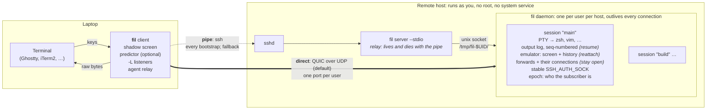

# fil — design

> **Status: draft for discussion, 2026-11-03.** M0 and M1 are done, the M1 sweep included (§15); M2 is in progress.
> Items marked **(decided)** are the owner's decisions. Everything else is a proposal.

*fil* is French for thread or wire. *Reprendre le fil*: to pick up the thread where you left off.

## 1. What fil is

fil is a remote shell for development over SSH. It keeps your place when the network drops or your local terminal dies. It combines:

- **Eternal Terminal's reconnect and native scrollback.** Output reaches your terminal as raw bytes, so its own scrollback, search and copy keep working.
- **tmux's detach and reattach, and only that.** A session survives your laptop sleeping, your network changing and your local terminal crashing. You can pick it up from another machine. There are no panes or windows, because your terminal emulator already has them.
- **Port forwards that stay open** across reconnects, with a clear view of what each session holds.
- **mosh-style predictive local echo**, as an optional, pluggable component.

## 2. Goals and non-goals

**Goals**

1. Native scrollback. While connected, the screen is never redrawn from a model.
2. Reconnect without user action, resuming exactly where the stream stopped.
3. Named sessions that outlive the client. You can reattach after a local crash or take a session over from a second machine.
4. Port forwards (`-L`, `-R`) that belong to the session and survive reconnects. `fil ports` shows them with context.
5. No root and no system service on the remote host. Installing means putting one static binary in your home directory.
6. SSH is the root of trust. fil adds no accounts, no key registry and no new identity system.
7. Two first-class transports from the first release, with automatic fallback **(decided)**:
   - a pipe (ssh by default)
   - direct QUIC over UDP
8. Prediction sits behind a trait so it can be improved independently **(decided)**.

**Non-goals**

- Panes, windows, tabs or layouts **(decided)**.
- More than one attached client per session. A second client takes the session over **(decided)**.
- Wire compatibility with mosh or ET (see §3).
- Non-interactive use such as scp, rsync or git. Plain ssh already does that well.
- Windows, as a remote host or as a client **(decided)**. Windows users can run fil inside WSL, which is a Linux host.
- Runtime-loaded plugins (§8.4).

## 3. Prior art

| Tool | Reconnect | Native scrollback | Reattach after a client crash | Port forwarding | Notes |
|---|---|---|---|---|---|
| Eternal Terminal | ✅ | ✅ | ❌ session tied to the client process | ✅ | system-wide `etserver` service on TCP 2022 |
| mosh | ✅ roams over UDP | ❌ syncs screen state | ❌ the key lives only in the original client | ❌ | best on lossy links |
| tmux / screen | — | ❌ redraws the screen (except iTerm2's `tmux -CC`) | ✅ | — | |
| shpool, zmx | — | ✅ | ✅ | — | session persistence only |
| ET + shpool | ✅ | ✅ | ✅ | ✅ | covers the features today, as two tools |
| koh | ✅ | ✅ | numbered sessions per client key | ❌ | replaces SSH with iroh peer-to-peer QUIC; experimental |
| mosh-rs | ✅ | opt-in, with its own server | ❌ | ❌ | Rust mosh rewrite, pre-alpha |
| WezTerm multiplexer | ✅ | ✅ | ✅ | — | both ends must be WezTerm |

**Why not reuse `mosh-server` or `etserver`?** Neither of them holds sessions.

- mosh-server syncs screen state rather than a byte stream, so native scrollback is impossible. It also has no forwarding.
- etserver has no reattach and no screen model to restore from, and it is a system-wide service.

The daemon *is* the product. Ideas and libraries are reusable:

- mosh's prediction design
- the mosh-rs and `morsh_predict` prediction code, both GPL-3
- shpool's restore crates (license to check)

## 4. Architecture



fil is one static binary, used on both ends. The remote side runs as `fil server …`.

- **Client** (`fil HOST [SESSION]`) owns the local terminal (in raw mode), the shadow screen that prediction uses, the local `-L` listeners and the agent relay. It holds its per-attach key in memory only.
- **Daemon** runs once per user per host and holds the sessions. The first attach starts it, detached from the login session. It listens on a Unix socket and, when direct mode is enabled, on one UDP port.
- **Relay** (`fil server --stdio`) is what the pipe runs. It connects its stdin and stdout to the daemon's socket. It keeps no state and dies with the pipe. Its first exchange is the **bootstrap**: start the daemon if needed, check versions, register the client's key and hand back the direct-mode details.

### 4.1 Attach

1. The client runs the pipe command (by default `ssh -T -- HOST fil server --stdio`). This is the one SSH login per attach, and the only Touch ID prompt for keys guarded by Touch ID.
2. The relay reads the client's hello, connects to the daemon of the client's wire (starting its own if that is the wire), and the two sides compare versions (§5.3, §8.5).
3. The client sends:
   - the session name
   - its terminal size, with the generation of that size (§4.4), and `TERM`
   - its host label (shown to the previous subscriber on a takeover, §5.2)
   - its per-attach public key
   - when resuming, its last epoch and sequence number
4. The daemon finds or creates the session. If the session is attached elsewhere, it takes the session over (§5.2). It replies with:
   - the epoch
   - a snapshot or a resume point
   - its UDP port and certificate fingerprint
5. The terminal stream starts **over the pipe immediately**, with no extra round trips before the first screen.
6. In the background, the client dials QUIC. If that succeeds, it moves every channel to QUIC and closes the pipe. If UDP is blocked, it stays on the pipe and tries again periodically, for example after a network change.

### 4.2 Reconnect

- **Liveness:** both transports send heartbeats, by default every 1 s, the client's first (§8.5). A link counts as dead after 5 s of silence. Both values are tunable.
- **On QUIC:**
  - A path change, such as Wi-Fi to cellular or a new IP address, is absorbed by QUIC connection migration with no new handshake.
  - If the connection itself is gone (for example the laptop slept past the idle timeout), the client performs a new QUIC handshake with the same in-memory key. **No SSH is involved.**
- **Fallback:** if QUIC can't be re-established within a few seconds, the client re-runs the pipe, which means a new SSH login.
- **Which transport, when:** the choice is `fil_transport::path::PathManager`, a state machine with no IO (`docs/m1/quic-link.md`). Retries back off with jitter, a link that dies soon after coming up counts as a failure so a flapping one slows down instead of cycling, and a network-change hint tries direct at once at a bounded rate; the timings are in `docs/m1/quic-link.md` § The path manager (`PathConfig` is the source). The pipe is closed only after the session has been moved to QUIC.
- **Resume:** either way, the client sends "resume session S, epoch E, from byte N", and the daemon continues from byte N (§6.2).
- **While disconnected:**
  - The client paints a status overlay, using the same erase-before-write mechanism as predictions (§9). It removes the overlay on reconnect, leaving the screen and the scrollback exactly as they were.
    - **Shown on** `Degraded` and `Down`, never before the first screen.
    - **Says** what is happening ("reconnecting over pipe", how long, which try), and on a second line how many bytes of input are held and how many were dropped.
    - **Drawn** in inverse video, at the edge of the screen farthest from the cursor, never on the cursor's row, and never over a wide character. If no place is safe, or the terminal is in the middle of an escape sequence, nothing is drawn; it comes back as soon as it is safe.
    - **Short and unpadded:** at most 40 columns a line, with a space of margin each side. A terminal that reflows on a width change re-wraps anything wider than the new width, and the erase cannot undo that; so if the window narrows at all while something is drawn (the rows under it are re-wrapped too), the screen can no longer be trusted and the next resume asks for a snapshot instead of a replay (`ResumeRequest.want_snapshot`). That is still a resume: the key, the epoch and the input stream are kept, so it needs no new login and loses no typed input, and the next swap between the pipe and QUIC repaints the screen too.
    - **The same overlay** carries the `~?` help and the questions the client asks (take the session back, confirm offline input, a replaced session), so none of them can corrupt the screen either.
  - Keystrokes typed while disconnected are handled as decided in §4.3.

### 4.3 Input while disconnected

The handling is configurable **(decided)**:

- **Buffer:** keystrokes are buffered in client memory up to a configurable cap (proposed default: 4 KiB). The status overlay shows how much is buffered, and how much was dropped once the cap was reached. A cap of 0 drops all input while disconnected.
- **Send on resume, or ask:** by default the buffer is sent as soon as the session resumes. Optionally (`offline_input.confirm`), when the disconnect lasted longer than a threshold, the client shows what was typed and asks before sending it. A Ctrl-C typed during a long outage then can't land late by surprise.
- **Optional log:** `offline_input.log` keeps everything typed while disconnected, including anything over the cap, by appending it to a file or piping it to a command. It is **off by default**, because keystrokes can include passwords. A file log is bounded in size and in age, like fil's own logs (§11.1), and fil refuses one whose directory other users can write to (§11):
  - **Size:** the file is rotated to `<file>.1` (replacing the one before) when it would grow past 1 MiB.
  - **Age:** the file is rotated once its first entry is 7 days old, and a rotated file is deleted 7 days after its last write (or at once, if its time is in the future). So nothing typed stays on disk for more than about 14 days **while fil is run**. It is checked when the log is opened, when an entry is written, and every hour while a client has the log open, so a client that is attached for weeks and writes nothing honours it too. At the start of every run the client also tidies the default path (`offline-input.log` in fil's state directory) even when the log is off, so switching it off does not leave old keystrokes behind. What the bound does not cover: no file is touched while no fil runs at all, and a log at another path that was then switched off keeps its contents until a client opens that path again.
  - **Several clients** can use one path: each step that reads or changes the clock (look, rotate, write) takes a lock on the log's directory and looks at the file again first, so a rotation by one client is seen by the others, nothing is written to a rotated file, and the size limit is the file's. The lock is waited for at most 1 s; past that the step (one write, or one maintenance pass) is skipped and counted, so a wedged holder can never hang the client. On a file system with no locks (`ENOTSUP`, `ENOLCK`: NFS without a lock daemon, some FUSE mounts) the log goes on without one, and two clients on such a file system lose this guarantee.
  - **The header:** the entries are raw keystrokes with no time stamps, so a file starts with one line, `# fil offline-input log, started <Unix seconds>`, written with its first entry. That is the file's age (a file birth time is not available everywhere). A file without the header (from before it existed, or not fil's) or with a start time in the future has no age that can be trusted, and is rotated when fil opens it.

### 4.4 Window size

A command typed right after a window resize must see the new size, as it does over ssh, where the window change travels in order with the keystrokes. On fil the two used to take different paths (a control message and a data segment), which §8.1 does not order, and the Raspberry Pi drop-in runs found the new size arriving after the command. The size now travels with the keystrokes:

- **In band.** The client sends the size as a record in the terminal channel's keystroke stream, placed between the last key typed before the change and the first typed after it (§8.5, *In-band records*). It is applied when it arrives, so the PTY has the new size before it is handed any later key. A key typed *before* the change may still be read under the new size, as with sshd.
- **Sampled.** The client reads the window size before it handles each batch of keystrokes, and a resize event re-reads it instead of trusting its payload. SIGWINCH goes through a different thread than the keyboard reader, so the event can be queued behind keys that were typed after the change; the read makes the order the user's, not the scheduler's. A read that fails, or reports an empty window, is not a size: the client keeps the last one it knew, so a transient failure never resizes the remote PTY to a made-up 80x24. A resize owed to a link also goes out ahead of any key on it, wherever the keys come from, including keys typed while a swapped link's snapshot is still arriving.
- **Generations.** Every change of the client's (clamped) size gets the next generation number, and the attach and the records carry it, so a stale size can never replace a newer one: the order in which a swap's old and new links reach the daemon does not matter. Each link remembers which generation its daemon has been told (`told_gen`), so a size changed during a swap is sent to the link that ends up as the session.

## 5. Sessions

### 5.1 Model

- **Name:** `[A-Za-z0-9._-]{1,64}`, default `main`. Both ends validate it.
- **Contents:**
  - the PTY and its child process
  - the output log and the emulator
  - the forwards
  - session environment such as `SSH_AUTH_SOCK`
  - the epoch, and the current subscriber (client ID, host label, attach time)
- **Lifetime:** a session lives until its shell exits or `fil kill` ends it. Detached sessions persist indefinitely; an idle reaper is available as an option.
- **Process grouping:**
  - On systemd hosts **with lingering enabled**, each session runs in its own transient user scope (`systemd-run --user --scope`). That gives reliable port attribution (§7.4) and clean teardown.
  - Without lingering, the user manager stops at logout and would take the scopes with it. Those hosts fall back to the session's process tree.
  - Lingering is read from `loginctl show-user -p Linger` when the session is created. The child is a session leader, so its pid is also its process group id.
  - The scope's unit name is `fil-<incarnation as 32 hex digits>` and its description is `fil session`. Unit names are readable by other local users (`/proc/<pid>/cgroup`) and the journal keeps them, so the session name stays out of both (§11.1).
  - **Teardown (`fil kill`):** a hangup to the group and to every descendant, as closing a terminal would send; after a short grace, SIGKILL to what is left, and `systemctl --user kill` on the scope. In the tree fallback the session records the descendants every few seconds, so a background job that was orphaned or moved to its own group (job control) is still found. A process that double-forks and dies between two scans escapes; the scope has no such limit.
  - When the shell exits by itself, what it left running is sent the hangup but not killed (in a scope, `systemctl --user kill --signal=SIGHUP`).
  - **No usable scope:** with `auto`, a trial scope (`systemd-run --user --scope true`) must start before the session uses one; if lingering is on but the trial fails, the session falls back to the process tree and logs a warning. With `scope = "systemd"` set explicitly there is no fallback: creating the session fails with the reason.

### 5.2 One subscriber, with takeover

At most one client is attached to a session **(decided)**. Attaching to a session that is already attached takes it over:

1. The daemon increments the epoch. It tells the old subscriber "taken over by `<host label>` at `<time>`", revokes that client's key and drops its transport.
2. The new subscriber receives a snapshot sized to its terminal, and the PTY is resized (SIGWINCH).

A client that resumes with a stale epoch is refused with the takeover message and asked whether to take the session back. A laptop waking up in a bag never steals the session silently.

**Detach:** type `~.` after Enter (like ssh) or run `fil detach`. Detaching also revokes the client's key. After `~.` the client gives the terminal back at once, with the session's modes reset as mosh does (the alternate screen, mouse reporting, focus events, bracketed paste, application keys, the kitty keyboard protocol, a hidden cursor; never a full reset, so the scrollback stays, and the window title is left as it is), and the same on every other exit. The terminal's settings come back first, and the reset and the closing message follow as one bounded write, given up on after 1 s: in whole escape sequences, on a fresh non-blocking open of the terminal, polled on the calling thread, so nothing is left running behind it. The error line `fil` prints after an unsuccessful run is bounded the same way. So a terminal that has stopped reading (XOFF, a hung emulator) cannot keep the user's shell from getting the terminal back; it may be left with a cut escape sequence, which is the price of giving up on it. Then it sends `Detach` once the daemon has acknowledged the input typed before it, or after 1 s, whichever comes first (at once on the candidate if the old link goes down during a swap), and waits up to 2 s from then for the daemon to hang up, which it does when it has handled the `Detach` (a `Link::flush` only means the bytes left this side, and closing the link or exiting drops what ssh has not forwarded). A `~.` while disconnected is local only: there is no link to tell, so the key is revoked later, by a takeover or when the session is reaped. `fil detach` reaches an attached client the way a takeover does: the daemon sends it `Detach` (the message a client sends to detach itself), flushes and closes, so the client reports "detached from elsewhere" at once instead of finding out through a reconnect.

### 5.3 Daemon location and lifecycle

- **Socket location:** the directory `/tmp/fil-$UID/` (mode 0700) holds the socket.
  - The daemon refuses to start if that directory exists with the wrong owner or mode. This defends against another user creating it first, as tmux does.
  - The socket is deliberately not in `$XDG_RUNTIME_DIR`. systemd-logind deletes that directory when your last login ends, which would strand a live daemon.
- **Logout cleanup:** hosts with `KillUserProcesses=yes` need `loginctl enable-linger`. The bootstrap detects this and warns (see below).
- **Peer check:** the daemon verifies every connection's peer UID (`SO_PEERCRED` on Linux, `getpeereid` on macOS) and refuses mismatches.
- **Files:** the socket is `/tmp/fil-$UID/fil-<major>-<rev>.sock` (mode 0600), where `<major>` is the protocol major and `<rev>` the wire revision (§8.5); the names hold those two numbers and nothing else (no session or host name). Next to it, `fil-<major>-<rev>.lock` is held (`flock`) by the running daemon for its whole life and holds its pid, and `fil-<major>-<rev>.start` is held for a moment by a relay that is starting a daemon. Each revision has its own three files, so relays of different revisions never wait for each other. A daemon from before revisions used `fil-<major>.sock` (and `.lock`, `.start`); it is found, never started. The directory is checked with `lstat` (a symbolic link in its place is refused), for its owner first and then for mode exactly 0700. A daemon that exits removes the lock and start files, so nothing of it stays in `/tmp` (a crashed one leaves them; the next reuses them). The daemon logs JSON lines to `~/.local/state/fil/daemon.log` and the client to `client.log` in the same directory, through one module (§11.1): files 0600 and the directory 0700 (tightened if it existed looser), moved to `NAME.1` at 4 MiB or once its first line is a week old (read from the line's own time stamp, so it is the same on every platform), and the rotated file deleted a week after its last write, so nothing older than two weeks stays. This is checked as lines are written, when the process starts and every hour, so a quiet daemon or a client left attached honours it too. Session names and host labels are in the log at `debug` only. `FIL_LOG` sets the level for fil's own crates (`debug`); other crates log only when named (`fil=debug,quinn=trace`), because the QUIC stack at trace logs every packet's size and time.
- **Starting:** the relay tries the socket; if nobody answers it takes the start lock, tries again, and runs the same binary with the daemon subcommand (null stdio, in `/`, without the SSH login's `SSH_*` variables). The daemon calls `setsid` first thing, so a hangup of the login does not reach it. Relays that start together serialize on the start lock, so one daemon starts. A daemon that finds the daemon lock taken waits briefly (one may be on its way out), then exits quietly. The lock dies with the process, so a socket file left by a crash is known to be stale and is removed by the next daemon.
- **Idle exit:** with no session and no connection for five minutes (`idle_exit_secs`, 0 for never), the daemon removes its socket and exits. A session counts for as long as its shell runs, attached or not.
- **Configuration:** `~/.config/fil/daemon.toml`, all keys optional, unknown keys an error: `direct` (default true), `bind` (default `::`, the IPv6 wildcard, which also takes IPv4; a host without IPv6 falls back to `0.0.0.0`), `port_range` (default `[60000, 61000]`), `history_lines` (scrollback kept per session, default 1000), `idle_exit_secs` (default 300), `scope` (`auto`, `systemd` or `tree`) and `[ports] probe` (`head`, `full` or `off`, §7.4).
- **Logout warning:** the relay prints a warning on its stderr, which ssh shows on the user's terminal, when it started the daemon on a host whose `logind.conf` says `KillUserProcesses=yes` and where the user does not linger (and the daemon logs it). Only an explicit `yes` warns.
- **Upgrades:** the socket path includes the protocol major and the wire revision, so daemons of different builds run side by side and nothing is killed or replaced.
  - A new build's relay starts a daemon of its own revision next to the old one, when its client is of that revision. New sessions go to it.
  - **The relay routes by the client's hello.** It writes the preamble, answers the client's opening ping itself with the opening pong (the client sends its `Hello` only once something has answered; ping, pong and hello are frozen bytes, §8.5 *The opening*, so a client of any build, whatever it did to its control messages, is routed), reads that `Hello` and connects to the daemon of the wire it names, then passes the bytes on unchanged: the same revision as the relay's own, ensuring (starting) the daemon as ever; another wire whose daemon is running (`fil-<major>-<rev>.sock`; revision 0 is a pre-revision `fil-<major>.sock`), connecting there and starting nothing; another wire with no daemon, answering with the relay's own `Hello` and `Error(VersionMismatch)` and ending (so no daemon of a wire nobody asked for is started). Something that does not open like a fil client (no frames, no hello within ten seconds) goes to the relay's own daemon unchanged.
  - Old sessions stay on their daemon until they end. Because of the routing, a client of the old wire reaches its session through **any** relay on the host, so a remote `fil` replaced in place (a package upgrade) while a client is attached does not strand the session: the next reconnect runs the new relay, which connects the client to the still-running old daemon. (Without the old binary on the host the old daemon cannot be restarted, but it runs until its sessions end.)
  - `fil ls` asks the daemon of its own revision, the only one it can speak to, and that daemon notes the others it finds running in the socket directory (`also running: a daemon of wire rev N; use that fil version for its sessions`; a daemon from before revisions is "a daemon from an older fil"). It finds them by their lock files (a shared, non-blocking `flock` on a file opened read-only, which creates, removes and connects to nothing), so a crashed daemon's leftover socket is not reported. The note carries numbers only. The relay says the same on its stderr (which ssh shows) when it has just started a daemon and others are running, so a first `fil HOST` after an upgrade does not silently make a second `main` beside the old one.
  - A client whose wire has no daemon on the host, and a relay of another wire, fail at the hello with a message that names both revisions and says which side is newer, so which `fil` to upgrade (§8.5). `fil --version` prints the wire (`fil 0.0.0 (wire 1.3)`: major, then revision).
  - Live upgrade by passing PTY file descriptors to the new daemon is a possible later step (§16).

## 6. The terminal stream

### 6.1 Output path

PTY output goes to three places:

1. the session's output log, a byte ring buffer (default 8 MiB) with a global sequence number
2. the daemon's terminal emulator
3. the subscriber, if one is attached

The client writes those bytes straight to the local terminal. That is why native scrollback, search, hyperlinks (OSC 8), clipboard writes (OSC 52) and graphics protocols behave exactly as they do over plain ssh.

### 6.2 Resume or snapshot

- **Resume** applies when the same client reconnects and its terminal is still open. The client acknowledges the bytes it has written. On reconnect it sends its last sequence number, and if that point is still in the log, the daemon sends the rest. Native scrollback has no gap.
- **Snapshot** applies to a new client, or when the log has wrapped. The daemon renders from its emulator:
  1. the last N history lines (default 1000), as text with SGR attributes, reflowed to the new width
  2. the current screen
  3. the terminal modes: alternate screen, cursor position and style, mouse, bracketed paste, focus and keypad modes, kitty keyboard flags, scroll region, title, tab stops (always cleared and set again, whatever the client's terminal had) and character sets (G0 to G3, the invoked one, and the ones the saved cursor holds)
- **Catch-up rule:** if the subscriber falls behind by more than a threshold (default 1 MiB or 2 s of output), the daemon jumps to a snapshot instead of replaying the backlog. On a slow link, `cat hugefile` followed by Ctrl-C stays responsive, which is mosh's main advantage. The cost is a gap in native scrollback. The gap is visible: a marker line such as `── fil: skipped 48 MB of output ──` goes into the scrollback.
- **One snapshot at a time:** the daemon announces no further snapshot (catch-up) until the client has acknowledged the previous one: an `Ack` of the terminal channel at or past the snapshot's `at`. A client sends that ack itself as soon as it has applied a snapshot, so it needs no output to follow. `Snapshot` goes on the control channel, which every transport delivers ahead of data, and every snapshot numbers its bytes from 0; a second announcement would overtake the first snapshot's unsent bytes and the client would mistake the old bytes for the new snapshot, or see a gap and reconnect. Nothing weaker confirms a snapshot: not a `Link::flush` (on QUIC it resolves once the peer's link has queued the payloads, and the peer's inbox hands control out before them). Meanwhile output past the snapshot is sent as usual; if the log has wrapped past the stream's position there is nothing to send, and the session waits for the ack, still handling takeovers, detaches and exits at once. The attach snapshot counts as one.

Details the session implements (`fil-session`):

- **Snapshots are only taken between escape sequences.** Neither emulator exposes its parser state, so a snapshot taken mid-sequence would lose the pending bytes. The session holds back the unfinished end of the output (it is in the log, but neither the emulator nor any subscriber sees it) until the sequence completes; a tail longer than 1 MiB is let through as it is. Every snapshot is therefore exact for the offset it announces.
- **The daemon writes the marker**, as the first thing in the snapshot, together with what is needed to put it in the scrollback: leave an alternate screen, reset the scroll region and mouse and kitty keyboard state, then scroll the screen contents and the marker line above the visible area. The client must not add a marker of its own. A new client (`skipped` is 0) gets no marker.
- **The rule is looked at between sends**, so a link that blocks the sender is judged when it unblocks. It does not fire when everything has already been sent and only the acknowledgements are late: a snapshot would rewrite what the client has.

### 6.3 Terminal queries

Programs ask the terminal questions: cursor position, device attributes, colors, kitty keyboard support.

- While a client is attached, queries pass through to the real terminal, and its replies come back as input.
- While detached, the daemon's emulator answers, so programs don't hang waiting for a reply. "Detached" includes a subscriber whose transport has died and not yet resumed. The emulator answers `CSI 18 t` (the text area in characters) but not the color queries (OSC 10, 11, 12 and 4) or the pixel sizes (`CSI 14 t`, `16 t`), so the session answers those: from the colors and cell size the last attached terminal reported (it watches the replies pass through as input), or dark-theme defaults. The text area in pixels is the cell size times the current grid, so it follows a resize.
- Output that holds a query the daemon answered cannot be replayed to a client that missed it, because its terminal would answer a second time and the answer would arrive as keystrokes. That client gets a snapshot instead of a resume.

**A takeover between a query and its reply** (§16 item 4): the query went to the old terminal, so its reply is lost. The old subscriber's input is ignored from the moment of the takeover, and the new terminal never sees the query (it gets a snapshot, which contains none). The program waits until its own timeout. This is the simplest behavior that cannot inject a stray reply into the new client's session.

### 6.4 `TERM`

A session's `TERM` is fixed when the session is created, from the first client, and kept for the session's life **(decided)**. Taking over from a different terminal emulator can't change it for programs that are already running anyway. When the new client's `TERM` differs, fil warns once at attach.

### 6.5 Emulator

fil runs a headless emulator (no rendering) in two places: in the daemon, to answer terminal queries while detached (§6.3) and to render snapshots (§6.2), and in the client, as the prediction shadow screen (§9).

**Emulators are modular.** `fil-term` defines one interface, and each emulator is a backend behind it, compiled in under its own cargo feature and chosen by name at run time:

- **The `Emulator` trait:** feed bytes, resize, drain query replies, and report the current state.
- **A backend-neutral state model** (`TermState`): the lines with their cells and attributes, history, cursor, the modes of §6.2, and hyperlinks. Every backend converts its own grid into it.
- **One snapshot writer** turns any `TermState` into the bytes that recreate it, so a backend doesn't need its own serializer. The model also lets the fidelity suite compare backends cell by cell.
- **Capabilities:** each backend declares what it can report, such as reflow or kitty keyboard flags. The suite then scores a field a backend can't see as unsupported rather than wrong.

A session picks its backend when it is created and keeps it.

**The default backend is `alacritty_terminal` (decided).** The M0 restore-fidelity comparison (`docs/spikes/emulator.md`) chose it. Two backends exist. `fil-term` builds both by default, but `fil-session` and `fil-client` ask only for `alacritty`, so the shipped binary contains just that one; `vt100` is built for the fidelity suite and the tests:

- `alacritty_terminal` (Apache-2.0), the default. It is the only candidate with reflow, OSC 8 hyperlinks, underline styles and replies to terminal queries, and it parses about 1.9x faster than `vt100`. The costs are about 30% more memory per session and glue around an API that wasn't built for this use, so every upgrade re-runs `just fidelity`.
- `vt100` (MIT), the light alternative, kept as a second opinion for the fidelity suite and the tests. It tracks fewer fields: no reflow, no query replies, and no saved cursor or origin mode.

libghostty-vt (C ABI, used by zmx) was not evaluated: it needs a Zig toolchain, and the default already meets the bar. It can be added later behind its own feature.

## 7. Port forwarding

### 7.1 Kinds

- `-L [bind:]port:host:hostport` listens on the client machine and connects out from the remote.
- `-R [bind:]port:host:hostport` listens on the remote and connects out from the client machine. Port 0 asks the remote for an ephemeral port; the one it got is reported back.
- `-D [bind:]port` is a SOCKS5 and SOCKS4a server (CONNECT only) on the client machine; each connection goes out from the remote to the target the SOCKS client names (M2, OD-1 in `docs/m2/plan.md`).

v1 is TCP only. Unix-socket forwards and UDP are open questions (§16). Both ends bind to loopback by default; anything wider needs an explicit address. Specs are written as in ssh, with a few differences (`docs/m2/binary.md`). A target is an IP address or a host name (letters, digits and inner hyphens, labels of 1 to 63 bytes, 253 bytes in all, the last label not all digits, so an address written as a name is always an address).

### 7.2 Ownership and persistence

Forwards must stay open across reconnects **(decided)**.

- **Ownership:** forwards belong to the **session**, not to a connection.
  - The list of forward specs persists.
  - `-R` listeners live in the daemon and never close during a disconnect.
  - `-L` listeners live in the client process and stay bound for as long as it runs.
- **Open connections:** each forwarded connection is its own channel, with sequence numbers and acknowledgements like the terminal stream. A disconnect pauses it and the reconnect resumes it. No data is dropped.
- **Bounded buffers:** each connection has a bounded buffer (default 1 MiB). When it fills, fil stops reading from the socket, and ordinary TCP flow control pauses the application.
- **New connections during a disconnect** are accepted and wait, with a time limit, for the reconnect.
- **Long disconnects:** after a configurable timeout (proposed default: 10 min), open connections close. The listeners stay.
- **Takeover:**
  - `-R` listeners stay and route to the new subscriber.
  - `-L` connections that started on the old machine end, because their applications live there.
  - The new client recreates the session's `-L` listeners, warning about any port already in use locally.
- **The table** (daemon memory only, nothing on disk) is the daemon's, at most 64 entries. Each entry has an id the daemon assigns, never reused for the session's life, and an origin: the attached client, or a management request (§7.3).
  - A spec's identity is `(kind, bind, port)`, except that an ephemeral `-R` (port 0) has none: every `-R 0` is a listener of its own, as with ssh, and never clashes. An add equal to an entry is answered with that entry; an equal add from the attached client also makes a management-origin entry the client's own. An add from the attached client with an entry's identity and another target **replaces** it under a new id; the old entry's open connections run until they close. From a management request that is a `Conflict`.
  - Identities that differ can still bind the same socket: `Loopback`, `127.0.0.1` and `::1`, or `-L` and `-D` on one port. The second then fails to bind (`AddrInUse`) and says so in its `Listening` report. Host names compare as written (case-sensitively).
  - A management request may not bind `-L` or `-D` beyond loopback (that would bind wide on the laptop), nor aim `-R` at a non-loopback target (a pivot into the laptop's network): `NotPermitted`. A non-loopback `-R` bind is refused from every origin until the owner decides OD-7.
  - On a fresh attach the daemon sends every entry, then the client adds its own specs (CLI and config). Consent does not carry across subscribers. On a resume the table is continuous.
  - Removing an entry closes its listener at once; its open connections run until they close (ssh's `-O cancel`).
  - The client binds `-L` and `-D` and reports the result; the daemon binds `-R` and reports it, with the actual port for port 0.
  - **On the daemon** (`fil_session`'s forwards, one endpoint per session that outlives its subscribers):
    - The daemon binds an `-R` listener when its entry is added, from either origin, so a management entry has its port before anyone consents to it.
    - It routes an `-R` connection only to a subscriber that holds the session (attached, or between links: the connection then waits up to `open_wait`) and has consented to that entry in its own run. Consent is the subscriber's own `AddForward` (an equal spec adopts the entry) or its `Consent { accepted: true }`; a fresh attach forgets it. Without both, the connection is reset at once and no `Open` is sent.
    - While nobody holds the session (after `~.` or `fil detach`) the listeners stay bound and refuse at once.
    - It accepts an `Open Local` or `Open Dynamic` only for an entry of that kind, and connects a `Local` one to the target in its own table.
    - A replaced or removed entry is answered with `ForwardGone`, and its listener closes.
    - A session that ends closes every channel and listener.
- **The rule for every connection fil makes on the user's behalf:** a client listens, or connects out, only for forwards it named itself (CLI or config) or that its user confirmed on screen in this run; it connects only to the target in its own copy of the spec, never one from the wire; it never binds beyond loopback, nor connects to a non-loopback `-R` target, except from its own CLI or config. The daemon socket is reachable by any process of the user's uid on the remote, so a remote compromise must not be able to pivot into the laptop's network, squat laptop ports or reach the laptop's agent through fil. The daemon also gates on consent, for the user's experience; the client's check is the security boundary.
- **The wire** (the MUX channel, dynamic channels, credit, close, resume and the limits) is in §8.5.

### 7.3 Managing forwards

- At attach time: `fil orin -L 5173 -R 9000`
- Afterwards: `fil forward -L 5173`, `fil forward -R 9000`, `fil forward --rm 5173`

These commands work from the client machine or from inside the session. Inside, `$FIL_SESSION` names the session and the command talks to the daemon over its socket.

Either way they are a management `Request::Forward { session, op }` (`Add(spec)` or `Remove { kind, port }`; without a kind, the one forward on that port, or `Ambiguous`), answered by `Response::Forward` (`Added(id)`, `Removed(id)` or `Refused(why)`). The daemon cannot tell a request from the laptop apart from one by a process on the remote, so such an entry has `Origin::Request` and the attached client asks its user once per entry (`remote_requests = "ask"`, or `"deny"`) before it binds or connects anything for it.

### 7.4 `fil ports`

`fil ports` shows as much context as possible **(decided)**:

```
$ fil ports
SESSION main on orin — attached from laptop since 09:12

FORWARDED
  DIR  LAPTOP            REMOTE          OWNER                      CONNS  ↓ / ↑           LAST
  -L   localhost:5173 →  127.0.0.1:5173  vite (pid 41872, ~/app)    2      14 MB / 220 KB  now
       http://localhost:5173 · HTTP 200 "Vite + React"
  -R   localhost:9000 ←  127.0.0.1:9000  your laptop                0      —               10:40
       detached: 1 connection waiting

LISTENING IN THIS SESSION, NOT FORWARDED
  8000  0.0.0.0 ⚠  python -m http.server (pid 42110, ~/tmp)  since 10:03  HTTP 200 "Directory listing for /"
        ⚠ reachable by the whole network, not just through fil  →  fil forward 8000

OTHER LISTENERS YOU OWN ON THIS HOST
  5432  127.0.0.1  postgres (pid 1201), not started from a fil session
```

- **For every forward:** direction, both endpoints, the process that owns the target, open connections, traffic in each direction, last activity and state.
- **Unforwarded listeners:** ports started inside the session that aren't forwarded yet, each with the one command that would forward it. Other listeners you own on the host are listed separately.
- **Exposure warnings** for anything bound beyond loopback, and a **port-squat warning** on a `-L` whose target another user's listener takes (their `127.0.0.1:P` in front of the user's `[::]:P`, say): the row says so, and names and probes nothing of theirs.
- **Incomplete answers say so:** when the host cannot see all its listeners (no `/proc/net/tcp`, a bound of the scan, a timeout, a host without discovery), the answer says why, and the listing ends with an "(incomplete: …)" note.
- **Protocol probe:** a light probe labels what is listening (TLS handshake, HTTP `HEAD`, a Postgres or Redis greeting), with clickable URLs for HTTP. It probes only the user's own listeners, on loopback, when `fil ports` asks, within 300 ms per port, 1 s in all and 8 ports at a time. A `-L` target that another user's more specific listener takes (their `127.0.0.1:P` in front of the user's v6-only `[::]:P`) is neither probed nor shown as the user's. `daemon.toml` `[ports] probe` is `head` by default (HTTP status and `Server` header), `full` (a `GET`, which also shows the page title; the mockup above shows one) or `off`. A probe is a real connection, with real effects: most web frameworks (Flask, Express, Django, Rails) run the `GET` handler for a `HEAD`, a one-shot listener (`nc -l`, `gdbserver --once`) loses its one connection, and Postgres logs `invalid length of startup packet`. To keep them small, a server that speaks first is sent nothing, Redis is recognised from its answer to the request line, usually before it sees a `Host:` header, and a port gets more than one connection only if it hangs up on HTTP without a word. Probe results are never logged.
- **Client side:** whether a local port is already taken.
- **`--json`** for scripting.
- **Where the data comes from:**
  - Linux: `/proc/net/{tcp,tcp6,udp,udp6}` and `/proc/<pid>/fd`
  - macOS: libproc
  - Ports are attributed to a session through its scope (§5.1), or through the process tree as a fallback.
- **Caveats:** container ports show up as `docker-proxy`, and listeners owned by root show no owner.
- **Notifications:** new listeners can raise a desktop notification (OSC 9 / OSC 777, which iTerm2 and Ghostty support). This is opt-in. fil never prints inline text, which would corrupt full-screen programs.

## 8. Transports

### 8.1 The trait

A transport provides one reliable, ordered, encrypted connection that carries many channels:

- control
- terminal
- agent
- one per forwarded connection

It also reports liveness, round-trip time and path changes. Resume logic, sequence numbers and channel semantics all live above the transport, so they behave the same on every transport.

The trait is `fil_transport::Link`: one live connection, which carries fil-proto payloads on numbered channels (§8.5).

```rust
trait Link {
    fn kind(&self) -> LinkKind;                                    // Pipe | Direct
    async fn send(&self, channel: ChannelId, payload: Bytes) -> Result<(), LinkError>;
    async fn recv(&self) -> Result<(ChannelId, Bytes), LinkError>;
    async fn flush(&self) -> Result<(), LinkError>;                // everything sent so far has left this side
    fn finish(&self, channel: ChannelId);                          // nothing more on this channel; free it
    fn status(&self) -> watch::Receiver<LinkStatus>;               // Up | Degraded | Down(reason), RTT, path changes
    fn close(&self);
}
```

What every link must do:

- **Order and backpressure per channel.** A full forward channel never delays control or terminal. There is **no order across channels** (on QUIC they are separate streams, and a lost packet delays one and not another; even on the pipe, control goes ahead of queued interactive frames). Anything that must take effect in order with keystrokes therefore travels *in* the terminal channel, as an in-band record (§8.5): the window size is the case that needed it (§4.4).
- **Liveness.** A link detects a dead path itself and goes `Down` within `dead_after` (default 5 s). It reports `Degraded` after `degraded_after` (default 2 s) of silence *from the peer*, which drives the status line (§4.2); a slow local consumer is never `Degraded`. The pipe needs fil's own heartbeats: ssh never notices a silent black hole by itself (`docs/m1/realnet.md`). Heartbeats are asymmetric (§8.5): the client pings, the daemon replies and pings only after 1.5 heartbeats of silence, and each side still detects a dead path within `dead_after`. On the pipe the consumer must keep up: past the inbound budget the link stops reading and freezes its silence clock, so a peer that dies meanwhile is not reported until the consumer catches up (§8.5).
- **`Up` means the peer has proven itself.** On the pipe, that is after the preamble and the first frame; on QUIC, after the daemon's first frame (§8.3).
- **Graceful close.** `close` discards what is still queued, so a last message (`TakenOver`, `AttachRefused`, `Error`, `SessionExited`) is followed by `flush` before `close`. `flush` resolves when every payload sent before the call has left this side, and fails if the link goes down first (also on a link that is down already). What "left" means depends on the transport:
  - **Pipe:** written to the byte stream, and the stream flushed. Bytes that ssh holds after that are ssh's. A busy channel does not hold a flush back: the driver flushes before it takes another frame.
  - **QUIC:** read by the peer's link and acknowledged. quinn reports a stream's acknowledgements only once the stream is finished, and then only from its own stack, so the link puts a flush marker behind everything sent on each open channel and waits for the peer to answer each one (§8.5, QUIC stream mapping); a channel being finished already ends in a marker, which the flush waits for too. That is a little stronger than QUIC's own acknowledgement: the peer's link has the payloads, not just its network stack. A flush costs one marker per open channel, not per channel the link ever carried.
  - **In-memory pair:** the peer's `recv` has taken everything.

  A peer that stops reading holds a flush back for as long as it likes, so callers bound it with a timeout. The session uses one second.
- **Channels end.** `finish(ch)` says this side sends nothing more on `ch` over this link. Payloads already accepted are still delivered in order; then the link frees what it holds for the channel (QUIC ends the channel's stream, which gives the peer its stream back; the pipe forgets the channel's counters). It is idempotent and a no-op for the fixed channels (0 to 15). A send on the channel fails with `Io` while the link still holds it; after that the link has forgotten it, since remembering every finished channel is the cost `finish` removes, and a send would open the channel afresh, which the peer's layer above drops as a closed channel. The layer above calls `finish` when it releases a channel on both sides, and never sends on it again. A link therefore carries any number of channels over its life, as long as not too many are open at once: every forwarded connection is a channel. `link::mem` is stricter, for the tests of the layers above: it remembers every finished channel and fails every later send on one.
- **A link does not survive a disconnect.** The layer above opens a new one and resumes (§8.5). `fil_transport::link::mem` is an in-memory pair for testing those layers.

The trait is not object-safe. A client that switches between the pipe and QUIC holds an enum of the two.

### 8.2 Pipe (ssh by default)

- **What it runs:** a command whose stdin and stdout reach `fil server --stdio` on the remote. The default is `ssh -T -- HOST fil server --stdio`. Using the system `ssh` means everything in `~/.ssh/config` applies: ProxyJump, certificates, agents and ControlMaster.
- **Fixed remote command:** the remote command is always exactly `fil server --stdio`. It is never assembled from user input, because ssh hands its command line to the remote shell as a string. Session names and everything else travel inside the protocol.
- **Configurable per host:** for example `kubectl exec -i`, `docker exec -i`, `aws ssm start-session` or `tailscale ssh`. This is fil's runtime extension point (§8.4).
- **Multiplexing:** all channels share one byte stream with fil's own framing.
  - The scheduler sends terminal and control frames ahead of forward data.
  - Forward frames are capped at 16 KiB, so a large transfer through a forward can't delay keystrokes.
- **Keepalive backstop:** when the program is `ssh`, fil adds `-o ServerAliveInterval=N -o ServerAliveCountMax=3`, unless the command line already sets them. `N` is `dead_after / 3` rounded up to whole seconds (2 s by default), so ssh gives up after between `N x 3` and `N x 4` of silence (6 to 8 s by default; measured 7.5 s) and never before `dead_after`. fil's heartbeat (§8.5) is the fast detector and kills the ssh process the moment it declares the link dead; the backstop is for a fil process that is gone while a black-holed ssh would linger for the TCP retry limit. A command that is not `ssh` runs untouched.
- **Process handling:** until the first attach is accepted, ssh's stderr is copied to the user's terminal a line at a time (a line left unfinished for 200 ms, such as a prompt a wrapper script prints without a newline, is shown as it is), with control characters removed (Touch ID and password prompts use the terminal directly), so warnings and errors stay visible, and what had arrived when the attach is accepted is shown first; from then on it is only captured, for the status line and the log, because the terminal belongs to the session. Every run after the first attach is started in a process group of its own, so a command that prompts on the terminal (a jump host asking for a password) is stopped by SIGTTIN rather than reading keystrokes meant for the session; the preamble timeout ends it and its whole group is killed. When the command exits, the link reports `Down(Io)` with its exit status. Closing the link closes the command's stdin, gives it a second to exit, then kills and reaps it. The host name is checked against an allowlist (letters, digits and `. _ @ : % [ ] -`, not starting with `-`) before it reaches the command line, because `~/.ssh/config` may expand it in `ProxyCommand` or `Match exec`.
- **Reconnect:** re-run the command.

### 8.3 Direct: QUIC over UDP

Direct mode is first-class **(decided)**.

- **Libraries:** `quinn` and `rustls` (TLS 1.3). Each channel is a QUIC stream, so forwards and the terminal never block each other.
- **Mutual authentication, set up during the bootstrap:**
  - **Daemon to client:** the daemon's certificate fingerprint arrives over the pipe and is pinned. Nothing is trusted on first use.
  - **Client to daemon:** the client generates a key pair in memory for each attach. Only the public half is sent, over the pipe, and the daemon accepts only that key.
  - A key is bound to the one session its pipe attach was accepted for, and over QUIC it can only resume that session (§8.5). Keys are revoked on detach, on takeover, when the session ends and when the attach is refused, and nothing is written to disk.
- **Port:** one UDP port per user, not per session. The default range is 60000–61000, the same range mosh uses, so hosts already opened for mosh work unchanged. Both the range and the bind address are configurable, for example to bind only to the LAN or tailnet interface.
- **Address:** the client dials `direct.address` if the host config sets it; otherwise the host name `ssh -G` reports for the default ssh pipe, resolved locally. A custom pipe command, and a host that ssh reaches through `ProxyJump` or `ProxyCommand`, are not dialed unless `direct.address` is set: the name belongs to the pipe command or the jump host, and looking it up would tell the local network's resolver where the user is connecting. A name is looked up once every five minutes (a failed lookup is remembered for 30 seconds, and a change of network forgets both), an IP literal never, and all of its addresses are dialed together, 250 ms apart (so an IPv6 address nobody answers on does not cost a timeout).
- **Roaming:** QUIC connection migration covers both client IP changes and NAT rebinding (a router changing the outside port).
- **Fallback and upgrade** work as in §4.1–4.2. Transport choice per host: `auto` (default), `pipe` or `direct`.
- **Exposure before authentication** is limited to handshake parsing in quinn and rustls. Stateless retry and handshake rate limiting blunt floods:
  - **Retry:** the first packet from an address that has not been validated gets a stateless Retry and nothing else. No handshake state is kept and no crypto is done until the client answers it, so forged source addresses cost one small packet each.
  - **Rate limits:** only validated addresses are counted, so a spoofed flood cannot spend a real client's allowance. Each source address has a token bucket (default burst 8, one a second) and the port has one (burst 100, 50 a second). Over the source limit the handshake is refused with a short close; over the global limit the packet is dropped silently. At most 128 handshakes are in progress at once.
  - **Revocation:** a revoked key's live connections are closed, not just refused at the next handshake. Timing and mechanism: §8.5 "Revocation timing" and `docs/m1/quic-link.md` § Revocation.

### 8.4 Extensibility is compile-time, not runtime

Transports and predictors are Rust traits. Their implementations are compiled in, with optional ones behind cargo features. There are no dynamically loaded plugins, for two reasons:

- Rust has no stable ABI.
- A loadable transport would be arbitrary code running inside the process that holds your shells.

The pipe command is the runtime extension point, in the Unix tradition of ssh's `ProxyCommand`.

### 8.5 Frames and channels (proposal)

This is the byte-level contract implemented by `fil-proto`. It is a proposal, not decided, except for the postcard encoding (§13). It applies to the pipe. On QUIC each channel is a stream, and the same data segments and control messages are used within it.

**Preamble (pipe only).** Before any frame, `fil server --stdio` writes one magic line: `ESC "FIL-CONNECT " <major, decimal> LF`, for example `\x1bFIL-CONNECT 1\n`. Anything the remote shell prints on stdout before fil starts (a banner, an `echo` in an rc file) would otherwise be read as a frame length. The client discards everything before the magic and hands the skipped text back so it can warn the user ("your shell printed this before fil started; check your shell's startup files"). The client must strip control characters from that text before showing it, because it is untrusted. The magic must start within the first 64 KiB; otherwise the client fails with a clear error (and still shows what it read, since that is probably the reason fil did not start). Frames begin right after the LF. The scanner is pure logic in `fil-proto`. QUIC streams have no preamble.

**Frame.** Everything on the pipe is a frame:

| Field | Encoding |
|---|---|
| `len` | `u32`, big endian: the size of the body in bytes (1 to 16 416) |
| body: channel | postcard varint `u32` |
| body: payload | the remaining bytes |

**Channels.**

| Id | Use | Scheduling |
|---|---|---|
| 0 | control messages (`ControlMsg`, one postcard value per frame, at most 4 KiB) | first |
| 1 | terminal: PTY output to the client, keystrokes and in-band records to the daemon | interactive |
| 2 | snapshot bytes | interactive |
| 3 | MUX: the forward table and the lifecycle of dynamic channels, a reliable stream of records (below) | interactive |
| 4 to 15 | reserved | interactive |
| 16 and up | dynamic channels: forwarded and agent connections, one each (below) | forward, round-robin |

Interactive frames keep the order they were queued in, so a snapshot and the output after it stay in order. Control frames are strictly first. Forwards have a guaranteed share: while forward data waits, one forward frame is sent after every N interactive frames (N is configurable, default 8), so a terminal that never goes idle cannot stall them. Forward channels take turns, one frame each.

**Data segment** (payload on every channel except 0): a postcard varint `u64` giving the offset of the first byte in that channel's byte stream, then 1 to 16 384 data bytes. Offsets are explicit even though the pipe is ordered, so a receiver can detect a gap or an overlap instead of silently corrupting a stream. On the terminal channel the offset is the output log's global sequence number (§6.1).

**In-band records** (terminal channel, client to daemon only). Between data segments the keystroke direction can carry a record: something that must take effect in order with the keys around it, but is not keys. The payload is the postcard varint `u64::MAX` (`RECORD_MARK`) followed by one postcard `InputRecord`; the daemon tells the two forms apart by the first varint. No data segment can start there: it holds at least one byte, so `seq + len` would overflow, which the segment parser already refuses. Keystroke bytes on the wire are unchanged.

- A record takes up **no space in the input stream**: it has no sequence number, is never acknowledged and never retransmitted, and does not count in `Resume`, `Ack` or `EchoAck.input_upto`. What it carries is re-established by the attach and the resume instead (below).
- Order comes from the link's per-channel order, which every transport guarantees (the pipe's FIFO interactive class, QUIC's one stream, the relay, `link::mem`).
- `InputRecord::Resize { at, size_gen, size }` (variant 0; add kinds at the end only). `at` is the offset of the next input byte not yet sent on this link, so the record sits between the byte before `at` and the byte at `at`. The daemon refuses an `at` beyond the input it has received with `Error(Protocol)`, as for a gap; a smaller one (a resumed link re-sending) is tolerated. The size is validated like any other (the caps below): zero or oversize does not decode. A record that does not decode, or has trailing bytes or an unknown kind, ends the connection as a malformed segment does.
- Records from a connection that no longer holds the session are ignored, like its keystrokes.

**Size generation.** The client counts `size_gen`: it starts at 0 and goes up by one whenever its clamped size changes (an unchanged size, or a change that clamps to the same size, is not a change); it never resets while the process runs. `Attach.size_gen` is the generation of `Attach.size`.

- **Daemon.** The session keeps the generation of the size it has. A *fresh* attach sets the size and takes the attach's generation (a new subscriber counts from its own start; the PTY is resized before the snapshot is rendered, so a takeover's snapshot has the new size). A *resumed* attach applies its size only if its generation is greater (a record on the old link can have overtaken it); the epoch state machine still emits its resize effect, and the session drops it when the generation is stale. A record applies only if its generation is greater, otherwise it is stale or a duplicate and ignored.
- **Client.** Each link remembers `told_gen`: the generation its daemon has been told, initially that of the link's own `Attach`. When `told_gen < size_gen` and keystrokes may go on the link (the attach is accepted, the screen is current, and for a resume the daemon's `Resume` for the terminal channel has arrived, step 3 below), it sends a record at the next unsent offset, before releasing offline input or anything pending. The record goes through the data queue, never the control one. A swap's candidate link carries the generation of its own attach, so a resize the user made while it was being set up is sent to it after its `Resume`, whichever order the daemon saw things in.
- **Guarantee:** the PTY has the new size before it is handed any byte typed after the change, as in ssh. A byte typed before the change can be read under the new size.

**Limits.** The decoder refuses any `len` above 16 416 (16 KiB of data plus 32 bytes of slack; a channel id and an offset need at most 15) before allocating, and then allocates the declared length, once (a peer that declares the limit and stalls costs us the limit and no more). Session names are `[A-Za-z0-9._-]{1,64}`, `TERM` is `[A-Za-z0-9._+-]{1,64}`, host labels have no control characters, and opaque keys and fingerprints are at most 256 and 64 bytes. All of these are checked while decoding, so an invalid value cannot exist in memory.

**Copies and allocations (implementation; nothing here is on the wire).** A frame's payload is a `Bytes` from the decoder to the consumer. The pipe decoder reads each body into one buffer of exactly its size (allocated once the length passes the limit) and hands it up with the channel varint skipped: one allocation and one copy per frame, with no zero-fill. It does not slice frames out of a shared slab, because a held payload would pin the slab and a peer could interleave frames that are consumed at once with ones that are not. The writer builds the channel varint on the stack and appends to a buffer it reuses, so encoding a data frame allocates nothing. A data payload is built from a send ring or the output log in one allocation (varint and bytes together), one copy. On QUIC every payload is copied once into a buffer of exactly its size (assembled from the chunks quinn delivers with `read_chunk`, not zero-filled first), even when it lies inside one chunk: a slice of a chunk would pin the buffer quinn received the datagram into, which with UDP GRO on Linux is one allocation of up to about 64 KiB shared by a whole batch of packets, for as long as the payload is queued, while the inbox budget counts only the payload. The stream reader also copies what is left of its last chunk before it waits for room in the inbox. A send ring (`ByteRing`) whose bytes are all acknowledged keeps at most 4 KiB of its buffer, so a forward that moved a megabyte and went idle does not pin it. `crates/fil-transport/tests/alloc.rs` counts these.

**Versioning.** A wire is a protocol **major** and a **wire revision**.

- **The hello.** `Hello { major, revision, agent }` is the first message each side sends, at every hop: client to relay (the relay reads the client's hello to route it, then passes the daemon's hello back through unchanged), relay to daemon (the client's bytes, forwarded), and client to daemon over QUIC. Its layout and variant index (0) never change, so a peer of any build can read it and report the mismatch. (`revision` is in the place the unchecked `minor` used to be, with the same width. A build from before revisions sent 0 there, which no build speaks: it is told apart and reported as "older, predates wire revisions".) Both numbers must match exactly. A side that sees a different one stops at once: the client with an error naming both and the direction (revisions only grow, so it knows which side is newer: "the fil on the remote host is newer (wire rev 2) than this fil (wire rev 1): upgrade this fil to match", or "older ...: upgrade the fil on the remote host to match"; the host the user typed is added where the error is printed, never in the error or the logs), the daemon or relay with `Error(VersionMismatch)` before it reads the request, which may not decode. Nothing waits and nothing is retried: a mismatch is not transient. The relay (§5.3) is the one hop that is not a plain byte pipe: it reads the client's hello to route, and answers a client whose wire has no daemon with its own hello and the refusal, so the client has both numbers.
- **The opening.** A pipe connection starts with a ping from the client, sent before it has heard from anyone, answered by whatever is at the other end (the relay, or the daemon when there is no relay) with a pong; only then does the client send its `Hello`. The relay is the one hop that must read this without knowing which wire the client speaks, so the ping, the pong and the hello are **frozen**: the ping is the payload `ff 7f 00` and the pong `ff 7f 01` on the control channel (`fil_proto::opening`), fixed bytes that are not `ControlMsg` variants (they start with a variant index, 16383, that no control message will have; the golden checks that they do not decode as one), so renumbering, adding or removing control messages cannot move them. They are in the golden's `[frozen]` section: no later revision can change them, and a relay of any revision can route a client of any revision from revision 3 on. Both sides' links treat them as the first heartbeat exchange (the pong measures the first round trip) and send them only in the handshake; every later heartbeat is a `Heartbeat` control message of the revision. The relay answers up to four pings (a client sends one), then expects the hello; a stream that opens otherwise is not a client's opening and goes to the relay's own daemon unchanged.
  - **Builds from before the opening was frozen** (revisions 0, 1 and 2, all development builds; fil is unreleased) opened with a `Heartbeat` control message, variant 7 until `Resize` was removed and 6 since. The relay recognises those two exact byte strings (`07 00 00`, `06 00 00`) and answers each in the form that build reads (`07 00 01`, `06 00 01`), so their clients are routed by their hello like any other: a revision-0 client reaches its `fil-<major>.sock` daemon, a revision-1 or 2 client its `fil-<major>-<rev>.sock`. Nothing further is guessed about old builds. A client with no daemon of its wire is refused as above; a revision-0 client from before `Resize` was removed (`ea619c8`) reads `Error` at another index and then reports a protocol error instead of the mismatch (later revision-0 builds read it at 11). **Known limit, the other direction:** a client of revision 3 or later that reaches a relay of revision 1 or 2 is not recognised by that relay (it does not know the frozen ping), so the relay passes it to its own daemon, starting one if none is running; that daemon refuses it at the hello, with the direction and the remedy. Nothing is stranded, but a daemon of a wire nobody asked for is started. Accepted: those relays are development builds.
- **What a daemon does with a request.** A daemon of revision N never acts on a request from a client of revision M: it compares the hello before it reads anything else, so the request is not even decoded. This holds for every daemon from the first one with a revision on. **Known limit of the transition:** a *pre-revision* daemon (a development build from before this was added; fil is unreleased) compares the major only, so a new client that sends its hello and request back to back (it does not wait for the daemon's hello) gets the request executed by that daemon and then reports the mismatch it sees in the daemon's hello. A round trip on every attach to guard that one transition was judged not worth it.
- **The revision.** `PROTOCOL_REVISION` (`fil-proto/src/limits.rs`) **must change whenever any encoding changes**: a message field or variant, their order, a limit a decoder enforces, the data segment, the QUIC stream layout. This holds before 1.0 as after; nothing else says which two builds can talk. It is part of the daemon's socket path (§5.3) and of the QUIC ALPN (`fil/<major>.<revision>`), so a direct connection of the wrong revision fails the TLS handshake itself.
- **The major** changes only when the preamble, the hello or the frame layout does, the things a peer must read to say "different version" at all. It is in the preamble and the socket path.
- **The golden.** `crates/fil-proto/tests/golden/wire.txt` is tagged with the major and revision it was made for, and holds:
  - `[frozen]`: the preamble, the hello (its bytes, the widest hello, and what the decoder makes of an agent one past `MAX_AGENT`, an escape character and a major or revision one past `u16`), the opening ping and pong (their bytes and framing, and that neither decodes as a control message), the frame layout, and the bytes of `Error(VersionMismatch)`. These are what a peer of *any* other build, including an old client that can only exit on a refusal, must read; the indexes of `ControlMsg::Error` and of `ErrorCode::VersionMismatch` are frozen within a major. (`ControlMsg::Error` is variant 11: it was 12 until `ControlMsg::Resize` was removed at revision 2. The freeze starts there. A development build from before the first revision reads a refusal at index 12, so it times out on one instead of exiting, but it also checks only the major in the hello, which is why such builds are named in the known limit above.)
  - `[limits]`: every constant that bounds a decoder or a peer (frame, data and control sizes, the length of a session name, `TERM`, host label, key, fingerprint, the terminal size caps, the preamble scan bound, the other-daemon cap) and the ALPN format.
  - `[revisioned]`: a canonical instance of every control message and of every variant of the enums in them; the widest instance of each (every field at its maximum: `u64::MAX`, `i32::MIN`, a 64-byte name, a 256-byte key, ...); the data segment; the in-band input records (`input/`, with an exhaustive match over `InputRecord`); the QUIC stream layout (`fil_transport::quic::pinned`: stream headers, flush markers, length prefixes, and the stream rules: streams open at once, how a finished stream ends, the cap on unanswered stream ends, a later stream for a channel, no stream credit); and what each decoder makes of the value one step either side of every limit and of one past the widest value of each narrow integer field, so that widening a type (an `i32` to an `i64`) or loosening a check changes the file even where small values encode alike.
  - `[history]`: one line per revision, the hash of `[frozen]`, `[limits]` and `[revisioned]` as that revision shipped. It only grows. Two branches that each bump to the same revision append different lines at the same place and conflict in git, instead of merging into one number that names two wires.

  `cargo test` (so `just ci`) fails if `[limits]` or `[revisioned]` change under an unchanged revision, if a `[frozen]` line changes or goes under an unchanged major (a line may be added, with a new revision, but only one that pins something no older peer has to read: a new probe of a frozen thing, or a new fact; never a new form of the opening or of the hello that a peer sends or must accept, which needs a new major), if the numbers change and the golden was not regenerated, or if the history does not end at this revision with this wire's hash. Adding a variant stops the test file compiling until it has an instance. To change the wire: bump `PROTOCOL_REVISION`, run `just wire-golden` (which refuses to write changed bytes under an unchanged number, and never rewrites a history line), commit both. If main moved to a revision you also bumped to, merge main, bump past it, and regenerate.
- **Compatibility.** There is none across revisions: a different revision is refused, whatever the change was, even an additive one (a trailing variant: postcard numbers variants by position, but the peer that lacks it cannot decode it). Keeping changes additive is still kind to the golden's diff, but the bump is the rule. Before v1 that costs little, because daemons of different revisions coexist and a refusal tells the user what to do.
- **Test hooks.** `FIL_TEST_WIRE_REVISION` and `FIL_TEST_SOCKET_DIR` exist only in builds with the `test-hooks` feature (the integration tests build `fil` that way, as a dev-dependency); the released binary does not read them, and `just release-deps` fails if the feature reaches it.

**Acks.** `Ack { channel, upto }` is cumulative: the sender has consumed every byte below `upto`. A receiver sends one after 32 KiB of unacknowledged data, or 100 ms after the first unacknowledged byte, whichever comes first. A sender keeps every unacknowledged byte, up to a bound: 1 MiB per forwarded connection (§7.2), and on the terminal channel the output log (8 MiB) in place of a per-subscriber buffer.

**Reconnect.** After a new transport comes up:

1. Each side sends `Hello`.
2. Each side sends `Resume { channel, received }` for every channel it receives on. For the terminal channel's output direction the attach request carries it (§4.1), and the daemon answers with a start point. For its keystroke direction the daemon sends `Resume { channel: 1, received }` after the `AttachReply`; the client sends no keystroke on a resumed attach before it arrives.
3. A sender sends on a channel only after the peer's `Resume` for it has arrived. It restarts exactly at `received`.
4. If `received` is older than the oldest byte the sender still holds, the channel cannot resume. The terminal channel never ends this way, because the daemon sends a snapshot instead (below). A dynamic channel closes with `Close { ResumeGone }` on MUX; the MUX channel keeps every unacknowledged byte, so for it this is a protocol error.

Frames still queued on the old transport are discarded. The send buffers rebuild them. In-band records are not retransmitted: the size travels in the attach, and the client sends a record after the `Resume` if its size has changed since (*Size generation*).

**Snapshots.** The daemon decides between replay and snapshot from the client's position, the log's range and the catch-up threshold (§6.2), as a pure function. A snapshot is announced in `AttachReply.start` (or, for a mid-stream catch-up jump, in `ControlMsg::Snapshot`; §6.2 says when one may follow another), which gives its byte length, the sequence number `at` where the terminal channel continues, and how many bytes were skipped for the marker line. The snapshot bytes then travel on channel 2. The snapshot channel is not resumable: if the link dies mid-snapshot the client reattaches without resume state and gets a new one.

**Catch-up rule.** Snapshot when the subscriber is more than 1 MiB behind, or when output has waited unacknowledged for more than 2 s and at least 16 KiB is outstanding. The size floor on the time rule stops a quiet shell on a slow link from triggering a snapshot. These are the §16 item 7 defaults, still to be tuned.

**Epoch rules.** A fresh attach (no resume state) increments the epoch, tells the old subscriber it was taken over, revokes its key and drops its transport. Detach increments the epoch and revokes; when it came from `fil detach`, the attached client is sent `Detach` before its transport is dropped. The attach request also carries a host label (§5.2), which the old subscriber sees in the takeover message.

**Resume rules.** Epochs are small per-session counters that restart at 1 whenever a session is created, so a resume is checked in this order:

1. **Incarnation.** The daemon picks a random 128-bit incarnation id when it creates a session (`fil-proto` has no randomness; the daemon passes it in). It is in `AttachReply`, and the client echoes it in its resume request. A mismatch means the session was killed and recreated, or the daemon restarted: refused with `SessionReplaced`, whatever the epoch says. The client tells the user it is a different session and offers a fresh attach.
2. **Epoch.** An epoch from the future is `BadResume`. Nobody attached (the session was detached) is `Detached`. An older epoch is refused with `TakenOver` carrying the current subscriber's host label and attach time. The client asks whether to take the session back.
3. **Key.** A resume with the current epoch must present the current subscriber's key. The client keeps its per-attach key in memory across reconnects (§4.2), on QUIC and on a re-run pipe, so a legitimate resume always has the same key. A different key is `WrongKey`: nothing changes and no effects are produced. Keys are never swapped on resume; only a fresh attach installs a new one.

An accepted resume keeps the epoch and drops the subscriber's previous transport. **On the direct transport the daemon must also require the connection's authenticated key (`fil_transport::auth::peer_key`) to equal the key in the attach request**, so the attach cannot claim a key the connection did not authenticate with. The epoch is a fence, not a secret.

**Messages for the terminal and prediction.**
- `AttachReply.term` carries the session's `TERM` (§6.4).
- `PtyMode { canonical, echo, at }` reports a change in the PTY's line discipline at terminal offset `at`, so the client applies it in order with the output. A password prompt is `canonical && !echo`. The daemon reads `ICANON` and `ECHO` once per batch of output it takes from the PTY (a change is positioned at the batch's first byte, which is at or before the true position, the safe direction), after the PTY has taken input, and by polling every 50 ms while a client is attached, because `read -s` changes the mode with no output at all. The poll slows to every 500 ms once there has been no input or output for 2 s, except for a client that asked for `EchoAck` (a predicting client): it keeps the 50 ms poll, so a password prompt that follows a silence is known before the first keystroke is painted. The mode in force is stated again after every `AttachReply` and after every snapshot, the attach-time one and the mid-stream catch-up, since a snapshot resets the client's picture, an open password prompt included. The message is sent once the output below `at` has been.
- `EchoAck { input_upto, output_at }` is mosh's echo acknowledgement. Every keystroke byte below `input_upto` was taken by the PTY (written, not merely queued: a child that is not reading holds the writer back) at least the echo window (50 ms) ago, and any output it caused is below `output_at`. `input_upto` counts the subscriber's input stream, which starts at 0 for a fresh attach and continues on a resume (the daemon sends `Resume { TERMINAL, received }` after the attach reply, and the client sends its input from there). The message is sent once the output below `output_at` has been.
- **A connection that lost the session is not read again.** On a takeover or detach the daemon stops reading the old link at once (QUIC returns what it had already received), and ignores input from any connection but the live one. Input queued in front of a child that is not reading is bounded: acks stop at 64 KiB, and a connection that sends on past a hard limit (4 MiB by default) is cut off with `Error`.
- **Graceful close.** `Link::close` discards what is queued, so before dropping a transport the daemon sends the last message (`TakenOver`, `Detach` for `fil detach`, `AttachRefused`, `Error`, `SessionExited`), calls `Link::flush` (§8.1) for at most one second, and only then closes. It no longer waits for the client to hang up.
- A session whose shell has exited ends. The daemon sends what is left of the output (a client that is behind gets the rest of the log, never a snapshot: the emulator is gone; if the log no longer reaches back to the client's position, nothing more can be sent), waits for the client to acknowledge it, sends `SessionExited`, flushes and closes the link. The wait for acknowledgements ends one second after the last acknowledgement that made progress, and ten seconds after it began at the latest, so a client that reads slowly is not hurried and one that never acknowledges cannot hold the session. A later attach is refused with `SessionGone { exit }`, which carries the status while the daemon remembers the ending.
- `SessionExited { code, signal }` reports that the session's shell exited. It follows the last of the output, which the client has acknowledged unless the wait above ran out, and it can still arrive before that output: control messages are handed up ahead of data on every transport. The flush before the close covers every channel, so the link does not go down before the client's link has read the output. **The client therefore does not end its run on `SessionExited`:** it records the status, keeps reading and acknowledging terminal data until the link goes down (three seconds at most, for a daemon that does not close it), and then ends the run with the status instead of reconnecting. Exactly one of the two fields is set when the status is known; `signal` is a signal number (the daemon gets the signal's description from the OS and maps the known texts back to this host's numbers, so a signal it cannot name arrives as neither field). The client prints how the session ended ("exited 0", "killed by signal 9"). A client that missed it and reconnects hears `SessionGone { exit }`, with the same status (`ExitStatus { code, signal }`) when the daemon's tombstone still has it.

**Session management.** `fil ls`, `fil kill` and `fil detach` reuse the fixed remote command. The client sends `Hello`, then one `Request` (`ListSessions`, `KillSession { name }` or `DetachSession { name }`) in place of an `Attach`. The daemon answers with one `Response`: `Sessions { list, truncated, others }`, `Done` or `NoSuchSession`. `fil forward` and `fil ports` are `Request::Forward` (§7.3) and `Request::Ports { session }` (one session, or all). `Response::Ports { part, more }` comes in parts, each one control message, with `more` on all but the last; an answer has at most 256 rows over all its parts (`MAX_PORTS_ROWS`, also the decoder's cap per part), and a receiver stops collecting there. Its rows are sessions, forwards (state, consent, connections, bytes each way, last activity, the owner of the target, and whether another user's listener takes a `-L` target: a port squat, shown as a warning, with no owner and no probe), listeners (address, port, owner: a process in a session, one of the user's own, or another user's, which shows port and address only) and the agent relay (counts only). Every part carries `incomplete`, set when the host could not find all its listeners: a closed enum of reasons (no socket table, a bound of the scan, a timeout, a host without discovery) with no data in it (wire revision 6 added it and the squat flag). Its strings come from processes on the remote and are capped (process name 32 bytes, path 128, probe label 64) but otherwise not checked, so a process that names itself oddly cannot make the answer undecodable; the client sanitizes every one before showing it. `SessionSummary` carries the number of forwards and whether the agent is relayed. A session list is cut to fit one control message (4 KiB) and marked `truncated`. `others` names the daemons of other wire revisions running beside this one (at most 8, a major and a revision each, numbers only; §5.3), for `fil ls` to mention. The sender cuts the list to 8 and the decoder refuses a longer one (`MAX_OTHER_DAEMONS`, in the golden's `[limits]` and its decode probes), so a hostile daemon cannot make `fil ls` print more.

**What the daemon does with a connection** (`fil-daemon`). It sends its `Hello` at once and expects the client's `Hello` and then an `Attach` or a `Request`, all within 10 s. A different major or wire revision gets `Error(VersionMismatch)`, decided on the hello alone, before the request is read. A resume for a session the daemon does not have is refused with `SessionGone` if it ended recently (the daemon remembers the last 256 endings) and with `SessionReplaced` otherwise, and never creates a session.

**A direct key is bound to its session.** A pipe `Attach` registers its key for QUIC (the bootstrap) and, once the session accepts the attach, binds the key to that session's name and incarnation. Over QUIC the key reaches that session and nothing else:

- a QUIC `Attach` must be a **resume**; a fresh attach (a take-back included) always goes over the pipe, with a new key, so QUIC can neither create a session nor take one over;
- it must carry the key the connection authenticated with, name the bound session and carry the bound incarnation, or it gets `Error(Protocol)`;
- a QUIC `Attach` never registers a key, and a `Request` on QUIC is refused.

The binding and the key end with the subscriber's hold on the session: on takeover and detach (the session's `RevokeKey`), when the session ends or is killed, and when the attach is refused (a key that attach newly registered is revoked again). The registry therefore holds at most one key per live session.

**Revocation timing.** Removing a key from the registry blocks new handshakes with it at once. Its live QUIC connections are closed by the listener 2 s later (`revoke_backstop`) unless something closes them first, which the session does: it sends `TakenOver`, waits for it to be read, and closes the link, so the old client is told. The delay is only a backstop for a serve task that is stuck. The listener side (`QuicListener::revoke`, the sweep, why the delay is safe) is in `docs/m1/quic-link.md` § Revocation.

- Terminal sizes are capped: at most 2000 columns, 1000 rows and 1,000,000 cells. Larger sizes are refused when decoded, because the emulator allocates the grid and an unbounded size would let one peer take down every session (M1 security sweep). The client clamps its real size.
- `Attach.size_gen`: the generation of `Attach.size` (*Size generation*, above). `ControlMsg::Resize` is gone: the size travels as an in-band record. Builds from before and after this change do not interoperate (an old daemon refuses the record as a malformed segment). It is **wire revision 2**: revision 1 was the first numbered wire and still had `ControlMsg::Resize`, and the revision rule above applies to it like any other change (a revision-1 and a revision-2 build refuse each other at the hello, with the direction in the message, instead of one failing on a record or a size the other does not know). The golden holds an `input/` section for the record: its layout, its widest values (`at` and `size_gen` at `u64::MAX`, the widest size), and what the decoder makes of a record with a trailing byte, an unknown kind, a zero size or nothing after the mark.
- `Attach.echo_ack`: only a predicting client asks for `EchoAck`, so other clients don't pay for them. The daemon also keeps the fast PTY mode poll for such a client. The M3 predictor must set it, or it gets neither.
- `ResumeRequest.want_snapshot`: resume the session but repaint from a snapshot, for when the client's screen no longer matches its byte position. The snapshot's reason is `Requested`, and `skipped` is what the client had not yet seen (`ready - seq`), so the gap marker appears when it missed output and not when it was current.
- `ErrorCode::SessionStartFailed`: the daemon could not start the session; the reason is in its log.

Before v1 these changes are made in place, with no compatibility kept.

**Pipe heartbeats.** Heartbeats are asymmetric (M1 efficiency sweep): an idle pipe carries one ping and one reply a second, not two of each.

- **The client** sends `Heartbeat { reply: false }` on channel 0 once `heartbeat` (default 1 s) has passed without it sending anything or receiving anything, and at most one ping per heartbeat. The receive condition matters: a client that is busy sending, with a daemon that has nothing to say, would otherwise never hear from it and look dead.
- **The daemon** answers each ping at once with `reply: true` and the same nonce, and sends pings of its own only after 1.5 heartbeats (1.5 s by default) of sending nothing or receiving nothing. On an idle link the client's pings arrive every heartbeat, so it never does; it does when the client is silent for longer, which is also how it learns the client's round-trip time. Either side hears the other at least every 1.5 heartbeats (plus the one-way delay), which is inside `degraded_after` (2 s by default) with half a second to spare.
- **Both** measure RTT from the pairs (the daemon's is the one from its handshake ping, until it has to ping again; a new value is published only when it differs by 10 % or 2 ms), and consume heartbeats themselves without passing them to the layer above. Any bytes received count as proof of life (so a large frame crawling over a slow pipe is not silence). At most one reply (to the latest ping) and one ping of our own are ever pending, and they are written ahead of everything else, so a flood of pings costs nothing and stale pings do not pile up behind a stuck write.
- **Slow consumer.** Received payloads wait for the layer above in a queue with a byte budget (2 MiB by default). Under the budget the link keeps reading, so a lagging consumer does not hide a dead peer; past it the link stops reading and freezes the silence clock until the consumer has caught up to half the budget. **The consumer must keep up:** while the clock is frozen a peer that dies is not reported, so a consumer that never catches up hides a dead peer (the link stays `Up` and sends its own pings), and the layer above must read promptly, or bound its own stalls. The link does not time the freeze out, because a stuck consumer next to a living peer is indistinguishable from the link not reading, and ending a healthy link would only reconnect into the same stall. It stays `Up` while it does: `Degraded` means the peer is silent, not that this side is slow, and a client that mistook the one for the other painted "no reply" over a healthy link for the whole of a large `cat`. Its own heartbeats go on (the sending side of the rule above), so the peer does not take it for dead.
- **Handshake.** `recv` still returns the payloads received before the link went down, then fails (a `TakenOver` sent just before the peer closed must not be lost). Each side sends the opening ping (§8.5, *The opening*: fixed bytes, answered by the opening pong) as soon as the preamble is past (the daemon side: as soon as it accepts the stream), and the link is `Up` once the peer's first frame has arrived. The pipe has no goodbye frame: after `close()` the peer sees the stream end and reports `Down(Io)`, not `Down(Closed)`.
- **Writes.** The writer puts the frames that are ready, in scheduler order, into one buffer for as long as they fit in 8 KiB, and writes it at once, so the small frames of a keystroke (echo, acks) share a packet. A frame that does not fit is held for the next write (a control frame still goes ahead of it), and a larger frame goes alone, so a control frame waits behind at most one frame's worth of data, as before.
- **Process group.** A pipe command run for a reconnect that nobody watches starts in its own process group (`PipeConfig::own_process_group`), so a prompt it makes on the terminal stops it (`SIGTTIN`) instead of taking the keys the user types into a session (M1 security sweep).

**QUIC stream mapping.**
- **Streams:** each channel uses one unidirectional stream per direction. The sender opens the stream when it first sends on that channel, and ends it on `Link::finish` (§8.1): after the last payload it writes a flush marker and then the stream's end (QUIC FIN). It forgets the channel once the peer has answered that marker, so the peer's link has read everything on the stream. A peer's link answers a marker before it reads the stream end that gives the stream back, so an honest peer leaves at most its stream credit plus the answers in flight unanswered; more than 2,048 finished channels waiting for answers end the link as a protocol violation (a peer that reads stream ends and never answers would otherwise make this side keep an entry per channel for the life of the link). The reader, at a stream's clean end, deregisters the channel once the payloads it holds have been handed up; a stream that ends any other way (reset) is deregistered the same way, and the hole it leaves is found by the layer above from its offsets. A later stream for the same channel is read only after that, so per-channel order holds; the layer above drops what it carries (a closed channel).
- **Stream layout:** a stream starts with the channel id (a postcard varint `u32`). It then carries payloads, each with a `u32` big-endian length prefix and the same limits as a pipe frame body.
- **Flush markers:** a length prefix of 0 is followed by a `u32` big-endian id, and is not a payload: it is a flush marker (`Link::flush`, §8.1). A reader that reaches one has read every payload before it on that stream, and answers on the control channel with a `Heartbeat { reply: true, nonce: id }`. The accept proof is the same message with nonce 0, and the link sends no other heartbeat, so a heartbeat *reply* with a non-zero nonce on a control stream is an answer to a marker (a `reply: false` heartbeat is not, and passes up like any other message); the receiving link consumes it and never passes it up. An answer for an id the link did not send is ignored.
- **Priority:** control streams have a higher quinn priority than everything else. Interactive and forwarded channels share one priority, so quinn takes turns between their streams. A forward therefore always gets a share of the link, however busy the terminal is, at the price of up to half the terminal's throughput while a bulk forward runs. The pipe's scheduler weights this 8:1 in the terminal's favor (above); on QUIC that exact ratio does not exist.
- **Liveness:** asymmetric, as on the pipe. The client's quinn keep-alive is the heartbeat; the daemon's is a fallback at 1.5 heartbeats. quinn restarts a keep-alive timer when a packet *arrives*, so on a healthy link the daemon's never fires, and an idle link carries the client's ping and its acknowledgement about once per heartbeat plus a round trip (one packet a second each way on a short path, not two). The idle timeout is `dead_after`. RTT comes from quinn. `Degraded` is reported after `degraded_after` without a datagram from the peer (more on a path whose round trip makes healthy gaps longer: the longer of `degraded_after` and a heartbeat plus 1.5 round trips, at most three quarters of `dead_after`), and `Down(Dead)` after `dead_after` without one, whether or not the layer above is reading. The link samples quinn's receive counter every 500 ms while healthy (every 100 ms or less once the peer has been quiet for 1.5 heartbeats). A sample only brackets when a datagram arrived (after the previous sample, by this one), so each decision takes the safe end: `Dead` the earliest, so it is at most one fast sample (100 ms) later than `dead_after` since the last datagram, as before; `Degraded` the latest, so it is never early and can come up to 0.5 s late.
- **`Up`:** a connection the daemon accepts starts with one internal frame, a control-channel `Heartbeat { reply: true, nonce: 0 }` that the receiving link consumes and never passes up. The client's link is `Up` when it, or any other frame, has arrived. Without it the client would wait for the layer above on the daemon to speak first.
- **Wire revision 5** made streams end (M2 C3): a finished channel's stream ends with a flush marker and FIN, the cap of 1,024 streams over a link's life became quinn's limit on streams open at once, a later stream for a channel is read after the earlier one instead of ending the link, and a side without stream credit goes down instead of dropping payloads. The stream cap left the golden's `[limits]` for its stream rules. No byte encoding changed; the revision says that peers of revision 4 and 5 would misread each other's stream lifetimes.
- **Limits:** a peer may have 1,024 unidirectional streams open at once (quinn's limit; it grants a new stream as one ends, so there is no limit over the link's life) and no bidirectional ones. quinn's credit comes back as soon as a reader has read a stream's end, so the reader also holds one of 1,024 places in the link's inbox from before it reads its stream until its channel is deregistered: a peer that finishes streams faster than the layer above reads them runs out of credit instead of growing the inbox. A side that gets no stream credit within `dead_after` takes its link `Down(Io)`: a payload `send` accepted is never dropped on a link that stays up, and the resume resends it from the buffers above. A payload length over the frame body limit, a truncated flush marker, or a bad channel id ends the link. Datagrams are off. Unread received data is capped per channel (256 KiB) and for the connection (16 MiB, after which only channels holding more than 16 KiB are held back).
- **Across channels:** QUIC gives no order between streams. The link hands up control payloads first, then interactive ones in arrival order, with forwarded channels handed one payload in every nine while both wait (this only orders what has already arrived; the share on the wire is the priority rule above). Anything that must stay in order across channels, such as a snapshot and the output after it, is placed by its offsets.
- **Path changes:** `path_generation` counts changes of the peer's address that the link saw. The daemon sees every change of the client's source address; a client sees only a change of its own local IP, and only where the OS reports it to quinn.
- **No preamble.**

**The MUX channel** (channel 3, `fil_proto::mux`). Control messages are not reliable across links: the control channel is not sequence-numbered. Everything about forwards that must happen exactly once and in order across reconnects and swaps therefore travels on MUX, an ordinary resumable channel: data segments, `Ack { 3, upto }`, `Resume { 3, received }` on every resumed link.

- Its byte stream is a sequence of records, `record := len:varint postcard(MuxMsg)`, with `1 <= len <= 1024` (`MAX_MUX_RECORD`) in the shortest varint form (at most two bytes). The receiver reassembles records across segment boundaries. A bad length, a body that is not exactly one `MuxMsg`, or trailing bytes in it, is a protocol error: the stream has no resynchronisation.
- `MuxMsg` is the forward table (`AddForward { req, spec }`, `RemoveForward { id }`, `Consent { id, accepted }` from the client; `Forward { id, spec, origin, req }`, `ForwardRefused { req, why }`, `ForwardGone { id }` from the daemon; `Listening { id, state }` from whoever binds) and the channel lifecycle (`Open { channel, window, kind }`, `OpenOk { channel, window }`, `OpenFailed { channel, why }`, `Eof { channel, at }`, `Close { channel, why }`, `Window { channel, window }`). A table message in the wrong direction is a protocol error. Refusals, failures and close reasons are enums only: no free-form string, because an OS error text is user data (§11.1) and an injection vector on a terminal.
- The MUX send buffer is 256 KiB. Past three quarters of it a side opens no channels and its listeners stop accepting, and a table message is refused (`TableError::Full`, which leaves the mux healthy: the daemon refuses the management request that caused it). The last quarter is for the records the protocol itself owes (`OpenOk`, `Eof`, `Close`, bounded per channel); if even those do not fit, the peer stopped acknowledging, and that is a protocol error rather than a lost record. The receiver drains the mux's events after every payload: one MUX segment can carry thousands of small records.
- `Ack` and `Resume` stay on the control channel: both are idempotent (acks are cumulative, and `Resume` is restated on every link).

**Dynamic channels** (16 and up): one forwarded or agent connection each.

- **Ids.** The client opens even ids and the daemon odd ones, so no coordination is needed. Each side allocates monotonically within a *mux epoch*, from 16 and 17; a fresh attach (takeover or take-back) starts a new epoch with empty channel tables and the MUX stream at 0 on a new link, and a resume or a swap continues it. Ids are never reused within an epoch, so no late frame can be taken for a new channel. An `Open` must carry exactly the peer's next id. After about 2^31 opens in an epoch a side refuses with `TooMany`.
- **Unknown ids.** Data, an ack or a `Resume` for an id below the opener's next id that is not in the table is about a closed channel and dropped silently. Data for an id at or above it, or an ack or `Resume` for an id of the receiver's own parity at or above its next, was never opened: a protocol error. An ack or `Resume` for the *peer's* id at or above its next is dropped: after a reconnect the peer restates its pending opens, and the `Open` itself may still be on its way.
- **Open.** The opener allocates an id and sends `Open { window }`, its receive window (16 KiB to 4 MiB, default 1 MiB; anything else does not decode). It sends **no data before `OpenOk`** (ssh's rule; it costs the round trip the target's connect needs anyway), and holds, within its window, data from the acceptor that overtakes the `OpenOk` (QUIC orders nothing across streams). `Local { forward }` and `Dynamic { forward, target }` come from the client, `Remote { forward }` and `Agent` from the daemon; a client connects a `Remote` only to the target in its own copy of the spec, never one from the wire (§7.2). Data from the opener before `OpenOk` is a violation.
- **Accept.** The acceptor checks the kind against its table and policy, connects within the connect timeout (10 s), and answers `OpenOk { window }` or `OpenFailed { why }`. It sends data only once its `OpenOk` is on the wire of the current link (after a reconnect, the MUX stream must have been resent past it), or reached the peer on an earlier one. Over the memory budget it answers `OpenFailed { Busy }` at once. A peer that opens more than 256 channels at once (`MAX_OPEN_CHANNELS`, opened and not released) is in violation.
- **Data and credit.** Ordinary data segments, from offset 0 each way. A sender puts bytes on the wire only below `peer_consumed + peer_window`, where `peer_consumed` is the highest `Ack` received. `Ack` means *consumed* (written to the local socket), so it is credit and bounds the receiver's buffer by its window; a receiver acks once `min(32 KiB, window / 4)` bytes are unacknowledged, or 100 ms after the first. Data at or past `consumed + window` is a violation. A sender keeps every unconsumed byte up to its send buffer (`forward.buffer`, 1 MiB, when the budget allows), then stops reading its socket: TCP backpressure.
- **Window raise.** `Window { channel, window }` raises the sender's receive window on an open channel to `window` (ssh's `WINDOW_ADJUST`): the peer's credit becomes `consumed + window`. It is raise-only: one that is not above the window in force, or one sent before the channel is open, is a protocol error, and one beyond 4 MiB does not decode. The sender reserves the difference from its budget before it sends the record.
- **Half-close.** `Eof { at }`: the sender's socket reached EOF after `at` bytes. It is sent once the channel is open; before that it waits. The receiver shuts down its socket's write side once it has consumed every byte below `at`. Data at or past `at`, an `at` below what was already received, a second `Eof`, or an `Eof` before the channel was open is a violation or a protocol error.
- **Close.** A local socket error or reset sends `Close { Reset }` at once and discards both buffers; the peer closes its socket with `SO_LINGER(0)` so the reset propagates. A side sends `Close { Done }` once its own `Eof` was consumed up to `at` and it consumed every byte below the peer's; receiving one therefore means the peer consumed everything. A side passes a peer's `Done` on as `Done` only if its own checks agree (its `Eof` was sent, the peer's whole stream consumed); otherwise it reports `Reset`, so a peer cannot turn a cut-off stream into a clean end. The other reasons are `TimedOut`, `Removed`, `ResumeGone` and `Violation` (the peer broke a rule above: the channel ends, the link does not).
- **Release.** A channel is released on a side once it has both sent and received `Close` (an `OpenFailed` counts as both). A side that receives a `Close` it has not answered answers with its own and releases; two that cross release each side on arrival. On release the side calls `Link::finish(ch)`; late payloads, acks and `Resume`s for the id are dropped as above.
- **Timeouts.** An `Open` unanswered for the connect timeout plus `open_wait` (30 s) is closed with `TimedOut`; one made while the link is down waits at most `open_wait` for a link. After `linger` (10 min) with no link, every channel is closed with `TimedOut`; the records wait on MUX for the next link, and the peer runs its own timer anyway.
- **Resume.** After the `AttachReply` and the terminal channel's `Resume`, each side sends `Resume { 3, received }` and `Resume { ch, received }` for every dynamic channel in its table (pending opens included), then `Ack { ch, consumed }` for each. `received` counts bytes buffered but not yet consumed, which stay in memory across links. Step 3 above holds per channel (the *Resume gate*): a sender that has put bytes on the wire sends on the channel again only once the peer's `Resume` for it has arrived. One that never sent a byte on it has nothing to restate and is not held, because the peer may not know the channel yet. A `Resume` counts once per channel per resumed link; another is ignored, since each one would make this side resend everything it holds for the price of a few bytes. An honest peer sends no other, and ignoring rather than refusing it keeps the case where the peer's restated pending open arrives after the retransmitted `Open` harmless.
- **Swap, takeover, detach, exit.** A swap moves the client to the candidate link at the commit point and is then a resume. A fresh attach drops every dynamic channel of the previous subscriber (local sockets closed with RST, no records, since the old link is never read again), keeps the table and the `-R` listeners, and sends the table. Detach closes the subscriber's channels; `-R` listeners stay bound but refuse at once while detached, while during a transient disconnect their accepts wait up to `open_wait`. A session that exits or is killed closes every channel and its `-R` listeners, removes the agent socket, and keeps its exit status in the tombstone.
- **Memory.** On each side and session, at most 64 MiB of buffered forward data (both directions, all channels): a hard cap, whatever the peer does. Each opener has half of it. A channel reserves its receive window and its send buffer from its opener's half when it opens (or, for the peer's channels, when their `Open` arrives), and gives them back when it closes. It gets the configured window and buffer if the rest of that half still holds the smallest share (a 16 KiB window and a 16 KiB buffer) for every channel that opener may yet open, and less otherwise, down to the smallest share; when not even that fits, the open is refused with `Busy`. When a share comes back (a channel closes), the next tick tops up the open channels that got less, smallest share first, from what each half can spare after keeping the smallest share for every channel its opener may yet open: their send buffers grow locally, and their windows with a `Window` record. So a channel opened while the budget was tight does not stay at 16 KiB for life. The first channels get full windows, every channel up to the open cap fits, and a peer that opens 256 channels and fills every window holds at most half the budget on this side. Each channel writes only into its own buffer, so a channel whose far end never reads stops only itself: stuck `-R` channels (the peer's half) can neither take the room of this side's `-L` forwards nor stop its new ones opening. A full forward never blocks the link's receive loop: payloads go into per-channel buffers that credit bounds.
- **Scheduling.** On the pipe MUX is interactive and dynamic channels are in the forward class (16 KiB frames, round-robin, one after every 8 interactive frames). On QUIC they share the interactive priority.
- **The state machine.** `fil_proto::mux::Mux` implements all of this for either side with no IO and no clock (the time is passed in). Its unit tests cover each rule; `tests/mux_model.rs` runs both ends over a link that reorders across channels, drops everything in flight, resumes, swaps and starts new epochs, under seeded random traffic, and checks that every channel's bytes arrive exactly once and in order or the channel ends with a reason, that every channel is released on both sides, the window and budget bounds, that no data leaves before `OpenOk`, and that no Resume gate is bypassed (`just mux-soak` runs many seeds). `fil_proto::mux::ForwardTable` holds the table rules of §7.2.

**Wire revision 4** added all of this: the MUX records, `Attach.agent`, `SessionGone { exit }`, `SessionSummary.forwards` and `.agent`, `Request::Forward` and `Request::Ports` with their responses (an `ExitStatus` with both a code and a signal does not decode), and the limits above (all in the golden's `[limits]`, with the widest instance of every new type and the one-past-limit probes: a 254-byte name, a 1,025-byte record, a window outside its bounds, port 0 for `-L`). It removed `ControlMsg::Reset`, whose job `Close` took over. Its slot, index 10, holds a variant with no values (`ControlMsg::Retired`), so that `Error` keeps its frozen index 11; nothing decodes there.

**Not specified yet:** the offline-input buffer (§4.3), which belongs to the client.

## 9. Prediction (optional, pluggable)

Prediction is pluggable **(decided)**.

**The core does these things, whatever predictor is in use:**

- It keeps a shadow screen in the client, fed only by the authoritative byte stream.
- It owns the overlay layer.
- **Erase before write:** before writing server bytes, the client restores every overlaid cell, and the cursor, from the shadow screen.

**The core enforces these rules on every predictor:**

- Never paint anything that would scroll the screen or wrap a line.
- Never predict while the daemon reports the PTY in canonical mode with echo off, which is what a password prompt looks like.
- Stay off on the alternate screen unless the predictor opts in.

**What a predictor sees and returns:** it receives keystrokes, a read-only view of the shadow screen, the RTT, and events that confirm or contradict its guesses. It returns overlay edits.

```rust
trait Predictor {
    fn on_key(&mut self, key: &KeyEvent, screen: &Screen, rtt: Duration) -> Vec<OverlayEdit>;
    fn on_output(&mut self, screen: &Screen) -> Vec<OverlayEdit>; // confirm or retract
    fn reset(&mut self);
}
```

**The default build** ships a conservative predictor modeled on mosh's:

- It predicts printable characters and backspace at the cursor, on the normal screen only.
- Unconfirmed predictions are underlined.
- It is adaptive, switching off below an RTT threshold that still needs tuning.

Prior work to learn from: mosh's prediction engine, mosh-rs, `morsh_predict` and WezTerm's local echo.

## 10. Agent forwarding (opt-in)

- **Stable path:** the session's `SSH_AUTH_SOCK` is `/tmp/fil-$UID/agent/<session>.sock`.
- **Relaying:** connections to that socket go over the agent channel to the current subscriber's local agent. While detached, they are refused immediately rather than left hanging.
- **What it fixes:** the socket survives reconnects and takeovers. This is the tmux-era problem where `git push` fails after you reattach.
- **Risk:** the same as `ssh -A`. While you're attached, root or your own UID on the remote can use your agent. Keys that require confirmation per use (Secure Enclave or Touch ID) prompt for every signature. Plain keys don't.

## 11. Security model

**Principles**

1. SSH (or the configured pipe) is the root of trust. Everything fil knows about who you are comes from that login.
2. No root, no system service, no setuid.
3. No secrets at rest. Per-attach keys live only in client memory, and crash recovery deliberately goes through a fresh login. The one opt-in exception is the offline-input log (§4.3). When the user turns it on, it can capture typed passwords. It is created with mode 0600 and never enabled by default.
4. Keep the attack surface small. Pipe mode opens no ports. Direct mode adds exactly one authenticated UDP port per user.

| Who | What they could reach | Protection |
|---|---|---|
| Anyone on the network | sshd; the UDP port when direct mode is on | OpenSSH as before. The QUIC handshake succeeds only with the per-attach client key that was registered over the pipe. Everything else is dropped. |
| A man in the middle | the direct connection | The client pins the daemon's certificate fingerprint received over the pipe. Nothing is trusted on first use. |
| Someone who steals a client key | the session | The key exists only in the memory of the client process, for one attach, is bound to its one session (over QUIC it can only resume that session), and is revoked on detach, takeover and when the session ends. |
| Other users on the remote host | the socket directory | 0700 and owned by you; the daemon refuses a directory created by someone else; every connection's peer UID is checked by the kernel. |
| Other users on the remote host | `-R` ports on 127.0.0.1 | Reachable by every user on that host, the same as `ssh -R`. Documented. |
| Crafted session names or arguments | the remote shell | The remote command is fixed. Names travel inside the protocol and are validated on both ends. |
| The remote host using your agent | signatures | Opt-in. The agent is relayed only while you're attached. Per-use confirmation keys prompt. |
| A laptop waking up later | the session | Epoch fencing (§5.2). |
| A stolen laptop disk | the opt-in offline-input log, if enabled | No tokens or keys are stored. The offline-input log (§4.3) is off by default, and when enabled it can contain typed passwords. |

**Out of scope:** root on the remote host, a compromised client machine, and the terminal emulator's own escape-sequence handling. fil passes bytes through exactly as ssh does.

**Server binary distribution:** if fil uploads its own server binary (§16), it uploads the build for the remote's architecture over the authenticated pipe into `~/.local/share/fil/<version>/`. It verifies a SHA-256 before running it.

### 11.1 Privacy: what fil reveals about its users

Security keeps attackers out. Privacy is about the people using fil: what fil itself sends, records, keeps or shows about their sessions, commands, hosts and habits. These principles are **decided** (owner, 2026-11-02). Every sweep (§15) and every review audits the code against them.

1. **Nothing leaves your machines.** fil talks only to the hosts you point it at, through the pipe command you chose. There is no telemetry, update check, crash reporting or third-party service.
2. **Logs record what fil does, not what you do.** No log at any level contains terminal output, keystrokes, command lines, environment variables or offline input. Identifying details (host names, addresses, user names, session names, paths) appear only where a person debugging fil needs them, and the defaults keep them to a minimum. Log files are private to the user (files 0600, directories 0700), rotated, and bounded in size and age.
3. **Nothing is kept that you didn't ask for.** Session output, history and snapshots live in the daemon's memory only and are never written to disk. The opt-in offline-input log (§4.3) is the only file fil writes that holds what you typed.
4. **Show others as little as possible.**
   - **On the network:** SNI is a fixed name (`fil.invalid`), and the daemon's certificate carries no host or user name.
   - **To your other clients:** `fil ls` and the takeover message show the host label of the machine that attached. The label can be configured, and it is never sent to anyone but you.
   - **Remote environment:** the remote session's environment drops everything that describes the login that happened to start the daemon: ssh's connection details (`SSH_CONNECTION`, `SSH_CLIENT`, `SSH_TTY` and similar), the login's agent, X11 and Kerberos variables (`SSH_AUTH_SOCK`, `DISPLAY`, `XAUTHORITY`, `KRB5CCNAME`; tmux's `update-environment` set), logind's `XDG_SESSION_*`, the forwarded terminal identification (`LC_TERMINAL*`), and what a hand-started daemon inherits from a multiplexer or a local login (`TMUX`, `STY`, `XDG_SEAT`, `WAYLAND_DISPLAY` and similar). The session scrubs its environment with one list (`fil_session::env`); the daemon's launcher uses the same list for the daemon it starts. Session names stay out of systemd unit names and descriptions, which other local users and the journal can read (§5.1).
5. **No surprises on the remote host.** fil creates no shell history, dotfiles or configuration on the host beyond its own state directory and socket directory. It removes what it no longer needs.

## 12. Testing

- **Network harness:** an in-process link simulator covering latency, jitter, loss, reordering, blackouts and NAT rebinding, used by unit and integration tests. Linux CI also runs through `tc netem`: the real-network harness (`docs/m1/realnet.md`) puts real OpenSSH (jump hosts, certificates, ControlMaster) and real NAT, conntrack and `tc netem` under stand-in programs, and is run on demand.
- **Transport matrix:** every integration test runs over both the pipe and QUIC.
- **Restore fidelity:** recorded byte streams from real programs (shells, vim, less, htop, a build with progress bars) are replayed. A snapshot rendered into a fresh emulator must match the original screen and history.
- **Fault injection:**
  - kill the relay
  - kill the client
  - take over in the middle of output
  - sleep past the QUIC idle timeout
  - fill the forward buffers
- **Fuzzing** (`cargo-fuzz`): the frame parser, control messages and the emulator's input path.
- **Prediction:** a scripted latency harness compares what the user saw with the authoritative screen. Any mismatch left after confirmation is a failure.

## 13. Implementation

- **Language:** Rust.
- **License:** GPL-3.0-or-later **(decided)**. GPLv3 rather than v2 because the planned dependencies include Apache-2.0 crates, which are compatible with v3 but not v2. Not AGPL, because users run fil on hosts they control, and many employers ban AGPL software outright.
- **Crates:**
  - async runtime: tokio
  - PTY, termios and peer credentials: rustix. M1's sessions (`fil-session`) use portable-pty for the PTY and its child (`openpty` plus a spawn that makes the child a session leader with the PTY as its controlling terminal). `fil-session` still uses nix for signals and for the termios flags portable-pty returns (its API hands over nix types); it is the only non-test crate that does, and `CLAUDE.md` records the rule (rustix in library and binary code, nix only in tests and examples).
  - direct mode: quinn and rustls
  - terminal emulator: chosen per §6.5
  - CLI: clap
  - serialization: serde, with postcard for frames **(decided)** and toml for config
  - JSON logs: tracing
- **Builds:** static binaries for Linux (x86_64 and aarch64, musl) and macOS (aarch64).
- **Workspace layout (proposed):**
  - `fil-proto`: frames and channel semantics
  - `fil-transport`: the trait, pipe and QUIC
  - `fil-term`: the emulator trait, its backends and snapshots
  - `fil-session`: one session (PTY, log, emulator, the subscriber protocol over any `Link`)
  - `fil-forward`: forwards above the link (§7, §8.5): the endpoint that drives `fil_proto::mux` for either side, with a pump per forwarded connection, listeners on loopback in both families, connects that apply address rules to every resolved address, the timers, the memory budget, a SOCKS5/4a CONNECT parser and per-forward stats; the session (daemon side), the client and the agent relay plug in their connector and policy
  - `fil-client`: the client engine (raw terminal, the attach, resume and reconnect loop, input while disconnected, the status line), independent of the transport
  - `fil-predict`: the trait, the default predictor and the overlay
  - `fil-netsim`: the in-process link simulator (§12), used only by tests
  - `fil-daemon`: the daemon, its socket and lifecycle, and the stdio relay (`fil server --stdio`)
  - `fil`: the CLI
  - `fil-testbins`: test programs for the real-network harness, used only by tests
  - `fil-testkit`: the scripted protocol client the fil-session and fil-daemon tests share; a dev-dependency only

## 14. CLI and configuration (sketch)

```
fil HOST [SESSION] [-L SPEC]… [-R SPEC]… [-D SPEC]… [-A|-a]
                                           attach, creating the session if needed (default: main)
fil ls HOST                                sessions: name, term, forwards, subscriber, last output, age
fil kill HOST SESSION
fil ports [HOST [SESSION]]                 inside a session: the current one
fil forward (-L|-R) SPEC | --rm PORT
fil detach [HOST SESSION]                  with no arguments, inside a session (M2)
fil server --stdio                         remote side; run by the pipe, not by people
```

M1 implements everything but forwards and `ports`. In M2 the forward flags and config keys are parsed and checked first (specs are written as in ssh: `docs/m2/binary.md`) and connected to the session afterwards; until then a run that asks for a forward is refused with a message. `-A` relays the local agent (§10), `-a` turns it off. The option `--transport auto|pipe|direct` overrides the config for one attach. The command line, the exit statuses and the dialer are in `docs/m1/binary.md`.

Escapes, typed after Enter as in ssh: `~.` detach, `~#` ports, `~?` help, `~~` a literal tilde. Pasted text (between the bracketed-paste markers) is never an escape.

`~/.config/fil/config.toml`:

```toml
[defaults]
transport = "auto"        # auto | pipe | direct
host_label = "laptop"     # shown to other clients on a takeover; default: this machine's short host name
predict = "adaptive"      # off | adaptive | always

[defaults.offline_input]  # keystrokes typed while disconnected (§4.3)
buffer = "4KiB"           # 0 drops them
confirm = "off"           # off | "after 10s": ask before sending after a long disconnect
# log = "~/.local/state/fil/offline-input.log"   # or a command: ["logger", "-t", "fil"]. Off by default; can capture passwords

[defaults.forward]        # tunables for forwards (M2); `forward` is either a list of specs or this table
# specs = ["-L 5173"]     # the list, when there are tunables too
# window = "1MiB"         # 16KiB to 4MiB; buffer 16KiB to 16MiB; open_wait 0 to 1h; linger 0 to 24h

[host.orin]
forward = ["-L 5173", "-R 9000", "-D 1080"]   # same specs as the flags; a bare port binds loopback
agent = "off"             # off | on | confirm; -A and -a override
agent_keys = []           # SHA256 fingerprints the agent relay answers for; empty is every key
remote_requests = "ask"   # ask | deny: forwards a process on the host asks for with `fil forward`
forward_failure = "warn"  # warn | exit (status 255, as ssh's ExitOnForwardFailure)
direct.address = "orin.example.net" # where the client dials UDP, when it is not what `ssh -G` reports; needed with a custom pipe or a jump host

[host.k8s-dev]
transport = "pipe"
pipe = ["kubectl", "exec", "-i", "dev-pod", "--", "fil", "server", "--stdio"]
```

## 15. Milestones, riskiest first

| Milestone | Scope | Done when | Status |
|---|---|---|---|
| **M0: spikes** | the link simulator; the prediction overlay with erase-before-write over a local PTY with injected latency; an emulator restore-fidelity comparison across the modular backends (§6.5) | the default emulator is chosen, and the overlay never corrupts the screen in the harness | done (M0) |
| **M1: sessions and both transports** | daemon and sessions; attach, detach and takeover with epochs; resume and snapshot; pipe and QUIC with upgrade and fallback; then the M1 sweep | usable as a daily driver for shells, shown by an automated drop-in-replacement suite (an agent uses fil the way people use ssh, et and mosh), and the sweep is closed | done (M1), closed 2026-11-03: the sweep's fixes are merged and verified; the drop-in suite passes 60 of 60 on both Pis with no expected failures, and `linux-check` passes every suite on main |
| **M2: forwards, ports, agent** | persistent `-L`/`-R`, `fil forward`, `fil ports`, agent relay; then the M2 sweep | port forwards survive a pulled network cable, and the sweep is closed | in progress: plan in `docs/m2/plan.md`; Wave 0 (the wire and link contracts) under way |
| **M3: prediction** | the trait and the default predictor; then the M3 sweep | no visible mispredictions in the harness, and the sweep is closed | not started |
| **M4: release** | install or upload, config, docs, packaging, license; the deeper pre-release sweep; the project site at fil.anthonywertz.com (below); macOS target tests on GitHub's macOS runners (free, since the repo is public) | the pre-release sweep is closed before the first release (the repo itself went public early, on 2026-11-03, by the owner's decision) | not started |

Direct mode is in M1 deliberately. Two real implementations are what prove the transport trait.

**Every milestone ends with a sweep** before the next one starts. Per-PR review sees one change at a time; a sweep reads the whole tree with one question in mind.
- **The five audits:** independent, read-only auditors go over the whole tree, one per dimension:
  - **redundancy:** duplicated or dead code and docs;
  - **efficiency:** CPU, memory, allocations, syscalls, wakeups and bytes on the wire;
  - **user privacy:** checked against §11.1;
  - **security:** checked against §11;
  - **bugs.**
- **Fixing:** findings become fix PRs, reviewed like any other.
- **Closing:** a verification pass closes the sweep.

M4 adds a **deeper pre-public sweep** of the code, the git history, the docs and CI before the repo goes public.

**Project site (M4).** fil.anthonywertz.com, set up the same way as Sempere's site: the site source lives in its own repository, `fil-site`, and its deploy script pushes the built output to a public GitHub Pages repository. The site hosts the docs, install instructions and release notes.

## 16. Open questions

1. ~~**License**~~ Resolved: GPL-3.0-or-later **(decided)**. See §13.
2. ~~**Default emulator**~~ Resolved: `alacritty_terminal` **(decided)**. See §6.5.
3. ~~**`TERM` when a different terminal takes over**~~ Resolved: keep the session's value and warn once on a mismatch **(decided)**. See §6.4.
4. ~~**Terminal-query replies in flight during a takeover**~~ Resolved for M1 (proposed, not decided): the reply is lost and nothing is repaired; the program's own timeout ends the wait. See §6.3.
5. **Server binary:** manual install, or upload by the client (§11)?
6. **Daemon upgrades with live sessions:** side-by-side daemons per protocol version (proposed), or file-descriptor handover?
7. **Defaults to tune:**
   - heartbeat interval and dead-link timeout
   - catch-up threshold
   - forward buffer size
   - how long forwarded connections survive a disconnect
   - prediction RTT threshold
8. **More forward kinds:** Unix sockets, SOCKS (`-D`) and UDP.
9. **macOS as a remote host:** fully supported, or best effort? It can't be tested on hosted runners until the repo is public (M4), so it waits until then.
10. ~~**Keystrokes typed while disconnected**~~ Resolved: a configurable buffer, an optional confirmation on resume, and an optional log **(decided)**. See §4.3.
11. ~~**Wire format**~~ Resolved: postcard **(decided)**. See §13.
