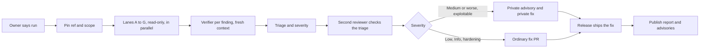

# Security and privacy audits

How fil audits itself, on a schedule, and publishes the result. The policy a reader needs (cadence, severity, the CVE rule, the AI-assisted caveat) is in [`SECURITY.md`](../../SECURITY.md) "Audits"; this page is the runbook that the people (and agent sessions) running an audit follow. The lane briefs are in [`LANES.md`](LANES.md), the report template in [`TEMPLATE.md`](TEMPLATE.md).

An audit is not a penetration test and not a certification: the reviewers are AI models reading the source, and a clean report is evidence, not proof. Every report says which models did what.

## Checks and audits

A **check** has a yes/no answer a script can give cheaply; it runs on every PR, on a timer or at release time, and fails a job (or, for the audit's age, warns). The **audit** is what needs judgment. Checks never open PRs or issues.

| Check | Where | What it answers |
| --- | --- | --- |
| `just deny` (`cargo deny check advisories licenses bans sources`, `deny.toml`) | PR gate, `linux-check`'s `lint` | no locked crate has a RustSec advisory or is yanked; every license is GPL-3.0-compatible; every crate comes from crates.io |
| `.github/workflows/audit.yml` | weekly, and by dispatch; fails only | the same advisory check against a fresh RustSec database, and the OSV database (`osv-scanner`) for `Cargo.lock` and the terminal exporter's lock, without waiting for a PR to touch them |
| `tests/release/lint-workflow.sh` | PR gate (`release-test`), release.yml's `prepare` | every `uses:` is pinned by a full commit SHA; read-only permissions where no release is made; no secret; the allowed triggers per workflow (`--check`, `--scheduled`) |
| `tests/release/just.sh release-check` | release.yml, `release-verify` | no test fixture's host name or address in a release binary, the layout, the installer's pinned key, and the rest of `docs/m4/release.md` §9 |
| `tests/release/audit-age.sh` | `release-preflight`, so every `tests/release/just.sh release` run | warns (never stops) when the last full audit in this directory is more than seven months old, or when there is none |

Actions are pinned by hand: a full audit moves each pin to the current release of its action (resolve a tag with `gh api repos/OWNER/REPO/git/ref/tags/TAG`; for an annotated tag, read the commit it points at) and keeps the `# vX` comment. A full audit also confirms that the weekly workflow is still enabled (`gh workflow view audit.yml`): GitHub disables a scheduled workflow after 60 days without repository activity.

Fuzzing follows the rule in `DESIGN.md` §12: before a release, each fuzz target for a parser of peer or remote-host input runs for 5 minutes, all in parallel, and the local config-file targets run only when their parser changes. An audit's report records the targets and durations it ran.

## The run

1. **Pin.** Make a working folder outside the repository and outside any synced or backed-up path that is public (for example `~/fil-audits/<YYYY-MM-DD>-<kind>-<version>/`). It is also the embargo store, so once an advisory is filed it holds the advisory's id, not exploit text. Record in `pin.md`: the commit SHA or tag, the kind (full, release, full + release), the tool versions (`rustc --version`, `cargo deny --version`, `osv-scanner --version`, the fuzz settings), and the scope table. A full audit runs all seven lanes. A **release audit** runs lane G plus every lane whose paths changed between the last audited tag and the release candidate: take `git diff --name-only LAST_TAG..RC` and use the table below, so the choice is mechanical.
2. **Lanes.** One read-only agent per lane, in parallel. Each gets its brief from `LANES.md`, the paths, the documents it names, the previous reports (so it checks that old findings stayed fixed) and the finding schema. Models: Opus for lanes A to D, the verifier and the triage reviewer; Sonnet for E to G. For the baseline run, Opus everywhere. Lanes write findings as JSON to `findings/<lane>.json` in the working folder.
3. **Verify.** Every finding rated Low or above goes to a verifier that sees only the finding's claim, its `path:line` and the code, not the lane's reasoning. It reproduces the finding (a failing test or script in the working folder, never committed unless it becomes the regression test) or explains why the claim is false. Verdicts: confirmed, not reproducible, false positive, downgraded. The verifier is a different agent, and a different model where one is available. A finding it cannot confirm is listed in the report as "not confirmed", with the reason.
4. **Triage.** The coordinator assigns the severity (`SECURITY.md` "Audits", one line of reasoning each) and an action, removes duplicates and writes the fix list. A second reviewer (Opus) checks the triage and the fix designs.
5. **Fix and ship** (below), then **publish**.

The owner's part: say "run the audit" (or the release checklist does, for a minor release); create each draft advisory from the coordinator's text (on a personal-account repository only the admin can); merge an embargoed fix at release time and run the release; request the CVE and publish the advisory in GitHub's interface; approve the report PR.

## Handling findings

- **Embargoed track:** Critical, High, and any Medium that someone other than the user can exploit. One private advisory per finding or per fix. The draft advisory holds the text, the reproduction and the credits. Develop the fix in a local branch, not in the advisory's temporary private fork (pushing there needs the account added to the advisory, and Actions do not run there); the fork stays available to an outside reporter who wants to collaborate.
- **Open track:** Low, Info, hardening, document fixes, and a Medium that only the user can trigger. They ride in one "audit fixes" PR per run with a neutral description ("tighten X"). No advisory.
- **Time limits (aims):** Critical and High fixed in the next release, within 30 days; Medium within 90. A fix that changes the wire bumps `PROTOCOL_REVISION` like any other (`CLAUDE.md`, "The wire has a revision"), so it ships in a minor release, and the advisory says that both ends need it. A finding that cannot ship in 90 days is published as withheld: id, severity, area, advisory link, no reproduction.
- **Outside reports** received between runs follow the same tracks and appear in the next report's "Reports from outside the audit".

### Embargoed fixes

A public commit, branch, tag or PR title is a disclosure, and fil's release is built on GitHub from `main` (`docs/m4/release.md` §9), so an embargoed fix becomes public when its PR is pushed. The aim is to keep the window between that push and the published release short.

1. The fix is one commit, with its regression test, on top of `origin/main`, in a local branch that is never pushed until release time. Its message, test names and any comment are neutral. No changelog line describes it yet.
2. Gate it on the Mac before anything is public: the tests it touches, `just ci`, and `just ci-release` (the quiet-host tier). The release's `suite=all` run on GitHub comes later, as for any release.
3. **At release time,** one PR carries the fix and the release changes (the version and the `CHANGELOG.md` section, whose entry says only "a security fix, see the advisory" with no detail). Hold other merges to `main` from then on. When the gate passes, merge it, and run `tests/release/just.sh release X.Y.Z` at once. The window is the release's length: the gate, the dry run and `suite=all`, the rebuild in the VM and the signatures, a few hours. If the release stalls, finish it before anything else.
4. **When `verify-published` passes,** publish the advisory and request the CVE, then edit the release notes to link the advisory and say who is affected and what to do (`SECURITY.md` "What happens next", step 4).
5. **Before any push** (the release PR and the open-track PR): no exploit detail in a commit message, branch name, PR title or body, changelog line or test name. Never `git push --tags` or `--follow-tags`; the owner pushes the one release tag by name. The Gitea backup mirrors GitHub's `main` only, so it never sees more than GitHub has.

### Publishing the report

After the last embargoed fix has shipped (an audit that finds nothing publishes at once), one PR adds the report from `TEMPLATE.md`, links the advisories (published at the same time), adds one row to the index below and to the `SECURITY.md` "Audits" table, and a `CHANGELOG.md` line.

**The report's file name** is `docs/audits/YYYY-MM-DD-KIND-VERSION.md`: the date the run was pinned (step 1), the kind (`full`, `release` or `full-release`) and the version or tag audited, for example `2026-12-01-full-1.0.0.md`. `tests/release/audit-age.sh` reads only these names: the newest `full` or `full-release` file's date is the last full audit.

## Path to lane

| Changed path | Lane |
| --- | --- |
| `crates/fil-proto/`, `crates/fil-term/`, `crates/fil-transport/src/pipe/answer.rs`, `crates/fil/src/install/probe.rs`, every `crates/*/fuzz/`, `crates/fil-proto/tests/golden/`; the config parsers and what the client writes to the terminal: `crates/fil/src/config.rs`, `crates/fil-client/src/{config,escape,text,terminal,display}.rs` | A |
| `crates/fil-transport/`, `crates/fil/src/{connect,dialer,link}.rs`, `crates/fil-client/src/{dialer,consent}.rs`, `docs/m1/quic-auth.md`, `docs/m1/quic-link.md`, `docs/user/transports.md` | B |
| `crates/fil-daemon/` (but `ports/`), `crates/fil-session/` (but `agent.rs`, `forward.rs`, `echo.rs`), `crates/fil/src/install/`, `crates/fil/src/{server,mgmt,cli,cmds,app,main,netwatch,ports_view,localtime,upgrade}.rs`, `crates/fil-client/src/{tty,status,offline}.rs`, and any other `crates/*/src/` path no row names, `crates/fil-transport/src/pipe/remote-commands.txt`, `docs/m4/install.md`, `docs/user/{policy,daemon,sessions}.md` | C |
| `crates/fil-forward/`, `crates/fil-daemon/src/ports/`, `crates/fil-session/src/{agent,forward}.rs`, `crates/fil-client/src/{agent,forward}.rs`, `crates/fil/src/forward_spec.rs`, `docs/user/{forwards,agent}.md` | D |
| `crates/fil-predict/`, `crates/fil-client/src/engine.rs`, `crates/fil-client/src/engine/`, `crates/fil-session/src/echo.rs`, `docs/m3/plan.md` | E |
| `Cargo.toml`, `Cargo.lock`, `deny.toml`, `about.toml`, `about.hbs`, `Cross.toml`, `rust-toolchain.toml`, `flake.nix`, `flake.lock`, `.github/`, `tests/release/`, `tests/ci/`, `packaging/`, `docs/m4/release.md`, `docs/m4/packaging.md` | F |
| every audit; also `SECURITY.md`, `DESIGN.md` §11, `docs/user/security-privacy.md`, `README.md`, every `logging.rs`, `crates/fil-client/src/offline.rs` (the offline-input log), and anything that opens a connection or writes a file or a log line | G |

A path in two rows runs both lanes. Every source file under `crates/*/src/` maps to at least one lane (C catches any that no other row names, so a new module is never silently out of scope). A path in none (documentation, tests, harnesses) runs none; lane G still runs.

## Reports

| Report | Kind | Code audited |
| --- | --- | --- |
| [2026-11-15, full, 1.0.0](2026-11-15-full-1.0.0.md) (the baseline) | full | `bcd8460`, the 1.0 candidate; fixes in 1.0.0 |
