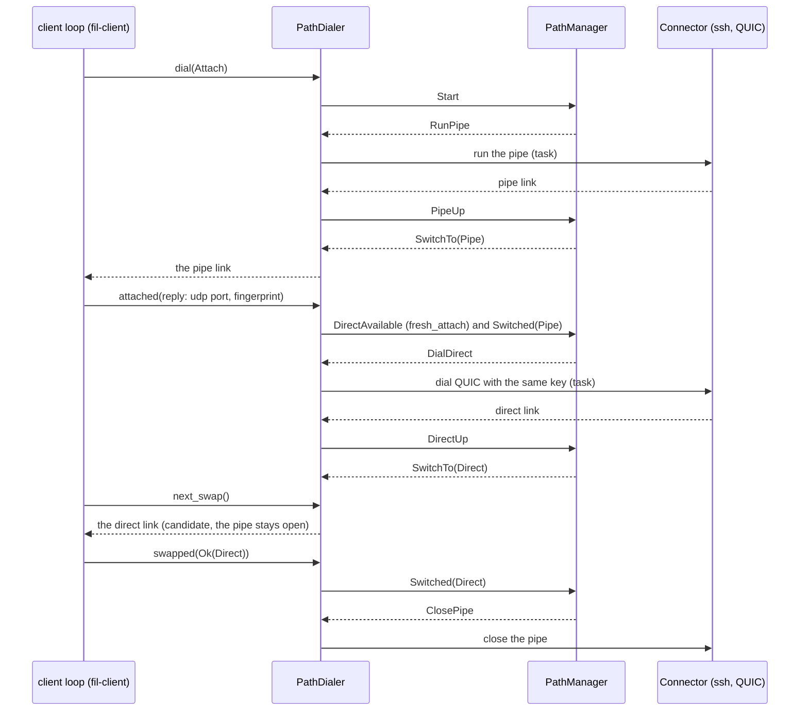

# The `fil` binary (`crates/fil`)

M1 package P6. One binary, both ends: `fil HOST` is the client; `fil server --stdio` and the daemon are the remote side (DESIGN.md §4, §13, §14). The crate has the command line, the config file, the **dialer** that turns the path manager into links, and the management commands. The client loop is `fil-client`; the transports are `fil-transport`; the remote side is `fil-daemon` (P5).

## Command line

```
fil HOST [SESSION] [-L SPEC]... [-R SPEC]...   attach (default session: main)
fil ls HOST                                    list sessions
fil kill HOST SESSION                          end a session
fil detach HOST SESSION                        detach whoever is attached (it keeps running)
fil server --stdio                             the remote side of the pipe (not for people)
fil server --daemon                            the daemon itself (hidden; started by the relay)
```

| Option | Meaning |
|---|---|
| `--transport auto\|pipe\|direct` | Overrides the config for this attach. `auto`: ssh first, QUIC in the background. `pipe`: never dial. `direct`: as auto, but an ssh re-login waits 10 s after QUIC is lost. |
| `--config FILE` | Another config file (also `$FIL_CONFIG`). A file named this way must exist: a typo is an error, not "no config" (only the default path may be missing). |
| `-L SPEC`, `-R SPEC` | Accepted; port forwards are M2, so they fail with a clear "not yet" message (exit 1). |
| `fil detach` with no host | Same: it needs the session's control socket (M2). |
| a HOST, SESSION, `-L`, `-R` or `--transport` together with a command | A usage error (exit 2): `fil orin ls box` would list `box` and drop `orin`. |

A host or session named `ls`, `kill`, `detach` or `server` is attached with `--`: `fil -- ls`, `fil orin -- ls`. (Without it `fil orin ls` fails loudly, because `ls` wants a host.)

**Exit status.** 0: detached or input closed. When the session ends (`Outcome::SessionEnded { code, signal }`), like ssh: the shell's own status if it exited with one (low eight bits), 128+N if it was killed by signal N (`fil kill` from elsewhere sends SIGHUP first and SIGKILL only to what survives the grace period, so usually 129 (SIGHUP), and 137 if the shell survives the hangup, e.g. `trap '' HUP`), and 0 if the daemon could not say (a reconnect that learns the session is gone). 128+N also when fil itself is stopped by signal N. 1: an error, or the session was taken over, replaced or detached elsewhere (so a shell that exits 1 and an error are not told apart by the status alone; the message differs). 2: a usage error (clap).

**Logs.** JSON lines in `~/.local/state/fil/client.log`, written by the same module as the daemon's `daemon.log` (`fil_daemon::logging`). The directory is 0700 and the file 0600, and both are tightened if they existed looser (a directory owned by someone else is not used; a symbolic link in place of the file is refused). The file is moved to `client.log.1` at 4 MiB or once it is a week old, **while the process runs** (a client attached for weeks rotates too), and the rotated file is deleted a week after its last write: nothing older than two weeks stays. `FIL_LOG=debug` for more, for fil's own crates; other crates (quinn, rustls) log only when named, `FIL_LOG=fil=debug,quinn=trace`. At the default level the log names no host, no session and no path, and not what ssh said (the reason class is `info`; the words are `debug`). The log holds no keystrokes, output or keys. Both programs switch core dumps off at start (`fil_daemon::hardening`): the client also sets its core limit to zero; a Linux daemon only clears its dumpable flag, which `execve` resets, so its sessions' programs still dump core.

Once the first attach has been accepted, nothing reaches the terminal except the client's own messages: a background run's stderr (ssh's, or any pipe command's) is captured, not inherited, and its last line goes to the status line and to the log. Until then ssh runs as written, with its prompts on your terminal and its errors and warnings copied there as they arrive (`PipeStderr::Tee`); from the attach reply on, the first ssh's stderr is captured too, so `Connection to X closed` cannot land in the middle of the screen.

## Config: `~/.config/fil/config.toml`

A missing default file means the defaults; a file named with `--config` or `$FIL_CONFIG` that is missing is an error. Unknown keys are errors. Every section is checked when the file is read, and an error names the file, the section and the key (`config.toml: [host.orin]: offline_input.buffer: not a size: "lots"`).

| Key | Values | Used by |
|---|---|---|
| `transport` | `"auto"` (default), `"pipe"`, `"direct"` | client |
| `pipe` | an argv, run untouched (except ssh keepalive options); default `ssh -T -- HOST fil server --stdio` | client |
| `host_label` | text, 1 to 128 bytes (default: this machine's short host name) | client |
| `predict` | `"off"`, `"adaptive"`, `"always"` | accepted; used from M3 |
| `forward` | list of `-L`/`-R` specs | accepted, warned about and ignored until M2 |
| `offline_input.buffer` | `"4KiB"`, `0`, `"512"`... (default 4 KiB) | client |
| `offline_input.confirm` | `"off"` (default), `"after 10s"` | client |
| `offline_input.log` | an absolute path or `~/...`, or a command `["logger", "-t", "fil"]`; off by default (can capture passwords) | client |
| `direct.address` | a host name or IP to dial UDP; needed with a custom `pipe` or a ProxyJump host | client |

`[defaults]` is the base; `[host.NAME]` overrides it field by field, nested tables too. `NAME` is matched against the HOST argument as typed (`user@name` tries `"user@name"`, then `name`).

`history_lines` and `direct.port_range` are settings of the daemon, in `~/.config/fil/daemon.toml` on the host where it runs (`history_lines`, `port_range = [60000, 61000]`). The client's config used to accept them and ignore them; now it refuses them with a message saying where they go.

The host label sent in `Attach` (shown to the previous subscriber on a takeover) is `host_label` if set, otherwise this machine's host name up to the first dot (no `.local`, no domain), stripped of control characters and cut to 128 bytes. The daemon logs it only at `debug`.

## The dialer

`fil_client::run` asks a `Dialer` for links and tells it what happened. `PathDialer` (`src/dialer.rs`) answers by running `fil_transport::path::PathManager`, the pure state machine that decides which transport carries the session.



### What is reported, and when

| Event | Reported to the manager as |
|---|---|
| a pipe run produced a link | `PipeUp`, before the attach over it |
| a pipe run failed | `PipeDown` |
| `attached(info)` | `DirectAvailable { port, fingerprint, fresh_attach: !resumed }`, or `DirectUnavailable` (no details, or a fingerprint that is not 32 bytes) |
| the QUIC dial succeeded / was refused | `DirectUp` / `DirectDialFailed` |
| a link the dialer holds went down | `PipeDown` / `DirectDown`, stamped with the time it was seen |
| `swapped(Ok(kind))` / `swapped(Err(_))` | `Switched(kind)` / `SwitchFailed(kind)`, and the candidate is closed |
| `attached` on a link `dial` returned | `Switched(kind)`: a link from `dial` carries the session from its reply on |
| the network changed, the machine woke | `NetworkChanged` |
| a deadline passed | `Timer(..)` |

### What the manager's actions become

| Action | Done by the dialer |
|---|---|
| `RunPipe` | spawn `Connector::run_pipe`; at most one at a time |
| `DialDirect` | spawn `Connector::dial_direct(port, pin, key)` with the last bootstrap |
| `SwitchTo(kind)` | remember it; the next `dial` or `next_swap` returns that link |
| `ClosePipe` / `CloseDirect` | close the held link; abandon a pipe run that is still starting |
| `ScheduleRetry` / `CancelTimer` | a deadline in a map, fired by whichever of `dial`, `next_swap` or `attached` runs next |

### Decisions worth knowing

- **Only the manager backs off.** The binary sets the client's `Backoff::None`, and `dial` waits for the manager's timers. A `dial` that cannot connect on a first attach returns the error at once (a typo in the host name must not retry forever); if the loop calls again, the manager's backoff holds, so a persistent failure is not an ssh storm.
- **ssh uses the terminal only for the process's first attach.** The user is waiting for it, so ssh runs as written: Touch ID, passwords and host-key questions work. Once an attach has been accepted the terminal belongs to the session (raw mode, fil reading the keys), so every later run, a fresh attach after a take-over or a replaced session included, is a background run. A background run of an `ssh` pipe command, the default one or one from `pipe = [...]`, adds `-o BatchMode=yes -o ConnectTimeout=10 -o LogLevel=ERROR` (each unless the command already sets it) and waits at most 30 s for fil's preamble; its stderr is captured (`PipeStderr::Capture`, the last 4 KiB). A command whose program is not `ssh` (`kubectl`, `tailscale ssh`, `docker exec`) runs untouched apart from the captured stderr, so it may prompt on a reconnect.
- **When a background ssh cannot log in** (it needs a password, a passphrase or a host-key answer: "Permission denied", "Host key verification failed", ...) the dialer returns a retryable error for each failure, and the status line says `ssh needs an interactive login: detach (~.) and run fil again. ssh said: ...`. It keeps retrying with the manager's backoff, so a login that starts working (an agent unlocked elsewhere) recovers by itself. Any other failure shows ssh's last stderr line there. The same line goes to the log. This needs one hook in fil-client: `Dialer::status_note`, shown under the "reconnecting" lines.
- **Keys.** A `ClientKey` is made when the dialer is built (memory only) and again on every `DialPurpose::Attach`, never on `Resume`. A fresh attach closes every link of the old key, aborts a direct dial in flight, forgets the pinned details, and tells the manager that direct is unavailable until the new reply, so the next link is a pipe: the new key is registered through it, and the daemon accepts a fresh attach nowhere else (`dial(Attach)` never returns a direct link). **The path manager is kept**, with its pipe backoff: a pipe that dies before the session is established (the engine dials `Attach` again whenever the session is not established) counts as a young death, so ssh logins stay bounded by the manager's 1 s to 30 s backoff however many fresh attaches follow. The one exception to rotating is a retry of a failed `Attach`.
- **The pin and the port** come from the bootstrap over the pipe only. A reply over direct (a resume, a swap) is still reported to the manager, but with the details in force; it cannot move the pin.
- **Links are shared.** Each link is held in an `Arc` by the loop and the dialer, so `ClosePipe` can close what the loop is using and a watcher can report its death. Events carry a link id: in a normal upgrade the loop closes the old pipe when the candidate's reply is in, so the pipe's death report is queued before `swapped(Ok)` and the `ClosePipe` it causes; without the id it would be read as the death of the direct link that now carries the session (`tests/dialer.rs` has the test; it fails when the direct-side check is weakened).
- **A first-attach failure is worded for the user.** A version mismatch says so and what to do; "no preamble" says fil may not be installed on the remote host or on the PATH of a non-interactive login; what the remote shell printed before failing is shown, sanitized.
- **Direct address.** The UDP dial goes to `direct.address` if set; otherwise, with the default ssh pipe, to the name `ssh -G` reports for HOST (so an alias from `~/.ssh/config` works), or to HOST itself without `user@` if ssh cannot say. A host that `ssh -G` shows behind a `ProxyJump` or `ProxyCommand`, and any host with a custom `pipe`, is **not dialed** unless `direct.address` is set: the dial fails at once with no lookup and no packet (the path manager backs off as for any failed dial). A looked-up name is cached for five minutes, an IP literal is never looked up, and up to four addresses (families alternating, the resolver's first family leading) are dialed together, each 250 ms after the one before or as soon as that one fails, the first to connect winning. The daemon listens on `::` and takes IPv4 as well, so a name that resolves to IPv6 first is not a 2 s detour.
- **Network changes** are hints (the manager rate-limits them), watched only for `auto` and `direct` (with `pipe` there is nothing to upgrade to). The detector (`src/netwatch.rs`) polls, every 2 s, which local address the kernel would use toward a documentation-range address (no packet is sent) for IPv4 and IPv6, and whether the wall clock ran ahead of the timer (sleep). It misses a move between two networks that hand out the same address; the periodic retry covers that within the manager's backoff.

## Management commands

`fil ls`, `kill` and `detach` open a pipe link (ssh may prompt: the user is waiting), send `Hello` and one `Request`, print the `Response` and close. `fil ls` prints a table (`NAME TERM ATTACHED LAST OUTPUT CREATED`, ages relative to now so no time zone is involved) and says when the daemon cut the list. ATTACHED is `-` when no transport is connected, even if a client that dropped off could still resume. A daemon of another protocol major is reported as a version mismatch; `fil ls` asks the daemon of its own major only, since an older major's wire format is not one it can speak.

When the daemon cannot create a session (no `XDG_RUNTIME_DIR` for `scope = "systemd"`, a bad `session.command`, a spawn that takes over 30 s) it answers `Error(SessionStartFailed)` and logs the reason; the client says so and points at `daemon.log`.

## Tests

All run in `just ci`. Times are debug builds on an Apple M-series laptop.

| Where | What | Time |
|---|---|---|
| `src/cli.rs` (15) | each form of the command line, defaults, `--`, `-L`/`-R` refused, usage errors, help text | under 0.05 s |
| `src/config.rs` (10) | the DESIGN.md sketch, field-by-field override, `user@host` matching, every kind of bad value (message names section and key) | under 0.05 s |
| `src/mgmt.rs` (10) | the `fil ls` table, truncation, hostile labels, answers as sentences, and the exchange over `link::mem` (version mismatch, dropped link, silent daemon, error message) | under 0.05 s |
| `src/connect.rs` (8), `src/logging.rs` (2), `src/app.rs` (2), `src/netwatch.rs` (1) | the background ssh command, `ssh -G` parsing, failure wording, log permissions and rotation, host labels, exit statuses | under 0.05 s |
| `tests/dialer.rs` (28), paused clock | the dialer called as the loop calls it, over fake transports and `link::mem`: upgrade (the pipe closes only after the switch), failed switch, candidate dying, UDP blocked (bounded dials), fallback after 3 s, a QUIC redial with no ssh, a refused redial going straight to ssh, ssh storms (first attach, mid-session, and across fresh attaches whose pipes die young), ssh interactive only until the first attach, status notes, a direct dial cancelled on a key change, the pin taken only from the pipe, ten minutes of direct flapping, keys (rotated on a fresh attach, kept on resume, old links closed), version mismatch, hints and their budget, stale death reports | 0.01 s |
| `tests/engine.rs` (11), paused clock | the real `fil_client::run` with the real dialer and fil-client's scripted daemon: upgrade with the same key, a QUIC blip with no ssh, UDP dying and the fallback, return to direct, ssh dying mid-session, a replaced session getting a new key through the pipe, first-attach failure, version mismatch, five minutes of outage | about 1 s |

Mutation checks (each change made by hand, the suites run, the change reverted): see the pull request for the list and results.

## Not done here

- Local time in the "taken over" message: the client formats UTC (labelled) because the local zone needs a database lookup this crate does not carry.
- Port forwards (`-L`, `-R`, `forward = [...]`, `fil ports`, `fil forward`) are M2.

## On demand: a real run without sshd

`just local` builds `fil`, writes a throwaway config whose pipe command is `fil server --stdio` run directly, and attaches to a session named `local`; the relay starts the daemon (`fil server --daemon`) on first use. `just local-direct` also lets it upgrade to QUIC over loopback (`direct.address = "127.0.0.1"`). The run on 2026-11-02 on macOS is in the pull request.
