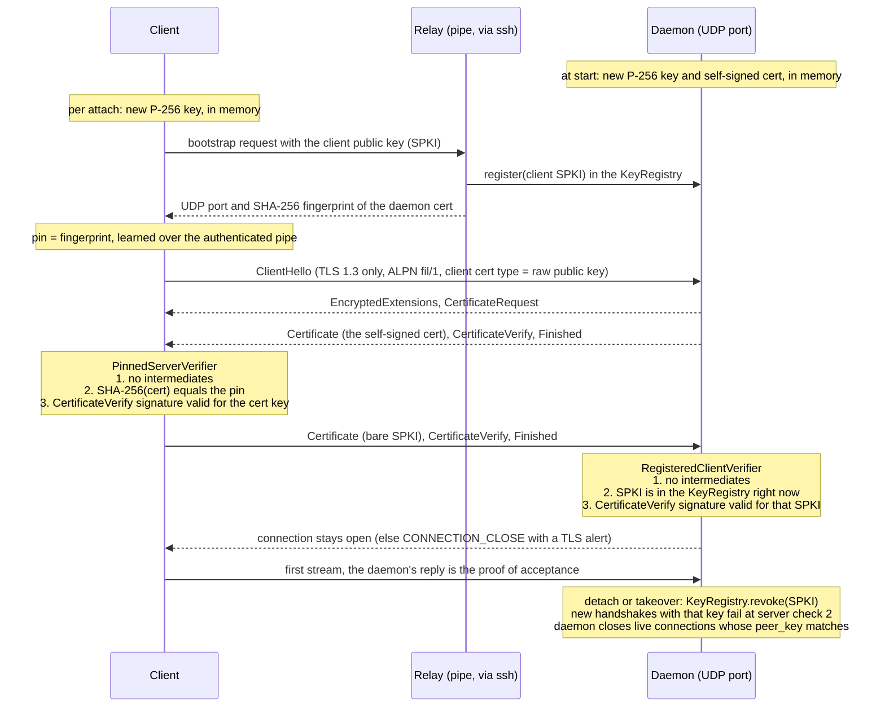

# QUIC authentication (`fil-transport::auth`)

> **Historical:** the work of this package, as built; where it and `DESIGN.md` or the code differ, they win.

Implements the mutual authentication of DESIGN.md §8.3 for direct mode. Spike B showed quinn and rustls (ring provider) running over the simulated network, but it trusted one exact certificate. The real transport needs fingerprint pinning, plus a client-key check on the daemon. That is what this adds.

## Handshake flow

Everything is in memory. The daemon's key and certificate are made at start. The client's key is made per attach. Nothing is written to disk.

## What is pinned and checked

**Client side (`PinnedServerVerifier`)**

- The end-entity certificate's SHA-256 must equal the fingerprint from the pipe. This is the whole trust decision.
- Intermediates are refused, not ignored. The daemon sends exactly one certificate.
- There is no CA, no validity-date check, no hostname check and no OCSP. The client connects with the fixed placeholder name `fil.invalid`, which is sent as SNI and never checked. The real host name is not leaked in the handshake.
- The TLS 1.3 handshake signature (CertificateVerify) is still verified against the key in the pinned certificate, using the ring provider's algorithms. A certificate is public, so matching its hash proves nothing about who holds the key. The signature does.
- TLS 1.2 is refused. The configs are TLS 1.3 only, as QUIC requires, and the verifier's TLS 1.2 methods fail.
- Only ECDSA P-256 / SHA-256 signatures are offered and accepted. Both sides' keys are generated here, so there is nothing to negotiate.

**Server side (`RegisteredClientVerifier` + `KeyRegistry`)**

- The client must present a public key, and it must be in the registry at that moment. The check runs on every handshake, so `revoke` takes effect on the next one.
- The CertificateVerify signature is verified against the presented SPKI. Seeing a registered public key (it crosses the pipe) is not enough to use it.
- Intermediates are refused. Client authentication is mandatory.
- Session resumption and 0-RTT are off on both sides. Every connection runs the full client check, so a revoked key cannot return through a cached session.

**Revocation scope.** `KeyRegistry::revoke` blocks new handshakes. It does not close a connection that already completed one. `QuicListener::revoke` does both (it uses `auth::peer_key(&conn)`, which returns the key a server-side connection authenticated with); see `docs/m1/quic-link.md` § Revocation.

**Caveat for callers.** In TLS 1.3 the client finishes its handshake before the server judges the client key. `connect().await` can therefore succeed on a connection the server is about to reject. The client must treat the link as authenticated only after the daemon's first reply (the tests do a one-stream echo for this reason).

## Raw public key vs self-signed client certificate

rustls 0.23.46 supports RFC 7250 raw public keys on both sides, and mixing is allowed (X.509 server, raw-key client). Verified in the source (`ClientCertVerifier::requires_raw_public_keys`, `AlwaysResolvesClientRawPublicKeys`, and the per-direction `client_certificate_type` / `server_certificate_type` extensions). This crate uses a raw public key for the client and an X.509 certificate for the server.

- **Client: raw public key.** The registered identity is the SPKI bytes. There is nothing else to parse, no names or validity dates to ignore, and no certificate to mint per attach. A client that offers an X.509 certificate fails negotiation (`IncorrectCertificateTypeExtension`).
- **Server: X.509.** DESIGN.md §8.3 and §4.1 specify a certificate fingerprint, which the bootstrap sends, so the pinned object is the certificate. A raw-key server would pin a key hash instead, a design change for no gain.

## Threat-table rows covered (DESIGN.md §11)

| Who | Covered how |
|---|---|
| Anyone on the network | The handshake succeeds only with a registered key and a valid signature by it. Tests: unregistered key, no key, and a registered public key without its private key are all refused. |
| A man in the middle | The client accepts only the pinned certificate and checks that its key signed the handshake. Tests: a different valid server, a wrong pin, and the right certificate with a different signing key are all refused. |
| Someone who steals a client key | The key is in memory only (no storage code here). `KeyRegistry::revoke` blocks new handshakes at once, and `QuicListener::revoke` also closes the live ones (`docs/m1/quic-link.md` § Revocation). |

Not covered here: stateless retry and handshake rate limiting (§8.3, "exposure before authentication"). They belong to the listener's accept loop, are implemented there (`HandshakeLimits`) and are described in `docs/m1/quic-link.md`; this document covers only the authentication itself.

## Liveness defaults

`LivenessParams::default()` is DESIGN.md §4.2: `keep_alive_interval` 1 s and `max_idle_timeout` 5 s. Spike B found these two to be the dead-link knobs.

## Tests

`cargo test -p fil-transport` runs 9 handshake tests over `fil-netsim`'s datagram link (paused time, about 20 ms) plus 3 unit tests. Mutation check: replacing either verifier's signature check with an unconditional `Ok` makes the two signature tests fail (right certificate with a different signing key, and registered public key without its private key).
