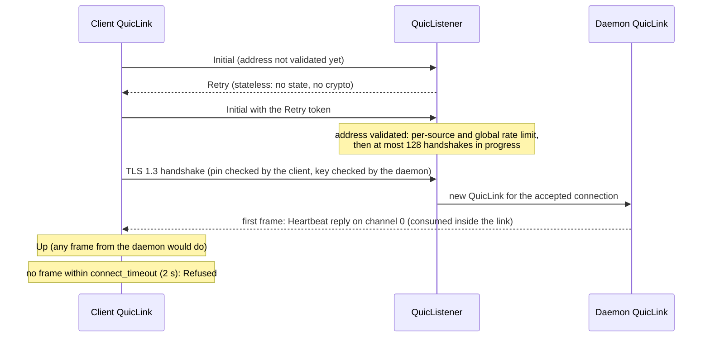
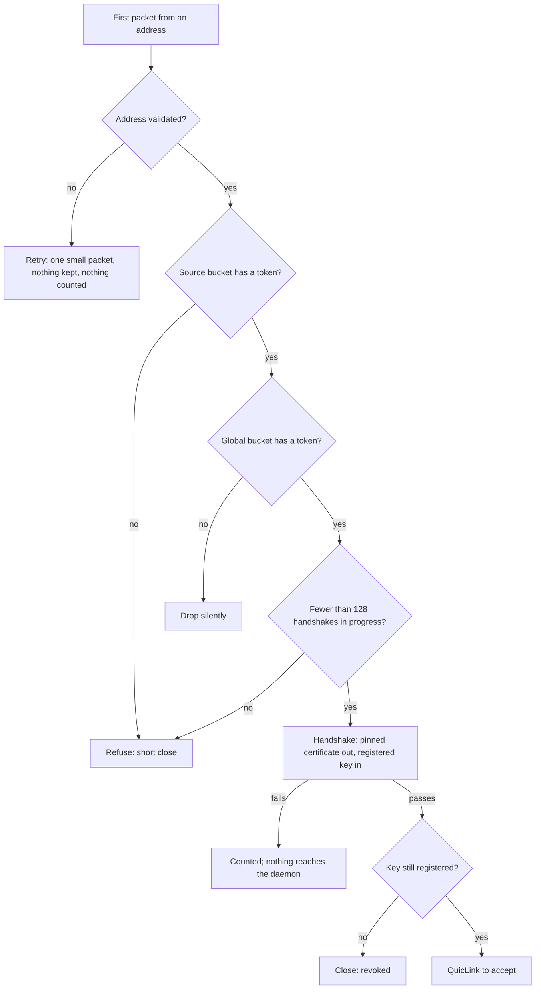
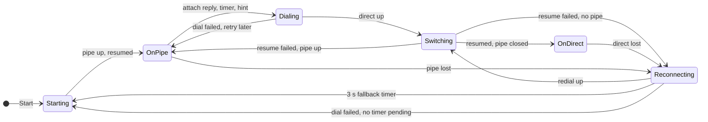

# The QUIC link and the path manager (`fil-transport::quic`, `fil-transport::path`)

M1 package P2. `QuicLink` is the `Link` (DESIGN.md §8.1) over quinn, with the stream mapping of §8.5 and the authentication of [quic-auth.md](quic-auth.md). `QuicListener` is the daemon's UDP port. `PathManager` is the client's choice between the pipe and QUIC (§4.1, §4.2), as a state machine with no IO.

## The link

### Connecting

`QuicLink::connect` is `Refused` if the daemon has not sent a frame within `connect_timeout`, and also on a wrong pin, an unregistered key, or a daemon that closes the connection. quinn alone fails a connect only at its idle timeout (5 s), which `docs/m1/realnet.md` measured; the separate timeout is what makes the fallback to the pipe quick. The first Initial retransmission is also faster than quinn's default (the initial RTT is 100 ms instead of 333 ms), so that one lost handshake packet does not use up half of the two seconds.

### The daemon's accept loop

Only validated addresses are counted. A flood with forged sources therefore costs the daemon one Retry packet each, cannot spend a real client's tokens, and cannot grow the table of sources (which is also capped at 4,096 entries). IPv6 sources are counted by /64.

Defaults: a source gets a burst of 8 and one token a second; the port gets a burst of 100 and 50 a second. A reconnecting client needs one or two. `ListenerStats` counts what each stage did.

### Revocation

The listener keeps every live connection with the key it authenticated with. `QuicListener::revoke(key)` removes the key from the registry and closes that key's connections at once (the client sees `Down(Closed)`). A `registry.revoke` that skips the listener blocks new handshakes at once, and a sweep (every 500 ms) closes the key's live connections once `ListenerConfig::revoke_backstop` (2 s by default) has passed since the revocation, so the layer above can send its last message (a takeover notice) first. This is safe because the session has already stopped reading from and writing to a connection whose subscriber lost the session. A key that is revoked while its handshake is finishing is caught by a check after the handshake.

### Channels and priorities

| | |
|---|---|
| Stream per channel and direction | opened on the first `send`; starts with the channel id (varint), then `u32`-BE length-prefixed payloads of 1 to `MAX_FRAME_BODY` bytes |
| quinn priority | control 100; interactive and forward channels 10, so quinn takes turns between their streams |
| Send queue | 8 payloads per channel; `send` waits when it is full, which is what QUIC flow control backs up into |
| Receive budget | 256 KiB unread per channel; a channel over budget stops being read and QUIC flow control stops its sender, nothing else. Also 16 MiB for the connection: once all channels hold that much, only channels holding more than 16 KiB are held back, so a pile of stalled forwards cannot stop the terminal. Worst case about 50 MiB with a peer that uses all 1,024 streams |
| `recv` order | control first; then interactive payloads in arrival order; one forward payload after every 8 interactive ones while forwards wait; forwards take turns |
| Limits for a peer | 1,024 unidirectional streams over the link's life, no bidirectional ones, no datagrams, one stream per channel, 16 MiB of quinn connection window |

A peer that breaks a rule (length 0 or too large, a bad channel id, a second stream for one channel, truncated frame) gets the link closed with `Down(Io("protocol violation: ..."))`.

**Forwards and the terminal share the link; the exact 8:1 weighting of the pipe does not exist here.** An earlier version gave forwards a lower priority than interactive channels. quinn's priorities are strict, so a terminal that never goes idle (a build scrolling, `tail -f` of a busy log) held a forward back for as long as it ran, which breaks DESIGN §8.5. Interactive and forward channels now share priority 10 and quinn takes turns between their streams, so a forward gets at least `1/(k+1)` of the sending turns with `k` busy interactive channels. The price: a bulk forward can take up to half of the terminal's throughput on QUIC, against one frame in nine on the pipe. Keystrokes are still never queued behind a forward: a full forward channel only stops that channel. `recv` also hands up one forward payload in every nine while both wait, but that only orders what has already arrived. If the exact weighting is wanted, it needs a link-level scheduler (one writer applying the 8:1 rule over per-channel queues, with a small `send_window`); not done.

**The 1,024 streams are per link, not per moment.** A channel's stream is never finished, so its slot is not returned. In M1 there are a handful of channels. M2 gives each forwarded connection a channel, so channel close (finish the stream, free the writer and the receive entry) must come with it. Until then `send` on a channel that cannot get a stream fails with an `Io` error after `dead_after`, and the link stays up. M2 note: on the 1,025th channel, up to 8 payloads that `send` had already accepted with `Ok` (the queue in front of the stuck stream) are dropped silently when the writer gives up.

### Liveness and path changes

- The client's quinn keep-alive is `heartbeat` and the daemon's is a fallback at one and a half heartbeats (see DESIGN.md §8.5), the idle timeout is `dead_after`. The link also closes itself with `Down(Dead)` once `dead_after` has passed without a datagram from the peer: quinn's idle timer restarts when it sends a keep-alive, so alone it can run up to a heartbeat late (5.8 s instead of 5 s was seen in the simulator).
- Liveness counts datagrams received from the network, not frames handed to `recv`. A consumer that stops reading backs up one channel at a time (QUIC flow control), but never hides a dead path and never makes a healthy one look dead.
- `Degraded` appears after `degraded_after` without a datagram from the peer, and clears when one arrives. The link samples quinn's counters every 500 ms while healthy and every 100 ms or less once the peer has been quiet for a heartbeat and a half.
- `path_generation` counts changes of the peer's address. **The daemon sees every change of the client's source address** (that is how quinn follows a NAT rebind or a new IP), so its link's generation rises with each. **A client cannot see its own NAT rebind**, and sees a change of its local IP only where the OS reports the local address of received packets to quinn. Nothing on the client needs it: the daemon's link is where a path change matters (the status line can say "roaming" there), and the client's own sockets keep working.
- `QuicLink::send` with a payload outside the allowed size is a caller bug: it returns an `Io` error and the link stays up.

### Contract notes

- **`recv` after `Down`:** payloads that arrived before the link went down are returned first, whoever closed it and why; `recv` fails once they are gone. A final `TakenOver` followed by a close therefore reaches the layer above.
- **What the peer of a closed link sees:** `Down(Closed)` when the close was a QUIC application close (`close()`, a revoke, or the other side ending the link over a protocol violation, which it reports itself as `Down(Io("protocol violation: ..."))`). A transport-level end, such as a reset, shows as `Down(Io(..))`. Session-level intent travels in control messages, so nothing relies on telling the two apart.
- **A slow consumer:** liveness reads quinn's receive counters, not `recv`. A consumer that falls behind backs up only the channels it is behind on (QUIC flow control); the path is still judged `Degraded` and `Dead` on what arrives from the network.
- **Replies:** the link sends no replies of its own. The one internal frame is sent once, by the daemon, when it accepts a connection, and only the first control-channel frame matching it is consumed.

### What a link does not do

- It does not flush on close. `close()` discards payloads still queued *for sending*, as the trait says; payloads already *received* stay readable: `recv` returns them first and fails afterwards, however the link ended. A layer that wants its last message to arrive (the "taken over" notice before the daemon drops a subscriber) calls `Link::flush` first and then `close()`; `flush` resolves once the peer's link has read everything sent before the call, and callers bound it with a timeout. The revoke path is the other way: it tells the client the connection was closed on purpose.
- It does not reconnect. A dead link is final (§8.1); the path manager decides what happens next.

## The path manager

### States

How to read it: `Starting` is a pipe run in flight, `OnPipe` and `OnDirect` name the link that carries the session, `Dialing` is `OnPipe` with a dial in flight, `Switching` is a resume running on the new link while the old one stays open, and `Reconnecting` is no carrier with a redial in flight and the pipe fallback timer running. In `Reconnecting`, a dial that times out does **not** start the pipe while that timer is pending (the timer decides, 3 s with `auto`, 10 s with `direct`). A dial the daemon refuses outright (an answer in under a second, as when it restarted and no longer knows the key) starts the pipe at once, because only a new bootstrap helps; so does a dial that fails when the manager has already been failing and started no timer. Both are the "dial failed, no timer pending" edge. A failed resume goes back to `OnPipe` if a pipe link is up (it carries the session again with no new ssh login), and to `Reconnecting` if the switch started from `Reconnecting` and there is no pipe. The diagram is a summary: the manager's real state is two *lanes* (pipe and direct, each `Idle`, `Waiting`, `Busy` or `Up`) plus a carrier and a pending switch. See the module docs of `path.rs` for the full rules.

### Settings

| Setting | Behavior |
|---|---|
| `pipe` | never dials; the pipe is re-run with backoff whenever it is gone |
| `auto` | pipe first, dial direct in the background, move to direct and close the pipe; redial at once when direct is lost, re-run the pipe if nothing carries within 3 s; keep retrying direct while on the pipe |
| `direct` | as `auto`, but an ssh login waits 10 s. The first attach still uses the pipe, because the bootstrap and the key registration travel over it |

### Inputs and actions

The client reports `Start`, `PipeUp`, `PipeDown`, `DirectAvailable` / `DirectUnavailable`, `DirectUp`, `DirectDialFailed`, `DirectDown`, `Switched`, `SwitchFailed`, `NetworkChanged` and `Timer(..)`, each with the current time. It carries out `RunPipe`, `DialDirect`, `SwitchTo`, `ClosePipe`, `CloseDirect`, `ScheduleRetry(timer, after)` and `CancelTimer`. Late reports from a link that is already gone are ignored.

**How it meets the client's dialer (P4/P6):**

| Client side | Path manager |
|---|---|
| a pipe link was established, before the attach over it | `PipeUp` |
| the pipe run failed, or the pipe link ended | `PipeDown` |
| `attached(&AttachInfo)` after every attach reply: UDP port and fingerprint present or absent (`resumed` is false for a fresh attach) | `DirectAvailable { port, fingerprint, fresh_attach: !resumed }` / `DirectUnavailable` |
| the dial of `QuicLink::connect` succeeded or was `Refused` | `DirectUp` / `DirectDialFailed` |
| the direct link ended | `DirectDown` |
| `swapped(Ok(kind))` / `swapped(Err(..))` after the resume on the new link | `Switched(kind)` / `SwitchFailed(kind)` |
| the OS reports a network change | `NetworkChanged` |
| a timer it was asked to set fires | `Timer(..)` |
| the manager says `SwitchTo(kind)` | the client keeps the old link open, resumes on `kind`, then reports `swapped` |

The manager compares each `DirectAvailable` with the last one and clears direct's backoff (and starts a waiting dial) only when the bootstrap really changed: another port or fingerprint (the daemon restarted), or `fresh_attach` (a new key). A plain resume reply, over the pipe or over direct, changes nothing. Clearing it on every reply, or on every reply over a pipe, let a direct link that keeps dying young cause an ssh login every few seconds (150 in ten simulated minutes); now it is about a dozen. Only the path manager backs off; the client's loop must not add a second layer.

`ClosePipe` follows `Switched(Direct)`, not `DirectUp`, and not a pipe run finishing during a pending switch: a direct link that comes up but cannot resume the session (the daemon restarted and refuses the resume, say) costs nothing, because the pipe is still carrying or still there to carry. If the switch fails and a pipe link is already up, the manager sends `SwitchTo(Pipe)` instead of starting a second ssh login.

### Why it does not flap or storm

| Risk | What stops it |
|---|---|
| Two dials or two ssh logins at once | each lane is started only from `Idle`; `Busy`, `Up` and `Waiting` are never restarted |
| Hammering a blocked UDP port | failures double the delay, 1 s to 2 min, with 20% jitter (so many clients of a restarted daemon do not retry in step) |
| An ssh login every second | the same for the pipe, 1 s to 30 s; a pipe that dies within 10 s of coming up counts as a failure, so a remote command that exits at once slows down instead of cycling |
| Direct up, dead, up, dead | a link that dies within 10 s counts as a failure and backs the next dial off; only a link that lived 10 s resets the count; a failed `SwitchTo` counts the same way |
| A long outage | both lanes sit at their maximum delay: about two ssh attempts and half a dial a minute, for as long as it lasts (measured over a simulated day: 3,000 ssh attempts, 750 dials) |
| A network that reports changes all day | a hint dials at once and clears the backoff, but hints inside 2 s are merged, a waiting pipe is restarted by a hint only if its last run began 5 s ago, and only 4 hints a minute are honoured. Measured over a simulated hour of one hint a second with everything failing: about 6 ssh attempts and 9 dials a minute |
| Waiting for ssh when direct is gone for good | after a loss, direct is tried at once and the pipe follows after the fallback timer (3 s; 10 s with `direct`) while the redial merely times out; if the daemon refuses the dial outright, or direct has been failing and no timer is pending, the pipe starts at once |

## Tests

All times are real time on an Apple M-series laptop, debug build.

| Where | What | Time |
|---|---|---|
| `src/quic/*` unit tests | varint and length rules; inbox order, forward share, per-channel budget, close semantics; rate-limiter buckets, source-first rule, IPv6 /64, bounded table; a reader parked on the connection cap wakes when its channel drains | under 0.05 s |
| `src/path/tests.rs` (30) | each transition above; backoff growth and caps; flapping; hints and the hint budget; stale reports; random event sequences (3 settings x 60 seeds x 400 steps) checking that no action contradicts the model; one simulated day and one simulated flapping hour of failures; convergence to direct in a healthy world | 0.05 s |
| `tests/quic_link.rs` (30), over `fil-netsim`, paused time, seeded | connect and the accept proof; per-channel order under 2% loss; forwards making progress while the terminal never goes idle on a 2%-loss path, with control ahead of both; a stalled forward blocks neither terminal nor control, and drains intact; NAT rebind twice mid-transfer (link stays `Up`, daemon's `path_generation` is 2, one handshake); blackout gives `Degraded` then `Down(Dead)` between 4 and 5.5 s, and a fresh handshake then works; a short outage recovers; payloads received before a close are still returned; a consumer that stopped reading neither hides a dead path nor makes a healthy one look dead; wrong pin and unregistered key refused in under 2 s; UDP black-holed from the start refused at exactly the connect timeout; 10% loss still connects 9 times in 10; revoke closes the key's links and no one else's; registry-only revoke is swept; Retry on every new address; a flood from one address refused after its burst while another address connects; global limit; malformed streams end the link; dropping links ends all their tasks (tokio's live task count returns to its baseline); the 1,025th channel's `send` fails instead of hanging; unread data is capped for the connection with an authenticated raw peer, and the terminal is not stuck behind it; a daemon passes up a client's first control frame even if it looks like the accept frame; a key revoked at the end of its handshake never reaches `accept`; finished handshakes free the handshake cap before `accept` | 0.46 s |
| `tests/quic_udp.rs` (3), real loopback UDP | connect through a real Retry; port scan takes the first free port and reports `NoFreePort`; a closed port is `Refused` at the connect timeout | 0.6 s |

`just ci` runs all of them. Mutation checks (each change made by hand, the suite run, the change reverted): dropping the first-frame wait, equal stream priorities, a sweep that never closes, no Retry, `revoke` that does not close, a stable-link check that always passes, closing the pipe at `DirectUp` instead of `Switched`, no hint cooldown, a limiter that does not judge the source first, and no per-channel budget each fail at least one test.

The `realnet` suite adds `s_quiclink_rebind`, `s_quiclink_udp_blocked` and `s_quiclink_blackouts` (`tests/realnet/udp.sh`), run through `quiclink-probe` in `crates/fil-testbins`. Results are in the pull request and in `docs/m1/realnet.md`.
