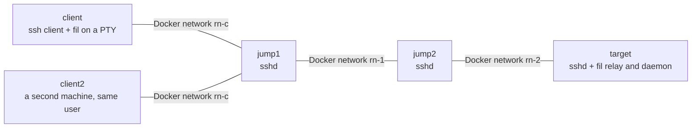
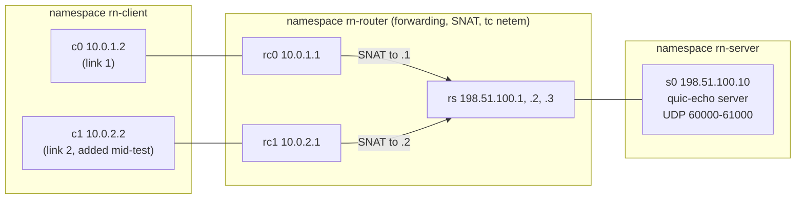
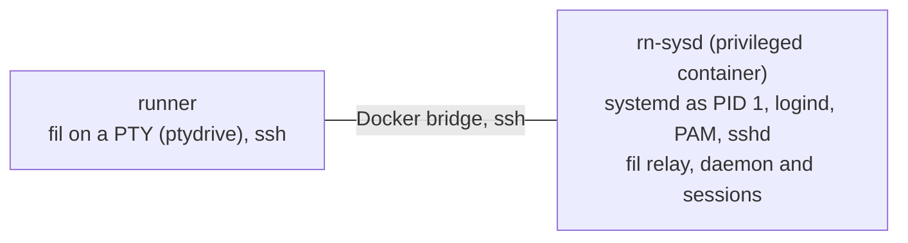

# Real-network test harness (Tier 1)

Everything fil was first tested against ran in process: `fil-netsim` stands in for ssh and for UDP. This harness runs the same questions against the real thing, with no mocks between the program and the network:

- **The pipe** over real OpenSSH (`ssh -T -- HOST fil server --stdio`, DESIGN.md section 8.2), through jump hosts, with certificates, ControlMaster and hostile shells.
- **Direct QUIC** over the real Linux network stack (DESIGN.md section 8.3): real NAT with conntrack, real `tc netem`, real route changes.
- **systemd**, for the session scope (DESIGN.md section 5.1): a host with a real user manager, logind and PAM.

Two kinds of program run under it. The **real `fil` binary** (since M1 P7a): the client on a pseudo-terminal, the relay (`fil server --stdio`) and the daemon, all started the way a user starts them. And the **stand-ins** in `fil-testbins`, which came first and use the real protocol code in small programs: they measure things the real binary does not print (raw quinn behaviour, netem, detection times of the bare pipe). The M1 "done when" item "the real-network suite passes on the real `fil` binary" is the first kind; the second stays because the numbers it gives are still the input to design decisions.

It is a manual check, like the rest of `linux-check`. It is never part of `just ci`.

## The test programs (`crates/fil-testbins`, test-only, `publish = false`)

The first two drive the real binary; the rest are the stand-ins.

| Program | What it is | Uses |
|---|---|---|
| `ptydrive serve NAME -- COMMAND...` and `ptydrive ctl NAME VERB` | The terminal for the real `fil` client. `serve` runs COMMAND on a pseudo-terminal (200 rows by 100 columns, so a test's whole output stays on the screen) and keeps a headless screen of what it prints. `ctl` types (`send '\r~.'` is Enter, then the detach escape), waits for text on the screen or in the raw output, prints the screen, and reads the exit status. Scenarios call it between `docker exec`s and `kill`s | `portable-pty`, `vt100` |
| `sockprobe PATH` | What a stranger sees when connecting to a Unix socket: refused, hung up on, or greeted | |
| `pipe-echo` (no arguments) | stand-in for `fil server --stdio`: writes the preamble, then echoes every frame it decodes | `preamble::encode`, `FrameDecoder` |
| `pipe-echo client [options] -- COMMAND...` | the client end of the pipe: runs `ssh ...`, finds the preamble, checks every echoed byte | `PreambleScanner`, `FrameDecoder`, `DataSegment` |
| `pipe-probe` (no arguments) | `fil server --stdio` once the daemon exists: writes the preamble, then runs a real `PipeLink` on stdio and echoes every payload | `PipeLink::accept_halves` |
| `pipe-probe client [options] -- COMMAND...` | the client end through the real `PipeLink::spawn`: sends numbered terminal data, verifies the echo, prints every state change and how the link ended | `PipeLink`, `PipeCommand` |
| `pipe-detach daemon` and `pipe-detach slow` | the detach-delivery test: the daemon side of a detach (writes `detached` or `lost` to a file), and an ssh stand-in that holds inbound chunks back and takes them with it when killed | `PipeLink` |
| `quic-echo server` | the daemon's endpoint: binds a port in a range, echoes streams, logs every handshake and every path change | `DaemonIdentity`, `KeyRegistry`, `auth::server_config`, `peer_key` |
| `quic-echo client` | the client: pins the fingerprint, presents a per-attach key, measures stalls, reconnects with a fresh handshake | `ClientKey`, `auth::client_config` |
| `quic-echo udp-send`, `udp-recv` | nothing: a numbered-datagram probe that measures whether a path reorders | |
| `quiclink-probe server` / `client` | the same two roles, built on the real `QuicListener` and `QuicLink` (P2): Retry, rate limits, the accept proof, `Degraded`, `Down(Dead)`, `path_generation` | `fil_transport::quic` |

`pipe-echo` takes no arguments on purpose. The harness runs it as the fixed remote command, as `fil server --stdio` is run.

**The bootstrap is files.** In production the client's public key and the daemon's fingerprint cross the authenticated pipe (DESIGN.md §4.1). Here they cross the filesystem: the client writes its public key, the server registers it and writes an acknowledgement, and the client then reads the fingerprint and pins it. The server's registry and the client's pin are the real ones. Only the transport of those two values is faked. Keys are generated in memory, as in the design. The harness's SSH keys are generated at run time in a temporary directory that is removed at the end, and nothing secret is committed.

Both programs are built statically for `x86_64-unknown-linux-musl` (`aarch64` on an ARM box), so they drop into any container and run unchanged in network namespaces. Their output is `KEY k=v` lines that the bash scenarios parse.

## Topologies

### Pipe: real OpenSSH in Docker



The three Docker networks are `--internal`, so the target is reachable only through the two jumps. The first scenario proves it: ssh to `target` by name and by address both fail from the client, and the target's sshd logs the login as coming from jump2's address. All five containers use one image (Ubuntu 24.04 pinned by digest, OpenSSH 9.6, the real `fil` and the static test programs: the stand-ins, `ptydrive`, `sockprobe`). Host keys are generated when each container starts.

Accounts on every host: `fil` (clean), `noisy` (`.bashrc` echoes text), `loud` (prints 60000 bytes) and `flood` (prints 100000 bytes), and for the real-`fil` scenarios `mallory` (a second ordinary user) and `victim`, `victim2`, `victim3` (users whose socket directory somebody else prepared). The client runs as `tester`. A host reached without a jump is `jump1`; `ssh direct` goes there. A second client machine, `client2` (same image, same user and keys), takes sessions over from `client`. Containers have their own host names, so the "taken over by ..." message names a real machine, and run under `--init` (a PID 1 that reaps orphans, so "the process is gone" is not fooled by zombies).

The image carries the real `fil` (in `/usr/bin`, on the default PATH of an ssh command, as the default pipe command needs). The users `fil`, `noisy` and `mallory` have `~/.config/fil/daemon.toml` with `direct = false` (there is no UDP path here) and `idle_exit_secs = 0` (the daemon never retires between scenarios); `tester` has a client config with `transport = "pipe"`.

### Direct: network namespaces with NAT and netem



- The server has no route to the client's private addresses, so the NAT is load-bearing. The first test checks that the server sees the router's address, not the client's.
- Each client link is NATed to a different public address (like Wi-Fi and cellular), so a link change is visible to the server. A third address (`.3`) is used to move the NAT pool.
- `tc netem` sits on the router's egress interfaces: `rs` carries client to server, `rc0` and `rc1` carry server to client. Every packet crosses exactly one netem instance, so `delay 40ms` means 40 ms one way.
- Segmentation offloads are switched off on every interface. Otherwise netem would delay and drop 64 KiB GSO bursts instead of packets.
- Documentation addresses (RFC 5737) and RFC 1918 only. Nothing here is a real host.

**The real `fil` needs an ssh path in this topology too** (it logs in over the pipe first, then upgrades). The choice: run the runner's own `sshd` inside `rn-server` (on `198.51.100.10:22`, a throwaway host key, public-key logins only, one allowed user) and have the client reach it through the same router. The alternatives were a Docker container attached to the namespace (needs more plumbing and a second sshd build) and ssh over loopback (would skip the NAT, which is the point). The ssh traffic crosses the same NAT and netem as the UDP; only UDP is ever dropped, so the pipe keeps working while QUIC does not. The harness makes two users for the run, `rnclient` (runs `ptydrive` and `fil` in `rn-client`) and `rnfil` (the account on the "server"), a throwaway key pair and an ssh config with `Host srv` (`HostName 198.51.100.10`); it puts the three binaries in a fresh `mktemp -d` directory (`/tmp/rn-udp-bin.XXXXXX`, recorded in `udp.env` for the scenario processes), first on the client's `PATH` and, through sshd's `SetEnv PATH=...`, on the `PATH` of the sessions sshd starts (so `ssh srv fil server --stdio` finds the `fil` under test; setup checks it), and removes users, keys and that directory at the end. Nothing is installed into `/usr/local/bin`. `fil srv` finds the UDP address the way a user's setup does, from `ssh -G srv`. Nothing secret is committed; the keys are made at run time.

### systemd: a host with a user manager



A privileged container whose PID 1 is systemd (cgroup v2), with logind, dbus, `libpam-systemd` and an sshd with `UsePAM yes`, so each login is a logind session with `XDG_RUNTIME_DIR` and `systemd-run --user` works as on a real host. The client runs on the runner and logs in with a throwaway key over the Docker bridge. `loginctl enable-linger` and `disable-linger` switch the conditions. This works on GitHub's `ubuntu-24.04` runners without any special setup (see Results).

## Running it

On a Linux box with Docker, passwordless root, `iproute2`, `iptables`, `conntrack` and `ethtool` (and `musl-tools` for the static build):

```bash
just realnet            # all three parts
just realnet ssh        # Docker topology only
just realnet udp        # namespaces only
just realnet sysd       # the systemd host only
just realnet udp f_upgrade f_nat_rebind   # named scenarios
```

On macOS (or without the tools) it refuses with a message and exits 2. From anywhere:

```bash
gh workflow run linux-check --ref BRANCH -f ref=BRANCH -f suite=realnet
```

`suite` is `check` (default: `just ci` and the on-demand harnesses), `realnet`, `aarch64` (the static binary for the lab Pis, `docs/m1/pi.md`) or `all`. The three realnet parts run as parallel jobs; each uploads its logs and per-scenario outputs as an artifact and writes the results table to the job summary. Exit status is non-zero if any scenario fails.

The scripts are in `tests/realnet/`: `run.sh` (entry), `ssh.sh`, `udp.sh` and `sysd.sh` (one bash function per scenario, each run in its own process so `set -euo pipefail` applies), `lib.sh` (assertions, parsing, the summary table), `fil.sh` (driving the real client through `ptydrive`: start, type, wait for text, exit status, the client's log), `build.sh` and `docker/`. `shellcheck` is part of the CI job. The scenarios named `f_*` use the real `fil`; `s_*` are the stand-in scenarios.

**Known findings.** When a scenario catches a defect in fil itself, it records `KNOWN-BUG: ...` in its measurements and carries on, so one finding does not hide the results after it. A scenario that recorded one passes with the status `PASS*` in the table, so a green run cannot be skimmed as clean. `REALNET_STRICT=1` makes them fail (`just realnet` with the variable set; in the workflow, the `strict` input: `gh workflow run linux-check -f suite=realnet -f strict=true`, default off). The current list is under "Real binary: findings".

## Results: the real `fil` binary

From [run 41575537104](https://github.com/anthonytw/fil/actions/runs/41575537104) (GitHub `ubuntu-24.04`, `fil` built for `x86_64-unknown-linux-musl`, static). All three parts passed; one scenario reports a known finding (below). The measurements come from that run unless a range is given; a range is over the runs in which the scenario worked. One shared runner VM: timings are indicative.

### ssh topology (client, two jumps, target; `fil` over the real OpenSSH pipe)

| Scenario | What it checks | Result |
|---|---|---|
| `f_attach_detach` | attach to `direct`, run a command, `~.`; `fil ls`; attach again | pass: shell prompt 300 to 380 ms after the start; `~.` printed `detached from session` and exited 0; the second client saw the earlier output on its screen and the same shell (same pid) |
| `f_detach_delivery` | ten attach and `~.` cycles on one session; every cycle must find the same shell, the session must stay listed, and `fil ls` must stop listing the client as attached within 5 s. `DETACH_LOST_MAX` is 0: any lost detach fails | **0 of 10 lost** since #31 ([run](https://github.com/anthonytw/fil/actions/runs/41580011372)); before the fix, finding 1: 3 of 10 never reached the daemon, in each of three runs. (The single-cycle check in `f_attach_detach` lost one of the 3 runs that polled for 18 s; in the others `fil ls` showed the session detached after 237 to 276 ms) |
| `f_ls_kill_detach` | `fil ls` shows who is attached; `fil detach` tells the client; `fil kill` of an attached session; kill again | pass; the client of a killed session exits **129** (SIGHUP), see finding 2 |
| `f_takeover` | a second machine (`client2`) attaches to a session held by `client` | pass: the first client was told `by client2` with the time, answered `n` and exited 1 with `was taken over by client2 ... (left alone)`; the second screen showed the earlier output; `fil ls` named `client2` |
| `f_takeover_back` | the first client answers `y` (take it back) | pass: the second client is told in turn (`by client`, not `client2`); the first client's screen shows a line the second client printed while it held the session, so the take-back really carries the session's state; a working shell again |
| `f_kill_ssh` | `kill -9` the client's ssh in the middle of a 15 s output run | pass: a new ssh was running **0.9 to 1.2 s** later; `TICK-1` to `TICK-60` each once, in order, no gap marker, the session continued |
| `f_daemon_restart` | `kill -9` the daemon | pass: the client said `is a different session now (killed and recreated, or the daemon restarted)` after **1.4 to 1.6 s**; answering `n` exited 1 with that message; a second session, answering `y`, got a fresh working shell |
| `f_noisy` | `.bashrc` prints on every login | pass: the client's warning (`your shell printed this before fil started`) with the text, `fil ls` printed it too; the session works. Note the warning is printed before the first snapshot, which pushes it into the scrollback |
| `f_proxyjump` | through both jumps | pass: the shell is on `target`, the target's sshd logged a new login, and the pipe command is `ssh viajumps fil server --stdio` |
| `f_tree_scope` | no systemd on the host: the process tree | pass: no scope; `fil kill` ended the shell and its background job |
| `f_other_user` | a second Unix user, the peer-UID check and the directory checks | pass, see below |

`f_other_user` in detail:

- The socket directory is `0700` and the socket `0600`, both the user's. `mallory` cannot list the directory, and connecting to the socket fails with `EACCES`.
- With the directory and socket opened by hand (as root: `711` and `666`) so that only the daemon's own check remains, `fil`'s own connection is accepted and greeted (the daemon speaks first), and `mallory`'s is hung up on at once; the daemon logs `refused a connection from another user` with `peer_uid` set.
- A directory `/tmp/fil-UID` made by another user: `fil server --stdio` exits with `/tmp/fil-1007 is owned by uid 1006, not by uid 1007; refusing to use it`. With mode `0755`: `has mode 0755, not 0700`. A symbolic link: `exists but is not a directory (or is a symbolic link)`. No daemon was started in any of the three.
- Two users on one host get two daemons and two directories; `mallory`'s `fil ls` on a host where `fil` has a session says `no sessions`.

### UDP topology (NAT and netem; real `fil`, sshd in the server namespace; 40 ms round trip)

| Scenario | What it checks | Result |
|---|---|---|
| `f_upgrade` | `fil srv` over `auto` | pass: the client log shows `Switched(Direct)` **0.17 s after the attach reply and 0.92 to 0.94 s after the process started** (the first prompt came at 0.8 to 1.4 s, the ssh login being most of that); the check allows 1.5 s from the attach reply; the ssh process was closed after the switch; the router's conntrack held the UDP flow to the daemon's port; 40 ticks over direct arrived once each in order |
| `f_nat_rebind` | three NAT moves under a 22 s output run (new port, another new port, a new address; each flushes conntrack). After each move the router's `conntrack -L` must show the client's flow mapped to the new address and a port in the new range, or the scenario fails | pass: `TICK-1` to `TICK-90` once each in order, no gap marker, **no further switch** after the upgrade and no ssh started: the session stayed on direct |
| `f_udp_blocked_mid` | UDP dropped for good in the middle of an output run | pass: a new ssh was running **5.1 to 5.2 s** after the block (QUIC `Degraded` at 2 s, `Down(Dead)` at 5 s, then the pipe); `TICK-1` to `TICK-120` once each in order across the fallback. After the block was lifted the client went back to direct **11 to 16 s later** (the path manager's retry backoff) |
| `f_udp_blocked_start` | UDP dropped before the attach | pass: first prompt at 0.8 s (QUIC does not delay the pipe); 15 s of output over the pipe, never switched; 3 to 4 failed direct dials in that time, none visible to the user |

### systemd host (`sysd`)

| Scenario | What it checks | Result |
|---|---|---|
| `f_linger_scope` | `loginctl enable-linger`; a session with a plain background job and one started with `setsid nohup` | pass: a running user scope `fil-<32 hex>.scope` (no session name in it or its description); the shell, the background job and the job that left the process tree are all in it; `fil kill` ended all three, and the scope was gone |
| `f_no_linger_tree` | lingering off | pass: no scope; the shell is in the session scope of the login; `fil kill` ended the shell and the plain background job. The `setsid` job **survived** (it left the process tree and was reparented to init): the documented limit of the fallback, which the scope does not have |

A privileged container with systemd as PID 1 starts on GitHub's `ubuntu-24.04` runners without any setup beyond `--privileged` and tmpfs on `/run` (boot in a few seconds, state `running`). The run is not special-cased.

### Real binary: findings

These are defects or surprises in `fil` itself, found by this suite. None is fixed here (this package owns only the tests).

1. **Fixed in #31.** A clean detach (`~.`) over ssh was lost about one time in three. The cause: the client closed its link without flushing or waiting, so the pipe dropped the queued `Detach` or `fil` exited and killed ssh before ssh sent it. Now the client waits up to 1 s for its typed input to be acknowledged, sends `Detach`, waits up to 2 s for the daemon to hang up (3 s at most in all), and `f_detach_delivery` requires 0 of 10 lost. The original report: The client sends `Detach` and closes; the daemon logs `attach ended ... LinkDown(Io("end of stream"))` instead of a detach, and `fil ls` keeps listing the client as attached (`client for 19s`, growing) until somebody takes the session over. Reproduce: `fil HOST s`, wait for the prompt, Enter then `~.`, then `fil ls HOST` at once; repeat (`just realnet ssh f_detach_delivery` counts it). It did not happen in the local run without ssh. Suspected cause: `Link::flush` on the pipe returns when the bytes are written to the ssh process's stdin, and the client then kills or closes ssh before ssh has sent them. Worth checking in `close_after_flush`.
2. **`fil kill` makes the client exit 129, not 137.** `docs/m1/binary.md` says a killed session exits 137 (signal 9). The daemon hangs up first (SIGHUP, then SIGKILL after a grace), and bash dies of the hangup, so the client reports `killed by signal 1 (SIGHUP)` and exits 129. Either the document or the wording is out of date.
3. **The first-attach banner warning scrolls out of the screen.** Not a defect: the warning is printed, then the snapshot pushes the screen into the scrollback (by design, so earlier work is kept). Recorded because a screen-based check misses it; the suite looks at the raw output.
4. **Tree fallback limit (known).** `setsid` and other double-forked processes outlive `fil kill` without a systemd scope (`f_no_linger_tree`).

## Results: the stand-ins

Three stand-in scenarios are **retired from the default run** because the real binary now covers what they showed (they still run by name, and their results below stand): `s_pipelink_echo` (PipeLink at both ends through the jumps and the noisy login: `f_proxyjump`, `f_noisy`, `f_attach_detach`), `s_pipelink_kill_ssh` (`f_kill_ssh`, which also checks the session resumes) and `s_quiclink_rebind` (`f_nat_rebind`). The rest stay: they measure what the real binary does not print (raw quinn, netem, the bare pipe's detection times, the QuicLink state changes).

From [run 41531920383](https://github.com/anthonytw/fil/actions/runs/41531920383) (GitHub `ubuntu-24.04`, image 20261021.618). Both parts passed. A fourth run of the final commit (after merging main, [run 41533608653](https://github.com/anthonytw/fil/actions/runs/41533608653)) passed too. Timings are from the first of those; ranges over the runs are noted where they matter. The ranges come from four runs of the same scripts (three for the scenarios added after the first run: NAT rebinding, the quiet and keystroke blackouts). One runner, a shared VM: treat throughput as indicative only.

### Pipe over OpenSSH

| Scenario | What it checks | Result |
|---|---|---|
| `s_topology` | target unreachable except through the jumps | pass |
| `s_direct` | 8 MiB framed echo, byte-exact, one hop | pass, 248 Mbit/s (248 to 498 over four runs), preamble at 193 ms |
| `s_jumps` | the same through `ProxyJump jump1,jump2` | pass, 238 Mbit/s (201 to 272), preamble at 491 ms |
| `s_controlmaster` | second session reuses the master | pass: no second login on the target, preamble 491 ms then 11 ms |
| `s_certs` | login with an SSH user certificate from a per-run CA, through both jumps | pass: valid certificate works (the sshd logs show `ED25519-CERT`); the same key without the certificate, with an expired one, and with the wrong principal are refused, and the driver reports it (status 4) instead of hanging |
| `s_noisy` | `.bashrc` prints before the program starts | pass: scanner skipped 48 bytes, reported them (control characters stripped), transfer byte-exact; 60000 bytes of noise (under the bound) also pass |
| `s_flood` | `.bashrc` prints 100000 bytes | pass: driver gives up with "no preamble" after 204 ms, having held 96 to 128 KiB (the 64 KiB bound plus a read); remote program cleaned up |
| `s_hostile_names` | 17 hostile names (command substitution, quotes, newlines, `-oProxyCommand=`, NUL, invalid UTF-8) inside frames | pass: all came back byte-exact, no canary file on any host, the remote command line is exactly `pipe-echo`. Control: the same text interpolated into the remote command string does run |
| `s_kill_ssh_client` | `kill -9` the ssh client mid-stream | pass: driver sees EOF in 1 ms (1 to 4 ms), remote program exits |
| `s_kill_sshd_child` | `kill -9` the target's per-connection sshd | pass: EOF in 6 ms (4 to 26 ms) |
| `s_netdown_app_heartbeat` | `docker network disconnect` jump2 from the target's network; only the driver's own 5 s silence rule is active | pass: dead after **4.9 s** |
| `s_netdown_ssh_keepalive` | same, only ssh's keepalive (`ServerAliveInterval 2`, `ServerAliveCountMax 3`) | pass: ssh gives up after **7.5 s** ("Timeout, server target not responding", status 255) |
| `s_netdown_no_detection` | same, neither | the client was **still waiting after 25 s**. This is the control that shows why a detector is needed |
| `s_pipelink_echo` | `PipeLink::spawn` at both ends (`pipe-probe`), through both jumps and through the noisy login | pass: byte-exact echo for 4 s, RTT 0.8 ms; ssh was started with `ServerAliveInterval=2 ServerAliveCountMax=3`; the noisy login's 48-byte banner was kept and shown with control characters stripped |
| `s_pipelink_flood` | 100000 bytes of shell noise, through `PipeLink::spawn` | pass: refused with "no preamble" after 189 ms, 80 KiB held (the bound plus a read), the local ssh and the remote program both gone |
| `s_pipelink_kill_ssh` | `kill -9` the ssh client under a live `PipeLink` | pass: `Down(Io)` in 1 to 2 ms, the reason names the signal, the remote program exits |
| `s_pipelink_netdown_heartbeat` | the black hole again, with fil's ssh keepalive switched off | pass: `Degraded`, then `Down(Dead)` after **4.9 s**, and the dead link's ssh was killed |
| `s_pipelink_netdown_keepalive` | the same with the keepalive fil normally adds (`ServerAliveInterval=2`, ssh gives up at 6 to 8 s) | pass: `Down(Dead)` after **4.9 s**, well before ssh's own 8 s, and ssh was killed at once |

Notes on the ssh results:

- **Clean closes are instant.** A killed ssh client or a killed sshd is a FIN or reset, and the client sees EOF within milliseconds, at every hop of the jump chain.
- **A silent black hole is not detected by ssh unless it is told to.** With no keepalive the stream just stops, with no error, for as long as the TCP connection lives (Linux's default TCP retry limit is about 15 minutes). fil's own heartbeat (`DEAD_AFTER` 5 s, over the pipe) found the break in 4.9 s without any ssh option. ssh's keepalive found it at interval times (count + 1), about 8 s, and also tears the ssh process down. Both are needed in production: the heartbeat for the fast answer, `ServerAliveInterval` so a dead ssh process does not linger.
- **fil's heartbeat finds the black hole by itself.** `s_pipelink_netdown_heartbeat` runs the real `PipeLink` with the ssh keepalive off: the link reports `Degraded` and then `Down(Dead)` at 4.9 s, the same time as the stand-in driver, and kills the ssh process rather than leaving it behind. With the keepalive on (the default) fil still wins, because the options it adds make ssh give up no earlier than `interval x count`, which is at least `dead_after` (6 to 8 s by default).
- The banner is a pre-authentication message: sshd sends it on stderr, never on the stream. The clean-login scenario asserts the preamble is the first thing on stdout.
- Through two jumps, the handshake costs about 490 ms to the first byte, against 190 ms direct. A ControlMaster session starts in 11 ms.

### Direct QUIC over NAT and netem

| Scenario | What it checks | Result |
|---|---|---|
| `s_netem_reorder_probe` | does netem reorder when it adds jitter? (3000 numbered datagrams, 1 ms apart) | clean: 0 reordered. `delay 55ms 15ms`: **2269 of 3000 reordered** (up to 29 positions). The same with `rate 1gbit`: **0 reordered** |
| `s_clean` | 32 MiB echo, byte-exact, NAT in the path | pass, one handshake in about 1 ms, 501 Mbit/s (378 to 709); the server saw `198.51.100.1`, not the client's own address; the port was in 60000 to 61000 |
| `s_port_range` | four servers on 60000-60003, then a fifth | four distinct ports in range; the fifth exits with status 3 and `NO-FREE-PORT` |
| `s_impaired` | 2 MiB echo under impairments (table below) | all pass: intact, one handshake each |
| `s_nat_rebind` | three NAT moves during a 16 s stream: new public port, another new port, then a new public address. Each move re-points the SNAT rule and flushes conntrack | pass: **one handshake**, no loss of the connection, the server's path changed 3 times, learned each move after 51, 84 and 54 ms (49 to 84 ms over three runs), longest stall 140 ms (121 to 140) |
| `s_ip_change` | add a second client address and route, switch the default route, take the first link down | pass: one handshake, the server learned the new public address after 77 ms, longest stall 180 ms |
| `s_blackouts` | UDP dropped at the router for N seconds (table below) | pass |
| `s_udp_blocked` | UDP dropped: how long until the client knows | pass: see below |
| `s_quiclink_rebind` | `s_nat_rebind` through `QuicLink`: three NAT moves during a 16 s stream at 512 KiB/s | pass: see [QuicLink](#quiclink-through-the-same-faults) |
| `s_quiclink_udp_blocked` | UDP blocked from the start, and blocked mid-session for good | pass: see below |
| `s_quiclink_blackouts` | 3 s, 4.5 s and 8 s blackouts with the probe reconnecting as the path manager would | pass: see below |

**Impairments** (2 MiB echo, 40 ms one way, `LivenessParams` defaults). Seconds. The simulator column is `docs/spikes/netsim.md`.

| Conditions | Real, run above | Real, four runs | Simulator |
|---|---|---|---|
| clean | 0.78 | 0.75 to 0.78 | 0.8 |
| 30 ms jitter, in order | 1.17 | 1.17 to 1.21 | 1.2 |
| 5% loss | 21.7 | 21.7 to 27.8 | not measured |
| 8% loss | 34.2 | 32.5 to 39.1 | 34 |
| 30 ms jitter, in order, 5% loss | 48.6 | 46.1 to 51.5 | 63 |
| 30 ms jitter, netem plain (reorders) | 49.9 | 47.5 to 49.9 | 53 |
| 1% of packets held back 80 ms | 11.3 | 9.1 to 12.7 | 12 |
| 10% of packets held back 10 ms | 21.4 | 19.4 to 23.6 | 26 |

**Blackouts** (UDP dropped at the router, idle timeout 5 s, keep-alive 1 s, 20 ms one way):

| Blackout | Traffic | Result |
|---|---|---|
| 3.0 s | stream | survives; first data 57 ms after the link returns |
| 4.0 s | quiet | survives |
| 4.5 s | stream | **lost** after 5033 ms; a fresh handshake 0.4 s later |
| 4.5 s | quiet | **lost** after 5189 ms; fresh handshake |
| 4.9 s | quiet | **lost** after 5191 ms; fresh handshake |
| 4.5 s | quiet, one keystroke when the link returns | **survives**; first echo 50 ms after the link returns |
| 4.9 s | quiet, one keystroke when the link returns | **survives**; first echo 50 ms after |
| 5.5 s | quiet, one keystroke when the link returns | lost after 5189 ms; fresh handshake |
| 5.5 s and 8.0 s | stream | lost after 5033 ms; fresh handshake once the link is back (2.8 s and 4.8 s after the loss, which includes the rest of the blackout) |

"Stream" is 256 KiB/s of echoed data. "Quiet" is nothing but keep-alives.

**UDP blocked** (the input for the fallback to the pipe, DESIGN.md §4.1 and §4.2):

| Situation | How long until the client knows |
|---|---|
| blocked from the start, idle timeout 5 s | the connect attempt fails at **5.0 s** |
| blocked from the start, idle timeout 15 s | it fails at **15.0 s** |
| blocked in the middle of a session, never lifted | the connection ends **5.03 s** after the last packet, reason `TimedOut` |

### QuicLink through the same faults

P2's `QuicLink` and `QuicListener` (`docs/m1/quic-link.md`), driven by `quiclink-probe` through the same topology. One run of the udp suite on a GitHub runner (linked in the pull request); all three scenarios passed, and the second run repeated the numbers within noise.

| Scenario | Result |
|---|---|
| `s_quiclink_rebind` | one accepted link, echo intact, never lost. The daemon's link counted **3 path changes** (`path_generation` 3), the last one to the third public address, and never left `Up`. The client's own `path_generation` stayed 0: a client cannot see its NAT rebind. The listener's first packet from the client got a Retry |
| `s_quiclink_udp_blocked`, blocked from the start | `Refused` after **2000 ms**, the connect timeout, against 5 s and 15 s (the idle timeout) for raw quinn in `s_udp_blocked`. The daemon never accepted anything |
| `s_quiclink_udp_blocked`, blocked mid-session, never lifted | `Degraded` after **2.0 to 2.1 s**, `Down(Dead)` after **5.07 s** |
| `s_quiclink_blackouts` 3 s | survived: `Degraded`, then `Up` again, one link, echo intact |
| `s_quiclink_blackouts` 4.5 s | **lost** (`Down(Dead)` 5.07 s after the block began, as in `s_blackouts`: an unprompted link does not survive 4.5 s); the probe's fresh handshake with the same key was up **670 ms** after the network came back (the redial loop in the probe waits 200 ms between tries, and the path manager redials at once) |
| `s_quiclink_blackouts` 8 s | lost at 5.07 s; fresh handshake **275 ms** after the network returned |

The quic-echo blackout result stands: a link that is quiet when the network comes back is lost at the idle timeout whether the blackout lasted 4.5 s or 8 s. What changes is what the layer above sees: the link says so (`Down(Dead)`) 5 s after the last datagram, never later, and the redial takes about 0.3 to 0.7 s, so the worst case for a blackout of N seconds is about max(N, 5) + 0.7 s.

## Real versus simulator

The two agree on almost everything, which is the main result: the simulator's numbers were a good predictor.

- **Impairments agree** to within run-to-run noise (single runs, extremes up to 40% apart on the lossy rows). Most real rows are within about 15% of the simulator; the jitter-plus-loss and 10%-reordering rows are 23% and 18% faster. The qualitative result holds: in-order jitter is cheap, loss is costly, and reordering is where quinn suffers (1% of packets held back 80 ms cost about 15 times a clean transfer in the simulator and about 14 times for real).
- **NAT rebinding agrees.** The connection survives with one handshake; a same-IP port change and a new-IP change both migrate. The old mapping dies at once in both worlds (a conntrack flush does what the simulator's `rebind` does). The real cost is small: the server learns in about 50 to 85 ms, and the longest stall was 140 ms. The simulator's timing figures (5.2 s against 7.9 s for the whole transfer) were noise and say nothing about stalls.
- **Disagreement: blackouts near the idle timeout.** The simulator reported that a 4.9 s blackout survives and 5.0 s does not, a sharp cutoff at `max_idle_timeout`. On the real network an unprompted connection **does not survive a 4.5 s blackout**, on a quiet link or a busy one. It survives 4.0 s. The explanation is in how that table was measured: the simulator test sent an echo the moment the link came back. With the same keystroke, the real connection survives 4.5 s and 4.9 s too (the echo returns in 50 ms) and is lost at 5.5 s, matching the simulator. Without it, nothing is sent after the link returns except the loss-recovery probes, whose spacing grows exponentially during the blackout, and the next probe falls after the idle timer expires. This is a hypothesis that fits all the numbers; the PTO schedule was not logged. It does not contradict the design (§4.2 already plans for a fresh handshake) but it moves the practical cutoff from 5 s to somewhere between 4.0 and 4.5 s when the user is not typing, and the real timeout fires 5.03 s (busy) or 5.19 s (quiet) after the last packet, a little after the nominal 5 s. The quiet case is probably the idle timeout stretching to three probe timeouts, as RFC 9000 section 10.1 requires; this too is not measured.
- **Netem is not the simulator's default jitter.** The simulator keeps jitter in order and reorders only when asked. Netem reorders by default (2269 of 3000 datagrams at 30 ms of jitter on 1 ms spacing). Adding `rate` makes it in-order, because with a rate limit netem queues each packet behind the previous one. The harness uses the `rate 1gbit` form for the "in order" rows and the plain form for the "reordering" row. The simulator's jitter is uniform from 0 to J added to the latency; netem's is uniform within plus or minus J around the delay, so "30 ms jitter" is `delay 55ms 15ms` here. The plain-netem result (49.9 s) is close to the simulator's opt-in `jitter_reorders` (53 s).
- **Simulated NAT is harsher in one way only.** The simulator drops the old mapping at once. So does a conntrack flush plus an SNAT change. A NAT that keeps the old mapping for a while is more lenient than either; the harness does not model one.

## What this tells M1

- **Run the heartbeat over the pipe, and also set `ServerAliveInterval`.** A black-holed ssh connection never errors on its own. Detection took 4.9 s with the 5 s heartbeat and 7.5 s with ssh keepalive alone (2 s interval, 3 misses).
- **Detecting a clean close needs nothing:** EOF within milliseconds.
- **Direct-mode fallback needs its own, shorter connect timeout.** With UDP blocked, quinn's connect fails only after `max_idle_timeout` (5.0 s by default, 15 s when that is 15 s). For `auto`, start the pipe at once and race the QUIC attempt against it, or cap the QUIC handshake at about 2 s.
- **A blackout longer than about 4 s costs one handshake (0.4 s once the link is back), not a hang.** The reconnect with the same key worked every time. If sub-5 s blackouts are common, a client that sends a ping when the network returns (an OS reachability change, a path event) would rescue the connection that a quiet link loses.
- **Roaming works as designed:** NAT rebinding and a client IP change both migrate without a handshake, with stalls of 140 to 180 ms.
- **The pipe preamble does its job** against a real login shell: noise is skipped and reported, and over 64 KiB is refused in 0.2 s without holding more than the bound plus one read.

## What the daemon and client should add

Done in M1 P7a (the sections above): the multi-user and permission tests, the systemd scope with and without lingering, the real bootstrap (relay starting the daemon, the fingerprint and key crossing the real pipe, QUIC to the reported port through NAT), resume under a killed ssh and a killed daemon, and pipe to QUIC and back. Still open:

- **The unauthenticated surface of the UDP port:** a UDP flood and spoofed Initial packets from the router namespace, to check the stateless retry and handshake rate limits (section 8.3, "exposure before authentication"). The one-UDP-port-per-user rule with two users.
- **More faults under the real client:** the relay killed (not only ssh), a blackout of 4 to 5 s under a quiet session, a path-MTU black hole (`ip link set mtu`, drop fragments), IPv6, a NAT that keeps the old mapping, and a user logging out with `KillUserProcesses=yes`.
- **Other pipes** (section 8.2): `docker exec -i` and `kubectl exec -i` are one-line additions to the Docker topology; remote shells other than bash (zsh, fish) for the noisy-login case; ssh agent forwarding.
- **The lab Raspberry Pis**: the same scenarios on aarch64 (`build.sh` already builds for it).

Out of scope here and later: lab hardware, macOS as a remote host, and real mobile networks (carrier-grade NAT, radio handoff).

## What was and was not verified

Verified on a runner: everything in the tables above, in the run linked at the top of each results section. The real-binary scenarios needed three runs to pass: the first run's failures were the harness's (a missing `ssh.socket` in the systemd image, the banner checked on the screen after it had scrolled off, the daemon's greeting mistaken for silence, and the runner's `XDG_CONFIG_HOME` leaking into the client's environment), plus one real finding (the lost detach, which is intermittent: it passed in one of the three runs of the first scenario that checks it).

Verified on a runner (stand-ins): Across the runs, one scenario failed once (NAT rebinding in the first run, on a missing `-p udp` in the SNAT rule; fixed), and the first run's 6.9 s heartbeat figure was a driver bug (the timestamp was taken after a 2 s wait for the child to exit; fixed, and it is 4.9 s). The hostile-name scenario has a positive control showing that the canary file would be created if the text reached a shell, so a passing result is not a blind check.

Assumed, not measured, for the real binary: that the four scenarios of the UDP topology behave the same on the lab's networks (the numbers are one runner's); that a systemd container on this runner stands in for a real host (cgroup v2, logind and a user manager are real, but there is no graphical session, no `KillUserProcesses=yes` and no real logout).

Assumed, not measured: the explanation for the blackout cutoff (probe timing, idle-timeout stretching); that the Ubuntu runner's veth and netem behave like a real link at these rates (the throughput numbers are the runner's, not a network's); that other OpenSSH versions behave like the one tested (9.6p1, logged by the harness) (the process title `sshd: USER@notty` that the sshd-kill scenario matches changed in later releases); and that one runner is typical.
