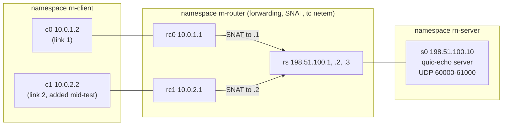

# Real-network test harness (Tier 1)

Everything fil has been tested against so far ran in process: `fil-netsim` stands in for ssh and for UDP. This harness runs the same questions against the real thing, with no mocks between the program and the network:

- **The pipe** over real OpenSSH (`ssh -T HOST pipe-echo`, DESIGN.md §8.2), through jump hosts, with certificates, ControlMaster and hostile shells.
- **Direct QUIC** over the real Linux network stack (DESIGN.md §8.3): real NAT with conntrack, real `tc netem`, real route changes.

The daemon and client (M1) do not exist yet, so the programs under test are two small stand-ins that use the real protocol code. When the daemon lands, swap the stand-in for `fil server --stdio` and the QUIC endpoint and keep the scenarios.

It is a manual check, like the rest of `linux-check`. It is never part of `just ci`.

## The stand-ins (`crates/fil-testbins`, test-only, `publish = false`)

| Program | Stands in for | Uses |
|---|---|---|
| `pipe-echo` (no arguments) | `fil server --stdio`: writes the preamble, then echoes every frame it decodes | `preamble::encode`, `FrameDecoder` |
| `pipe-echo client [options] -- COMMAND...` | the client end of the pipe: runs `ssh ...`, finds the preamble, checks every echoed byte | `PreambleScanner`, `FrameDecoder`, `DataSegment` |
| `pipe-probe` (no arguments) | `fil server --stdio` once the daemon exists: writes the preamble, then runs a real `PipeLink` on stdio and echoes every payload | `PipeLink::accept_halves` |
| `pipe-probe client [options] -- COMMAND...` | the client end through the real `PipeLink::spawn`: sends numbered terminal data, verifies the echo, prints every state change and how the link ended | `PipeLink`, `PipeCommand` |
| `quic-echo server` | the daemon's endpoint: binds a port in a range, echoes streams, logs every handshake and every path change | `DaemonIdentity`, `KeyRegistry`, `auth::server_config`, `peer_key` |
| `quic-echo client` | the client: pins the fingerprint, presents a per-attach key, measures stalls, reconnects with a fresh handshake | `ClientKey`, `auth::client_config` |
| `quic-echo udp-send`, `udp-recv` | nothing: a numbered-datagram probe that measures whether a path reorders | |

`pipe-echo` takes no arguments on purpose. The harness runs it as the fixed remote command, as `fil server --stdio` will be run.

**The bootstrap is files.** In production the client's public key and the daemon's fingerprint cross the authenticated pipe (DESIGN.md §4.1). Here they cross the filesystem: the client writes its public key, the server registers it and writes an acknowledgement, and the client then reads the fingerprint and pins it. The server's registry and the client's pin are the real ones. Only the transport of those two values is faked. Keys are generated in memory, as in the design. The harness's SSH keys are generated at run time in a temporary directory that is removed at the end, and nothing secret is committed.

Both programs are built statically for `x86_64-unknown-linux-musl` (`aarch64` on an ARM box), so they drop into any container and run unchanged in network namespaces. Their output is `KEY k=v` lines that the bash scenarios parse.

## Topologies

### Pipe: real OpenSSH in Docker


The three Docker networks are `--internal`, so the target is reachable only through the two jumps. The first scenario proves it: ssh to `target` by name and by address both fail from the client, and the target's sshd logs the login as coming from jump2's address. All four containers use one image (Ubuntu 24.04, OpenSSH 9.6, the two static binaries). Host keys are generated when each container starts.

Accounts on every host: `fil` (clean), `noisy` (`.bashrc` echoes text), `loud` (prints 60000 bytes) and `flood` (prints 100000 bytes). The client runs as `tester`. A host reached without a jump is `jump1`; `ssh direct` goes there.

### Direct: network namespaces with NAT and netem



- The server has no route to the client's private addresses, so the NAT is load-bearing. The first test checks that the server sees the router's address, not the client's.
- Each client link is NATed to a different public address (like Wi-Fi and cellular), so a link change is visible to the server. A third address (`.3`) is used to move the NAT pool.
- `tc netem` sits on the router's egress interfaces: `rs` carries client to server, `rc0` and `rc1` carry server to client. Every packet crosses exactly one netem instance, so `delay 40ms` means 40 ms one way.
- Segmentation offloads are switched off on every interface. Otherwise netem would delay and drop 64 KiB GSO bursts instead of packets.
- Documentation addresses (RFC 5737) and RFC 1918 only. Nothing here is a real host.

## Running it

On a Linux box with Docker, passwordless root, `iproute2`, `iptables`, `conntrack` and `ethtool` (and `musl-tools` for the static build):

```bash
just realnet            # both parts
just realnet ssh        # Docker topology only
just realnet udp        # namespaces only
just realnet udp s_nat_rebind s_ip_change   # named scenarios
```

On macOS (or without the tools) it refuses with a message and exits 2. From anywhere:

```bash
gh workflow run linux-check --ref BRANCH -f ref=BRANCH -f suite=realnet
```

`suite` is `check` (default: `just ci` and the on-demand harnesses), `realnet` or `all`. The two parts run as parallel jobs; each uploads its logs and per-scenario outputs as an artifact and writes the results table to the job summary. Exit status is non-zero if any scenario fails.

The scripts are in `tests/realnet/`: `run.sh` (entry), `ssh.sh` and `udp.sh` (one bash function per scenario, each run in its own process so `set -euo pipefail` applies), `lib.sh` (assertions, parsing, the summary table), `build.sh` and `docker/`. `shellcheck` is part of the CI job.

## Results

From [run 41531920383](https://github.com/anthonytw/fil/actions/runs/41531920383) (GitHub `ubuntu-24.04`, image 20261021.618). Both parts passed. A fourth run of the final commit (after merging main, [run 41533608653](https://github.com/anthonytw/fil/actions/runs/41533608653)) passed too. Timings are from the first of those; ranges over the runs are noted where they matter. The ranges come from four runs of the same scripts (three for the scenarios added after the first run: NAT rebinding, the quiet and keystroke blackouts). One runner, a shared VM: treat throughput as indicative only.

### Pipe over OpenSSH

| Scenario | What it checks | Result |
|---|---|---|
| `s_topology` | target unreachable except through the jumps | pass |
| `s_direct` | 8 MiB framed echo, byte-exact, one hop | pass, 248 Mbit/s (248 to 498 over four runs), preamble at 193 ms |
| `s_jumps` | the same through `ProxyJump jump1,jump2` | pass, 238 Mbit/s (201 to 272), preamble at 491 ms |
| `s_controlmaster` | second session reuses the master | pass: no second login on the target, preamble 491 ms then 11 ms |
| `s_certs` | login with an SSH user certificate from a per-run CA, through both jumps | pass: valid certificate works (the sshd logs show `ED25519-CERT`); the same key without the certificate, with an expired one, and with the wrong principal are refused, and the driver reports it (status 4) instead of hanging |
| `s_noisy` | `.bashrc` prints before the program starts | pass: scanner skipped 48 bytes, reported them (control characters stripped), transfer byte-exact; 60000 bytes of noise (under the bound) also pass |
| `s_flood` | `.bashrc` prints 100000 bytes | pass: driver gives up with "no preamble" after 204 ms, having held 96 to 128 KiB (the 64 KiB bound plus a read); remote program cleaned up |
| `s_hostile_names` | 17 hostile names (command substitution, quotes, newlines, `-oProxyCommand=`, NUL, invalid UTF-8) inside frames | pass: all came back byte-exact, no canary file on any host, the remote command line is exactly `pipe-echo`. Control: the same text interpolated into the remote command string does run |
| `s_kill_ssh_client` | `kill -9` the ssh client mid-stream | pass: driver sees EOF in 1 ms (1 to 4 ms), remote program exits |
| `s_kill_sshd_child` | `kill -9` the target's per-connection sshd | pass: EOF in 6 ms (4 to 26 ms) |
| `s_netdown_app_heartbeat` | `docker network disconnect` jump2 from the target's network; only the driver's own 5 s silence rule is active | pass: dead after **4.9 s** |
| `s_netdown_ssh_keepalive` | same, only ssh's keepalive (`ServerAliveInterval 2`, `ServerAliveCountMax 3`) | pass: ssh gives up after **7.5 s** ("Timeout, server target not responding", status 255) |
| `s_netdown_no_detection` | same, neither | the client was **still waiting after 25 s**. This is the control that shows why a detector is needed |
| `s_pipelink_echo` | `PipeLink::spawn` at both ends (`pipe-probe`), through both jumps and through the noisy login | pass: byte-exact echo for 4 s, RTT 0.8 ms; ssh was started with `ServerAliveInterval=2 ServerAliveCountMax=3`; the noisy login's 48-byte banner was kept and shown with control characters stripped |
| `s_pipelink_flood` | 100000 bytes of shell noise, through `PipeLink::spawn` | pass: refused with "no preamble" after 189 ms, 80 KiB held (the bound plus a read), the local ssh and the remote program both gone |
| `s_pipelink_kill_ssh` | `kill -9` the ssh client under a live `PipeLink` | pass: `Down(Io)` in 1 to 2 ms, the reason names the signal, the remote program exits |
| `s_pipelink_netdown_heartbeat` | the black hole again, with fil's ssh keepalive switched off | pass: `Degraded`, then `Down(Dead)` after **4.9 s**, and the dead link's ssh was killed |
| `s_pipelink_netdown_keepalive` | the same with the keepalive fil normally adds (`ServerAliveInterval=2`, ssh gives up at 6 to 8 s) | pass: `Down(Dead)` after **4.9 s**, well before ssh's own 8 s, and ssh was killed at once |

Notes on the ssh results:

- **Clean closes are instant.** A killed ssh client or a killed sshd is a FIN or reset, and the client sees EOF within milliseconds, at every hop of the jump chain.
- **A silent black hole is not detected by ssh unless it is told to.** With no keepalive the stream just stops, with no error, for as long as the TCP connection lives (Linux's default TCP retry limit is about 15 minutes). fil's own heartbeat (`DEAD_AFTER` 5 s, over the pipe) found the break in 4.9 s without any ssh option. ssh's keepalive found it at interval times (count + 1), about 8 s, and also tears the ssh process down. Both are needed in production: the heartbeat for the fast answer, `ServerAliveInterval` so a dead ssh process does not linger.
- **fil's heartbeat finds the black hole by itself.** `s_pipelink_netdown_heartbeat` runs the real `PipeLink` with the ssh keepalive off: the link reports `Degraded` and then `Down(Dead)` at 4.9 s, the same time as the stand-in driver, and kills the ssh process rather than leaving it behind. With the keepalive on (the default) fil still wins, because the options it adds make ssh give up no earlier than `interval x count`, which is at least `dead_after` (6 to 8 s by default).
- The banner is a pre-authentication message: sshd sends it on stderr, never on the stream. The clean-login scenario asserts the preamble is the first thing on stdout.
- Through two jumps, the handshake costs about 490 ms to the first byte, against 190 ms direct. A ControlMaster session starts in 11 ms.

### Direct QUIC over NAT and netem

| Scenario | What it checks | Result |
|---|---|---|
| `s_netem_reorder_probe` | does netem reorder when it adds jitter? (3000 numbered datagrams, 1 ms apart) | clean: 0 reordered. `delay 55ms 15ms`: **2269 of 3000 reordered** (up to 29 positions). The same with `rate 1gbit`: **0 reordered** |
| `s_clean` | 32 MiB echo, byte-exact, NAT in the path | pass, one handshake in about 1 ms, 501 Mbit/s (378 to 709); the server saw `198.51.100.1`, not the client's own address; the port was in 60000 to 61000 |
| `s_port_range` | four servers on 60000-60003, then a fifth | four distinct ports in range; the fifth exits with status 3 and `NO-FREE-PORT` |
| `s_impaired` | 2 MiB echo under impairments (table below) | all pass: intact, one handshake each |
| `s_nat_rebind` | three NAT moves during a 16 s stream: new public port, another new port, then a new public address. Each move re-points the SNAT rule and flushes conntrack | pass: **one handshake**, no loss of the connection, the server's path changed 3 times, learned each move after 51, 84 and 54 ms (49 to 84 ms over three runs), longest stall 140 ms (121 to 140) |
| `s_ip_change` | add a second client address and route, switch the default route, take the first link down | pass: one handshake, the server learned the new public address after 77 ms, longest stall 180 ms |
| `s_blackouts` | UDP dropped at the router for N seconds (table below) | pass |
| `s_udp_blocked` | UDP dropped: how long until the client knows | pass: see below |

**Impairments** (2 MiB echo, 40 ms one way, `LivenessParams` defaults). Seconds. The simulator column is `docs/spikes/netsim.md`.

| Conditions | Real, run above | Real, four runs | Simulator |
|---|---|---|---|
| clean | 0.78 | 0.75 to 0.78 | 0.8 |
| 30 ms jitter, in order | 1.17 | 1.17 to 1.21 | 1.2 |
| 5% loss | 21.7 | 21.7 to 27.8 | not measured |
| 8% loss | 34.2 | 32.5 to 39.1 | 34 |
| 30 ms jitter, in order, 5% loss | 48.6 | 46.1 to 51.5 | 63 |
| 30 ms jitter, netem plain (reorders) | 49.9 | 47.5 to 49.9 | 53 |
| 1% of packets held back 80 ms | 11.3 | 9.1 to 12.7 | 12 |
| 10% of packets held back 10 ms | 21.4 | 19.4 to 23.6 | 26 |

**Blackouts** (UDP dropped at the router, idle timeout 5 s, keep-alive 1 s, 20 ms one way):

| Blackout | Traffic | Result |
|---|---|---|
| 3.0 s | stream | survives; first data 57 ms after the link returns |
| 4.0 s | quiet | survives |
| 4.5 s | stream | **lost** after 5033 ms; a fresh handshake 0.4 s later |
| 4.5 s | quiet | **lost** after 5189 ms; fresh handshake |
| 4.9 s | quiet | **lost** after 5191 ms; fresh handshake |
| 4.5 s | quiet, one keystroke when the link returns | **survives**; first echo 50 ms after the link returns |
| 4.9 s | quiet, one keystroke when the link returns | **survives**; first echo 50 ms after |
| 5.5 s | quiet, one keystroke when the link returns | lost after 5189 ms; fresh handshake |
| 5.5 s and 8.0 s | stream | lost after 5033 ms; fresh handshake once the link is back (2.8 s and 4.8 s after the loss, which includes the rest of the blackout) |

"Stream" is 256 KiB/s of echoed data. "Quiet" is nothing but keep-alives.

**UDP blocked** (the input for the fallback to the pipe, DESIGN.md §4.1 and §4.2):

| Situation | How long until the client knows |
|---|---|
| blocked from the start, idle timeout 5 s | the connect attempt fails at **5.0 s** |
| blocked from the start, idle timeout 15 s | it fails at **15.0 s** |
| blocked in the middle of a session, never lifted | the connection ends **5.03 s** after the last packet, reason `TimedOut` |

## Real versus simulator

The two agree on almost everything, which is the main result: the simulator's numbers were a good predictor.

- **Impairments agree** to within run-to-run noise (single runs, extremes up to 40% apart on the lossy rows). Most real rows are within about 15% of the simulator; the jitter-plus-loss and 10%-reordering rows are 23% and 18% faster. The qualitative result holds: in-order jitter is cheap, loss is costly, and reordering is where quinn suffers (1% of packets held back 80 ms cost about 15 times a clean transfer in the simulator and about 14 times for real).
- **NAT rebinding agrees.** The connection survives with one handshake; a same-IP port change and a new-IP change both migrate. The old mapping dies at once in both worlds (a conntrack flush does what the simulator's `rebind` does). The real cost is small: the server learns in about 50 to 85 ms, and the longest stall was 140 ms. The simulator's timing figures (5.2 s against 7.9 s for the whole transfer) were noise and say nothing about stalls.
- **Disagreement: blackouts near the idle timeout.** The simulator reported that a 4.9 s blackout survives and 5.0 s does not, a sharp cutoff at `max_idle_timeout`. On the real network an unprompted connection **does not survive a 4.5 s blackout**, on a quiet link or a busy one. It survives 4.0 s. The explanation is in how that table was measured: the simulator test sent an echo the moment the link came back. With the same keystroke, the real connection survives 4.5 s and 4.9 s too (the echo returns in 50 ms) and is lost at 5.5 s, matching the simulator. Without it, nothing is sent after the link returns except the loss-recovery probes, whose spacing grows exponentially during the blackout, and the next probe falls after the idle timer expires. This is a hypothesis that fits all the numbers; the PTO schedule was not logged. It does not contradict the design (§4.2 already plans for a fresh handshake) but it moves the practical cutoff from 5 s to somewhere between 4.0 and 4.5 s when the user is not typing, and the real timeout fires 5.03 s (busy) or 5.19 s (quiet) after the last packet, a little after the nominal 5 s. The quiet case is probably the idle timeout stretching to three probe timeouts, as RFC 9000 section 10.1 requires; this too is not measured.
- **Netem is not the simulator's default jitter.** The simulator keeps jitter in order and reorders only when asked. Netem reorders by default (2269 of 3000 datagrams at 30 ms of jitter on 1 ms spacing). Adding `rate` makes it in-order, because with a rate limit netem queues each packet behind the previous one. The harness uses the `rate 1gbit` form for the "in order" rows and the plain form for the "reordering" row. The simulator's jitter is uniform from 0 to J added to the latency; netem's is uniform within plus or minus J around the delay, so "30 ms jitter" is `delay 55ms 15ms` here. The plain-netem result (49.9 s) is close to the simulator's opt-in `jitter_reorders` (53 s).
- **Simulated NAT is harsher in one way only.** The simulator drops the old mapping at once. So does a conntrack flush plus an SNAT change. A NAT that keeps the old mapping for a while is more lenient than either; the harness does not model one.

## What this tells M1

- **Run the heartbeat over the pipe, and also set `ServerAliveInterval`.** A black-holed ssh connection never errors on its own. Detection took 4.9 s with the 5 s heartbeat and 7.5 s with ssh keepalive alone (2 s interval, 3 misses).
- **Detecting a clean close needs nothing:** EOF within milliseconds.
- **Direct-mode fallback needs its own, shorter connect timeout.** With UDP blocked, quinn's connect fails only after `max_idle_timeout` (5.0 s by default, 15 s when that is 15 s). For `auto`, start the pipe at once and race the QUIC attempt against it, or cap the QUIC handshake at about 2 s.
- **A blackout longer than about 4 s costs one handshake (0.4 s once the link is back), not a hang.** The reconnect with the same key worked every time. If sub-5 s blackouts are common, a client that sends a ping when the network returns (an OS reachability change, a path event) would rescue the connection that a quiet link loses.
- **Roaming works as designed:** NAT rebinding and a client IP change both migrate without a handshake, with stalls of 140 to 180 ms.
- **The pipe preamble does its job** against a real login shell: noise is skipped and reported, and over 64 KiB is refused in 0.2 s without holding more than the bound plus one read.

## What the daemon and client should add

These need the real programs and are not in this harness:

- **Multi-user and permission tests:** the socket's mode and owner, peer-UID rejection (a second account connecting to the first's socket), a second user's daemon on the same host, and the one-UDP-port-per-user rule with two users.
- **Daemon lifetime:** systemd user sessions and `loginctl enable-linger`, so the daemon survives logout; what happens to it with and without linger, and when the user's session ends while attached.
- **The real bootstrap:** `fil server --stdio` starting the daemon on demand, the fingerprint and the client key crossing the real pipe, then QUIC to the port it reports, through the NAT topology above. Swap `pipe-echo` for it and have `quic-echo`'s file exchange replaced by that.
- **Resume under real faults:** kill the client's ssh mid-output and the relay mid-output, then check the `Resume` and snapshot behavior against the real daemon, not just the byte echo.
- **Pipe to QUIC switching and back**, timed against the numbers above; the "stale pipe" and "stale QUIC connection" cases from §4.2.
- **The unauthenticated surface of the UDP port:** a UDP flood and spoofed Initial packets from the router namespace, to check the stateless retry and handshake rate limits (§8.3, "exposure before authentication").
- **MTU and path-MTU black holes** (`ip link set mtu`, drop fragments), IPv6, and a NAT that keeps the old mapping.
- **Other pipes** (§8.2): `docker exec -i` and `kubectl exec -i` are one-line additions to the Docker topology; remote shells other than bash (zsh, fish) for the noisy-login case; ssh agent forwarding.

Out of scope here and later: lab hardware, macOS as a remote host, and real mobile networks (carrier-grade NAT, radio handoff).

## What was and was not verified

Verified on a runner: everything in the tables above, in the run linked at the top of the results. Across the runs, one scenario failed once (NAT rebinding in the first run, on a missing `-p udp` in the SNAT rule; fixed), and the first run's 6.9 s heartbeat figure was a driver bug (the timestamp was taken after a 2 s wait for the child to exit; fixed, and it is 4.9 s). The hostile-name scenario has a positive control showing that the canary file would be created if the text reached a shell, so a passing result is not a blind check.

Assumed, not measured: the explanation for the blackout cutoff (probe timing, idle-timeout stretching); that the Ubuntu runner's veth and netem behave like a real link at these rates (the throughput numbers are the runner's, not a network's); that other OpenSSH versions behave like the one tested (9.6p1, logged by the harness) (the process title `sshd: USER@notty` that the sshd-kill scenario matches changed in later releases); and that one runner is typical.
