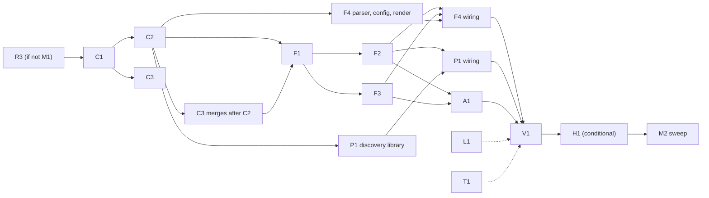

# M2 plan: forwards, ports, agent

> **Status: adopted by the coordinator on 2026-11-03, while the owner runs M1 to M2 autonomously.** Work starts with Wave 0 once M1 closes. The decisions in §4.6 marked **OWNER** stay open, and each of those packages uses the conservative interim default listed there until the owner decides. Written on `origin/main` at `aeb7775`; R2 (#44, wire revision and golden) lands before Wave 0, and §2.12 depends on it. M2 in DESIGN.md §15 covers persistent `-L`/`-R`, `fil forward`, `fil ports` and the agent relay, then the M2 sweep. It is done when port forwards survive a pulled network cable and the sweep is closed. The owner's yardstick also applies: fil should be usable as a drop-in replacement for `ssh -L/-R/-D/-A`, and better than ssh across reconnects.

## 0. Preconditions (M1 close)

- **R2 merged:** `PROTOCOL_REVISION`, the golden, coexisting daemons and relay routing.
- **R3 merged:** the terminal is restored on `~.` (`leave_screen` in `crates/fil-client/src/engine.rs`). If R3 misses M1, it becomes the **first M2 PR**, before C1. C1 and F3 both edit `engine.rs`, and R3 is too small to be worth a conflict.
- The S6 leftovers and the M1 sweep verification pass are closed.
- Nothing else is in flight. Wave 0 changes call sites across the tree.

## 1. Scope

### Goals (DESIGN §7, §10, §14, §15)

1. **Persistent `-L` and `-R`**, owned by the session (§7.2, decided: forwards stay open across reconnects).
   - `-L` listeners live in the client process. `-R` listeners live in the daemon.
   - Each forwarded connection is a resumable channel. A disconnect pauses it and the resume continues it with no byte lost (§7.2).
   - New connections accepted during a disconnect wait for a bounded time. Open connections close after a long disconnect (10 min); the listeners stay.
2. **`fil forward` (`-L|-R|-D` SPEC, `--rm`)**, from the client machine or from inside the session (§7.3), with the consent rules of §4.
3. **`fil ports`** as in §7.4 (decided output): forwards with state and traffic, listeners in the session that are not forwarded, other listeners the user owns, exposure warnings, the protocol probe, and `--json`. The escape `~#` shows a compact overlay summary.
4. **The agent relay** (§10): a stable `SSH_AUTH_SOCK` per session, relayed only while attached, refused at once while detached.
5. **The M1 CLI items marked M2:** `fil detach` with no arguments inside a session, and the forwards column in `fil ls`.
6. **The M2 sweep** (§15).

### Recommended additions (owner decisions, §4.6)

- **`-D` (SOCKS5 and SOCKS4a, CONNECT only)**, OD-1. This settles part of §16.8. It is cheap on the channel design below, and `ssh -D` is everyday drop-in use.
- **`-A` with a message filter, a `confirm` mode and a key allowlist**, OD-3 and OD-4.

### Non-goals for M2

- UDP forwards and Unix-socket forwards (`-L 5432:/run/...sock`). They stay in §16.8.
- X11 forwarding.
- `-W` stdio forwarding, and `-N` "tunnel-only" mode. Non-interactive use is a §2 non-goal; OD-12 asks the owner about M4.
- Desktop notifications for new listeners (§7.4, opt-in) move to M4.
- macOS as the *remote*: listener discovery and attribution are Linux only (`/proc`), per §16.9. A macOS daemon shows forwards only.
- A client-side control socket that would make laptop-side `fil forward` trusted without a prompt (§4.2). Deferred.

### Carried items, verified against the code

| Item | Verified | Decision |
|---|---|---|
| **QUIC stream lifetime cap.** `MAX_STREAMS = 1024` is counted in `accept_streams` (`quic/link.rs` ~560); the 1,025th stream a peer opens ends the link. Streams are never finished. The inbox `register` refuses a second stream for a channel forever. | yes | **Include, C3.** Every forwarded connection is a channel, so a busy dev server would kill the link after 1,024 requests. |
| **Payloads dropped at the limit.** When `open_uni` fails, `write_stream` sets `lost_payloads` and drops up to 8 payloads that `send` already accepted with `Ok`. | yes | **Include, C3.** With fil-level channel caps a failed open becomes `Down(Io)` and the resume repairs it. Nothing is silently lost. |
| **Unbounded per-channel bookkeeping (found while reading).** The pipe's `Queues.sent/popped/written` HashMaps are never pruned, and `mark_written` clones `popped` on every write (O(channels ever used) per write). QUIC's `writers` map and the inbox `chans` are never pruned, and `flush` places a marker on every writer ever created. | yes | **Include, C3.** A memory leak and a CPU cost once channels churn. |
| **`Frame` holding `Bytes`.** `Frame.payload` is a `Vec<u8>`. `encode_into` uses `postcard::to_allocvec` for the channel varint on every frame. `Segment::payload()` copies again. `serve.rs` does `seg.data.to_vec()`. QUIC reads zero-fill a `Vec` per payload. `ByteRing` (a `VecDeque`) never shrinks after a burst. | yes | **Include, C1**, before the fan-out. Forwards are the bulk path, and it is an API change across crates. The golden must stay byte-identical, which proves there is no wire change. |
| **Pipe keystroke latency (`TCP_NODELAY` only for tty sessions in OpenSSH, so `ssh -T` may Nagle).** | unverified (claim) | **Measure in L1** (strace `setsockopt` in realnet, then echo latency). Any remedy is OD-10. |
| **Final snapshot and exit status for ended sessions.** Tombstones are `(name, incarnation)` only (`daemon.rs` `MAX_TOMBSTONES = 256`). A client that missed `SessionExited` hears `SessionGone` with no status. | yes | **Include the exit status** (one wire field, C2, plus F2). **Defer the final output tail to M3**: there is no emulator after exit, it needs a new bounded memory policy, ssh and et do no better, and the value is low. |
| **Big-`cat` scrollback loss** (catch-up by design). | yes (dropin finding 2) | **Defer the "prefer complete scrollback while healthy" option to M3.** It changes the §6.2 catch-up rule in session core while F2 is editing session code. **L1 measures** how often catch-up fires with a fast consumer, as input for M3. |
| **R3, terminal restore on `~.`.** | not on main | M1, or the first M2 PR (§0). |
| **Drop-in "Planned (M2)" scenarios.** | listed in `dropin.md` | **Include in V1**, except the two needing hardware or hands: a real terminal application and a second real client machine. |

### Done when

1. **Forwards survive everything:** a killed ssh, a sleeping client (12 s on QUIC, 45 s on the pipe), three NAT rebinds, and a pulled cable (`ip link set down`) of 30 s and of 5 min, on QUIC and on the pipe. In each case:
   - the application keeps **the same TCP connection** (the server counts one accept);
   - the data is byte-exact (sha256);
   - the daemon is untouched.
2. **10,000 sequential forwarded connections and 200 concurrent ones work on one QUIC link.** M1 dies at 1,024.
3. **`fil ports` and `fil forward` behave as specified**, including the consent rules and refusal of hostile requests.
4. **The agent works:** `ssh-add -l` and a signature through a reconnect, a swap and a takeover; immediate refusal while detached; off by default; the filter enforced.
5. **The suites pass:** the M2 drop-in scenarios on both Pis and the M2 realnet scenarios. There is no XFAIL without an owner-accepted finding.
6. **The M2 sweep is closed.**

## 2. Wire and contract changes first

### 2.1 Principles

- **Forward state lives above the link** (§8.1). The pure protocol state machine goes in **`fil_proto::mux`**: no IO, no clock, time passed in, as everything else in fil-proto. It is shared by both ends.
- **Control messages are not reliable across links**: the control channel is not sequence-numbered. Channel lifecycle messages therefore travel on a **reliable, resumable channel (channel 3, MUX)** that reuses `SendChannel`/`RecvChannel` and `Resume`. Lifecycle events are exactly-once and in order across reconnects and swaps.
- **Acks and Resume stay on control.** Both are idempotent: acks are cumulative and `Resume` is restated on every link.
- **No new `ControlMsg` variants for channels.** `ControlMsg::Reset` (handled only by the client engine, `engine.rs` ~1406) is **removed**; its job moves to MUX `Close`.

### 2.2 Channel map (replaces the table in §8.5)

| Id | Use | Class |
|---|---|---|
| 0 | control | first |
| 1 | terminal (with R1's in-band records) | interactive |
| 2 | snapshot | interactive |
| **3** | **MUX**: the forward table and channel lifecycle, a reliable record stream (was "agent relay (M2)"; `ChannelId::AGENT` becomes `ChannelId::MUX`) | interactive |
| 4–15 | reserved | interactive |
| 16 and up | **dynamic channels**: forwarded TCP connections and agent connections | forward, round-robin |

- **Parity:** the client opens even ids and the daemon opens odd ones, so no coordination is needed.
- **Allocation:** monotonic per opener within a *mux epoch*. A fresh attach (takeover or take-back) starts a new epoch with empty tables and counters at 16 and 17. A resume or swap continues the epoch. Ids are never reused within an epoch, so no late frame can be mistaken for a new channel.
- **Unknown ids:**
  - data, ack or `Resume` for an id **below** the opener's next id that is not in the table: a closed channel, dropped silently;
  - an id at or above it that was never opened: `Error(Protocol)`.
- **Exhaustion:** 2³¹ opens per epoch, then `OpenFailed{TooMany}`.

### 2.3 MUX record stream

- Channel 3 carries ordinary data segments. Its byte stream is a sequence of records: `record := varint(len) postcard(MuxMsg)`, with `1 ≤ len ≤ MAX_MUX_RECORD (1024)`.
- The receiver parses records incrementally across segment boundaries (stateful, but on its own channel, so the terminal-input accounting R1 protected is untouched).
- **Bounds:** MUX send buffer 256 KiB. Records are about 40 to 300 B. While the MUX buffer is more than 3/4 full, a side stops accepting local connections.
- **Acks** as on every channel (`Ack{3, upto}`).
- **Resume:** `Resume{3, received}` each way on every resumed link. A ResumeGone on MUX is a protocol error and cannot happen: the writer is bounded.

### 2.4 Messages (fil-proto, postcard, validated on decode)

```rust
pub struct ForwardId(pub u32);              // assigned by the daemon; unique for the session's life
pub enum ForwardKind { Local, Remote, Dynamic }
pub enum BindAddr { Loopback /* 127.0.0.1 and ::1 */, Any, Ip(IpAddr) }
pub enum TargetHost { Ip(IpAddr), Name(DnsName) } // DnsName: 1..=253 bytes, LDH labels 1..=63, checked on decode
pub struct Target { pub host: TargetHost, pub port: u16 /* >= 1 */ }
pub struct ForwardSpec {
    pub kind: ForwardKind,
    pub bind: BindAddr,
    pub port: u16,              // 0 only for Remote (ephemeral; the actual one comes in Listening)
    pub target: Option<Target>, // Some for Local and Remote, None for Dynamic
}
pub enum Origin { Client /* the attached client, over MUX */, Request /* a management Request: anyone of the uid */ }

pub enum MuxMsg {
    // The forward table (daemon-authoritative)
    AddForward { req: u32, spec: ForwardSpec },                                     // C→D
    Forward { id: ForwardId, spec: ForwardSpec, origin: Origin, req: Option<u32> }, // D→C: one table entry
    ForwardRefused { req: u32, why: ForwardRefusal },                               // D→C
    RemoveForward { id: ForwardId },                                                // C→D
    ForwardGone { id: ForwardId },                                                  // D→C
    Listening { id: ForwardId, state: ListenState },                                // whoever binds reports it
    Consent { id: ForwardId, accepted: bool },                                      // C→D (§4.2)
    // Channels
    Open { channel: ChannelId, window: u32, kind: OpenKind },
    OpenOk { channel: ChannelId, window: u32 },
    OpenFailed { channel: ChannelId, why: OpenFailure },
    Eof { channel: ChannelId, at: u64 },
    Close { channel: ChannelId, why: CloseReason },
}
pub enum OpenKind {
    Local { forward: ForwardId },                   // C→D: the daemon connects to the target in its table
    Remote { forward: ForwardId },                  // D→C: the client connects to ITS OWN stored target
    Dynamic { forward: ForwardId, target: Target }, // C→D: the SOCKS target
    Agent,                                          // D→C
}
pub enum ListenState { Listening { port: u16 }, Failed(BindFailure) }
pub enum BindFailure { AddrInUse, PermissionDenied, AddrNotAvailable, Other }
pub enum ForwardRefusal { Conflict, TooMany, BadSpec, NotPermitted }
pub enum OpenFailure {
    NoSuchForward, NotPermitted, Refused, Unreachable, NameNotFound,
    TimedOut, TooMany, Busy, AgentUnavailable, Detached, Other,
}
pub enum CloseReason { Done, Reset, TimedOut, Removed, ResumeGone, Violation }
```

**No free-form strings** go in errors: OS error texts are user data (§11.1) and a terminal-injection vector. Enums only.

**Other wire additions**, all in C2:

- `Attach.agent: bool`: this client relays its agent.
- `AttachRefusal::SessionGone { exit: Option<ExitStatus> }`, with `ExitStatus { code: Option<i32>, signal: Option<i32> }` as in `SessionExited`. The tombstone keeps it.
- `SessionSummary` gains `forwards: u16` and `agent: bool`.
- `Request::Forward { session, op: ForwardOp }`, where `ForwardOp` is `Add(ForwardSpec)` or `Remove { kind: Option<ForwardKind>, port: u16 }`.
- `Request::Ports { session: Option<SessionName> }`.
- `Response::Forward(ForwardResult)`, either `Added(ForwardId)` or `Refused(ForwardRefusal)`.
- `Response::Ports { part: PortsPart, more: bool }`. It is chunked: one control message is capped at 4 KiB, there are at most 256 rows, and every string field is capped (process name 32 B, path 128 B, probe label 64 B). Strings are sanitized on display, never trusted.
- `ControlMsg::Reset` removed.

### 2.5 Forward table semantics

- **Identity of a spec** is `(kind, bind, port)`. Port 0 (an ephemeral `-R`) has no identity: every `-R 0` is its own listener and never clashes (C2 review). Equal specs still dedup.
- **`AddForward` from the attached client:**
  - equal to an existing entry: answered with that entry;
  - conflicting (same identity, different target): the client's spec **replaces** it under a new id. The old entry's open channels run until they close.
  - The daemon answers with `Forward{req}` or `ForwardRefused{req}`.
- **`Request::Forward` from management** has `Origin::Request`. It may not use a non-loopback `bind` for `Local` or `Dynamic` (that would bind wide on the laptop), nor a non-loopback `target` for `Remote`: `NotPermitted`.
- **Fresh attach:** the daemon sends every entry as `Forward{req: None}`, then the client sends `AddForward` for its CLI and config specs. Consent does not carry across subscribers. On a resume the table is continuous through MUX.
- **`RemoveForward` and `fil forward --rm`:** the listener closes at once. Open connections run until they close, which is ssh's `-O cancel` behaviour.
- **Binding and its report:** the client binds `Local` and `Dynamic` and reports `Listening`. The daemon binds `Remote` and reports `Listening`, with the actual port for port 0.

### 2.6 Channel lifecycle (precise)

1. **Open.** The opener allocates an id, creates its state (the pending local socket), and sends `Open{window}`, where `window` is its receive window.
   - **The opener sends no data before `OpenOk`.** This is ssh's rule; it costs the same RTT the target connect needs anyway.
   - The opener *may receive* the acceptor's data before `OpenOk`, because QUIC orders nothing across streams. It holds that data within the window it advertised.
2. **Accept.** The acceptor checks the kind against the table and policy, then:
   - connects within the connect timeout (10 s);
   - sends `OpenOk{window}` or `OpenFailed{why}`;
   - only then sends data.
3. **Data.** Ordinary data segments (varint offset plus 1 to 16 KiB) on the channel id, starting at offset 0 each way.
4. **Credit.** A sender may put bytes on the wire only below `peer_consumed + peer_window`, where `peer_consumed` is the highest `Ack{ch, upto}` received.
   - `Ack` means *consumed*: written into the local socket. That makes it credit and bounds the receiver's buffer by its window.
   - A receiver acks when `unacked ≥ min(32 KiB, window/4)` or 100 ms after the first unacked byte.
   - Data at or past `consumed + window` is `Close{Violation}`.
   - The sender's retention buffer is its local `forward.buffer` (default 1 MiB, §7.2). When it is full, the sender stops reading the local socket: TCP backpressure.
5. **Half-close.** `Eof{at}`: the sender's local socket hit EOF after `at` bytes. The receiver calls `shutdown(Write)` on its socket once it has consumed every byte below `at`. Data at or past `at` is `Violation`.
6. **Abort.** A local socket error or RST sends `Close{Reset}` at once and discards both buffers. The peer closes its socket with `SO_LINGER(0)` so the RST propagates.
7. **Graceful completion.** A side sends `Close{Done}` once both of these hold:
   - its `Eof` has been sent and acked up to `at`;
   - it has received the peer's `Eof` and consumed all bytes below it.

   Receiving `Close{Done}` implies the peer consumed everything up to our `Eof`.
8. **Release.** A channel is released on a side once it has **both sent and received** `Close`, with any reason, in any state after `Open`. A side that receives a `Close` it has not answered answers with its own and releases. On release the side calls **`Link::finish(ch)`** (§2.10). Late payloads, acks and `Resume`s for the id are dropped (§2.2).
9. **Timeouts:**
   - an `Open` unanswered for `connect_timeout + open_wait` gets `Close{TimedOut}`;
   - an accept made while the link is down waits at most `open_wait` (30 s) for a link, then is closed;
   - after `linger` (10 min) with no link, every open channel is closed with `Close{TimedOut}`. The records are queued on MUX and delivered on the next link. The peer runs its own timer anyway.

### 2.7 Reconnect, swap, takeover, detach, exit

- **Resume (same epoch):**
  - after `AttachReply` and the existing `Resume{TERMINAL}`, each side sends `Resume{3, received}` and `Resume{ch, received}` for every dynamic channel it receives on (pending opens included), followed by its current `Ack{ch, consumed}`;
  - §8.5 step 3 holds per channel: send only after the peer's `Resume` for that channel has arrived;
  - `received` covers bytes buffered but not yet consumed. Those stay in the receiver's memory across links.
- **Client swap (pipe↔QUIC):** the client's endpoint moves to the candidate at the commit point (the candidate's `AttachReply`). From there it behaves as a resume.
- **Fresh attach:** a new mux epoch.
  - The daemon drops every dynamic channel of the previous subscriber (local sockets closed with RST; no records, because the old link is never read again, as in M1).
  - It keeps the table and the `-R` listeners, and sends the table.
  - `-L` and `-D` connections on the old machine end there; their applications live there (§7.2).
- **Detach (`~.`):** the client closes its channels and listeners and exits. The daemon closes the subscriber's channels.
  - `-R` listeners stay bound but **refuse at once** while detached.
  - A transient disconnect is different: the subscriber exists and the link is down, so accepts wait up to `open_wait`.
- **Session exit or kill:** every channel is closed, the `-R` listeners close, the agent socket is removed, and the exit status goes into the tombstone.

### 2.8 Scheduling and memory

- **The pipe:** unchanged. MUX is interactive. Dynamic channels are in the forward class: 16 KiB frames, round-robin, one forward frame after every 8 interactive ones.
- **QUIC:** dynamic channels share the interactive priority (§8.5). L1 and V1 measure keystroke latency under a bulk forward on both transports; H1 acts on the result (§3).
- **Memory budget per side and session:** 64 MiB of buffered forward data, a hard cap (C2 review). Each opener has half; a channel reserves its window and send buffer from its opener's half at open, full while the rest still covers the smallest share (16 KiB + 16 KiB) for every channel that opener may yet open, smaller down to that share otherwise, and `Busy` when not even that fits (DESIGN §8.5, "Memory").
- **`ByteRing` gives memory back when drained** (C1), so an idle channel after a burst does not pin 1 MiB.
- **A full forward never blocks the link's `recv` loop.** Payloads go into per-channel buffers that credit bounds, with no await on a socket write. This keeps §8.1's "the consumer must keep up" on the pipe.

### 2.9 Limits and defaults (new constants; all in the golden `[limits]`)

| Name | Value | Note |
|---|---|---|
| `MAX_FORWARDS` | 64 per session | |
| `MAX_OPEN_CHANNELS` | 256 per opener | Fixed channels plus 2×256 is well under quinn's 1,024 concurrent streams per direction. |
| `MAX_MUX_RECORD` | 1 KiB | |
| MUX send buffer | 256 KiB | |
| `MIN_WINDOW`, `DEFAULT_WINDOW`, `MAX_WINDOW` | 16 KiB, 1 MiB, 4 MiB | |
| `forward.buffer` | 1 MiB | §7.2 |
| `connect_timeout` | 10 s | |
| `open_wait` | 30 s | |
| `linger` | 10 min | §7.2 |
| `agent_wait` | 10 s while disconnected, 0 when detached | |
| `MAX_AGENT_MSG` | 256 KiB | OpenSSH's `AGENT_MAX_LEN` |
| Forward memory budget | 64 MiB per session per side | |
| `MAX_PORTS_ROWS` | 256 | |
| `DnsName` | ≤ 253 bytes | |

The tunables (`window`, `buffer`, `open_wait`, `linger`) go in config under `[defaults.forward]` (client) and `daemon.toml` `[forward]`. They join §16.7's "defaults to tune".

### 2.10 Link contract change (C3)

```rust
/// This side sends nothing more on `channel` over this link. Payloads already accepted are
/// still delivered in order; then the link frees what it holds for the channel (QUIC: finishes
/// the stream; pipe: forgets its counters). Sending on it again over this link fails with
/// `Io`. Idempotent. A no-op for channels 0..=15.
fn finish(&self, channel: ChannelId);
```

- **QUIC send side:** `Item::Finish` makes the writer call `stream.finish()`, exit, and remove its `writers` entry.
- **QUIC receive side:** a stream that ends cleanly (`FinishedEarly(0)`) is deregistered from the inbox once its payloads are handed up. A later stream for that id is allowed; the layer above drops it.
- **The lifetime cap is removed.** quinn's `max_concurrent_uni_streams(1024)` stays, quinn grants credit as streams finish, and the inbox registry is bounded by open streams. This keeps security sweep #3 fixed.
- **No silent loss:** if `open_uni` gets no credit within `dead_after`, the link goes `Down(Io("no stream credit"))`. The resume then retransmits from fil-level buffers. `lost_payloads` is deleted.
- **Flush** markers go only to live writers.
- **Pipe:** prune `sent/popped/written` when a finished channel's counts are written, and stop cloning `popped` on every write (track a dirty set instead).
- **`link::mem`:** implements `finish`.
- **`crates/fil/src/link.rs`** (the client's link enum) forwards it.

### 2.11 Mux API (fil-proto, sans-IO; the contract F1 builds on)

```rust
impl Mux {
    fn new(side: Side, cfg: MuxConfig) -> Self;
    fn open(&mut self, kind: OpenKind) -> Result<ChannelId, OpenFailure>;
    fn accept(&mut self, ch: ChannelId);
    fn reject(&mut self, ch: ChannelId, why: OpenFailure);
    fn write(&mut self, ch: ChannelId, data: &[u8]) -> usize; // local socket → send buffer
    fn read(&mut self, ch: ChannelId, max: usize) -> Bytes;   // receive buffer → local socket
    fn consumed(&mut self, ch: ChannelId, n: usize);
    fn eof(&mut self, ch: ChannelId);
    fn abort(&mut self, ch: ChannelId, why: CloseReason);
    fn on_payload(&mut self, ch: ChannelId, payload: &[u8]) -> Result<(), MuxError>; // MUX and dynamic channels
    fn on_ack(&mut self, ch: ChannelId, upto: u64);
    fn on_resume(&mut self, ch: ChannelId, received: u64);
    fn link_down(&mut self);
    fn link_up(&mut self, resumed: bool) -> Vec<ControlMsg>;
    fn new_epoch(&mut self);
    fn poll_transmit(&mut self) -> Option<(ChannelId, Bytes)>; // honours credit and the Resume gate
    fn poll_event(&mut self) -> Option<MuxEvent>; // Opened, Readable, PeerEof, Closed, Released(ch), Table(..)
    fn tick(&mut self, now: Instant);
}
```

### 2.12 The revision rule (R2)

- **C1** changes no encoding. The golden must stay byte-identical with `PROTOCOL_REVISION` unchanged, which is the proof.
- **C2** bumps the revision: new variants, removed `Reset`, changed `SessionGone`/`Attach`/`SessionSummary`, new limits. It regenerates the golden (`just wire-golden`), adding canonical and widest instances of every new type, one-past-limit cases (a 254-byte `DnsName`, `MAX_MUX_RECORD + 1`, a window outside the bounds, port 0 for `Local`) and the MUX record framing.
- **C3** bumps again: the stream cap leaves `[limits]` and the `finish` semantics enter the QUIC stream layout section.
- C2 and C3 are developed in parallel and merge in that order. C3 merges main, bumps past it and regenerates: the `[history]` conflict is the guard.
- **After Wave 0, no package changes the wire.** A wire change found in review becomes a small coordinator PR with its own bump. The Pi binary must come from the same tree at every run.

## 3. Packages



The diagram must be render-checked with mermaid-cli before it is committed (CLAUDE.md).

Every package keeps M1's rules:

- one PR from its own branch;
- `just ci` gated on its exit status;
- an independent Opus review that always covers privacy and security;
- the author fixes, the reviewer re-checks once, the coordinator merges;
- **every PR carries a mutation table**: each important check is mutated by hand and the named test must fail. `cargo mutants` on the pure modules is optional and goes in the PR when run;
- each package updates its own DESIGN sections.

### Wave 0: contracts (serial merges, coordinator-owned)

**C1: zero-copy frames** (no wire change)
- **Owns:** `fil-proto/src/{frame,chan,ring,input}.rs`, `fil-transport/src/pipe/{driver,shared}.rs` (encode and decode only), `fil-transport/src/quic/{link,wire}.rs` (read and write path). Mechanical call-site edits in `fil-session/src/serve.rs`, `fil-client/src/engine.rs` and tests. It runs alone, so nothing else is in flight.
- **Builds:**
  - `Frame { channel, payload: Bytes }`; the decoder hands out slices of one `BytesMut`;
  - `encode_into(&mut BytesMut)` writes the varint from a stack buffer;
  - `SendChannel::next_payload() -> Bytes`: header plus data in one allocation, one copy out of the ring;
  - QUIC reads use `read_chunk`, with no zero-fill;
  - `ByteRing` shrinks when drained;
  - `fil-proto` gains `bytes` (MIT).
- **Tests:**
  - an allocation-counting integration test (global counting allocator): at most one allocation to encode a 16 KiB data frame and one to decode it on the pipe; a QUIC read of a payload within one chunk copies nothing;
  - the golden is unchanged;
  - the existing suites pass.
- **Mutation:** restore `to_allocvec` in `encode_into` and the alloc test fails; add a zero-fill and it fails.

**C2: the MUX wire and the pure state machine**
- **Owns:** `fil-proto/src/{mux.rs, mux/*}` (new), `msg.rs`, `limits.rs`, `frame.rs` (the `MUX` constant), `fil-proto/tests/{wire_golden.rs, golden/wire.txt, mux_model.rs}`, DESIGN §7.1–7.3 and §8.5 (the protocol text), plus compile fixes in consumers.
- **Builds:** §2.2 to §2.9 and §2.11.
- **Tests:**
  - unit tests per rule;
  - decode validation (`DnsName`, window bounds, port rules, record framing across segment boundaries, random bytes never panic);
  - **a model test**: two `Mux`es over a link model that delivers in order per channel, reorders across channels (QUIC-like), drops the whole link with what is in flight at random points, resumes, swaps and starts new epochs, driven by random open, write, eof, abort and consume operations under a seeded RNG. Its invariants:
    - per channel, the bytes are delivered exactly once and in order, or the channel ends with a reason;
    - every channel is eventually released on both sides;
    - buffered bytes stay at or below the window per channel and within the budget;
    - no data leaves before `OpenOk`;
    - no `Resume` gate is bypassed.
  - `MUX_SEEDS` scales the model test on demand (`just mux-soak`).
- **Mutation:** each of these must fail a named test: drop the credit check; skip the retransmit on `on_resume`; accept data past `Eof`; release after one `Close`; allow an opener-parity collision; send data before `OpenOk`; skip the `new_epoch` reset.

**C3: channel finish and QUIC stream lifetime**
- **Owns:** `fil-transport/src/{link.rs, link/mem.rs, quic/*, pipe/shared.rs, pipe.rs}`, `crates/fil/src/link.rs` (one method), `fil-transport/tests/*`, DESIGN §8.1 and §8.5 (the QUIC mapping and limits).
- **Builds:** §2.10.
- **Tests:**
  - 20,000 sequential channels (open, send, finish) on one `QuicLink` over loopback and over fil-netsim: the link stays up, the inbox and writer maps stay at or below the open count, and process RSS is flat;
  - the old case in which the peer opens 1,025 streams *concurrently* still fails, now at quinn's limit;
  - a 2,000-channel pipe churn shows the bookkeeping maps bounded;
  - a starved stream credit takes the link `Down`, never `Ok` with the payload dropped (a test-hooks quinn config with a tiny limit);
  - `flush` cost is independent of channels ever used.
- **Mutation:** never deregister from the inbox and the 20k test fails; keep the lifetime counter and it fails; keep the `popped.clone()` and the bounded-map test fails.

### Parallel with Wave 0 (tests and measurement only)

**L1: latency lab** (one batched realnet run)
- **Owns:** `tests/realnet/latency.sh` (new), `crates/fil-testbins/src/bin/keyprobe.rs` (new), `docs/m2/latency.md`.
- **Measures:**
  1. whether ssh and sshd call `setsockopt(TCP_NODELAY)` for `ssh -T` versus `ssh -t` (`strace -f -e setsockopt` inside the containers);
  2. keystroke-to-echo latency (p50 and p99) at 5, 20 and 50 keys/s with netem at 40 ms ± 5 ms, for raw `ssh -tt`, fil-pipe and fil-QUIC;
  3. the baseline for later: keystroke latency while a bulk transfer runs through `ssh -L`;
  4. on the Pis and in realnet, how often a 4 MB `cat` triggers catch-up with a fast discarding consumer (input for M3).
- **Output:** a recommendation for OD-10, and thresholds for H1.

**T1: test infrastructure**
- **Owns:** `crates/fil-testbins/src/bin/fwdprobe.rs` (new), the fil-testbins `Cargo.toml`, a new `justfile` recipe `pi-build` (if OD-11 is approved), `docs/m2/pi.md`.
- **`fwdprobe`** is a static TCP tool for the Pis (installed through the existing `install` verb and run *inside the fil session's shell*, so no new gate verb is needed) and for realnet. It has `serve` (echo, a seeded source of N bytes with sha256, a sink with sha256, hold-open, half-close response, RST), `connect`, and an accept counter. It prints `KEY=v` lines.
- **A local aarch64 musl build** (`cargo zigbuild` or `cross` with Docker on the Mac, per OD-11), checked against the CI artifact (the same sha256, or at least a passing `pi-e2e`), so Pi runs stop costing Actions minutes.

### Wave 1

**F1: the `fil-forward` crate** (new; add it to the DESIGN §13 crate list)
- **Owns:** `crates/fil-forward/**`, the workspace members line.
- **Builds:**
  - **`Endpoint`:** the async actor that drives `fil_proto::mux::Mux` for either side. It has `attach_link(Arc<L: Link>)` and `detach_link()`, plus a non-blocking `on_payload` that the link owner's recv loop calls without awaiting socket IO;
  - a pump task per channel (TCP read → `write` with backpressure; `read` → socket write; half-close; RST through `SO_LINGER(0)`);
  - the timers (`open_wait`, `linger`, connect timeout) and the memory budget;
  - the traits `Connector` (how an accepted `Open` becomes a stream: TCP to a target, the client's own target, the agent) and `Policy` (opener-side and acceptor-side checks; implemented by F2, F3 and A1);
  - listeners on loopback in both families; `connect` with resolution, a 250 ms stagger over the addresses, and the timeout;
  - a pure SOCKS5/SOCKS4a CONNECT parser and replies;
  - per-forward stats (connections, bytes each way, last activity) for `fil ports`.
- **Tests:** both roles in one process over `link::mem`, `PipeLink` on fil-netsim streams and `QuicLink` on fil-netsim datagrams, against real loopback TCP:
  - 256 MiB bulk transfer, sha256 compared;
  - half-close (the client shuts down its write side, the server still answers);
  - RST propagation;
  - 1,000 concurrent and 20,000 sequential connections;
  - swaps and link drops mid-transfer, byte-exact;
  - `linger` and `open_wait` expiry;
  - a local application that never reads does not delay a terminal-channel probe sharing the link, and does not freeze the pipe's silence clock;
  - buffered bytes stay within the budget;
  - SOCKS: a vector table (5 and 4a, IPv4, IPv6, domain, bad versions, auth methods) and random bytes that never panic (a fuzz target listed for `cargo-fuzz`).
- **Mutation:**
  - write to the socket inline in `on_payload` → the stuck-consumer test fails;
  - never call `link.finish` → the 20k test on QUIC fails;
  - no linger(0) → the RST test sees a clean EOF;
  - skip the budget → the budget test fails.

### Wave 2 (in parallel)

**F2: forwards on the daemon side**
- **Owns:** `fil-session/src/{forward.rs (new), serve.rs, handle.rs, config.rs}`, minimal hooks in `core.rs` (takeover, detach, exit), `fil-session/tests/{common/mod.rs, forward*.rs}`, `fil-daemon/src/{conn.rs, daemon.rs}`, `fil-daemon/tests/forward*.rs`, DESIGN §7.2.
- **Builds:**
  - a session-owned `Endpoint` (daemon side) that outlives subscribers;
  - `serve.rs` routes MUX, dynamic data and their acks and `Resume`s to it without awaiting. Today `inbound` awaits `handle.send(Cmd::Input)`, and forwards must not share that path;
  - the mux epoch on fresh attach, the table snapshot, `Listening`;
  - `-R` listeners: bind, refuse at once while detached, route only to a *consenting* attached or disconnected subscriber, wait up to `open_wait`;
  - accepting `Local` and `Dynamic` opens only for table ids of that kind;
  - `Request::Forward` and `Request::Ports` (forward rows only until P1);
  - `fil detach` inside a session; `SessionSummary.forwards`;
  - the tombstone with exit status, returned in `SessionGone{exit}`;
  - `SessionHandle::pids()` for P1.
- **Tests:**
  - scripted client over `link::mem` with real loopback targets: takeover, take-back, detach and exit semantics (§2.7);
  - no `Open Remote` before `Consent`;
  - a refusal while detached arrives in under 50 ms;
  - a management add reaches the client as `Origin::Request`;
  - a resume after the session exited gets its status;
  - forward floods do not slow the terminal (an echo probe while 8 bulk channels run).
- **Mutation:**
  - route `-R` without consent → test fails;
  - skip the epoch reset on takeover → the leaked-channel test fails;
  - await the endpoint in `inbound` → the terminal-starvation test fails;
  - drop the exit status from the tombstone → test fails.

**F3: forwards on the client side**
- **Owns:** `fil-client/src/{forward.rs (new), consent.rs (new, pure), engine.rs (the seam only), escape.rs (~#), status.rs}`, `fil-client/tests/{common/daemon.rs, forward*.rs}`, `fil-client/src/config.rs` (`ForwardSet`, policy fields).
- **Builds:**
  - the client `Endpoint` lives for the run, moves to a candidate at swap commit, and starts a new epoch on a take-back;
  - `-L` and `-D` listeners are bound **before the attach** from the CLI and config, so failures print before raw mode and exit-on-failure works;
  - table adoption under §4's consent rules, with prompts through the existing question overlay;
  - `Open Remote` is accepted only for a consented `Remote` id and always connects to the **client's own stored target**, never one from the wire;
  - `Open Agent` is refused unless this run enabled the agent;
  - `Listening` reports; the `~#` overlay summary (two lines, 40 columns, dismissed by the next key);
  - `forward_failure = warn|exit` (exit status 255, as ssh's `ExitOnForwardFailure`).
- **Tests:**
  - FakeDaemon scenarios: a **hostile daemon** sends `Open Remote` for an unknown id, a non-consented id, a `Local` id, and `Open Agent` with the agent off. Each is refused, and a canary listener on the would-be target sees **zero** connection attempts;
  - target pinning: the daemon's announced spec says port A, the client's own spec says port B, so only B is connected;
  - the consent prompts (yes, no, the quiet rule);
  - `-L` byte-exact across a swap and a reconnect;
  - takeover adoption;
  - a bind failure warns or exits.
- **Mutation:**
  - remove the consent check → hostile-daemon test fails (the key test);
  - use the wire target → pinning test fails;
  - bind a management-origin `Local` on a non-loopback address → test fails.

**F4: CLI, config, `fil forward`, `fil ports` rendering**
- **Owns:** `crates/fil/src/{cli.rs, config.rs, app.rs, mgmt.rs, forward_spec.rs (new), ports_view.rs (new)}`, `crates/fil/tests/*`, DESIGN §14, `docs/m2/binary.md`.
- **Phases:** part 1 (the parser, config and rendering against the C2 types) runs in parallel with F2 and F3; part 2 (the wiring) merges after both.
- **Builds:**
  - the flags `-L/-R/-D` (repeatable) and `-A/-a`;
  - config: `forward = [...]`, `agent = "off"|"on"|"confirm"`, `agent_keys = [...]`, `remote_requests = "ask"|"deny"`, `forward_failure`, `[defaults.forward]`;
  - **an ssh-compatible spec parser**: `5173`, `8080:localhost:80`, `127.0.0.1:8080:db:5432`, `[::1]:8080:[2001:db8::1]:80`, `*:8080:…`, `-D 1080`, `-D localhost:1080`, port 0 for `-R`;
  - `fil forward` from the laptop (a `Request` over the pipe) and inside the session (the daemon socket of its own revision, with R2's mismatch message otherwise; `$FIL_SESSION`), plus `--rm` and the ambiguity error;
  - `fil ports [HOST [SESSION]] [--json]`, rendered as in the §7.4 mockup, with every remote string sanitized (`fil_proto::text`);
  - `fil detach` with no arguments; the forwards column in `fil ls`.
- **Tests:**
  - a parser table including hostile input (`-oProxyCommand`, control characters, overlong names, port 0 on `-L`);
  - a rendering golden for a fixed `Ports` response, plus a JSON stability test;
  - an escape-sequence-in-process-name test (it must be shown inert);
  - in-session commands against `fil-daemon-dev`.
- **Mutation:** a bind defaulting to wide → test fails; unsanitized rendering → injection test fails.

**P1: listener discovery and probe**
- **Owns:** `fil-daemon/src/ports/{mod,procnet,attribute,probe}.rs` (new), its fixtures, and, after F2 merges, the `Request::Ports` wiring in `conn.rs`. DESIGN §7.4 details.
- **Builds (Linux only):**
  - parse `/proc/net/tcp{,6}` `LISTEN` rows: address, port, uid, inode, IPv4-mapped addresses;
  - map inodes to pids through `/proc/<pid>/fd`, **for the user's own processes only**, with a bounded scan;
  - process name (`comm`) and working directory (shown with `~`);
  - session membership by the scope's `cgroup.procs`, or by the process tree (`SessionHandle::pids()`);
  - the owner of each `-L` target;
  - exposure classification;
  - the probe, on loopback only, for own listeners only, on demand, 300 ms per port, 1 s in all, 8 at a time: a TLS sniff, **HTTP `HEAD`** (status and `Server`; titles only with `ports.probe = "full"`, because a `GET` has side effects; see §6 Q4), a Postgres `SSLRequest`, a Redis `PING`;
  - `ports.probe = "off"` turns it off.
- **Tests:**
  - a fixture-based parser (IPv4, IPv6, mapped, malformed lines never panic, another uid's rows filtered out);
  - attribution on a fake `/proc` root;
  - the probe against slow, garbage and TLS-like local servers within budget;
  - **nothing a probe returns reaches any log** (log capture).
- **Mutation:** drop the uid filter → the fixture test fails; drop the timeout → the slow-server test exceeds its budget.

### Wave 3

**A1: the agent relay**
- Comes after F2 and F3, so its small edits to `engine.rs`, `serve.rs` and `pty.rs` do not conflict.
- **Owns:** `fil-forward/src/agent/{filter,relay}.rs`, `fil-session/src/agent.rs` (new), `fil-client/src/agent.rs` (new), those hooks, DESIGN §10 and §11.
- **Builds:**
  - **Remote socket:** `/tmp/fil-$UID/agent/` (0700, checked with `lstat` for owner and mode, like the socket directory) and `<session>.sock` (0600). The socket exists only while the current subscriber has `Attach.agent`. Every accept gets a peer-UID check. An accept opens an `Agent` channel right away when attached, waits at most `agent_wait` when disconnected, and is closed at once when detached.
  - **Client:** connects to the local `SSH_AUTH_SOCK` as it was at start.
  - **Filter** (on the client, the trusted end): allow `REQUEST_IDENTITIES`(11), `SIGN_REQUEST`(13), and `EXTENSION`(27) only for `session-bind@openssh.com` and `query`. Every other type gets `SSH_AGENT_FAILURE`, among them add, remove, remove-all, lock, unlock, smartcard and constrained add. Messages are at most 256 KiB.
  - **`agent_keys` allowlist:** SHA256 fingerprints; the list answer is filtered and other signatures are refused.
  - **`confirm` mode:** an overlay question per signature (key type and fingerprint; the comment sanitized), with a 30 s timeout that refuses.
  - **Key-use visibility:** counts and last use per fingerprint, shown in `fil ports` and `~#`, never logged above debug, and the debug lines carry counts only.
  - **Session environment:** `SSH_AUTH_SOCK` is always the stable path (OD-6).
- **Tests:**
  - a filter table over every message type;
  - random bytes never panic; oversize messages are refused;
  - a test-only mini agent (Ed25519) for list and sign across a reconnect and a swap;
  - a refusal while detached in under 50 ms;
  - a hostile daemon's `Open Agent` with the agent off is refused, with no connect to the local agent;
  - confirm yes and no; the allowlist;
  - socket permissions.
- **Mutation:** allow `REMOVE_ALL` → filter test fails; skip the "agent enabled" check → hostile test fails; skip the peer-UID check → realnet `f_agent_other_user` fails.

**V1: drop-in and realnet M2 scenarios**
- **Owns:** `crates/fil/examples/dropin/**`, `examples/support/harness.rs`, `tests/realnet/**`, `docs/m2/{dropin,realnet}.md`.
- Forward scenarios start after F2, F3 and F4; agent scenarios after A1. The scenarios are in §5.

**H1 (conditional): pacing or the NODELAY remedy**
- It exists only if L1 or V1 shows that keystroke p50 under a bulk forward exceeds 2× idle plus 10 ms, or that `ssh -T` Nagles, *and* the owner approves (OD-10).
- **Candidate:** a delay-based in-flight cap for forward data per link (LEDBAT-like, measured from fil-level ack RTT). It keeps ssh's and TCP's buffers short, so a bulk forward cannot make the shell laggy, which ssh -L does.
- **Owns:** `fil-forward` pacing only.

### File-ownership hot spots

Owned in sequence, never in parallel:

- `fil-client/src/engine.rs`: R3, then C1, then F3, then A1 hooks.
- `fil-client/tests/common/daemon.rs`: F3, then A1.
- `fil-session/tests/common/mod.rs`: F2, then A1.
- `fil-daemon/src/conn.rs`: F2, then P1 wiring.
- The golden: C2, then C3 only.
- DESIGN.md: each package edits its own sections, and the coordinator resolves overlaps.

## 4. Security design

### 4.1 One rule for every connection fil makes on the user's behalf

> **A client listens, or connects out, only for forwards it named itself (CLI or config) or that the user confirmed on screen in this client run. It connects only to the target in its own copy of the spec, never one taken from the wire. It never binds a non-loopback address, nor connects to a non-loopback `-R` target, except from its own CLI or config.**

The reason is that the daemon socket is reachable by **any process of the user's uid on the remote**. A remote compromise, such as a malicious package on the dev box, must not be able to do any of these through fil:

- **pivot into the laptop's network:** `-R` to `10.0.0.5:22` on the laptop's LAN;
- **squat laptop ports:** a management-added `-L 127.0.0.1:5432` to an attacker's host would collect `psql` passwords;
- **reach the laptop agent:** ssh's server side can do none of these. Only ssh's client can add forwards (`~C`, `-O forward` through its own control socket).

The daemon also gates on consent, so `-R` listeners refuse instead of opening channels that would be refused. That is only for the user experience: **the client-side check is the security boundary.**

### 4.2 Defaults

| | Default | Wider only if |
|---|---|---|
| `-L` and `-D` bind (laptop) | loopback, 127.0.0.1 and ::1 | explicit address in own CLI or config |
| `-R` bind (remote) | loopback | explicit address in own CLI or config, and `fil ports` warns about exposure (OD-7) |
| `-R` target (laptop) | own spec | non-loopback only from own CLI or config |
| Forwards from management (`fil forward` anywhere, which the daemon cannot tell apart from a remote process) | the attached client asks y/N once per entry (`remote_requests = "ask"`); `deny` refuses them | the user adds the spec to config |
| Takeover | the table survives; the new client adopts entries matching its own specs and asks about the rest | |
| Agent | **off** (`agent = "off"`; `-A` or per-host config turns it on) | `confirm` mode prompts per signature |
| Agent while detached | the socket file is removed; refused at once | |
| `-R` peers | any local user (ssh parity) | `forward.remote_peers = "same-user"` checks the peer socket's uid through `/proc/net/tcp`, using P1's parser (OD-9) |
| Probe | own loopback listeners, `HEAD` | `ports.probe = "off"` or `"full"` |

### 4.3 The agent

- **Exposure:** the same as `ssh -A` while attached. Root or the user's uid on the remote can ask for signatures.
- **Better than ssh:**
  - nothing is relayed while detached; the socket file does not exist then;
  - the filter means the remote cannot add, remove or lock keys;
  - an optional per-signature confirm and a key allowlist;
  - signature counts are visible in `fil ports` and `~#`.
- **Worse than, or different from, ssh:**
  - OpenSSH 8.9+ destination constraints (`ssh-add -h`) assume the agent sees ssh's `session-bind` for the laptop→remote hop. fil's relay is an ordinary local agent client, so a key constrained to `-h github.com` (meaning "only from this laptop") becomes usable from the remote, and a key constrained to `orin>github.com` fails. This is true of any non-ssh relay. **OD-5.**
  - `ssh-add` on the remote can no longer load keys into the laptop agent (the filter, OD-3).
- **Socket path:** `/tmp/fil-$UID/agent/<session>.sock`. The session name sits inside a 0700 directory and the child's own environment, which other users cannot read. That is consistent with §11.1.4.

### 4.4 Privacy (§11.1, decided: targets, ports and agent use are user data)

- **Info-level logs** say "forward added (kind L)", "channel open failed (Refused)" and counts. Ports, addresses, target names, process names, cwd paths and fingerprints appear **only at debug**.
- **No per-connection lines at info.**
- **Probe results and agent key comments are never logged** at any level.
- **The forward table lives in daemon memory only**, nothing on disk.
- **`fil ports`** shows another user's listener rows by port and address only. It never reads their processes (it cannot).
- **Error enums only on the wire** (§2.4).
- **The sweep's privacy audit** gets this list as its checklist.

### 4.5 Compared with OpenSSH

| Control | OpenSSH | fil M2 |
|---|---|---|
| Forwards only when requested | client: yes | yes, plus consent for management-origin forwards |
| Local bind | loopback (`GatewayPorts no`) | loopback |
| Remote wide bind | sshd `GatewayPorts` must allow it | explicit address honoured; no server policy (OD-7, OD-8) |
| Client checks remote opens | rejects `forwarded-tcpip` for an unrequested listen | forward id plus consent plus own target |
| Server side adding forwards | impossible | possible (`fil forward`), gated by on-screen consent |
| Admin switches (`AllowTcpForwarding`, `PermitOpen`, `PermitListen`, `AllowAgentForwarding`) | enforced by sshd | **bypassed**: fil runs as the user (as any user-level relay would). Documented now; policy file in M4 (OD-8) |
| Agent default | `ForwardAgent no` | off |
| Agent mutations from the remote | allowed | filtered |
| Per-use confirm | agent-side (`ssh-add -c`) | agent-side passes through, plus fil's `confirm` |
| Agent while not connected | n/a | the socket is removed; refused at once |
| Forwards across reconnects or roaming | die | survive (the selling point) |
| `ExitOnForwardFailure` | yes | `forward_failure = "exit"` |
| SOCKS (`-D`) | 4, 4a, 5 | 4a and 5 CONNECT (OD-1) |
| Unix-socket forwards, X11 | yes | no (non-goal) |

### 4.6 Owner decisions

| # | Decision | Touches | Recommendation |
|---|---|---|---|
| OD-1 | `-D` in M2 | §16.8 | Yes: SOCKS5 and 4a CONNECT, loopback. |
| OD-2 | The consent rule (§4.1) for management-origin forwards and for takeover adoption | §7.2 (takeover routing), §7.3 ("works from inside the session"), §11 | Yes. `remote_requests = "ask"` by default, `deny` available. |
| OD-3 | The agent message filter (no add, remove or lock from the remote), with no off switch | §10 | Yes. |
| OD-4 | `agent = off/on/confirm` and `agent_keys` in M2; default off | §10, §14 | Yes. |
| OD-5 | Accept that destination-constrained keys are bypassed or broken through fil's relay | §10, §11 | Accept; document it in §10 and the §11 table, and point users at `agent_keys`. |
| OD-6 | `SSH_AUTH_SOCK` always set to the stable path in every session | §10, §11.1.4 | Yes. Opt out with `daemon.toml agent_socket = false`. |
| OD-7 | Honour an explicit non-loopback `-R` bind with no daemon-side switch | §7.1, §11 | Honour it from own CLI or config with an exposure warning; refuse it from management. |
| OD-8 | fil bypasses sshd's forwarding and agent switches | §11 | Document it in §11 in M2; a read-only `/etc/fil/policy.toml` deny switch in M4. |
| OD-9 | The `-R` peer check (`same-user`) | §11 table row "`-R` ports on 127.0.0.1" | Ship it as an option, default `any` (ssh parity). |
| OD-10 | The NODELAY remedy, if L1 finds Nagle (for example `ssh -tt` with the relay setting raw mode before the preamble: a pty, utmp entries, stderr merged into the stream), and forward pacing (H1) | §8.2 (the pipe invocation; the remote command itself stays fixed) | Decide on L1's data; avoid `-tt` unless p50 improves by more than 20 ms. |
| OD-11 | Infrastructure: a local aarch64 cross toolchain on the Mac (zig or Docker), optionally a Lima VM for realnet; or make the repo public, or a self-hosted runner | Actions budget | A local aarch64 build in T1. Making the repo public waits for M4. **Decided 2026-11-03:** the owner made the repo public, so Actions minutes are no longer scarce; T1 skipped the local cross build (the CI `aarch64` job builds `fil` and `fwdprobe`), and a seat-owned Lima VM runs realnet locally. |
| OD-12 | `-N` tunnel-only mode | §2 non-goal | Not in M2; consider it for M4 ("autossh replacement"). |

**Decision status (coordinator, 2026-11-03).** The owner asked for M1 to M2 to run without waiting on them. They still decide access changes, router changes and anything that weakens a §11 invariant. So:

- **Adopted as recommended:** OD-1, OD-2, OD-3, OD-4, OD-6, OD-9, OD-10 (on L1's data) and OD-12. Each keeps or strengthens the §11 invariants, or is a scope call inside the milestone.
- **OWNER, open:**
  - **OD-5** (destination-constrained keys through the relay). Interim: the agent stays off by default, and the limitation is documented. A1 must not turn the agent on anywhere by default.
  - **OD-7** (non-loopback `-R` bind). Interim: refused, with a message naming the decision, until the owner rules.
  - **OD-8** (bypassing sshd's forwarding and agent switches). Interim: documented in §11 as a known property; no policy file.
  - **OD-11** (infrastructure): decided, the repo is public (see the table).

## 5. Verification

### 5.1 Per PR

- `just ci`, passing on its exit status.
- The package's unit, model and integration tests, with its mutation table.
- `linux-check` is **not** dispatched by agents; the coordinator batches it (§5.4).

### 5.2 New drop-in scenarios (Pis, `just dropin`; the Mac client against `fwdprobe` inside the session)

| Scenario | What a person does | What is asserted |
|---|---|---|
| `fwd_local_http` | `-L 18080`; fetches 64 MiB from a server in the session | sha256 equal; `fil ports` lists it with ↓ bytes |
| `fwd_local_kill_ssh` | pipe transport; ssh killed mid-transfer | the same connection (1 accept), byte-exact, a link-down logged |
| `fwd_local_sleep` | client stopped 12 s (QUIC) and 45 s (pipe) mid-transfer | the same as above |
| `fwd_many_short` | 10,000 sequential short requests over QUIC | all succeed, no reconnect. **This fails on M1 at 1,024**; the mutation is to restore the lifetime cap |
| `fwd_parallel` | 200 concurrent connections | all exact |
| `fwd_halfclose`, `fwd_rst` | the client shuts down its write side; the server resets | the response still arrives; a reset is seen as a reset, not an EOF |
| `fwd_remote` | `-R 19000`; a client in the session connects to a Mac server | exact; a connection opened while ssh is dead waits and succeeds within `open_wait` |
| `fwd_remote_detached` | `~.`; a connect inside another session | refused in under 100 ms |
| `fwd_dynamic` | `-D 11080`; `curl --socks5-hostname` to a server on the Pi's loopback | exact; DNS resolved on the remote |
| `fwd_inside_add_rm` | `fil forward -L 18081` inside the session | the consent prompt appears; `n` → nothing is bound; `y` → bound, works, `fil ports` shows it; `--rm` closes it |
| `fwd_hostile_remote` | inside the session, `fil forward -R 19001:<Mac LAN address>:22` | refused with `NotPermitted`; nothing connects on the Mac (a canary) |
| `fwd_takeover` | a second client takes over | the first machine's `-L` connections end; `-R` routes to the second only after its consent |
| `fwd_ports_view` | `python`-free: `fwdprobe serve` on 0.0.0.0 and on 127.0.0.1 inside the session | `fil ports` attributes both to the session with a pid, warns about 0.0.0.0, the HTTP probe labels it, `--json` parses |
| `fwd_bulk_typing` | types in vim while a bulk `-L` transfer runs | the file is exact; keystroke latency measured and bounded against idle (the threshold from L1) |
| `agent_list_sign` | `-A` with a throwaway `ssh-agent` on the Mac; `ssh-add -l`, then `ssh-keygen -Y sign` in the session | the signature verifies on the Mac |
| `agent_reconnect` | the ssh is killed, the client sleeps | the same `SSH_AUTH_SOCK`; signing works after the resume |
| `agent_off_default`, `agent_detached` | no `-A`; after `~.` | the socket is absent; `ssh-add -l` says no agent at once |
| `agent_filter`, `agent_confirm` | `ssh-add -D` from the session; confirm mode | the Mac agent's keys are intact; `n` refuses, `y` signs |

These rely on `ssh-add` and `ssh-keygen` being on the Pis; `tools` reports them, and the default `--require` list gains them. The M1 "Planned (M2)" list is also covered:

- a takeover from a different size and `TERM`;
- bracketed paste and mouse in bash;
- Ctrl-S/Q, Ctrl-\ (exit status 131), Ctrl-V, Alt, function keys;
- `LANG`/`LC_*` and typed non-ASCII;
- tmux inside fil (a static tmux through `install`) and fil inside a local tmux;
- OSC 52 and OSC 8 passthrough;
- a driver that answers DA and DSR.

### 5.3 Realnet additions (`tests/realnet`)

- **`f_fwd_cable_pull` (the "done when" scenario).** A 200 MB `-L` download from an HTTP server in `rn-server`, during which `ip link set c0 down` for 30 s and then for 5 min, on QUIC and with UDP blocked (the pipe: ssh dies on `ServerAlive` and a new login follows). Asserted:
  - the server logs one connection;
  - sha256 is equal;
  - no `ResumeGone`.

  The same done with `ssh -L` is recorded; ssh is expected to fail, as a comparison.
- **`f_fwd_roam`.** Three NAT moves during a transfer: no reconnect, and the largest stall is measured.
- **`f_fwd_vs_ssh`.** Throughput and keystroke latency under bulk load, fil against `ssh -L`. The target: within 2× ssh's throughput, and keystroke p99 no worse than ssh's.
- **`f_fwd_other_user`.** `mallory` can reach a 127.0.0.1 `-R` port (documented; with `same-user` it is refused), but cannot reach the agent socket or the daemon socket.
- **`f_agent_ssh_hop`.** From the fil session on `target`, a real `ssh jump2` authenticates with the key in `client`'s agent through fil.
- **`f_first_login_prompts`** (from the M1 planned list). Host key and password prompts pass through before the attach, without `BatchMode`.
- **`f_fwd_ports_scope`** (sysd). A `setsid`'d listener in the scope is still attributed to the session.

### 5.4 CI budget (Actions: about 700 free minutes left this month)

| Run | When | Suite | Minutes (about) |
|---|---|---|---|
| A | after C3 plus L1 | `check` plus realnet `udp` and `ssh` (latency lab) | 60 |
| B | after V1 | `all` (check, realnet three parts, aarch64) | 70 |
| C | sweep close | `all` | 70 |

- Pi binaries come from the CI `aarch64` artifact (OD-11 decided: the repo is public, so the minutes here no longer bind; batch runs anyway).
- Pi runs are free, so they are the main end-to-end check:
  - after Wave 2: the forward subset;
  - after V1: the full M2 suite, both Pis;
  - at sweep close: the full M1 and M2 suites.
- Total about 200 minutes. Anything more needs the coordinator's sign-off.

### 5.5 The M2 sweep (§15)

Five independent read-only audits of the whole tree, each with an M2 focus list, then fix PRs and a verification pass (Run C plus both Pis).

1. **Redundancy:** terminal-channel versus dynamic-channel code duplicated in engine and session; SOCKS and agent framing helpers; the test harnesses (FakeDaemon and the session scripted client).
2. **Efficiency:**
   - copies and allocations per forwarded byte (the C1 counters, extended to the forward path);
   - wakeups per idle forward and per idle listener;
   - memory per idle channel after a burst;
   - per-channel bookkeeping;
   - the cost of a probe; the `/proc` scan cost.
3. **Privacy:** §4.4 as the checklist; logs at every level; `fil ports` output; the probe.
4. **Security:**
   - §4.1 on every code path;
   - parsing on decode (MUX, SOCKS, agent, `/proc`);
   - resource bounds (§2.9) against a hostile peer on both ends;
   - socket and directory modes; peer-UID checks;
   - `SO_LINGER`/RST handling.
5. **Bugs:** a model-test soak (`just mux-soak`), lifecycle edge cases (swap during open, takeover during `Eof`, exit during `open_wait`).

## 6. Risks and open questions, ranked

### Risks

1. **The remote-to-laptop trust boundary.** A wrong consent or target rule turns a remote compromise into a pivot into the laptop's network, or agent misuse. *Mitigations:* one pure policy module (`consent.rs`) with exhaustive tests; hostile-daemon tests with canaries; the sweep's security focus; OD-2 decided before F3 starts.
2. **Lifecycle correctness across resume, swap and takeover.** Leaked or hung channels, or worse, corrupted bytes. *Mitigations:* the sans-IO `Mux` with the reordering and link-drop model test and its mutation table; ids never reused; the MUX reliable stream instead of lossy control.
3. **Interactivity under bulk forwards.** On the pipe, fil's scheduler cannot see ssh's and TCP's buffers. On QUIC, forwards share the terminal's priority. A forward could make the shell laggy, exactly as `ssh -L` does. *Mitigations:* measure (L1, `fwd_bulk_typing`, `f_fwd_vs_ssh`); H1 pacing behind OD-10.
4. **Resource exhaustion by a hostile peer** (either end): channels, windows, pending opens, listeners, MUX records, agent messages, management rows. *Mitigations:* the §2.9 caps in the golden, a budget test per cap, and the sweep.
5. **`engine.rs` size and contention** (2,500 lines; R3, C1, F3 and A1 touch it). *Mitigations:* strict sequencing; F3 adds one seam and keeps its logic in `forward.rs` and `consent.rs`.
6. **Test infrastructure and Actions minutes.** The Pi binary needs a same-tree aarch64 build, and realnet needs Linux with root. *Mitigations:* the local cross build (OD-11), three batched runs, and Pis for everything that does not need a broken network.
7. **QUIC behaviour at scale.** quinn's stream-credit timing under churn, MAX_STREAMS frames, priority. *Mitigation:* the 20k test in C3 and `fwd_many_short` on real hardware.
8. **Agent expectations.** Destination constraints (OD-5), the filter breaking a remote `ssh-add`, confirm-prompt fatigue.
9. **Pipe Nagle.** It may be a non-issue. Measure before designing.
10. **`/proc` discovery portability:** containers (`docker-proxy`), hidepid mounts, IPv4-mapped addresses, large fd tables. The probe's side effects on dev servers. *Mitigations:* fixtures, bounded scans, `HEAD` only by default.

### Open questions (besides the ODs)

1. **Window and budget defaults** (1 MiB and 64 MiB). These are §16.7 values to tune with `f_fwd_vs_ssh` data.
2. **Should `open_wait` for `-R` while disconnected be shorter than 30 s?** Applications behind `-R` may have their own shorter connect timeouts.
3. **`fil ports` from the laptop when no client is attached:** should it show "would bind" for `-L` entries? Proposed: yes, marked "not attached".
4. **`fil ports` probe:** DESIGN's mockup shows an HTML title, but titles need a `GET`. Proposed: `HEAD` by default, titles only with `"full"`. The owner may prefer the mockup as drawn.
5. **Unix-socket forwards** (`docker.sock`, Postgres sockets) are common in dev workflows. They are a good M3 or M4 candidate on the same channel design (`OpenKind::LocalUnix`).

### Critical files for implementation

- /Users/claude/dev/fil/crates/fil-proto/src/msg.rs (plus a new /Users/claude/dev/fil/crates/fil-proto/src/mux.rs)
- /Users/claude/dev/fil/crates/fil-transport/src/quic/link.rs (and /Users/claude/dev/fil/crates/fil-transport/src/quic/inbox.rs, /Users/claude/dev/fil/crates/fil-transport/src/pipe/shared.rs)
- /Users/claude/dev/fil/crates/fil-session/src/serve.rs
- /Users/claude/dev/fil/crates/fil-client/src/engine.rs
- /Users/claude/dev/fil/DESIGN.md (§7, §8.5, §10, §11, §14)