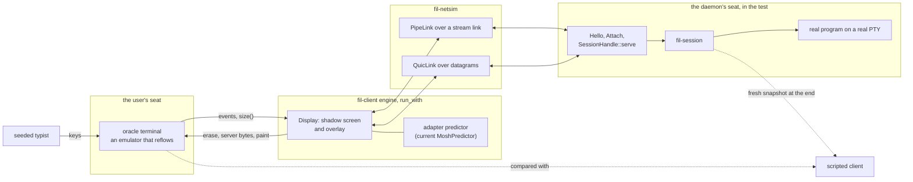

# M3 T1 part 1: the full-stack prediction harness, and resize in the true order

> **Status: built; the result below gates W1 (`docs/m3/plan.md` §2.8).** Written against `origin/main` at `0c1413e` (wire revision 11), with the M0 predictor and trait as they are on that commit. Part 2 of T1 (the prediction suites and the independent classifier) builds on this.

## 1. What it is

The real `fil-client` engine (`run_with`, with a predictor factory) against a real `fil-session` with a real program on a real PTY, over `fil-netsim` links with latency and jitter (loss on QUIC), on the real `PipeLink` or `QuicLink`. The user's terminal is an emulator that **reflows when it is resized**, and the user is a seeded typist.



| File | What |
|---|---|
| `crates/fil-client/tests/common/oracle_term.rs` | the oracle terminal, the rig, the adapter, the trials. Self-contained, so the test and the example both include it |
| `crates/fil-client/tests/predict_e2e.rs` | the small cases that run in `just ci`; one reproduction is `#[ignore]`d |
| `crates/fil-client/examples/predict_e2e.rs` | the on-demand runs: `just predict-e2e resize\|baseline\|secret\|all` |
| `crates/fil-client/tests/common/mod.rs` | one line: `pub mod oracle_term;` |

`fil-session`, `fil-netsim` and `quinn` are dev-dependencies of `fil-client`. Neither fil crate depends on `fil-client` (`cargo tree -p fil-session -e normal,build,dev` has no `fil-client`), so there is no cycle.

### The oracle terminal

`OracleOut` is the `TermOutput` the client writes to. It feeds an alacritty emulator and, after every write, looks at the screen:

- **guesses written**: cells that are underlined and hold a glyph (nothing else in these programs underlines; the M0 predictor shows its guesses underlined);
- **flashes**: such a glyph that went away without the same glyph being there, plain (a written guess that was erased and not confirmed). Counted between resizes only;
- **secrets**: any character of the reserved alphabet (Latin-1 letters, plan §5.2) in the decoded byte stream, with a character cut between two writes carried over.

`OracleHandle::resize` is the **true order**: the emulator is resized first (and re-wraps what it holds), then the client is told. `resize_late` is the order the M0 harness used: the client is told, answers, and only then does the emulator change size. It is kept as a control. Both wait for the client to read the new size (`OracleOut::size` is how the engine learns it) before anything else happens.

### What "damage" is measured against

Two references, taken once the run is quiet:

1. **The client's shadow screen** (`Rig::compare_to_shadow`). The overlay's contract is that the user's terminal equals the shadow whenever nothing is drawn. The adapter predictor is handed the shadow on every call, so after the run settles the harness types one more key and reads the shadow from that call (the terminal's state is taken just before the key). A difference is damage the client cannot see. This is the measure that gates W1.
2. **A fresh snapshot of the session** (`Rig::compare_to_snapshot`): a second scripted client attaches (it takes the session over, so this is the last thing a run does) and the terminal is compared with what the daemon draws from its own emulator. This is what a repaint would show, and what plan §5.6 `predict_resize` asserts.

They differ, and the plan's wording ("the screen ends equal to a fresh snapshot") is not the right test of the overlay: with **no** guesses at all the terminal sometimes ends different from a fresh snapshot (about 1 run in 5 on `cat`, `fill` and bash when narrowing, live or on QUIC). The daemon resizes its emulator at the point of the PTY's output where it reads the resize record, and the user's terminal resizes at the point of the output the client has shown, which is a round trip behind; the same reflow at two points of the stream leaves different screens. Over plain ssh the terminal is simply right, because it is the only screen. This skew is not the overlay's, and W1 does not have to repair it, though a repaint would. The control predictor (below) separates the two.

### The adapter

The harness reaches the predictor through one place, `Predict` and `Adapter`, so a change to the trait is one edit there. The variants:

| `Predict` | |
|---|---|
| `Off` | no predictor (`run_with(.., None)`) |
| `Passive` | the prediction machinery runs (shadow, overlay, the predictor called on every key and output) and the predictor never guesses. **The control** |
| `Mosh` | the M0 `MoshPredictor` with its own RTT threshold (20 ms), given the link's real RTT |
| `MoshAlways` | the same with the threshold at zero |
| `Eager` | a hostile predictor: a guess for every printable key, shown at once, no epochs |

The stock engine never gives the overlay an RTT (`Overlay::set_rtt` is not called anywhere), so the M0 predictor, whose threshold is 20 ms, would never predict. The adapter passes the link's configured RTT as `Ctx::rtt`. The adapter also keeps the predictor's side of the accounting (`AdapterStats`: guesses shown, confirmed, taken back, mispredicted), read from the edits it returned and the shadow screen it was given.

### What this part cannot do

It cannot classify each written glyph from the structured flush. The engine writes one buffer per flush (erase, server bytes and paint together, in synchronized-output brackets that the server's own bytes may also contain), so the paint cannot be told from the server's output from the bytes alone. The oracle terminal counts underlined glyphs instead, and the predictor's own accounting is the second count. The independent classifier needs the flush tap that T1 part 2 adds to `display.rs`.

It has no `--guard-off`. `Display` builds its overlay with `Config::default()` and the engine gives the harness no way to change that. The mutation is made another way, below.

## 2. Running it

```
just predict-e2e resize [--transport pipe|quic|both] [--seeds N] [--one-way-ms N] [--filter TEXT] [--verbose]
just predict-e2e baseline
just predict-e2e secret
cargo test -p fil-client --test predict_e2e                 # the cases that run in just ci
cargo test -p fil-client --test predict_e2e -- --ignored    # the resize reproduction
FIL_E2E_TRACE=1 ...                                         # prints every write (secret and status cases)
```

Real time, real PTYs, so everything takes seconds, not milliseconds. On Linux: `just vm-run cargo test -p fil-client --test predict_e2e` (`docs/dev/vm.md`).

| Run | macOS (Apple silicon) | Linux (the Lima VM, aarch64) |
|---|---|---|
| `cargo test -p fil-client --test predict_e2e` (8 tests, in `just ci`) | 7.4 s | passes (as part of the next row) |
| the same with `--include-ignored` (adds the reproduction, 6 seeds) | 21.4 s | 22.4 s, 9 of 9 pass |
| `predict_e2e secret` | 16.5 s | 16.2 s |
| `predict_e2e resize --seeds 5 --filter cat`, both transports | not timed on its own | 7 min |
| `predict_e2e baseline`, one transport, 4 seeds | 4 min with seven other runs in parallel | not run |
| the whole `resize` matrix, 72 cases of 5 runs | an estimated hour or more sequentially; under 30 min as six parallel processes, one per transport and program | not run |

Adding the file to `tests/common/mod.rs` costs every `fil-client` test binary one more module to compile; `cargo test -p fil-client` took 41 s in all on the development machine.

The Linux numbers on `cat` are the same as macOS's, case by case.

## 3. The result: resize in the true order damages the screen

**The reproduction succeeds.** W1's gate (plan §2.8) is met: with guesses on the screen, a resize in the true order leaves the user's terminal different from the client's shadow, and the same resize in the M0 order does not.

### The matrix

`just predict-e2e resize --seeds 5`, 75 ms each way (150 ms RTT), `MoshAlways`. A case is (transport, program, direction, order). Each runs five seeds, which set the typed text (14, 20, 26, 32 or 38 characters before the resize, 12 after), the timing of the keys, and nothing else. **live** is the real thing: output is in flight when the window changes. **frozen** holds the path from the last key until the client has answered, so no output arrives meanwhile; it isolates the overlay's erase and makes the M0 order exact. Cells are `damaged / runs` against the shadow, with `painted` the runs that had guesses on the screen at the resize; `control` is `Passive`.

| Program, direction | order | painted | **predict** | control |
|---|---|---|---|---|
| `cat`, 80 to 30 | true, live | 5 | **2 / 5** | 0 / 5 |
| | true, frozen | 5 | **2 / 5** | 0 / 5 |
| | M0, frozen | 5 | 0 / 5 | 0 / 5 |
| `cat`, 30 to 80 | true, live | 4 | 0 / 5 | 0 / 5 |
| | true, frozen | 4 | 0 / 5 | 0 / 5 |
| | M0, frozen | 4 | 0 / 5 | 0 / 5 |
| fill (8 long lines then `cat`), 80 to 30 | true, live | 5 | **2 / 5** | 0 / 5 |
| | true, frozen | 5 | **2 / 5** | 0 / 5 |
| | M0, frozen | 5 | 0 / 5 | 0 / 5 |
| fill, 30 to 80 | true, live | 4 | **4 / 5** | 0 / 5 |
| | true, frozen | 4 | **4 / 5** | 0 / 5 |
| | M0, frozen | 4 | 0 / 5 | 0 / 5 |
| bash (readline), 80 to 30 | true, live | 5 | **1 / 5** | 0 / 5 |
| | true, frozen | 5 | **2 / 5** | 0 / 5 |
| | M0, frozen | 5 | 0 / 5 | 0 / 5 |
| bash, 30 to 80 | true, live | 4 | 0 / 5 | 0 / 5 |
| | true, frozen | 4 | 0 / 5 | 0 / 5 |
| | M0, frozen | 4 | 0 / 5 | 0 / 5 |

That is the pipe. QUIC gives the same numbers in every row of predict bar one, and the same (clean) controls bar the same one: `bash`, 80 to 30, M0 order, frozen shows 1 of 5 runs different from the shadow in both the guessing run and the control run (rows 1 and 2). The QUIC freeze is a black hole with retransmission, not a held stream, so a late datagram can still be in the way; read that row as noise in the harness, not as damage.

Linux (the Lima VM) was run for `cat`, both transports, and matches macOS in every cell.

### What the numbers say

- **It is the overlay.** The control, which draws nothing, is clean against the shadow in every row (bar the QUIC row above), live and frozen. The guessing run is not.
- **It is the order.** The same case in the M0 order is clean in every row. That is why the M0 harness's `resize_with_predictions_showing` passed: it erased first, on the geometry the guesses had been drawn on.
- **Narrowing damages whenever the reflow moves a guess.** On `cat`, the damaged runs are seeds 3 and 4, the two whose typed text (32 and 38 characters) is longer than the new width of 30; seeds 1, 2 and 5 (20, 26 and 14 characters) are clean (checked by running seeds 1 to 2, 1 to 3 and 1 to 4). Damage needs a guess in a cell that the reflow moves.
- **Widening damages when the screen has wrapped lines to join.** `cat` and bash have none on the screen (the typed line fits), and are clean. The fill program leaves 8 long lines wrapped at 30; joining them moves everything below, and every run that had a guess on the screen is damaged.
- **Live and frozen agree**, so the output in flight at the resize is not what causes it, and the guessing run's damage is the same in both.

### What the damage looks like

`cat`, 80 to 30, 38 characters typed, true order (rows of the user's terminal against the shadow; `*` marks a row that differs):

```
  user's terminal                              | client's shadow
* wawetz i p  hymfof  amxxdjcjwj               | READY
*                           cjwj               | wawetz i p  hymfof  amxxdjcjwj
    gqpvuw qi or                               |   gqpvuw qi or
  cursors: (2, 14) | (2, 14)
```

The terminal re-wrapped the line, guesses included, so it needs one row more than the shadow's model of it; its screen scrolled by a row (`READY` is gone from the top); the client then erased the guesses at their old row and column, which left a blank hole and a **stale underlined guess** (`cjwj`) behind. Every later write lands one row off from where the shadow thinks. The difference was still there after 12 more keystrokes and their echoes. Nothing in the run repairs it: there is no snapshot, and the status line is not involved.

Widening, the fill program, true order: the terminal's cursor ends on **row 17 while the shadow's is on row 9**, and the typed line is split between the two rows (`rfytaignknantcm  q d` at row 9, the rest at 17). The program's next output goes to the wrong place.

The attributes differ too (`screen.attrs`, `screen.underline_style`: a guess left underlined), and so do the `wrapped` flags.

### The status line has it as well

The disconnect status line is drawn by the same overlay, so a resize under it is the same hazard (`DESIGN.md` §4.2 documents it as a known limit). `just predict-e2e resize --filter "fill narrow"` draws it (cut the path, wait for "fil: ..."), narrows the window to 30 columns, and compares the terminal with a fresh snapshot, leaving the status line's own rows (inverse video) out:

| | pipe | QUIC |
|---|---|---|
| true order, while disconnected | no difference outside the status rows | **row 1 differs** |
| M0 order, while disconnected | clean | clean |
| true order, after the path is back | clean (the resume repaired it, `want_snapshot`) | **rows 0 and 1 still differ** |
| M0 order, after the path is back | clean | differs in attributes only (no text) |

On the pipe the path coming back is a new link and a resume, and the resume's snapshot repairs the screen, as `DESIGN.md` §4.2 says. On QUIC the same outage is a `Degraded` link that **recovers by itself**: there is no resume and no snapshot, and the damage stays. That is the common case (a Wi-Fi hiccup), and §4.2's "until the next resume or swap" can mean never. The plan's rule 9 second bullet (repaint once the status line is removed) covers it; this reproduces the need. (One case each, not a matrix: it is the plan's second trigger and cheap to see, but the counts above are the evidence.)

### The decision this feeds

**W1 lands.** The reproduction is deterministic (every run whose reflow moves a guess), on both transports and both platforms, and the control and the M0-order run show that it is the erase running on a geometry the terminal has already left. T2's reflow finding is the second trigger and is not needed for this decision, but note what it cannot change: the oracle here is the same emulator as the shadow (alacritty), so this reproduces the overlay's order error, not a real terminal reflowing unlike the shadow.

What W1's tests should assert, using this harness:

- `a_narrowing_resize_with_guesses_on_screen_damages_it_in_the_true_order` (`#[ignore]`d, in `predict_e2e.rs`) passed then and was to be flipped to assert the opposite when W1 landed (done: see "After W1" below) (its six seeds then end with `compare_to_shadow` clean, or the terminal equal to a fresh snapshot once the repair has landed);
- add the widening fill case, which needs W1's repaint, not just a no-write rule: the terminal's cursor is on the wrong row;
- `the_resize_controls_are_clean` stays as it is.

### After W1: the repaint repairs it

W1 (wire revision 13, `DESIGN.md` §4.2 and §8.5 `InputRecord::Repaint`) lands the repair. The same matrix, `just predict-e2e resize --seeds 5`, 75 ms each way, `MoshAlways`, macOS, both transports, run as six processes (one per transport and program, under 4 minutes each). `repainted` is the runs in which the daemon sent a repaint snapshot; `after rp` the repainted runs that do not end equal to a fresh snapshot.

| Program, direction | order | painted | **predict vs shadow** | predict vs snapshot | repainted | after rp | control vs shadow | control vs snapshot |
|---|---|---|---|---|---|---|---|---|
| `cat`, `fill`, bash, 80 to 30 | true, live | 5 | **0 / 5** | 0 / 5 | 5 | 0 | 0 / 5 | 1 / 5 |
| | true, frozen | 5 | **0 / 5** | 0 / 5 | 5 | 0 | 0 / 5 | 0 to 1 / 5 |
| | M0, frozen | 5 | 0 / 5 | 0 / 5 | 5 | 0 | 0 / 5 (QUIC bash: 1 / 5) | 0 to 1 / 5 |
| `cat`, `fill`, bash, 30 to 80 | true, live | 4 | **0 / 5** | 0 / 5 | 5 | 0 | 0 / 5 | 0 / 5 |
| | true, frozen | 4 | **0 / 5** | 0 / 5 | 4 | 0 | 0 / 5 | 0 / 5 |
| | M0, frozen | 4 | 0 / 5 | 0 / 5 | 4 | 0 | 0 / 5 | 0 / 5 |

Every row is the same for the three programs and the two transports, bar what the cells say.

- **The predicting runs end equal to the shadow, and equal to a fresh snapshot**, in every case: the client had guesses on the screen at the resize, asked for a repaint after the resize record, and the repaint made the terminal the daemon's. That includes the widening `fill` case (4 of 5 damaged before), whose cursor ended on another row: a rule that only stops guesses could not have fixed it.
- `repainted` is 5 where `painted` is 4 in the live widening rows: the fifth run had nothing drawn at the resize but wrote a guess afterwards, on the untrusted screen, which asks too (with C1's rule 9 the core holds that guess instead of writing it).
- **The controls do not ask** (nothing is drawn, so nothing is repainted: the lazy rule), and they are where the stream-point skew of §1 still shows against a fresh snapshot (1 run in 5, as before). Against the shadow they stay clean, bar the QUIC bash M0-order row that was noise before too.

The status line, the same `fill narrow` case as above:

| | pipe | QUIC |
|---|---|---|
| true order, while disconnected | no difference outside the status rows | row 1 differs (nothing can be repaired while the link is down) |
| true order, after the path is back | clean | **clean** (was: rows 0 and 1 still differ) |
| M0 order, after the path is back | clean | one cell of the status line differs: the harness compared before the link had come back (its "the client wrote" wait was met by the status line's clock ticking), a timing artifact of `status_trial` and not damage |

**After the review of #102 (F1).** The repaint is no longer held until every byte sent is acknowledged (steady output starved it); it is rendered where the daemon's stream is, and the client applies the output in flight first. Re-run with 2 seeds: every predicting row is still 0 against the shadow. One case moved: on QUIC, bash, narrowing in the true order with output live, 2 of 6 runs ended with the text and cursor equal to a fresh snapshot but **row 0's `wrapped` flag** different. The repaint now lands before bash's redraw after `SIGWINCH` instead of after it, and that exposed a snapshot-writer gap: a wrapped row followed by an entirely blank row was ended with a newline, so the receiver lost the wrap. ST1 (#105) fixed the writer (the next row's first cell is always written). **After #105, the same case is 0 of 6, and 0 of 12 in a second run.** Command: `just predict-e2e resize --transport quic --seeds 6 --filter "quic bash narrow 80->30 true-order live predict" --verbose` (it prints the comparison after a repaint that differs).

On QUIC the client now asks for the repaint when the quiet link recovers by itself: the status line had been drawn at the resize, and the request goes out after the resize record once the link is up. The small tests in `just ci`: `a_narrowing_resize_with_guesses_on_screen_is_repaired_in_the_true_order` (three seeds) and `a_widening_resize_that_joins_wrapped_rows_is_repaired_in_the_true_order` (two), in `predict_e2e.rs`.

## 4. The baseline, with `EchoAck` off

`just predict-e2e baseline`: faithful typing (a 41-character command, 4 seeds, 10 to 90 ms between keys) into `cat` and an interactive bash, the M0 predictor, both transports. `EchoAck` is off because the stock client asks for none. "Always" is the threshold at zero; "adaptive" is the M0 predictor's 20 ms threshold with the link's real RTT. `shown` is the predictor's own count of guesses it showed; `paints` is the oracle terminal's count of underlined glyphs written (spaces do not count: an underlined blank has no glyph, which is the 28 between `shown` and `paints`); `flashes` is written guesses erased without being confirmed.

| RTT | predictor | keys | paints | flashes | shown | confirmed | mispredicted | screen at the end |
|---|---|---|---|---|---|---|---|---|
| 10 ms | always | 164 | 132 | 0 | 160 | 160 | 0 | = snapshot |
| 10 ms | adaptive | 164 | 0 | 0 | 0 | 0 | 0 | = snapshot |
| 50, 150, 400 ms | always | 164 | 132 | 0 | 160 | 160 | 0 | = snapshot |
| 50, 150, 400 ms | adaptive | 164 | 132 | 0 | 160 | 160 | 0 | = snapshot |

The same for `cat` and bash, pipe and QUIC (32 rows; the 50 ms, 150 ms and 400 ms rows are identical, so they are merged). **Zero visible mispredictions on faithful echo, and nothing painted at 10 ms with the adaptive threshold.** That is the bar P1 has to keep, and it is the number to compare with once `EchoAck` is on. The M0 predictor is not tested against the cases that make it hard (autosuggestion, `RPROMPT`, a slow echo, mid-line edits): those are P1's and part 2's suites.

## 5. Secrets, and the full-stack mutation

`just predict-e2e secret`: `read -s` (a prompt, then a second later `stty -echo` and a read), with a secret of reserved-alphabet characters typed by the seeded typist. *Ahead* means typing starts the moment the program turns echo off, before the client can have heard (the typist watches a marker file the program touches). *After* waits for the daemon's second `PtyMode` to arrive.

| Case | pipe leaked | QUIC leaked |
|---|---|---|
| M0 predictor, typed ahead of the report | 0 | 0 |
| M0 predictor, typed after the report | 0 | 0 |
| hostile predictor, typed after the report | **0** | **0** |
| **MUTATION**: hostile predictor, `PtyMode` withheld from the client | **16 of 16** | **16 of 16** |
| hostile predictor, typed ahead of the report | 3 to 6 | 3 to 5 |

- The core's password rule works through the whole stack: a predictor that shows every key at once is stopped once the report has arrived.
- The mutation is the harness's check that it can see a leak. The plan asks for `--guard-off password` to fail on `read -s`; the engine gives the harness no way to switch a guard off (`Display::overlay_for` uses `Config::default()`), so the daemon's `PtyMode` is withheld from the client instead (`Faults::drop_pty_mode`, a wrapper link that drops them), which takes away what the guard needs. The leak is seen: all 16 reserved characters reach the terminal. Both this and the "after the report" case are tests in `just ci`.
- The last row is what the M0 predictor's epochs are for, and what C1's core must do for **any** predictor: keys typed in the window between the PTY turning echo off and the client learning of it are written by a predictor that does not keep its own epochs. That window is one daemon poll plus one way trip; here it held 3 to 6 of the 16 characters (3 and 3 on macOS, 6 and 5 on Linux). The row is reported and not asserted: it is C1's `sudo`-typed-ahead trace, run on the whole stack.

## 6. For C1: what the adapter needs

Everything that names the predictor API is in `oracle_term.rs`, in the "adapter" section. If `fil-predict` changes, these are the edits:

- `impl Predictor for Adapter`, `Passive`, `EagerPredictor`: the trait's methods (`on_key`, `on_output`, `on_tick`, `next_deadline`, `reset`, `has_outstanding`, `wants_alt_screen`) and their arguments (`KeyEvent`, `Ctx { screen, rtt, now }`). A new required method, a new `Ctx` field or a changed return type is one edit per impl. `Adapter` forwards to an inner `Box<dyn Predictor>` and records `ctx.screen` (a `TermState`) on every call: if the shadow is handed over as a `ScreenView` and not a `TermState`, `Adapter::shadow` and `compare_to_shadow` need it converted (they use only `screen`, `cursor` and `modes` through `fil_predict::oracle::diffs`).
- `Adapter::apply` reads the edits (`OverlayEdit::{Put, Remove, Clear, Cursor}`) to know what the predictor shows. If edits become *declared guesses* (shown or not, tagged with the input offset), count `shown` from the ones the core writes, or keep counting from the declared and show-able ones as now and say so in the table.
- `predictor_factory`: how the M0 predictor is built (`MoshPredictor::new(MoshConfig { rtt_threshold, .. })`) and what the factory returns (`PredictorFactory`, from `fil-client`). With P1's adaptive switch the RTT threshold and the injected RTT go away: the adapter then passes the link hint through whatever `LinkView` becomes, or nothing.
- `fil_predict::sim::Rng` (the seeded typist) and `fil_predict::oracle::diffs` / `Capabilities` (the comparison) are used as public functions: keep them public or tell this file's owner.
- `CellStyle::Underline` is how the oracle terminal recognizes a written guess. If P1 stops underlining (plan §2.7 underlines only above 80 ms or in a glitch window), the `paints` and `flashes` counts go to zero at low RTT by design; use the adapter's `shown`, or have the harness count the style P1 uses. The C1 tests of the password rule and the resize damage do not depend on it for `Eager` and `MoshAlways` at 150 ms.
- The tests that must still hold after C1: `the_resize_controls_are_clean`, the three secret tests, the two typing tests. The `#[ignore]`d reproduction should *keep* passing until W1.

**Done in C1 (PR #98).**

- The adapter is on the new trait. `ctx.screen` is a `&dyn ScreenView`; the shadow for `compare_to_shadow` comes from the test-only `ScreenView::test_state` (the `testkit` feature of `fil-predict`, a dev-dependency here).
- `AdapterStats` counts the keys the core gave the predictor, the guesses it declared (`shown`: what it asked to be shown; the core decides what is written), and what the core settled (`confirmed`, `mispredicted`, `withdrawn`).
- `compare_to_shadow` reports `guesses_shown`, the underlined glyphs still on the user's terminal, so that a guess the engine never ticked away is not read as resize damage.
- **The secret tests against the core:**
  - After the report, the core does not ask the predictor at all (`keys == 0`, `leaked == 0`).
  - Typed ahead of the report, the hostile predictor is asked and guesses every key (`keys > 0`, `shown > 0`), and nothing is written (`leaked == 0`, down from 3 to 6).
  - With `PtyMode` withheld, the core's epochs now stop the hostile predictor too (`keys > 0`, `shown > 0`, `leaked == 0`), so that run is no longer a leak. A full-stack mutation that leaks needs a guard seam in the engine (finding 2, E1a). The oracle terminal's own test still shows it sees a leak.
- **Until E1a routes `EchoAck`**, only an epoch that starts the session can be confirmed through the full stack: rule 2 makes every later epoch's first confirmation wait for an `EchoAck` covering the keys before it. The cases here type into a fresh session, so they still show guesses.

## 7. Findings about the plan

1. **The resize oracle.** §3 T1 and §5.6 say the terminal must end "equal to a fresh snapshot". That test fails for reasons that are not the overlay (a daemon and a terminal that reflow at two points of the stream, §1 above): 1 run in 5 on `cat` with no guesses. The right oracle for the overlay is the client's shadow; the snapshot comparison is right once W1's repaint has run. V1's `predict_resize` should say which, or it will be flaky.
2. **`--guard-off` through the full stack needs a seam.** The plan's T1 mutation ("`--guard-off password` must fail on `read -s`") cannot be made without changing `Display::overlay_for` or `ClientConfig` (E1a's or part 2's files). Proposed: the test feature that part 2's tap uses also lets a test pass the overlay's `Config`. Until then the withheld `PtyMode` is the mutation (§5).
3. **The stock engine passes no RTT.** `Overlay::set_rtt` has no caller, so the M0 predictor (threshold 20 ms) never predicts under the real engine. E1a's `LinkView` fixes it; the harness injects the RTT meanwhile.
4. **No test feature was added in part 1.** The plan lists "a test feature in `Cargo.toml`"; nothing in part 1 needs one (the tap is part 2's, and the example and test use dev-dependencies), so it comes with part 2.
5. **The engine has no `on_tick`.** `Display` never calls `Overlay::on_tick`, so the predictor's timeout (1.5 s) never fires and a guess that is never echoed stays on the screen until output comes. The 10 s backstop of §2.9 needs a tick source in E1a.
6. **Widening damages too, and in a way a "no write until repaint" rule alone does not repair**: the terminal's cursor ends on a different row. Rule 9's "no guess after a resize until a snapshot at the current generation" stops the *next* damage; the repaint is what repairs the screen that is already wrong. W1 has to ask for it when guesses were on the screen at the resize, not only when the next one is about to be written.

## 8. P2: the screen view and the performance budget

P2 (`docs/m3/plan.md` §3) made the shadow cheap to read. `fil_term::Emulator::screen` lends a read-only `Screen` borrowed from the backend's own grid: the cursor, the modes, one cell at a time (a printable ASCII cell borrows its text from a static table; other text is converted for its row only, the first time it is asked for), a cell's hyperlink, and a per-row stamp. The overlay reads only through it (`overlay.rs` `Shadow`), so it builds no `TermState` per key or per output chunk; `Overlay::view` (the oracle's) is the one place left that does. `ScreenView::test_state` is still `Some` for harnesses: the visible screen, copied once per event when first asked for.

**How `row_stamp` works now.** It is the backend's per-row write counter, which only grows, so a change drawn and undone on another row between two keys is seen (C1's hash of the glyphs could not see it). Every emulator's stamps are in a range of their own.

- **`alacritty_terminal`** (the release backend): its damage tracking, the record its renderer redraws from. After every `feed`, `resize` and `apply_pending`, each damaged line gets a new stamp (every line on full damage: a scroll, a clear, the alternate screen, a resize) and the damage is reset. A write is damage on its line directly (erase, delete, insert, clear) or through the cursor, whose line is damaged at every read and by every move between lines. Damage is per line, so the stamp is stricter than the glyphs: an attribute-only write moves it, and so does a cursor that passes through a row and comes back without writing (that makes the next key tentative; nothing in the faithful suites does it between two keys). The one write off the cursor's line that alacritty does not damage (review S1 of #117): overwriting a wide character at column 0 or 1 clears the leading-spacer flag on the last cell of the line above, which shows only when a zero-width character sits on that spacer (a combining mark typed after a wide character that did not fit, with autowrap off; its text goes from `""` to `" \u{301}"`). So a damaged line also stamps the line above when that line's last cell carries zero-width characters, with no allocation (the lines stamped in a harvest are the ones past a mark taken before it).
- **`vt100`** (tests and the fidelity suite only): it has no damage tracking and no hook for a write, so `feed` parses the stream a second time and classifies each action by what `vt100` 0.18 does with it, feeding `vt100` up to the action when the cursor before it is needed. A run of printable characters stamps the cursor's row if it cannot reach the wrap at the last column; EL, ICH, DCH and ECH stamp the cursor's row; a line feed or reverse index that leaves the cursor where it was stamps every row (a scroll); ED, IL, DL, SU, SD, REP, the alternate screen and RIS stamp every row; cursor moves, modes, SGR, OSC and what `vt100` ignores stamp nothing. Its feed is slower for it (`just fidelity`: 81 to 58 MB/s); `alacritty`'s is unchanged (115 MB/s).

`crates/fil-predict/tests/screen_view.rs` checks the stamps differentially, on both backends (the design is the #117 review's): a reference emulator is fed each chunk byte by byte and C1's hash of every row is taken after every byte, so a row drawn and undone inside a chunk counts as written; the emulator under test is fed the chunk whole or cut in two and is never asked for `state` (which on alacritty damages everything); every written row's stamp must move. The streams are adversarial (odd parameters, cut and invalid sequences, wide characters at the last column, combining marks, C1 controls, every editing and screen sequence). 12 seeds in `just ci`; `just predict-soak 400` runs 400 (about 133,000 written rows on alacritty and 158,000 on vt100, whole and cut, none unseen). It also counts `Emulator::state` calls while predicting (none), and checks that a prompt drawn and erased on another row between two keys makes the next one tentative. `crates/fil-term/tests/screen_view.rs` checks that the view says what `state(0)` says, cell by cell, on the fixtures and on random streams. `just fidelity` is unchanged (its output identical to main's at `932c479`, but for the timings).

### The measurements (`cargo bench -p fil-predict --bench budget`)

Taken on 2026-11-04 on the macOS development machine (Apple silicon, 14 cores), shared with other agents' builds: the load average is given with each. Each set was repeated; the numbers below are the ranges over the repeats. "main" is `932c479` (C1) with the same bench file.

**Per keystroke** (§2.10: p99 under 200 µs here). `Overlay::on_input` for one printable key at 200x50 on `alacritty`, typing 150-key lines at a prompt under a full screen of colored text, with the default predictor showing and every key echoed two keys later (so guesses are outstanding and written: 5,960 of 6,000 keys written), 3 runs of 6,000 keys, twice. The echo chunk is `Overlay::on_server` for one echoed key.

| build | load (1 min) | key p50 | key p99 | key max | echo chunk p50 | echo chunk p99 |
|---|---|---|---|---|---|---|
| P2 | 10 to 11 | 1.8 to 1.9 µs | 2.2 to 6.0 µs | 4.9 to 70 µs | 3.5 to 4.0 µs | 4.1 to 11.4 µs |
| main (C1) | 10 to 11 | 117 to 120 µs | 139 to 153 µs | 190 to 465 µs | 140 to 144 µs | 158 to 166 µs |

About 60 times cheaper; the p99 is two orders of magnitude inside the budget. C1's review measured 250 to 500 µs per key before P2, in its own scenario; on this one main is about 120 µs. What P2 removed is the `TermState` built at every event (the whole screen converted cell by cell, the tab stops probed by moving the cursor across the row).

**`cat` of 100 MB** (§2.10: within 3 % of `predict = "off"` in client CPU, medians of 10 runs with the spread). `Overlay::on_server` in 16 KiB chunks at 200x50 on `alacritty`, thread CPU time, nothing outstanding, the default predictor (showing at the injected 150 ms) against one that never predicts (the client's `NoPrediction`), 10 runs each, interleaved, twice:

| build | load (1 min) | off: median (min to max) | on: median (min to max) | on / off |
|---|---|---|---|---|
| P2, round 1 | 9.3 to 8.5 | 744 ms (741 to 749) | 742 ms (741 to 759) | −0.2 % |
| P2, round 2 | 14.5 to 12.5 | 744 ms (741 to 749) | 744 ms (743 to 749) | +0.0 % |
| main, round 1 | 8.5 to 14.5 | 769 ms (748 to 821) | 770 ms (751 to 810) | +0.1 % |
| main, round 2 | 12.5 to 11.0 | 747 ms (745 to 777) | 746 ms (743 to 814) | −0.1 % |

Within the budget, and the damage harvest costs `cat` nothing measurable (P2's "off" is no slower than main's). An earlier set at a load of 12 to 66 had a spread of about 20 % on both builds (P2 +1.1 %, main −0.6 %); the rounds above are the ones taken when the machine was quieter. This is the client's display path, the part prediction can change; the real client adds the transport and the engine, the same with and without prediction, so its relative difference is smaller still.

**Output with guesses outstanding:** at most one screen read per output chunk, and no grid copy: the counting test shows no `Emulator::state` call at all while 48 keys are typed and echoed at 200x50 with guesses outstanding at every chunk.

**Allocation per key.** None for a cursor row of printable ASCII (the bench's). A row that holds a cell which is not printable ASCII (a CJK or box-drawing prompt, a combining mark) has its text converted once per event on alacritty, a `String` and a span table for that row, so such a prompt allocates per key, against §2.10's "no allocation per key in steady state beyond the edit list". It is small (one row) and left as it is; keeping one buffer in the emulator would mean a view that holds it mutably. For the M3 sweep's efficiency audit.

**Follow-up (not P2's file):** `fil-client`'s `Display::open_gates` still builds a whole `TermState` to read the cursor (`overlay.view(0).shadow.cursor`). It runs for questions and the offline confirmation, not per key; once `Overlay` exposes the view's cursor it can read that instead (E1a or the sweep).

**Still to measure (done-when 7):** GitHub's Linux x86_64 and arm64 runners, which V1 measures with the Pis (`linux-check`; the bench needs no PTY and runs as is: `cargo bench -p fil-predict --bench budget`).
