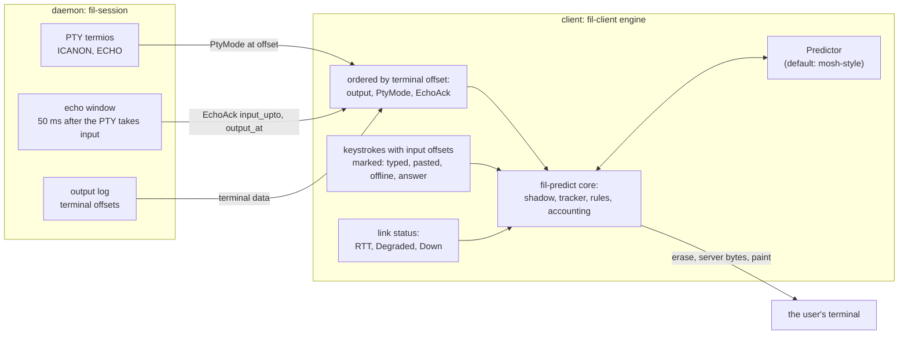
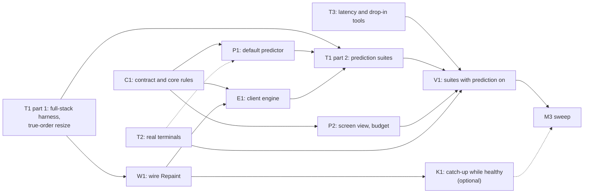

# M3 plan: prediction

> **Status: proposed by the coordinator on 2026-11-04, for the owner's questions in §4.4.** The owner asked (2026-11-04) for M3 to start now, overlapping the last M2 sweep PRs. Written on `origin/main` at `12f974d` (wire revision 11). M3 in `DESIGN.md` §15 is "the trait and the default predictor; then the M3 sweep", done when "no visible mispredictions in the harness, and the sweep is closed". `DESIGN.md` stays the source of truth: each package updates its own sections, and where this file and `DESIGN.md` or the code differ, they win. Items marked **proposed** are the coordinator's calls and can change in review. Items marked **OWNER** wait for the owner, with an interim default.

## 0. Preconditions and the overlap with the M2 sweep

- **M2 is in its sweep.** SW6 (#88, efficiency) is open and edits `crates/fil-forward/src/endpoint.rs`, `crates/fil-proto/src/mux.rs` (with `mux/tests.rs`), `crates/fil-proto/src/ring.rs` and `DESIGN.md`. The verification pass comes after it.
- **No M3 package touches `crates/fil-forward/src/endpoint.rs` or `crates/fil-proto/src/mux.rs`** (nor `mux/*` or `ring.rs`) until the M2 sweep is closed. Nothing in this plan needs them.
- **The wire.** W1 (§2.8) is the only planned wire change. If an M2 sweep PR bumps `PROTOCOL_REVISION` first, W1 takes main's golden, bumps past it and regenerates (the `[history]` conflict is the guard, `CLAUDE.md`).
- **The M3 sweep starts only after the M2 sweep is closed** (§15: every milestone ends with its own sweep).
- `DESIGN.md` conflicts with the M2 sweep's edits are resolved by the later PR. M3 packages edit only their own sections (§9, §4.2, §6.2, §8.5's terminal messages, §12, §14, §16).

## 1. Scope

### Goals (DESIGN §9, §12, §14, §15)

1. **The predictor trait, settled** (§9: pluggable, decided; behind a trait, decided in §2 goal 8). The M0 trait grows what M1 made available: input offsets, the echo acknowledgement, PTY mode changes, link health and a cheap read-only screen.
2. **The default predictor**, mosh-style, conservative, adaptive (§9), good enough that a person typing into a shell, a REPL or `cat` over a slow link sees **no visible misprediction** (§2.5 defines it).
3. **The core's rules** for every predictor (§9), extended for what M3 makes real: the password rule, epoch boundaries the core forces, no prediction of pasted, offline or question-answer input, and misprediction accounting that does not trust the predictor.
4. **Integration in the client engine**: `Attach.echo_ack`, `EchoAck` and `PtyMode` applied in order with the output, RTT from the link, and correct behavior across resume, swap, snapshot, takeover, resize, detach and exit.
5. **Configuration**: `predict = "off" | "adaptive" | "always"` per host (already parsed, §14), plus a `--predict` flag (proposed).
6. **A harness that proves the done-when**: the M0 oracle extended to the whole stack on real PTYs (macOS and Linux), real terminals, real-network latency cells, and the Pi drop-in suite with prediction on.
7. **The M3 sweep** (§15).

### Non-goals for M3 (proposed)

- **Prediction on the alternate screen** (vim, less, htop, tmux). §9 keeps it off unless a predictor opts in; the default one does not. A later predictor can opt in behind the same trait.
- **Predicting a wrap to the next line, a scroll, or `Enter`.** §9 forbids painting anything that would scroll or wrap; the predictor stops before the last column, as in M0.
- **Predicting the effect of control keys** (Tab completion, history, Ctrl-R, Ctrl-U, Ctrl-W). They end an epoch (§2.4).
- **A second predictor.** The trait must make one possible. Shipping one is not in scope.
- **The M2 deferrals that are not prediction** (§1, "Carried items"): the final output tail of an ended session and Unix-socket forwards go to M4's backlog.

### Carried items, verified against the code

| Item | Verified | Decision |
|---|---|---|
| **M0: report ICANON/ECHO in order with the output.** | Done in M1: `PtyMode { canonical, echo, at }`, read per output batch, after input, and by a 50 ms poll (`fil-session` `core.rs`), stated again after every `AttachReply` and snapshot. The client queues it by offset (`engine.rs` `apply_modes`) and hands it to `Display::set_pty_mode`. | Use as is. E1 adds the epoch boundary on each change (§2.4). |
| **M0: acknowledge input echo the way mosh does.** | Done in M1, daemon side: `EchoAck { input_upto, output_at }` after a 50 ms echo window counted from the PTY *taking* the bytes (`fil-session/src/echo.rs`), only for `Attach.echo_ack`, which also keeps the 50 ms mode poll. **Client side not done:** `begin_attach` sends `echo_ack: false`, and `ControlMsg::EchoAck` is ignored (`engine.rs`). | E1 asks for it and routes it; P1 uses it to confirm and contradict. |
| **M0: width disagreements (VS16, ambiguous width).** | Unresolved by design (`docs/spikes/emulator.md` row 10). M1 hardened the restore path: a restored cell that is not printable ASCII gets a cursor move of its own (`overlay.rs` `restore`), and the status line avoids ambiguous runs (`tests/status.rs`). The predictor only guesses ASCII and Latin letters. | T2 measures each real terminal's widths against the shadow's; P1 keeps the character rule; a guess next to a cell the table marks as disputed is not made (proposed). |
| **M0: prediction never tested in a real terminal.** | Still true. M1 and M2 tested the overlay's status line against emulators only; the drop-in suite reads the client through `vt100`. | **T2**, early: it can invalidate the core's assumptions. |
| **M0 harness resizes in the wrong order.** (found while reading) | `driver.rs` `Ev::Resize` erases, *then* resizes the oracle. A real terminal resizes (and reflows) first; the client learns afterwards. `hazards.rs` `resize_with_predictions_showing` passes only because of the order. | **T1** reproduces it in true order; **W1** gives the client a way to repair (§2.8). |
| **Status-line known limit: a narrowing resize under the overlay** leaves damage until the next resume or swap (`ResumeRequest.want_snapshot`, §4.2). | yes (`display.rs` `resize`, `engine.rs`) | With prediction painting at every keystroke this stops being rare. **W1** repairs it at once, for predictions and status lines alike. |
| **The client reads no RTT.** | yes: `LinkStatus.rtt` exists (`fil-transport/src/link.rs`); nothing in `fil-client` reads it. | E1. |
| **`predict` is parsed and unused.** | yes: `Predict { Off, Adaptive, Always }`, per `[defaults]` and `[host.NAME]` (`crates/fil/src/config.rs`); `run` passes no predictor (`fil-client/src/lib.rs`). | E1. |
| **Big-`cat` scrollback loss** (deferred to M3 by the M2 plan). | yes: L1 found catch-up firing on every 4 MB `cat` on both transports, even with a fast consumer (`docs/m2/latency.md` §4). | **K1**, optional and parallel (§3). Not a done-when item. |
| **Final output tail of an ended session** (deferred to M3 by the M2 plan). | yes | Proposed: move to M4's backlog. Not prediction, low value, needs a new memory policy. |
| **Test harness code ships in the library.** `fil-predict`'s `oracle`, `driver` and `sim` are unconditional `pub mod`s. | yes (`lib.rs`) | C1 puts them behind a feature (proposed); the linker drops them today, so this is tidiness. |
| **Duplicated parsers.** The tracker reimplements charsets (now in `fil_term::model::Modes.charsets`) and an at-rest scanner (now `fil-term/src/boundary.rs`). | yes | M3 sweep, redundancy audit. Not in C1: the tracker's "unknown after DECSTR" semantics differ and must be kept. |

### Done when

1. **No corruption and no secret, anywhere.** Across every suite below, with every guard on: zero oracle violations of the kinds `Erase`, `Flush`, `Painted`, `Cursor`, `Probe`, `Secret`, `Policy` and `Leftover`, and no typed byte of a secret in the client's output stream (§5.4).
2. **No visible mispredictions** at the bar in §2.5 (OQ-3), in:
   - the sans-IO scripted soak (`just predict-soak`), 1,000 seeds;
   - the full-stack harness (T1) on real PTYs on macOS and on Linux, over the pipe and QUIC (§12's transport matrix), at 50, 150 and 400 ms RTT, with jitter and with 2 % loss on QUIC;
   - the real-network latency cells (§5.5);
   - the Pi drop-in suite with prediction on (§5.6).
3. **Prediction helps.** At 150 ms RTT and above, the p50 time from a key to its glyph on the screen of a predictable key is under 5 ms (it is about one RTT without prediction), measured by `keyprobe --screen`.
4. **Adaptive is quiet when it should be.** With `adaptive` at a 5 ms RTT, nothing is painted in the shell scenarios.
5. **Nothing regresses.** Every M1 and M2 drop-in and realnet scenario passes with prediction on (`always`, and `adaptive` with injected latency).
6. **Real terminals agree** with every assumption the core makes, on at least four terminals with an automated read-back (§5.3), or the core has a guard for each disagreement.
7. **The performance budget** (§2.10) holds.
8. **The M3 sweep is closed.**

## 2. Contracts first

### 2.1 Principles

- **The core is the safety boundary; the predictor is untrusted** (as in M0). Every rule in §2.4 is enforced in `fil-predict`'s `Overlay`, with a `Guards` switch so a test shows it is needed.
- **Everything ordered with the output stays ordered with the output.** `PtyMode` and `EchoAck` reach the predictor only once the client has applied the output below their offsets, whatever order the transport delivered them in (control goes ahead of data on every transport, §8.1).
- **Displayed means written.** Bytes the overlay paints reach the user's terminal, its recorders (asciinema, iTerm2's session logging, a local tmux's history) and anything sharing the screen, even if they are erased a moment later. So "never show a secret" means "never write it".
- **Measure in the core, not the predictor.** Whether a painted glyph was right is decided by the core from the shadow screen, so a predictor cannot hide its own mistakes.

### 2.2 Where prediction state comes from



| Source | Today | What M3 uses it for |
|---|---|---|
| **Output bytes** | fed to the shadow by `Display::server` | confirm or contradict guesses; the tracker's gates (§9, spike C) |
| **`PtyMode`** | ordered by offset, applied in `apply_modes` | the password rule (canonical, echo off); an epoch boundary on every change (§2.4) |
| **`EchoAck`** | daemon sends it for `echo_ack` clients; client ignores it | a guess for input below `input_upto` that the shadow does not show once output below `output_at` is applied will never be echoed: contradicted at once instead of after a timeout |
| **Alternate screen, bracketed paste, kitty keyboard flags** | in the shadow's `Modes` | the alt-screen rule; paste detection; key decoding |
| **Input offsets** | the terminal channel's `SendChannel` (`sess.input`); records take no space | pairing each guess with the `EchoAck` that settles it |
| **Input kind** | implicit in the engine's paths (`user_bytes`, offline buffer, answers) | only typed, live input is predicted |
| **Link RTT and health** | `LinkStatus { rtt, .. }` | adaptive on/off and the underline rule (OQ-1) |
| **Snapshots, resume, swap, takeover** | engine events | resets and rebases (§2.6) |

No new daemon state is needed for prediction. W1's `Repaint` is for screen repair (§2.8).

### 2.3 The trait (C1; replaces the §9 sketch)

```rust
/// Where a byte sits in the subscriber's input stream: the offsets `EchoAck.input_upto` counts
/// (DESIGN §8.5). Starts at 0 on a fresh attach, continues on a resume.
pub type InputPos = u64;

/// A read-only view of the shadow screen. C1 implements it over `TermState`; P2 makes it cheap.
pub trait ScreenView {
    fn size(&self) -> Size;
    fn cursor(&self) -> Cursor;                // row, col, pending wrap, visible, pen
    fn modes(&self) -> &Modes;                 // alt screen, insert, origin, autowrap, paste, ...
    fn cell(&self, row: u16, col: u16) -> Option<CellRef<'_>>; // text, width, attrs
}

pub struct LinkView {
    pub srtt: Option<Duration>,  // smoothed, from LinkStatus.rtt
    pub degraded: bool,          // LinkStatus::Degraded
}

pub struct Ctx<'a> {
    pub screen: &'a dyn ScreenView,
    pub link: LinkView,
    pub pty: PtyMode,
    pub now: Time,
}

/// Why the core ends the current epoch: guesses after it stay hidden until one is confirmed.
pub enum Boundary { ModeChange, Unpredicted, Paste, Unexplained, Idle, Resumed }

pub trait Predictor: Send {
    fn on_key(&mut self, key: &KeyEvent, at: InputPos, ctx: &Ctx<'_>) -> Vec<OverlayEdit>;
    fn on_output(&mut self, ctx: &Ctx<'_>) -> Vec<OverlayEdit>;
    /// Called once the output below the ack's `output_at` is in the shadow.
    fn on_echo_ack(&mut self, input_upto: InputPos, ctx: &Ctx<'_>) -> Vec<OverlayEdit>;
    fn on_boundary(&mut self, why: Boundary, ctx: &Ctx<'_>) -> Vec<OverlayEdit>;
    fn on_tick(&mut self, ctx: &Ctx<'_>) -> Vec<OverlayEdit>;
    fn next_deadline(&self) -> Option<Time>;
    fn reset(&mut self);
    fn has_outstanding(&self) -> bool;
    fn wants_alt_screen(&self) -> bool { false }
}
```

- `OverlayEdit`, `KeyEvent` and `CellStyle` stay as in M0. `KeyEvent` gains nothing; paste and kitty keys are handled in the core's decoder (§2.4).
- `Overlay` gains `on_input(bytes, at: InputPos, kind: InputKind, now)`, `on_echo_ack(input_upto, now)` (the caller orders it), `set_link(LinkView)` (replacing `set_rtt`), and `stats() -> PredictStats` (§2.5).
- `Ctx.screen` changes from `&TermState` to `&dyn ScreenView` now, so P2 can make it cheap without changing the contract again.
- Predictors are compiled in (§8.4). The factory stays `PredictorFactory` in `fil-client`.

### 2.4 Rules the core enforces on every predictor

M0's rules stay (spike C's hazard table: pending wrap, pen, hyperlink, insert mode, origin mode, charsets, DECSTR, wide characters, cursor visibility, last column, parser state, the sync bracket, a program's own sync batch, DECSC, the alternate screen, scrolling, queries, images). New in M3:

1. **Password rule (§9, unchanged):** nothing is painted while the PTY is canonical with echo off; anything painted is retracted when the report arrives.
2. **Every `PtyMode` change is an epoch boundary** (`Boundary::ModeChange`): the core retracts what is shown and the predictor starts a tentative epoch. A program that turns echo off in raw mode (sudo with `pwfeedback`, a TUI's secret field) changes the mode, so its first key is never shown.
3. **Only typed, live input is predicted.** `InputKind::Typed` only. Not predicted, and each an epoch boundary (`Boundary::Unpredicted`) with its offsets passed through so `EchoAck` accounting stays aligned:
   - **pasted text:** between bracketed-paste markers (`CSI 200~`/`201~`), and any single read of more than 256 bytes when bracketed paste is off (a paste the terminal did not mark);
   - **offline input** released on resume or after the confirmation (§4.3): it was typed against a screen that may be gone;
   - **answers** to the client's own questions, and escapes (`~.`, `~#`, `~?`), which never reach the session.
4. **Unexplained output is an epoch boundary** (`Boundary::Unexplained`): output that moves the cursor anywhere but where the guesses say, changes a glyph on another row, or changes a glyph left of the cursor that is not a guess. A prompt that a program prints before reading a secret therefore makes the next key tentative. Glyphs right of the cursor (fish's autosuggestion, zsh's `RPROMPT`) and attributes (syntax highlighting) do not count. While nothing is outstanding the core only notes that output arrived, and checks once, at the next key, against a copy of the cursor's row taken when the last guess was settled, so a flood costs nothing.
5. **An idle pause is an epoch boundary** (`Boundary::Idle`): the first key after 2 s with no input and no output is tentative. Proposed. It covers `read -s` after a silence, where the mode change can arrive after the first key, and it lets the daemon's mode poll slow down for predicting clients too (§2.10, M3 sweep).
6. **Kitty keyboard protocol:** an unmodified printable key reported as `CSI codepoint u` is decoded as that character; every other `CSI ... u` is an unknown key. Proposed.
7. **Bounded state:** at most 1,024 guesses outstanding; past that the core stops asking the predictor until some resolve.

### 2.5 Misprediction: definition, accounting, bar

**Definition (proposed, OQ-3 confirms the bar).** A *visible misprediction* is a predicted glyph that the overlay wrote to the user's terminal (in a shown epoch) and later removed without the shadow screen showing that glyph in that cell at the moment of removal, for whatever reason (contradicted by output, contradicted by `EchoAck`, expired, retracted by a core rule, dropped by a reset). Glyph means the cell's text; a different color or attribute (fish or zsh syntax highlighting recoloring the echo) is *restyled*, counted and not a misprediction. A predicted cursor position the real cursor never reaches is counted separately (`cursor_miss`).

**Accounting (C1).** The core keeps `PredictStats`: `painted`, `confirmed`, `restyled`, `mispredicted { contradicted, echo_ack, expired, core_rule, reset }`, `cursor_miss`, `tentative_dropped` (guesses never shown: correct behavior, not a misprediction). It is counts only. The oracle (T1, sim) reads it after every flush; the client logs it at `debug` when a run ends (§4.3). A snapshot's reset classifies what was painted against the shadow after the snapshot has landed.

**The bar (OQ-3, recommendation).**

| Suite | Bar |
|---|---|
| Corruption, `Secret`, `Policy`, `Leftover` | **zero, everywhere**; not negotiable |
| **Faithful echo**: bash, zsh (with `RPROMPT`), fish (with autosuggestions), dash, a Python REPL, raw `cat`, canonical `cat`, `read` with echo on; no other writer on the terminal | **zero** visible mispredictions over the whole run (at least 100,000 predicted keys over seeds, latencies and transports) |
| **Adversarial echo**: a program that echoes something else (upper case, asterisks), raw no-echo, the M0 adversary's escape sequences, a background job writing while the user types | **at most one shown epoch per contradiction**: after any misprediction nothing more is shown until a new guess is confirmed. Reported as a rate per 1,000 keys |

### 2.6 Lifecycle: the overlay and the rest of fil

| Event | What happens to predictions (proposed) |
|---|---|
| **Resume** (same epoch, replay) | Kept. Input offsets continue (§8.5), so outstanding guesses are settled by the replayed output and later `EchoAck`s. `EchoAck`s lost with the old link are not needed: they are cumulative. A boundary (`Resumed`) makes keys after the resume tentative. |
| **Swap** (pipe and QUIC) | A resume at the commit point: as above. |
| **Snapshot** (attach, catch-up, `want_snapshot`, W1's `Repaint`) | `Display::reset` builds a new shadow and predictor (as today); painted cells are classified, then dropped. Keys sent but not yet echoed are echoed after the snapshot, unpredicted. |
| **Link `Degraded`** | Keys still go out and are predicted: a slow link is the case prediction is for. The status line and predictions share the overlay (M1). |
| **Link `Down`** | Keys are offline input (§4.3), never predicted. What was shown stays until it is settled or expires (backstop: 10 s, or the next snapshot), so a key typed just before a drop still shows. |
| **Takeover, `fil detach` from elsewhere, refusal, `SessionExited`** | Retracted at once, before any question or message is drawn. The old client's later keys are not the session's. |
| **Fresh attach after a take-back** | New predictor; input offsets rebase to 0 (§8.5). |
| **Resize** | Erase and reset, as today. A narrowing while anything is drawn is damage on a reflowing terminal; the client sends `Repaint` at once (W1) instead of waiting for the next resume. |
| **Native scrollback** | Untouched: nothing is painted that scrolls (§9), `Enter` is never predicted, and a guess never reaches the last column. A `Repaint` renders no history (W1), so the scrollback is not duplicated. |
| **Offline input confirmation and questions** | Their keys are answers (§2.4 rule 3). |
| **`~.` and exit** | Retracted before the terminal restore (`restore_sequence`). |

### 2.7 Configuration (E1)

- `predict = "off" | "adaptive" | "always"` in `[defaults]` and `[host.NAME]`, as parsed today; default per OQ-1 (interim: `adaptive`, as §14 sketches).
- **`--predict off|adaptive|always`** overrides it for one run, like `--transport`. Proposed.
- `off`: no predictor, `Attach.echo_ack = false` (no `EchoAck`, no fast mode poll). `adaptive` and `always`: `echo_ack = true` for the whole attach, so turning on mid-session needs no message.
- **Adaptive thresholds (proposed, mosh's, §16.7 "to tune"):** show predictions when the smoothed RTT is above 30 ms, stop below 20 ms; also show them for the next 30 s after a *glitch* (a key whose echo took more than 250 ms), whatever the average. `always` shows them at any RTT.
- **Underline (OQ-1):** interim as §9 says, every unconfirmed guess underlined.
- Tunables (the thresholds, the glitch window, the expiry backstop) are constants in `MoshConfig`, not config keys, until V1's data says a user needs them. Proposed.

### 2.8 Wire changes

**W1: `Repaint`, one bump (revision 11 to 12, or past main at the time).**

- `ControlMsg::Repaint` (client to daemon, no fields): repaint my screen now.
- `SnapshotReason::Repaint`: the daemon answers with a mid-stream `Snapshot` announcement, as for catch-up, under the rule that only one snapshot is in flight (§6.2). It renders **the screen and the modes with no history lines** (the client's native scrollback already holds the history; rendering it again would duplicate it), and `skipped` 0 (no marker).
- The daemon honors at most one `Repaint` per second per session; others are dropped. A `Repaint` while a snapshot is in flight is dropped (the snapshot repaints anyway).
- Used for: a narrowing resize while the overlay has anything drawn (predictions or a status line). It replaces "the next resume asks for a snapshot" in §4.2 for the live case; `want_snapshot` stays for a narrowing while disconnected.
- **Why a wire change:** without it the only repair is a resume, which on the pipe is a new ssh login.
- **Gate:** T1's true-order resize reproduction lands first and shows the damage on alacritty as the oracle. If it does not, W1 is dropped and §4.2's text stays.

**Considered and not needed:**

- More termios flags in `PtyMode` (`IUTF8`, `ECHOE`, `ECHOCTL`) for canonical-mode backspace: the predictor erases only its own guesses (§3, P1), and a terminal without `ECHOE` is rare; a wrong guess there is an adversarial-suite case.
- Toggling `echo_ack` mid-attach for `adaptive`: set it for the attach (§2.7).
- A daemon-side "alternate screen" or "paste mode" report: the client's shadow has both.
- Per-key acknowledgements: `EchoAck` is cumulative and enough.

After W1, no package changes the wire. A wire change found in review becomes a small coordinator PR with its own bump (the M2 rule).

### 2.9 Limits and defaults (proposed; constants, not wire)

| Name | Value | Note |
|---|---|---|
| Echo window | 50 ms | daemon, M1 (`echo_window`) |
| Adaptive on / off | 30 ms / 20 ms smoothed RTT | mosh |
| Glitch | echo slower than 250 ms; predictions shown for 30 s after | mosh |
| Expiry backstop | 10 s, or the next snapshot | a guess is settled by `EchoAck` normally |
| Idle boundary | 2 s with no input or output | §2.4 rule 5 |
| Unmarked paste | a read of more than 256 bytes | §2.4 rule 3 |
| Outstanding guesses | 1,024 | §2.4 rule 7 |
| `Repaint` rate | 1 per second per session | W1 |

### 2.10 Performance budget (proposed; P2 measures, the sweep audits)

- **Per keystroke** (decode, predictor, validate, paint; not the write): p99 under 200 µs at 200x50 on the Mac in release, under 1 ms on the Linux CI runner and on a Pi-class aarch64 build.
- **Output with nothing outstanding:** no screen read, as today (`has_outstanding`); `cat` of 100 MB costs within 3 % of `predict = "off"` in client CPU.
- **Output with guesses outstanding:** at most one screen read per output chunk, and no grid copy (P2's `ScreenView`). Unexplained output ends the epoch (§2.4 rule 4), so a flood stops the reads after its first chunk.
- **Memory:** predictor state bounded by §2.4 rule 7; no allocation per key in steady state beyond the edit list.
- **Wire:** at most one `EchoAck` per 50 ms window while typing, none while idle.
- **Daemon wakeups:** an idle attached session of a predicting client polls the mode every 50 ms today (`poll_interval`, `predicting = true`), 20 wakeups a second for as long as it is attached. With §2.4 rule 5 in place, the M3 sweep's efficiency audit decides whether predicting clients can get the 500 ms idle poll like everyone else (target: at most 2 wakeups a second while idle). Not changed before that audit.

## 3. Packages



Order is riskiest first: the privacy rules and the contract (C1), the real terminals that could invalidate the core (T2), and the resize damage (T1 part 1, W1) start at once; the predictor's quality (P1) and the integration (E1) follow; verification (V1) and the sweep close.

Every package keeps the M2 rules: one PR from its own branch; `just ci` gated on its exit status; an independent review that always covers privacy and security; the author fixes, the reviewer re-checks once, the coordinator merges; **a mutation table** in every PR (each important check broken by hand, and the named test must fail); each package updates its own `DESIGN.md` sections.

### Wave 0 (start now; C1 is serial, the rest run beside it)

**C1: the predictor contract and the core's rules**
- **Owns:** `crates/fil-predict/src/{predictor.rs, overlay.rs, keys.rs, oracle.rs, driver.rs, sim.rs, lib.rs}`, `crates/fil-predict/tests/*`, `crates/fil-predict/Cargo.toml`; a compile fix in `crates/fil-client/src/display.rs` (`NoPrediction` and the new calls, behavior unchanged); `DESIGN.md` §9.
- **Builds:** §2.3 (the trait, `ScreenView` over `TermState`, `Overlay`'s new inputs); §2.4 rules 2 to 7 with a `Guards` switch each; `InputKind`; `PredictStats` and the classification of §2.5; the oracle's new kind `Mispredict` with the suite category; `oracle`, `driver` and `sim` behind a cargo feature of their own, which the tests enable (proposed); the M0 `MoshPredictor` ported to the new trait with its behavior unchanged (P1 improves it).
- **Tests:** a deterministic trace per new rule in `hazards.rs`: a shown guess retracted on a mode change; a raw-mode echo-off program (asterisks) never shows a typed key; a bracketed paste and an unmarked 1 KiB read never painted, and the key after them tentative; released offline bytes unpredicted with their offsets kept; a prompt printed before a secret makes the next key tentative; the first key after 2 s idle tentative; kitty `CSI 97 u` decoded as `a`; the outstanding cap. Accounting: a guess confirmed, restyled (same glyph, other color), contradicted, expired, dropped by a reset, each counted right. `sim.rs` gains the fake daemon's `EchoAck` (an echo window over its tty model) and the M3 scenarios (paste, offline release, raw echo-off, async writer), on both backends.
- **Mutation:** skip the mode-change boundary (the asterisk trace shows a key: `Secret`); predict inside a paste; classify by attributes (the restyle test counts a misprediction); count a tentative drop as a misprediction; drop the idle boundary (the `read -s` after silence trace shows a key).
- **Done when:** the above pass, `just predict-mutants` shows every new guard needed, and the M0 suites are unchanged.

**T1 part 1: the full-stack harness, and true-order resize** (parallel with C1)
- **Owns:** `crates/fil-client/tests/predict_e2e.rs` (new), `crates/fil-client/tests/common/oracle_term.rs` (new: an in-memory `TermOutput` that feeds an oracle emulator and records flushes), `crates/fil-client/examples/predict_e2e.rs` (new), a `justfile` recipe `predict-e2e`, `docs/m3/harness.md` (new). It does not touch `fil-predict` (C1's) or `engine.rs`.
- **Builds:** the real `fil-client` engine (`run_with`, a predictor factory) against a real `fil-session` with real programs on a real PTY, over `fil-netsim` links with latency, jitter and loss, on `PipeLink` and `QuicLink` (§12's matrix); the client's terminal is the oracle terminal; the user is a seeded typist. On macOS and Linux (Linux through `linux-check`). First, with the M0 predictor behind the current trait:
  - **true-order resize:** the oracle terminal resizes (and reflows, alacritty) *before* the client sees the resize event; narrowing with predictions or a status line drawn; the damage is reported, not hidden;
  - a baseline of mispredictions with `EchoAck` off, to compare with P1.
- **Tests:** small cases in `just ci` (one program, one transport, a few keys); the rest on demand.
- **Mutation:** the existing `Guards` switched off through the full stack (`--guard-off password` must fail on `read -s`).
- **Done when:** the resize result is written in `docs/m3/harness.md` (gating W1), and the baseline is recorded.

**T2: real terminals** (parallel with C1; riskiest, so first)
- **Owns:** `tests/terminals/**` (new), `crates/fil-predict/examples/trace_export.rs` (new: writes a scenario's flush stream with checkpoints and the expected screen at each), `.github/workflows/linux-check.yml` (a `terminals` suite), `docs/m3/terminals.md` (new).
- **Builds:** replays exported traces (the spike's hazard traces, the scripted scenarios, status lines) into real terminals and reads the screen back at each checkpoint (after an erase, at the end):
  - **Linux, under Xvfb (CI):** xterm (its print-screen action, with attributes), kitty (`kitty @ get-text --ansi`), WezTerm (`wezterm cli get-text --escapes`), and tmux (`capture-pane -e -p`, also the "fil inside a local tmux" case);
  - **macOS (this Mac):** iTerm2 through its Python API where it is installed, and Terminal.app through AppleScript (text only);
  - **Ghostty:** no read-back API is known. If the only way is an action triggered by a synthetic keystroke, that needs an accessibility grant for the agent's account: an access change, so it is asked of the owner then, not assumed.
- **Checks** each assumption the spike lists as unverified: `?2026` ignored where unsupported; `CUP` clears a pending wrap; overwriting a line's last cell clears its wrap flag; DECSTR's resets; unknown private modes ignored; how underline renders next to a color pen; and the width of VS16 sequences, emoji and ambiguous-width characters against `unicode-width`. Also whether `ED 2` pushes the screen into the scrollback (it matters for W1's repaint and for snapshots).
- **Output:** a table per terminal. A disagreement with the core is a finding for C1's successor packages: a new guard (owned by whoever holds `overlay.rs` then: C1, else P2) or a documented limit.
- **Done when:** at least four terminals read back automatically, and every assumption has a verdict.

**W1: the `Repaint` wire change** (after T1 part 1 shows the damage; parallel with C1)
- **Owns:** `crates/fil-proto/src/{msg.rs, limits.rs}`, `crates/fil-proto/tests/{wire_golden.rs, golden/wire.txt}`, `crates/fil-session/src/{core.rs, serve.rs}` (the repaint path only), `crates/fil-session/tests/repaint.rs` (new), `crates/fil-client/src/engine.rs` (send `Repaint` where `want_snapshot` is set today for a live link; nothing else), `crates/fil-client/tests/resize_order.rs` (additions), `DESIGN.md` §4.2, §6.2, §8.5.
- **Builds:** §2.8.
- **Tests:** the golden regenerated with the new variant, its widest instance and the reason; a session test: a `Repaint` mid-stream gives a snapshot with no history lines and no marker, the terminal's scrollback does not grow (an emulator fed the client's stream), a second `Repaint` within a second and one during a snapshot are dropped, the one-snapshot-in-flight rule holds against a racing catch-up; a client test: narrowing with a status line drawn sends `Repaint` on the live link at once; T1's true-order case then ends with the oracle equal to the shadow.
- **Mutation:** render history in a repaint (the scrollback test fails); drop the rate limit (the flood test fails); let a `Repaint` start a second snapshot in flight (the ordering test fails); bump nothing (the golden test fails).

### Wave 1 (after C1; E1 also after W1)

**P1: the default predictor**
- **Owns:** `crates/fil-predict/src/mosh.rs`, `crates/fil-predict/tests/predictor.rs` (new), the scenarios it adds to `sim.rs` (coordinated with T1 part 2: P1 owns `sim.rs` from here).
- **Builds** (mosh's design, conservative):
  - **settle by `EchoAck`:** a guess for input below `input_upto` is confirmed if the shadow shows it, otherwise contradicted, at the `EchoAck`; the timeout is only the 10 s backstop;
  - **epochs** with the core's boundaries; a contradiction makes the epoch tentative;
  - **append** at the cursor when the cells from the cursor to the margin are blank, or hold a suggestion the shell draws (fish's autosuggestion: dim text after the cursor; a typed character overwrites one cell and is right whether the suggestion stays or goes);
  - **mid-line insert** (shift right) only when the row to the right of the cursor ends at least two columns before the last column, and not when the row ends in a right-aligned run (zsh's `RPROMPT`, detected as a run separated by at least two blanks and ending at the margin); proposed;
  - **backspace** only over a guess of this epoch or a confirmed character this predictor typed on this row since the last boundary, never over the prompt (M0's "stray blank" case);
  - **left and right arrows and Ctrl-B/Ctrl-F** move the predicted cursor within this epoch's confirmed typed span; anything else is unknown;
  - **adaptive** display (§2.7) from `Ctx.link` and its own glitch detection;
  - characters as in M0 (printable ASCII and Latin letters), and none next to a cell T2's table marks as disputed in width.
- **Tests:** unit tests per rule; the faithful and adversarial categories of `sim.rs` with `EchoAck`; fish autosuggestion, zsh `RPROMPT` and readline vi-mode cases as scripted remotes; hysteresis of the adaptive switch.
- **Mutation:** backspace over the prompt (the prompt test counts a misprediction); no `RPROMPT` detection (the zsh test fails); ignore `EchoAck` (a no-echo guess outlives its ack: the stale test fails); no hysteresis (the flapping test fails).

**E1: the client engine**
- **Owns:** `crates/fil-client/src/{display.rs, engine.rs (the seams only), config.rs, lib.rs}`, `crates/fil-client/tests/{predict.rs (new), common/daemon.rs (EchoAck from the fake daemon)}`, `crates/fil/src/{config.rs, cli.rs, app.rs}`, `crates/fil/tests/*` (config and flag), `DESIGN.md` §14, `docs/m1/binary.md` (the `predict` row and the flag).
- **Builds:**
  - `echo_ack` from the setting (§2.7); `EchoAck` queued by `output_at` like `PtyMode` and applied once the output below it is (`apply_output`); `PtyMode` as today plus the boundary;
  - input offsets: `Display::input(bytes, at, kind)` with `at` the offset the bytes get in `sess.input`; offline release, answers and escapes marked; rebase to 0 on a fresh attach;
  - `LinkView` from the active link's status, on every status change and swap;
  - retract before `TakenOver`, `Detach` from elsewhere, refusals, `SessionExited` and the exit restore (§2.6);
  - the predictor factory from the setting (`off`: none); `--predict`;
  - `PredictStats` logged at `debug` when a run ends (§4.3).
- **Tests:** FakeDaemon scenarios: an `EchoAck` that overtakes its output (QUIC-like ordering) is held until the output is applied; offsets continue across a resume and a swap and restart at 0 after a take-back; nothing painted while disconnected and the released offline input unpredicted; a takeover retracts before the question is drawn; `echo_ack` set exactly when predicting; the flag over the config over the default.
- **Mutation:** apply `EchoAck` on arrival (the overtaking test mispredicts); no rebase on a take-back (the wrong guess is settled); predict offline bytes (the offline test fails); keep predictions on takeover (the question test sees them).

**P2: the screen view and the budget**
- **Owns:** `crates/fil-term/src/{lib.rs, backends/*}` (a borrowed screen view: cursor, modes and a row's cells without building a `TermState`), `crates/fil-predict/src/overlay.rs` (from C1's merge: internal reads only, plus T2's guards if any), `crates/fil-predict/benches/` or a counting test (new).
- **Builds:** `ScreenView` without a grid copy on both backends; the overlay reads through it; the numbers of §2.10.
- **Tests:** a counting test (no `state()` call per key or per output chunk while predicting); the `cat` 100 MB comparison; the keystroke cost at 200x50; `just fidelity` unchanged.
- **Mutation:** read a full `state(0)` per key (the counting test fails).

**T3: latency and drop-in tooling** (parallel; no product code)
- **Owns:** `crates/fil-testbins/src/bin/keyprobe.rs` (a `--screen` mode: the output through an emulator; a key counts when its glyph first appears at its cell, so a predicted glyph counts, and the final screen is checked too), `crates/fil/examples/dropin/netcut.rs` (a delay knob: hold bytes and datagrams for N ms each way, so the Pis can be reached at a chosen RTT), `tests/realnet/latency.sh` (the prediction cells, §5.5), their unit tests.
- **Done when:** keyprobe's `--screen` agrees with its byte mode without prediction, and netcut's delay is measured within 2 ms of the setting.

**K1: catch-up while healthy** (optional, carried from M2; after W1, which owns `core.rs` first)
- **Owns:** `crates/fil-proto/src/log.rs` (`decide_start`, `CatchUpParams`), the catch-up decision in `crates/fil-session/src/core.rs` (`on_catch_up`), their tests, `DESIGN.md` §6.2.
- **Proposal:** while acknowledgements keep up (the client acknowledged output within the last 2 s), do not jump on bytes behind alone; jump only on the time rule (output waiting unacknowledged for more than 2 s with at least 16 KiB outstanding). On a slow link `cat hugefile` and Ctrl-C still recover within about 2 s; on a fast one a 4 MB `cat` keeps its scrollback, as over ssh.
- **Visible behavior:** the owner may veto it; it is not a done-when item. Measured with L1's `l_catchup` cells and on the Pis.

### Wave 2

**T1 part 2: the prediction suites** (after P1 and E1)
- **Owns:** T1's files.
- **Builds:** the faithful and adversarial categories of §2.5 on real programs (bash, zsh with `RPROMPT`, fish, dash, `python3`, raw and canonical `cat`, `read`, `read -s`, a Python `getpass`, an asterisk-echo program, the M0 adversary, a background writer), at 50, 150 and 400 ms RTT, jitter, 2 % loss on QUIC, both transports, macOS and Linux; with the faults of §2.6 injected mid-typing: a killed link (resume), a swap, a catch-up snapshot, a takeover by a second in-process client, a true-order narrowing resize (now repaired by W1), offline typing with and without the confirmation.
- **Output:** the misprediction counts per category against the bar, in `docs/m3/harness.md`.

**V1: verification with prediction on**
- **Owns:** `crates/fil/examples/dropin/predict.rs` (new) and its registration in `main.rs`, `tests/realnet/**` (prediction scenarios), `docs/m3/{dropin,latency}.md` (new).
- **Runs:** §5.5 and §5.6.

### File-ownership hot spots

Owned in sequence, never in parallel:

- `crates/fil-predict/src/overlay.rs`: C1, then P2 (and T2's guards through whichever of them holds it).
- `crates/fil-predict/src/sim.rs`: C1, then P1.
- `crates/fil-client/src/engine.rs`: W1 (one call site), then E1.
- `crates/fil-session/src/core.rs`: W1, then K1.
- `crates/fil/examples/dropin/netcut.rs`: T3, then V1.
- The golden: W1 only.
- `DESIGN.md`: each package its own sections; the coordinator resolves overlaps, including with the M2 sweep's.
- Off limits until the M2 sweep closes: `crates/fil-forward/src/endpoint.rs`, `crates/fil-proto/src/mux.rs`, `mux/*`, `crates/fil-proto/src/ring.rs`.

## 4. Security and privacy (§11, §11.1)

### 4.1 Secrets

- **Hard rule (core):** nothing is written while the PTY is canonical with echo off (§9), which is what `sudo`, `ssh`, `passwd`, `read -s` and `getpass` look like.
- **Raw mode with echo off** is also what every line editor looks like (readline, zsh's ZLE, fish), which do their own echo: forbidding prediction there would turn it off in every shell. So raw-mode secrets are protected by the epoch rules instead: a key is shown only in an epoch that the program has already confirmed by echoing, and the core forces a new epoch at every mode change, every unexplained output (a prompt), every unpredicted input, every paste and after every idle pause (§2.4).
- **The residual (OQ-2):** keys typed *ahead* into a raw-mode program that then reads them as a secret without changing the terminal mode, typed before its prompt has reached the client, can be shown (underlined) for up to one round trip, and are then written to the terminal and anything that records it. mosh has the same exposure. Interim: accepted and documented in the §11 table; `predict = "off"` per host is the escape hatch.
- **Every suite checks it:** the `Secret` oracle kind, and in the drop-in suite the raw client output stream is searched for the typed secret bytes (§5.6).

### 4.2 What leaves the machine

Nothing new: prediction is local to the client. `EchoAck` and `PtyMode` already exist and carry offsets and two flags.

### 4.3 Logs

- No keystroke, glyph, cell text or screen content at any level, including the predictor's debug output and panics (a `Debug` impl of predictor state must not print guesses).
- `PredictStats` (counts only) at `debug` when a run ends. Info-level lines say at most "prediction on (adaptive)" once per run.
- The harness's traces (`driver::Trace::to_rust`, T2's exports) hold keystrokes by design: they are built from synthetic sessions only, never from a user's session, and the release binary has no way to record one (their cargo feature, C1).

### 4.4 Owner questions

Few, and only where the answer is visible product behavior or a §11 trade-off. Each has an interim default that the packages build to.

| # | Question | Recommendation | Interim |
|---|---|---|---|
| **OQ-1** | **The default and the look.** (a) Is `adaptive` the default for every host, as §14 sketches? (b) Are unconfirmed guesses always underlined, as §9 says, or, as mosh does, underlined only when the link is slow (smoothed RTT above 80 ms) or after a glitch, and plain otherwise? | (a) Yes: `adaptive`, on above a 30 ms RTT; low-latency hosts never see it. (b) mosh's rule: an underline that flickers for 40 ms under every key on a good link looks like a fault, and a plain guess at that RTT is replaced before anyone can read it. | (a) `adaptive`; (b) always underlined, as §9 says |
| **OQ-2** | **The raw-mode secret residual** (§4.1): accept that keys typed ahead into a raw-mode program that reads them as a secret, before its prompt arrives and without a mode change, can be shown for up to one round trip? The strict alternative is never to predict with echo off, which disables prediction in every shell. | Accept, as mosh does, with the core's boundaries of §2.4; document it in the §11 table next to the offline-input log; `predict = "off"` per host for anyone who disagrees. | accepted and documented; the owner can veto before V1 |
| **OQ-3** | **What "no visible mispredictions in the harness" means** (§15's done-when): zero on faithful-echo programs and at most one shown epoch per contradiction on adversarial ones (§2.5), with zero corruption and zero secrets everywhere? Or zero on everything, which no predictor can meet when a program echoes something else or another process writes to the terminal? | The split bar of §2.5. | the split bar |

### 4.5 Proposed calls (not the owner's; review may change them)

| # | Call |
|---|---|
| PC-1 | The trait of §2.3, replacing the §9 sketch. |
| PC-2 | Core boundaries: mode change, unexplained output, unpredicted input, paste, idle (§2.4). |
| PC-3 | Visible misprediction is by glyph, not attributes (§2.5). |
| PC-4 | No prediction of offline input, answers or escapes; keep shown guesses through a link drop with a 10 s backstop (§2.6). |
| PC-5 | W1's `Repaint` renders no history, at most one per second (§2.8). |
| PC-6 | `--predict` flag; tunables stay constants (§2.7). |
| PC-7 | mosh's adaptive thresholds (§2.9). |
| PC-8 | No alternate-screen prediction in M3 (§1). |
| PC-9 | The daemon's idle mode poll for predicting clients is left to the M3 sweep's efficiency audit (§2.10). |
| PC-10 | The final output tail of ended sessions and Unix-socket forwards move to M4's backlog (§1). |
| PC-11 | K1 included as optional (owner may veto). |

## 5. Verification

### 5.1 Per PR

`just ci` on its exit status; the package's unit, model and integration tests and its mutation table; `linux-check` batched by the coordinator, not dispatched by agents (the M2 rule).

### 5.2 The sans-IO suite (`fil-predict`, in `just ci` at small counts)

The M0 oracle (I1, I2, the probe, `Secret`, `Policy`, `Leftover`) plus `Mispredict` with the suite categories; `EchoAck` in the fake daemon; the M3 scenarios (§3, C1). `just predict-soak 1000` and `just predict-mutants` on demand, after any change to a rule or the predictor.

### 5.3 Real terminals (T2)

The table of §3 T2, rerun whenever `overlay.rs` changes a byte it writes, and at the sweep close. `linux-check -f suite=terminals` on Linux; on this Mac by hand from the recipe.

### 5.4 The full stack (T1)

`just predict-e2e`: real `fil-session` and `fil-client` on real PTYs (macOS here, Linux in `linux-check`), both transports, the faults of §2.6, the categories of §2.5. Every flush is checked by the oracle. The secret check: the typist's secrets are random strings, and the oracle terminal's whole input (what the client wrote) must never contain one.

### 5.5 Real-network latency cells (T3, V1; `just realnet latency`, a Linux box or `linux-check -f suite=latency`)

L1's topology and `keyprobe` (`docs/m2/latency.md`), now with `--screen`:

| Cell | Paths | Network | Measured |
|---|---|---|---|
| `p_keys` | fil pipe and QUIC, `predict` off, adaptive, always; `ssh -tt -o ObscureKeystrokeTiming=no` as the control | `delay` 25, 75 and 200 ms each way, ±5 ms | key-to-glyph p50 and p99, mispredictions (from the client's debug stats), lost keys |
| `p_loss` | fil QUIC, adaptive | 75 ms each way, 2 % and 5 % loss | the same; glitches |
| `p_roam` | fil QUIC, adaptive | three NAT moves while typing | no misprediction across the moves |
| `p_shells` | fil, adaptive | 75 ms each way | bash, zsh, fish typing scripts: zero mispredictions, the final screen exact |

The bar: done-when 3 and 2.

### 5.6 The Pi drop-in suite with prediction on (V1)

The Pis are on the LAN, where `adaptive` would rarely paint, so:

- **Every M1 and M2 scenario again with `--predict always`** at the Pis' own RTT: no regression (files exact, sequences exact, sha256s equal).
- **The prediction scenarios** through netcut with 75 ms each way (T3) and `--predict adaptive`:

| Scenario | What a person does | What is asserted |
|---|---|---|
| `predict_shell` | types commands into bash (and zsh and fish when the Pi has them): edits, backspace, arrows, history, Tab | results exact; the debug stats show zero visible mispredictions and some painted; no underline on the screen at quiet points |
| `predict_secret` | `read -s`, a Python `getpass`, and `sudo -k; sudo true` where allowed, typed ahead and typed after the prompt | the secret bytes never appear in the client's raw output; nothing painted after the prompt |
| `predict_alt` | vim and less | nothing painted |
| `predict_paste` | a bracketed paste and an unmarked one into bash | nothing painted for the pasted text; the shell has it exactly |
| `predict_reconnect` | types across an ssh kill (pipe) and a pulled cable (netcut) | the line is exact; no misprediction; offline keys not painted |
| `predict_resize` | narrows the window while typing | the screen ends equal to a fresh snapshot of the session (W1); no gap marker |
| `predict_takeover` | a second client takes over while the first has guesses shown | the first retracts before its question; the second's screen is exact |

### 5.7 CI budget

The repo is public, so Actions minutes do not bind; batch anyway: a run after Wave 0 (`check` plus `terminals`), one after V1 (`all`, including `terminals` and `latency`), one at the sweep close (`all`). Pi runs: the prediction subset after E1 and P1, the full M1, M2 and M3 suites after V1 and at the sweep close. The Pi binary comes from the same tree as the client (the `aarch64` job).

### 5.8 The M3 sweep (§15)

Five independent read-only audits of the whole tree, then fix PRs, then a verification pass (the CI run and both Pis):

1. **Redundancy:** the tracker's charsets and at-rest scanner against `fil_term::model::Modes.charsets` and `fil-term/src/boundary.rs`; the client's ordered queues (`PtyMode`, `EchoAck`); the three harnesses (sim, T1, the drop-in driver).
2. **Efficiency:** §2.10 item by item; the daemon's mode poll for predicting clients (PC-9); `EchoAck` traffic; screen reads under floods.
3. **Privacy:** §4.3's list; no content in any log or `Debug` output; the raw-stream secret checks; the residual of OQ-2 as documented.
4. **Security:** the core's rules against a hostile predictor and a hostile daemon (a daemon that sends `EchoAck` or `PtyMode` with offsets out of range, or none at all, or floods `Repaint` answers); W1's rate limit; the bounded state.
5. **Bugs:** a soak of the sans-IO suite and of T1 with faults; lifecycle edge cases (a snapshot during a paste, a takeover during an `EchoAck`, a resize during a `Repaint`).

## 6. Risks and open questions, ranked

### Risks

1. **Showing a secret.** A rule gap writes typed secret bytes to the terminal, where recorders keep them. *Mitigations:* the hard rule and the boundaries in the core, each with a guard and a deterministic trace; the `Secret` kind in every suite; the raw-stream search on the Pis; OQ-2 settled before V1.
2. **Real terminals disagree with the emulators.** The core was proved only against alacritty and vt100. A terminal that keeps a pending wrap across `CUP`, or measures a glyph differently, makes the erase wrong, which is corruption, not a misprediction. *Mitigations:* T2 first, with at least four terminals read back; a guard per disagreement.
3. **Resize damage**, now frequent. *Mitigations:* T1's true-order reproduction; W1's `Repaint`.
4. **"Zero visible mispredictions" on real shells.** Syntax highlighting, autosuggestions, right prompts, vi modes and redisplays can contradict good guesses. *Mitigations:* the faithful suite includes them from P1's start; conservative scope (§1 non-goals); OQ-3's split bar; mosh's epochs.
5. **Ordering across transports.** `EchoAck` overtaking its output on QUIC, or a lost one at a swap, settles a guess against the wrong screen. *Mitigations:* the offset queue (E1), the overtaking test, cumulative acks.
6. **Efficiency.** Screen reads under floods and the daemon's 20 Hz poll for every predicting client. *Mitigations:* P2, rule 4, PC-9.
7. **Adaptive thresholds on real networks**, flapping on jittery Wi-Fi. *Mitigations:* hysteresis, the glitch window, V1's loss and roaming cells.
8. **The overlap with the M2 sweep.** *Mitigations:* the off-limits files; the golden's `[history]` guard.

### Open questions (not the owner's; proposed answers)

1. **Which shells the Pis have.** The faithful suite wants zsh and fish; the gate's `install` verb can add static builds if the Pis lack them (proposed: try it, and run the scenario where it is present).
2. **iTerm2 and Ghostty on this Mac.** T2 uses what is installed; a missing terminal is noted, not installed by an agent without asking.
3. **The glitch window and the backstop** (30 s and 10 s) are mosh's values or close to them; V1 tunes them (§16.7).
4. **Mid-line insert** may prove too costly for zero mispredictions with right prompts. If P1's suite shows that, it ships append and backspace only, and insert becomes a later predictor's.

### Critical files

- `crates/fil-predict/src/{overlay.rs, predictor.rs, mosh.rs, keys.rs, oracle.rs}`
- `crates/fil-client/src/{display.rs, engine.rs}`
- `crates/fil-session/src/{core.rs, echo.rs, serve.rs}`
- `crates/fil-proto/src/msg.rs` (W1)
- `crates/fil-term/src/lib.rs` (P2)
- `DESIGN.md` §4.2, §6.2, §8.5, §9, §11, §14, §16
