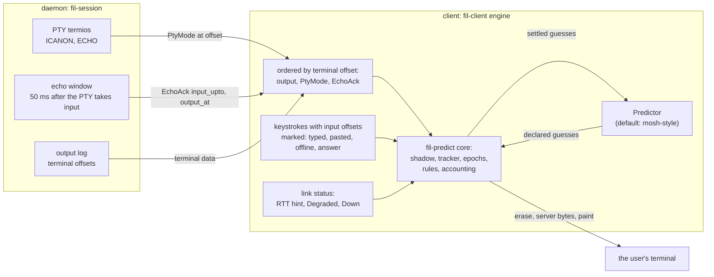
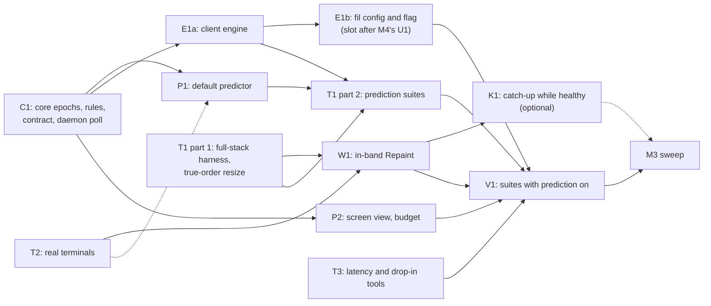

# M3 plan: prediction

> **Status: proposed by the coordinator on 2026-11-04, for the owner's questions in §4.4.** The owner asked (2026-11-04) for M3 to start now, overlapping the last M2 sweep PRs and running beside M4 (`docs/m4/plan.md`). Written on `origin/main` at `12f974d` (wire revision 11); revised after review. M3 in `DESIGN.md` §15 is "the trait and the default predictor; then the M3 sweep", done when "no visible mispredictions in the harness, and the sweep is closed". `DESIGN.md` stays the source of truth: each package updates its own sections, and where this file and `DESIGN.md` or the code differ, they win. Items marked **proposed** are the coordinator's calls and can change in review. Items marked **OWNER** wait for the owner, with an interim default. **The owner answered on 2026-11-04:** OQ-1 and OQ-2 as recommended, and PC-1 confirmed except its glitch underline trigger, which is pending (§2.7, §4.4, §4.5).

## 0. Preconditions and the overlap with M2 and M4

- **M2 is in its sweep.** Its fix PRs edit `crates/fil-forward/**` and `crates/fil-proto/src/{mux.rs, mux/*, ring.rs}`. **No M3 package touches those files until the M2 sweep is closed.** Nothing in this plan needs them.
- **M4 runs beside M3.** M4 does not touch `crates/fil-predict/**` or `crates/fil-client/**` until M3 closes (its §0). The files both milestones need are serialized by the coordinator (§3, "File ownership"):
  - `crates/fil/src/{cli.rs, config.rs, app.rs}`, the `crates/fil/tests/*` files named below, and `DESIGN.md` §14: M4's U1 first, then M3's **E1b** (only E1's `crates/fil` part), then M4's LIC, then M4's CFG. The coordinator opens each slot; each later PR merges main first.
  - **The catch-up rule** (§6.2, `fil-proto/src/log.rs`, the catch-up decision in `fil-session/src/core.rs`) is M3's K1. M4's CFG comes after K1 and does not touch it.
  - `crates/fil-proto/src/limits.rs` is W1's while W1 is open.
  - `.github/workflows/linux-check.yml` and `tests/realnet/**`: each package adds its own suite or part file. The shared suite list in the workflow and the part list in `tests/realnet/run.sh` take one-line additions, merged by whichever PR lands second.
- **The wire.** W1 (§2.8) is the only planned wire change. If an M2 sweep PR bumps `PROTOCOL_REVISION` first, W1 takes main's golden, bumps past it and regenerates (the `[history]` conflict is the guard, `CLAUDE.md`).
- **The M3 sweep starts only after the M2 sweep is closed** (§15: every milestone ends with its own sweep).
- **M3's `DESIGN.md` sections:** §2 goal 1 (W1), §4.2 (W1), §6.2 (W1, K1), §8.5's terminal messages, in-band records and mode poll (C1, W1), §9 (C1, P1), §11 (OQ-1's outcome), §12 (C1), §14 (E1b), §16.7's prediction RTT threshold (P1) and §16. Conflicts with M2's and M4's edits are resolved by the later PR.

## 1. Scope

### Goals (DESIGN §9, §12, §14, §15)

1. **The predictor trait, settled** (§9: pluggable, decided; behind a trait, decided in §2 goal 8). The M0 trait grows what M1 made available: input offsets, the echo acknowledgement, PTY mode changes, link health and a cheap read-only screen.
2. **The core as the safety boundary.** Every rule that protects a secret or the screen lives in `fil-predict`'s core, whatever the predictor does: the predictor *declares* guesses; the core decides which are written (§2.4).
3. **The default predictor**, mosh-style, conservative, adaptive (§9), good enough that a person typing into a shell, a REPL or `cat` over a slow link sees **no visible misprediction** (§2.5).
4. **Integration in the client engine**: `Attach.echo_ack`, `EchoAck` and `PtyMode` applied in order with the output, input offsets, and correct behavior across resume, swap, snapshot, takeover, resize, detach and exit.
5. **Configuration**: `predict = "off" | "adaptive" | "always"` per host (already parsed, §14), plus a `--predict` flag (proposed).
6. **A harness that proves the done-when**: the M0 oracle extended to the whole stack on real PTYs (macOS and Linux), real terminals, real-network latency cells, and the Pi drop-in suite with prediction on.
7. **The M3 sweep** (§15).

### Non-goals for M3 (proposed)

- **Prediction on the alternate screen** (vim, less, htop, tmux). §9 keeps it off unless a predictor opts in; the default one does not.
- **Predicting a wrap to the next line, a scroll, or `Enter`.** §9 forbids painting anything that would scroll or wrap; the predictor stops before the last column, as in M0.
- **Predicting the effect of control keys** (Tab completion, history, Ctrl-R, Ctrl-U, Ctrl-W). Each is a core boundary (§2.4 rule 3).
- **A second predictor.** The trait must make one possible. Shipping one is not in scope.
- **The M2 deferrals that are not prediction:** the final output tail of an ended session and Unix-socket forwards are handed to M4 (`docs/m4/plan.md`).

### Carried items, verified against the code

| Item | Verified | Decision |
|---|---|---|
| **M0: report ICANON/ECHO in order with the output.** | Done in M1: `PtyMode { canonical, echo, at }`, read per output batch, after input, and by a 50 ms poll (`fil-session` `core.rs`), stated again after every `AttachReply` and snapshot. The client queues it by offset (`engine.rs` `apply_modes`) and hands it to `Display::set_pty_mode`. | Use as is. C1 makes every change a core boundary (§2.4). |
| **M0: acknowledge input echo the way mosh does.** | Done in M1, daemon side: `EchoAck { input_upto, output_at }` after a 50 ms echo window counted from the PTY *taking* the bytes (`fil-session/src/echo.rs`), only for `Attach.echo_ack`, which also keeps the 50 ms mode poll for as long as the client is attached. **Client side not done:** `begin_attach` sends `echo_ack: false`, and `ControlMsg::EchoAck` is ignored (`engine.rs`). | E1a asks for it and routes it; the core settles guesses with it (C1). C1 also ends the indefinite 50 ms poll (§2.10). |
| **M0: width disagreements (VS16, ambiguous width).** | Unresolved by design (`docs/spikes/emulator.md` row 10). M1 hardened the restore path: a restored cell that is not printable ASCII gets a cursor move of its own (`overlay.rs` `restore`), and the status line avoids ambiguous runs (`tests/status.rs`). The core only paints ASCII and Latin letters. | T2 measures each real terminal's widths against the shadow's; P1 makes no guess next to a cell T2's table marks as disputed (proposed). |
| **M0: prediction never tested in a real terminal.** | Still true. M1 and M2 tested the overlay's status line against emulators only; the drop-in suite reads the client through `vt100`. | **T2**, early: it can invalidate the core's assumptions. |
| **M0 harness resizes in the wrong order.** (found while reading) | `driver.rs` `Ev::Resize` erases, *then* resizes the oracle. A real terminal resizes (and reflows) first; the client learns afterwards. `hazards.rs` `resize_with_predictions_showing` passes only because of the order. | **T1** reproduces it in true order, narrowing and widening; **W1** gives the client a way to repair (§2.8). |
| **Status-line known limit: a narrowing resize under the overlay** leaves damage until the next resume or swap (`ResumeRequest.want_snapshot`, §4.2). | yes (`display.rs` `resize`, `engine.rs`) | With prediction painting at every keystroke this stops being rare. **W1** repairs it at once, for predictions and status lines alike. |
| **The client reads no RTT.** | yes: `LinkStatus.rtt` exists (`fil-transport/src/link.rs`); nothing in `fil-client` reads it. On the pipe it is a single ping sample, refreshed only after 1 s without traffic, so it goes stale while the user types. | E1a passes it as a hint; P1 measures its own smoothed echo time (§2.7). |
| **`predict` is parsed and unused.** | yes: `Predict { Off, Adaptive, Always }`, per `[defaults]` and `[host.NAME]` (`crates/fil/src/config.rs`); `run` passes no predictor (`fil-client/src/lib.rs`). | E1a (the client) and E1b (the `fil` binary). |
| **Big-`cat` scrollback loss** (deferred to M3 by the M2 plan). | yes: L1 found catch-up firing on every 4 MB `cat` on both transports, even with a fast consumer (`docs/m2/latency.md` §4). | **K1**, optional and parallel (§3). Not a done-when item. |
| **Final output tail of an ended session; Unix-socket forwards** (deferred to M3 by the M2 plan). | yes | Handed to M4 (`docs/m4/plan.md`). |
| **Test harness code ships in the library.** `fil-predict`'s `oracle`, `driver` and `sim` are unconditional `pub mod`s. | yes (`lib.rs`) | C1 puts them behind a cargo feature that the `harness` feature and the tests enable (proposed). `just predict-harness --seeds 2 --keys 60` (which M4's MAC job runs) keeps working with the same flags. |
| **Duplicated parsers.** The tracker reimplements charsets (now in `fil_term::model::Modes.charsets`) and an at-rest scanner (now `fil-term/src/boundary.rs`). | yes | M3 sweep, redundancy audit. Not in C1: the tracker's "unknown after DECSTR" semantics differ and must be kept. |

### Done when

1. **No corruption and no secret, anywhere.** Across every suite below, with every guard on: zero oracle violations of the kinds `Erase`, `Flush`, `Painted`, `Cursor`, `Probe`, `Secret`, `Policy` and `Leftover`, and no character of a secret written to the terminal (the reserved-alphabet check, §5.2).
2. **No visible mispredictions** at the split bar in §2.5 (OQ-2; decided, owner 2026-11-04), counted by the independent classifier (§5.4), in:
   - the sans-IO scripted soak (`just predict-soak`), 1,000 seeds;
   - the full-stack harness (T1) on real PTYs on macOS and on Linux, over the pipe and QUIC (§12's transport matrix), at 50, 150 and 400 ms RTT, with jitter and with 2 % loss on QUIC;
   - the real-network latency cells (§5.5);
   - the Pi drop-in suite with prediction on (§5.6).

   **Open, blocks the M3 close (P1 review, #120):** the faithful zero-misprediction bar holds in the soak only with each program write delivered whole (`SimConfig::split_writes = false`). With writes cut at arbitrary bytes, faithful programs show 0.02 to 0.12 visible mispredictions per 1,000 keys at 1,000 seeds (vi-mode 0.12, fish 0.10, offline, paste and zsh 0.04, echo 0.02; 0.2 to 0.8 before #120's core fix), and the reviewer measured the same with cuts only at sequence boundaries, as the daemon releases output. Two kinds:
   - **`ended`** (vi-mode, `\b \b`, an insert's shifted rest): correct guesses blink out and come back with their echo; no wrong glyph is shown. #120 fixed the main case (an echo's second piece leaving the cursor where the epoch's latest confirmed guess left it is explained); the residue is open for P2 (`overlay/epochs.rs`).
   - **`contradicted`** (fish): a suggestion drawn in a later write than the echo contradicts a written guess ahead of the cursor, and a wrong glyph shows. It needs an owner decision: class fish's after-echo suggestion as "echoes something else" (the adversarial bar), or change rule 3's redraw exemption so a cell ahead of the echo is contradicted only by `EchoAck` (which moves OQ-1 case 4's end from the prompt's chunk to the ack).

   The close gate: the soak passes the faithful bar with splits at sequence boundaries at least (a delivery model the sim still has to gain), or the owner accepts a named residual, as for OQ-1.
3. **Prediction helps.** With `adaptive` at 150 ms RTT and above, the p50 time from a printable key to its glyph on the screen, over the keys whose guesses were written, is under 5 ms (it is about one RTT without prediction), measured by `keyprobe --screen`. The p50 over all printable keys is reported next to it.
4. **Adaptive is quiet when it should be.** With `adaptive` at a 5 ms RTT, nothing is painted in the shell scenarios (glitches are measured from `EchoAck`, so a slow program does not count as a slow link: §2.7).
5. **Nothing regresses.** Every M1 and M2 drop-in and realnet scenario passes with prediction on (`always`, and `adaptive` with injected latency).
6. **Real terminals agree** with every assumption the core makes, including how they reflow on a resize, on xterm, kitty, WezTerm and tmux under Xvfb, read back automatically (§5.3), or the core has a guard for each disagreement. No macOS terminal is required (§3 T2).
7. **The performance budget** (§2.10) holds on the macOS development machine, GitHub's Linux x86_64 runner and GitHub's Linux arm64 runner.
8. **The M3 sweep is closed.**

## 2. Contracts first

### 2.1 Principles

- **The core is the safety boundary; the predictor is untrusted** (as in M0). Every rule in §2.4 is enforced in `fil-predict`'s `Overlay`, with a `Guards` switch so a test shows it is needed, and each guard's test also runs with the hostile predictor, so the test proves that the *core* is needed and not the default predictor's good manners.
- **The predictor proposes; the core decides.** A predictor declares every guess, shown or not, tagged with the input offset of its key. The core confirms guesses from the shadow screen and from `EchoAck`, keeps the epochs, and writes a guess only in an epoch it has confirmed itself.
- **Everything ordered with the output stays ordered with the output.** `PtyMode` and `EchoAck` reach the core only once the client has applied the output below their offsets, whatever order the transport delivered them in (control goes ahead of data on every transport, §8.1).
- **Written means shown.** Bytes the overlay paints reach the user's terminal, its recorders (asciinema, a terminal's session logging, a local tmux's history) and anything sharing the screen, even if they are erased a moment later. So "never show a secret" means "never write it", and how long a guess stayed on the screen does not matter.
- **Mispredictions are counted twice, independently.** The core counts them (`PredictStats`), and the harness counts them again from the bytes the overlay wrote, against its own emulator (§5.4). The two must agree.

### 2.2 Where prediction state comes from



| Source | Today | What M3 uses it for |
|---|---|---|
| **Output bytes** | fed to the shadow by `Display::server` | the core confirms or contradicts guesses; the tracker's gates (§9, spike C); unexplained output |
| **`PtyMode`** | ordered by offset, applied in `apply_modes` | the password rule (canonical, echo off); a boundary on every change (§2.4) |
| **`EchoAck`** | the daemon sends it for `echo_ack` clients; the client ignores it | the core settles a guess whose key is below `input_upto` once the output below `output_at` is applied (§2.4 rule 5); P1's echo-time measurement |
| **Alternate screen, bracketed paste, kitty keyboard flags** | in the shadow's `Modes` | the alt-screen rule; paste detection; key decoding |
| **Input offsets** | the terminal channel's `SendChannel` (`sess.input`); records take no space | the epoch of every guess; pairing it with the `EchoAck` that settles it |
| **Input kind** | implicit in the engine's paths (`user_bytes`, offline buffer, answers) | only typed, live input is predicted |
| **Link RTT and health** | `LinkStatus { rtt, .. }` | a starting hint for P1's adaptive switch (§2.7) |
| **Snapshots, resume, swap, takeover, resize** | engine events | resets, rebases, boundaries (§2.6) |

No new daemon state is needed for prediction. W1's in-band `Repaint` is for screen repair (§2.8).

### 2.3 The trait (C1; replaces the §9 sketch)

```rust
/// Where a byte sits in the subscriber's input stream: the offsets `EchoAck.input_upto` counts
/// (DESIGN §8.5). Starts at 0 on a fresh attach, continues on a resume.
pub type InputPos = u64;

/// A read-only view of the shadow screen. C1 implements it over `TermState`; P2 makes it cheap.
pub trait ScreenView {
    fn size(&self) -> Size;
    fn cursor(&self) -> Cursor;                // row, col, pending wrap, visible, pen
    fn modes(&self) -> &Modes;                 // alt screen, insert, origin, autowrap, paste, ...
    fn cell(&self, row: u16, col: u16) -> Option<CellRef<'_>>; // text, width, attrs
    /// A value that changes whenever a glyph on `row` changes (§2.4 rule 3). It may also change
    /// when nothing visible did (stricter is allowed). C1's implementation is a 64-bit hash of the
    /// row's glyphs from `TermState`, so it stays the same across a glyph change only by an
    /// accidental collision (about 2^-64 per row and key), and it cannot see a change undone
    /// before it is read; P2's is a write counter or damage tracking in the backend, which sees
    /// every write.
    fn row_stamp(&self, row: u16) -> u64;
}

pub struct LinkView {
    pub rtt_hint: Option<Duration>, // LinkStatus.rtt: a hint only (stale on the pipe while typing)
    pub degraded: bool,             // LinkStatus::Degraded
}

pub struct Ctx<'a> {
    pub screen: &'a dyn ScreenView,
    pub link: LinkView,
    pub pty: PtyMode,
    pub now: Time,
}

/// What a predictor proposes. Nothing here is written by itself: the core checks every guess,
/// records it, and writes one only in an epoch it has confirmed (§2.4).
pub enum OverlayEdit {
    /// The key at input offset `at` will put its own character in this cell (for a Backspace: a
    /// blank). The core knows the key's character and computes where the cursor ends up.
    Guess { row: u16, col: u16, at: InputPos },
    /// The key at `at` (a left or right arrow, Ctrl-B, Ctrl-F) moves the cursor only; the core
    /// computes where to.
    Move { at: InputPos },
    /// The predictor no longer expects this cell's guess (a backspace over it, a shift).
    Withdraw { row: u16, col: u16 },
    /// Withdraw every guess.
    Clear,
}

/// How the predictor wants confirmed guesses drawn. It can only hold back: `Hide` writes
/// nothing, and no value makes the core write a guess it has not cleared.
pub enum Show { Hide, Plain, Underline }

/// What the core decided about one guess.
pub struct Settled { pub at: InputPos, pub outcome: Outcome, pub sent: Time, pub settled: Time }
pub enum Outcome { Confirmed, Restyled, Contradicted, Withdrawn(WithdrawReason) }

pub trait Predictor: Send {
    fn on_key(&mut self, key: &KeyEvent, at: InputPos, ctx: &Ctx<'_>) -> Vec<OverlayEdit>;
    /// Output was applied: re-plan (shift guesses after an echo, say). Settling is the core's.
    fn on_output(&mut self, ctx: &Ctx<'_>) -> Vec<OverlayEdit>;
    /// What the core settled since the last call, for the predictor's own bookkeeping.
    fn on_settled(&mut self, settled: &[Settled], ctx: &Ctx<'_>);
    /// An `EchoAck` was applied (after the core settled what it could): for timing only.
    fn on_echo_ack(&mut self, input_upto: InputPos, ctx: &Ctx<'_>);
    fn on_tick(&mut self, ctx: &Ctx<'_>) -> Vec<OverlayEdit>;
    fn next_deadline(&self) -> Option<Time>;
    /// The display policy now (adaptive: `Hide` on a fast link).
    fn show(&self, ctx: &Ctx<'_>) -> Show;
    fn reset(&mut self);
    fn has_outstanding(&self) -> bool;
    fn wants_alt_screen(&self) -> bool { false }
}
```

- **The core checks every edit** (anything else is ignored and counted as `rejected`):
  - `at` is a typed key the core has seen, of the current epoch, not yet settled; at most one edit per input offset;
  - the edit's kind matches the key: a `Guess` only for a printable key or a Backspace, a `Move` only for a left or right arrow, Ctrl-B or Ctrl-F;
  - a `Guess`'s glyph is the key's own character (a blank for Backspace), and it must be one the core may paint (M0's character and cell rules); a predictor cannot choose the glyph;
  - the cursor after a guess is computed by the core (the cell plus the glyph's width, on the same row; the cell itself for a Backspace blank); a `Move`'s target is the cursor one column left or right;
  - **in a tentative epoch only the plain forms are accepted:** the first key's guess at the shadow cursor and each later key's at the cursor the previous guess leaves (append), a Backspace blank one column left, a `Move` one column either way. Mid-line insert, with its shifted cells, is accepted only in a confirmed epoch.
- The core derives the cursor it draws from the latest written guess or move; there is no separate cursor edit.
- `KeyEvent` and `CellStyle` stay as in M0. Paste, kitty keys and the key boundaries are the core's (§2.4).
- `Overlay` gains `on_input(bytes, at: InputPos, kind: InputKind, now)`, `on_echo_ack(input_upto, now)` (the caller orders it), `set_link(LinkView)` (replacing `set_rtt`), `resized()` and `repainted()` (§2.4 rule 9), and `stats() -> PredictStats` (§2.5).
- Predictors are compiled in (§8.4). The factory stays `PredictorFactory` in `fil-client`.

### 2.4 Rules the core enforces on every predictor

M0's rules stay (spike C's hazard table: pending wrap, pen, hyperlink, insert mode, origin mode, charsets, DECSTR, wide characters, cursor visibility, last column, parser state, the sync bracket, a program's own sync batch, DECSC, the alternate screen, scrolling, queries, images). New in M3, each with a guard:

1. **Password rule (§9, unchanged):** nothing is written while the PTY is canonical with echo off; anything written is retracted when the report arrives.
2. **Epochs are the core's.**
   - Every guess belongs to the epoch its key was typed in; the core knows that from `at`, never from the predictor.
   - After a boundary the new epoch is **tentative**: its guesses are recorded and written nowhere. A tentative epoch that has ended (a later boundary) is never written.
   - **Every key is guessed.** A tentative epoch's guesses must cover its keys contiguously in `at`: a key the predictor declined to guess (no edit for it before the next key or output) is a boundary. So one guess that happens to match cannot stand in for keys the predictor skipped.
   - **The first confirmation needs the whole chunk explained.** An output chunk (one call of `on_server`) confirms a tentative epoch only if, in that chunk:
     - no guess of the epoch is contradicted, and the chunk is not `Unexplained` (rule 3); both are checked **before** confirmation, so a chunk that does both ends the epoch;
     - every glyph it changes, outside rule 3's two exemptions, is one of the epoch's guessed cells and now shows exactly its guess;
     - at least one guessed cell's glyph **changed** to the guess in this chunk, and **that guess is not a blank** (a Backspace's erase, a typed space): a masked prompt erasing its `*` for a Backspace changes one cell to exactly the blank the core computed, which is no evidence that the program echoes what is typed *(review B1, `Guards::nonblank_first`; a blank can still be confirmed, and can re-confirm an epoch after a late echo)* (a cell that already showed it, such as a fish autosuggestion under the cursor, does not count for the first confirmation; it can in a confirmed epoch);
     - the shadow cursor ends where the core computed it would be after one of the guesses this chunk confirms, or after a later declared guess of the epoch provided every guessed cell up to that guess shows its guess (a typed space over a blank qualifies), so a chunk that changes one cell and moves the cursor several columns does not confirm;
     - the chunk was received after the key of the first confirmed guess was sent (the client knows the terminal offset it had received when it sent each key).
     - **an `EchoAck` has already covered every key typed before the epoch's first key** (the keys still outstanding from earlier epochs). *(Coordinator's call, 2026-11-04, in C1.)* Until then a chunk that would confirm can be the late echo of an earlier key that happens to be the same character: keys typed ahead of a prompt are echoed after it, and a new epoch's first guess at the shadow cursor matches one. Such a chunk is neutral: it confirms nothing and ends nothing. The condition applies to the first confirmation only (a late echo re-confirms without it), it can only delay or prevent a confirmation, never cause one (`Guards::prior_acked`; `tests/sim.rs` checks that no write ever comes earlier with it), and it narrows OQ-1 case 3: output that equals the typed keys must now also come after the earlier input was acknowledged.

     A chunk that breaks any of these is `Unexplained`, and the tentative epoch ends unwritten. So a prompt (`Password: `) cannot confirm an epoch: it changes cells no guess covers, and no guess can hold `:` unless `:` was typed.
   - In a confirmed epoch, later guesses are written as they come (in the predictor's `Show` style) and confirmed by their glyph alone.
   - A contradiction (the guess's cell shows something that is neither the guess, nor what was there, nor an earlier guess for the cell) withdraws what is written and starts a new tentative epoch.
3. **Boundaries** end the current epoch (the next guesses are tentative, and nothing new is written for the ended epoch). What the ended epoch had already written **stays until it settles** (confirmed by its echo, or contradicted) after a `Key`, `Idle`, `Resumed` or `Unpredicted` boundary, and after a key the predictor declined (rule 2); it is **withdrawn at once** after `Unexplained` output, a `ModeChange`, a `Snapshot`, a contradiction, and on a withdrawal, reset, resize or lifecycle event. *(Coordinator's call, 2026-11-04, in C1: a written guess is already shown, "a guess once written is written", so erasing it at a boundary adds no secrecy and only flickers on most commands at 150 ms RTT. A kept guess belongs to no epoch the core is confirming: it never confirms the next one, and settles by its glyph, by `EchoAck` or by contradiction. The `Guards::keep_on_boundary` switch shows it is needed against the faithful bar.)* The boundaries:
   - `Key`: Enter, Tab, every C0 control except Backspace and DEL, a bare Esc, every escape sequence except the left and right arrows (`CSI C`/`D`, `SS3 C`/`D`), and every Alt-key; Ctrl-B and Ctrl-F are arrows here.
   - `ModeChange`: every `PtyMode` change. A raw-mode program that turns echo off (sudo with `pwfeedback`) therefore never has its first key written, and its `*` echoes contradict every later guess; its Backspace's erase (`\b \b`) cannot confirm an epoch either, because a blank guess never gives the first confirmation (rule 2, review B1).
   - `Unpredicted`: input that is not typed and live (rule 6), and keys typed while the outstanding cap holds (rule 8).
   - `Unexplained`: output that leaves the cursor anywhere but where the epoch's guesses say (the written ones in a confirmed epoch, the declared ones in a tentative epoch, where nothing is written), changes a glyph on any other row, or changes a glyph left of the cursor on its row that is not a guess. A prompt printed before a secret is read therefore makes the next key tentative, wherever on the screen it is drawn, with the cursor put back or not.
     - **Two exemptions, kept on purpose:** glyphs right of the cursor on the cursor's row (fish's autosuggestion, zsh's `RPROMPT`, both redrawn at every key), and attribute-only changes anywhere (syntax highlighting recolors the line at every key). Counting either would end every epoch in fish and in a highlighting zsh, so prediction would never show there. What they leave open is OQ-1 case 4.
     - **Cost:** while nothing is outstanding the core only notes that output arrived, and checks once, at the next key: the cursor against where the last settled guess left it, the cursor's row against a copy of its glyphs taken then, and every other row by its `ScreenView::row_stamp` against the stamps taken then. A flood costs nothing per chunk.
     - **The seam C1 needs** is only `row_stamp` (§2.3). C1 implements it by hashing each row's glyphs from one `TermState` read at that next key (correct, slower); P2 replaces it with the backend's write counter or damage tracking, which may be stricter but never misses a glyph change (a stricter stamp may also count an attribute-only write on another row; that only makes more keys tentative). C1 does not wait for P2.
   - `Idle`: the first key after 1 s with no input sent and no output received. Shorter than the daemon's 2 s quiet window (`ACTIVE_WINDOW`), so one-way delay cannot leave the daemon on its slow mode poll while the client still counts the session as active (§2.10).
   - `Resumed`: the first key after a resume or a swap.
   - `Snapshot`: every snapshot (fresh attach, catch-up, `want_snapshot`, W1's repaint), and every `Display::reset`. A snapshot can skip output the core never saw, a secret prompt among it, so **a new overlay always starts with a tentative epoch**; no epoch state survives a reset.
   - The boundaries are kept whenever `predict` is not `off`, also while the predictor's `Show` is `Hide` (adaptive on a fast link). A key typed while prediction was quiet therefore still ends the epoch when prediction turns on.
4. **Only confirmed epochs are written, in the predictor's style or less.** `Show::Hide` writes nothing; the core never writes a tentative guess, whatever the predictor returns.
5. **Settling by `EchoAck`.** Once the output below an ack's `output_at` is in the shadow, every guess whose key is below `input_upto` and is not confirmed is settled (and, review B2, so that this does not depend on the predictor: a guess whose cell showed its glyph before the guess is confirmed only if the cursor shows the echo reached it, else it is unechoed; a written guess the predictor withdraws makes the epoch tentative at once; and a written guess it supersedes (another key guessed on its cell) is checked like a pending one when the ack covers it and no covered later guess holds its cell, review B3; `Guards::ack_reached`, `Guards::withdraw_tentative`, `Guards::superseded_acked`):
   - its cell shows something else: contradicted (rule 2);
   - its cell is unchanged (no echo yet): the epoch goes tentative at once (no new guess is written), and the guess already written stays for a grace of 250 ms, for a program that echoes after the 50 ms window (zsh with highlighting plugins, Python's pyrepl, a loaded host). Echoed within the grace, it is confirmed and the epoch becomes confirmed again; otherwise it is contradicted.
   - An `EchoAck` whose `input_upto` is beyond the input sent is ignored, and settles nothing.
   - The acknowledgement that rule 2 requires before an epoch's first confirmation (covering every key *before* the epoch) is a rule; the hardening below (covering the confirming key itself) is separate.
   - **A proposed hardening, not a requirement:** before an epoch's first write, also require that no `Unexplained` output arrived up to the `EchoAck` that covers the confirming key. It would close OQ-1 case 3's split-chunk prompt, at about 50 ms more before the first written guess of each epoch. T1 part 2 measures that cost on the faithful suite (a `Guards` switch, off by default), and the coordinator decides from the number.
6. **Only typed, live input is predicted** (`InputKind::Typed`). Not predicted, and each a boundary (`Unpredicted`), with its offsets recorded so `EchoAck` accounting stays aligned:
   - **pasted text:** between bracketed-paste markers (`CSI 200~`/`201~`); when bracketed paste is off, any read of 64 bytes or more, and the reads that follow it within 5 ms (the short last chunk of a split paste);
   - **offline input** released on resume or after the confirmation (§4.3): it was typed against a screen that may be gone;
   - **answers** to the client's own questions, and escapes (`~.`, `~#`, `~?`), which never reach the session.
7. **Kitty keyboard protocol:** an unmodified printable key reported as `CSI codepoint u` is decoded as that character; a release event (`CSI ... ; m:3 u`, flag 2) is ignored; every other `CSI ... u` is a `Key` boundary. Proposed.
8. **Bounded state:** at most 1,024 guesses outstanding; past that the core stops asking the predictor, and the keys typed meanwhile are recorded as unpredicted ranges (rule 6) until guesses settle.
9. **Resize.** A resize marks the screen **untrusted**: a terminal may reflow differently from the shadow, so the shadow no longer says what the terminal shows, even where nothing was drawn. While it is untrusted the core still records and confirms guesses (from the shadow, which is the daemon's view) but writes none. The repaint is asked for **lazily** (W1, §2.8), so a user whose predictions never show (adaptive on a fast link) never gets one:
   - when the core next has a guess it would write: it asks for a repaint and holds the guess; the repaint is a snapshot, so a `Snapshot` boundary, and the held guess is re-checked in the new, tentative epoch: it is written only after a new confirmation (the first key after a resize waits for one echo);
   - when the overlay has something drawn at the resize (a status line, a question, written guesses): at once, as today's `want_snapshot` case does at the next resume;
   - when a status line or question is drawn on an untrusted screen (the user must still see what is happening while disconnected): once it is removed.

   Trust comes back with **any** snapshot rendered at the client's current size generation (W1). While the link is down the repair is the resume's snapshot (`want_snapshot`).

### 2.5 Misprediction: definition, accounting, bar

**Definition (proposed; OQ-2 confirms the bar).** A *visible misprediction* is a predicted glyph that the overlay wrote to the user's terminal and later removed without the shadow screen showing that glyph in that cell at the moment of removal, because the core contradicted it (by output or by `EchoAck`), expired it while the link was up, or retracted it under the password rule. Glyph means the cell's text: a different color or attribute (fish or zsh syntax highlighting recoloring the echo) is *restyled*, counted, and not a misprediction. A cursor drawn at a place the real cursor never reaches is counted separately (`cursor_miss`). C1 replaces §12's "any mismatch left after confirmation is a failure" with this definition.

**Lifecycle withdrawals are counted apart** (decided, owner 2026-11-04, as part of OQ-2's bar) (`withdrawn { takeover, detached, exit, refusal, snapshot, resize, backstop }`): a takeover, a `fil detach` from elsewhere, a refusal, `SessionExited`, a snapshot's reset, a resize, and the 10 s backstop while the link is down remove written guesses that may well have been right. They are reported and excluded from the faithful bar; a fault run has its own bar (below).

**Accounting (C1).** The core keeps `PredictStats`: `guessed`, `written`, `confirmed`, `restyled`, `tentative_dropped` (never written: correct behavior), `mispredicted { contradicted, echo_ack, expired, password }`, `withdrawn { .. }`, `cursor_miss`, `rejected` (edits the core refused). Counts only. A snapshot's reset classifies what was written against the shadow after the snapshot has landed. The client logs the counts at `debug` when a run ends (§4.3).

**The bar (OQ-2; decided, owner 2026-11-04: the split bar).** Everywhere, zero corruption and zero secrets shown; on programs that echo faithfully, late echo included, zero visible mispredictions; on programs that echo something else or share the screen, at most one shown run of wrong guesses per contradiction; withdrawals from takeover, exit, snapshot, resize or a link drop counted apart.

| Suite | Bar |
|---|---|
| Corruption, `Secret`, `Policy`, `Leftover` | **zero, everywhere**; not negotiable |
| **Faithful echo**: bash, zsh (with `RPROMPT`), fish (with autosuggestions), dash, Python 3.13+'s pyrepl and its readline REPL (`PYTHON_BASIC_REPL=1`), raw `cat`, canonical `cat`, `read` with echo on; no other writer on the terminal | **zero** visible mispredictions over the whole run (at least 100,000 predicted keys over seeds, latencies and transports) |
| **Faithful but slow**: a scripted remote that echoes 60 to 200 ms after the PTY takes the key | **zero**: held to the faithful bar (rule 5's grace is for it) |
| **Adversarial echo**: a program that echoes something else (upper case, asterisks), raw no-echo, the M0 adversary's escape sequences, a background job writing while the user types | **at most one written epoch per contradiction**: after any misprediction nothing more is written until the core confirms a new epoch. Reported as a rate per 1,000 keys |
| **Fault runs** (the faithful programs with takeovers, snapshots, swaps, link drops and resizes injected) | zero mispredictions outside `withdrawn`; and `withdrawn` only ever removes guesses that were written when the fault happened |

### 2.6 Lifecycle: the overlay and the rest of fil

| Event | What happens to predictions (proposed) |
|---|---|
| **Resume** (same epoch, replay) | Kept. Input offsets continue (§8.5), so outstanding guesses are settled by the replayed output and later `EchoAck`s. `EchoAck`s lost with the old link are not needed: they are cumulative. The next key is a `Resumed` boundary. |
| **Swap** (pipe and QUIC) | A resume at the commit point: as above. |
| **Snapshot** (attach, catch-up, `want_snapshot`, W1's repaint) | `Display::reset` builds a new shadow and predictor (as today); written guesses are classified, then dropped. A `Snapshot` boundary: the new overlay starts tentative (§2.4 rule 3). Keys sent but not yet echoed are echoed after the snapshot, unpredicted. |
| **Link `Degraded`** | Keys still go out and are predicted: a slow link is the case prediction is for. The status line and predictions share the overlay (M1). |
| **Link `Down`** | Keys are offline input (§4.3), never predicted. What was written stays until it is settled or the backstop (10 s, or the next snapshot) withdraws it, so a key typed just before a drop still shows. |
| **Takeover, `fil detach` from elsewhere, refusal, `SessionExited`** | Withdrawn at once, before any question or message is drawn. The old client's later keys are not the session's. |
| **Fresh attach after a take-back** | New predictor; input offsets rebase to 0 (§8.5). |
| **Resize** | Erase and reset, as today; the screen is untrusted, and no guess is written until a snapshot at the new size lands, asked for only when something would be written (§2.4 rule 9, W1). |
| **Native scrollback** | Untouched: nothing is painted that scrolls (§9), `Enter` is never predicted, and a guess never reaches the last column. W1's repaint renders no history, so the scrollback is not duplicated. |
| **Offline input confirmation and questions** | Their keys are answers (§2.4 rule 6). |
| **`~.` and exit** | Withdrawn before the terminal restore (`restore_sequence`). |

### 2.7 Configuration and the adaptive switch

- `predict = "off" | "adaptive" | "always"` in `[defaults]` and `[host.NAME]`, as parsed today; default `adaptive` (decided, owner 2026-11-04: PC-1).
- **`--predict off|adaptive|always`** overrides it for one run, like `--transport` (E1b; proposed).
- `off`: no predictor, `Attach.echo_ack = false` (no `EchoAck`, the M1 mode poll). `adaptive` and `always`: `echo_ack = true` for the whole attach, so turning on mid-session needs no message.
- **The adaptive switch (P1, proposed, mosh's values, §16.7 "to tune"):**
  - **The estimate is P1's own:** a smoothed time from a key's send to the `EchoAck` that covers it, minus the 50 ms echo window, which is the link and the PTY's queue and not the program's own echo time. `LinkView.rtt_hint` seeds it until the first ack. The pipe's `LinkStatus.rtt` (one ping sample, refreshed only after a second without traffic) and QUIC's (quinn's smoothed RTT) therefore do not make the two transports behave differently.
  - Show guesses when the estimate is above 30 ms (decided, owner 2026-11-04: PC-1); stop below 20 ms.
  - Also show them for the next 30 s after a **glitch**: a key whose `EchoAck` came more than 250 ms after it was sent (measured from the ack, so a program that echoes late on a fast link is not a glitch).
  - `always` shows them at any RTT.
- **Underline (PC-1):** a written guess is underlined while the estimate is above 80 ms (decided, owner 2026-11-04), and after a glitch, an echo more than 250 ms late (decided, owner 2026-11-04, round 2: not "after a wrong guess"); plain otherwise (mosh's rule). DESIGN §9 says the same.
- Tunables (the thresholds, the glitch window, the grace, the backstop) are constants in `MoshConfig` and the core's config, not config keys, until V1's data says a user needs them. Proposed.

### 2.8 Wire changes

**W1: an in-band `Repaint`, one bump (revision 11 to 12, or past main at the time).**

- **`InputRecord::Repaint`** (variant 1, appended; client to daemon, on the terminal channel's keystroke direction, no fields): repaint my screen at the size I have told you. As an in-band record it takes no input space (§8.5) and is ordered after the `InputRecord::Resize` before it by the channel's own order, so the daemon has applied that size before it reads the request. (A control message would overtake the resize record, §8.1, and the daemon would render at the old size.)
- **`SnapshotReason::Repaint`**: the daemon answers with a mid-stream `Snapshot` announcement, as for catch-up, rendering **the screen and the modes with no history lines** (the client's native scrollback already holds the history) and `skipped` 0 (no marker).
- **`SnapshotInfo.size_gen`**: **every** snapshot (attach, catch-up, `want_snapshot`, repaint) says the size generation it was rendered at. The client trusts its screen again after applying any snapshot whose `size_gen` is its current one, so a catch-up or a resume snapshot rendered after the resize repairs it too, and prediction does not stay off until the next resize.
- **Rendered where the stream is.** The repaint is rendered at exactly the offset the connection has sent (`at`); output released meanwhile is sent first and the render tried again, so nothing is skipped and no marker is needed. Acknowledgements are not waited for (that starved the repaint under steady output: review of #102, F1); the bytes below `at` that are still in flight are applied by the client before the snapshot, which it holds until its terminal stream reaches `at`. On QUIC the output after `at` can overtake the announcement: the client then drops that stale repaint's bytes and asks again, without reconnecting (re-check F3). A link lost while a repaint is held resumes (a repaint moves no position) with `want_snapshot`. A repaint's confirmation can be early (an ack of `at` sent before the client saw the announcement), so the next snapshot can be announced ahead of the repaint's bytes: the client queues one announcement behind an incomplete or held snapshot and begins it once the current one's bytes are in; a catch-up supersedes an unapplied repaint; a third announcement reconnects (re-check 2, F4).
- **Coalesced, never dropped.** A request the daemon cannot serve at once becomes one *owed* repaint, served as soon as it can be:
  - while output released is not yet sent: once it is;
  - while a snapshot is in flight (it was rendered before the resize, at the old size): after the client has acknowledged it (§6.2's one-at-a-time rule);
  - within 1 s of the last repaint served: when the second has passed (a trailing repaint, so the final size of a window drag is always repainted);
  - any number of requests meanwhile owe one repaint.
- **Across links:** a repaint owed or in flight when the link dies is asked for again: a client that is still untrusted resumes with `want_snapshot`, whose snapshot carries `size_gen` like any other.
- A `Repaint` from a connection that no longer holds the session is ignored, as its keys are.
- **The client** sends it lazily, as §2.4 rule 9 says, never just because the window changed. Exactly (W1, `crates/fil-client/src/engine/repair.rs`): after any resize the screen is untrusted until a snapshot at the current `size_gen` lands; a repaint is needed (1) at once when anything was drawn at the resize, in either direction (T1: a widening that joins wrapped rows leaves the cursor on another row, so the next write would land wrong; the `Display::resize` flag that fires only on narrowing is not used); (2) when a guess would be written on the untrusted screen, before it is (C1's core holds it and raises `take_repaint_request`, which E1a feeds to the engine's `Repair` through `Display`; until then the M0 overlay writes the guess and the engine asks right after; T2 found that real terminals reflow unlike the shadow with nothing drawn, so this is the case that covers the terminal's own reflow: a client whose predictions show repaints after every resize before its first write, an adaptive one on a fast link never); (3) when a status line or a question drawn on the untrusted screen is removed (T1: a QUIC link that recovers by itself has no resume). The record goes after the resize record of the current generation. A snapshot that lands at an older generation than the client's (the window changed while it was on its way) also makes a repaint needed (F2); one asked for and not landed when the link goes (or needed while it is down) is the next resume's `want_snapshot`, and after a swap whose attach did not ask it is asked again on the new link.
- **The clear.** The snapshot writer starts with `CSI H CSI J` (`fil-term/src/snapshot.rs`). T2 found that tmux pushes the screen into its scrollback on it (and on `CSI 2 J`), and that `CSI 2 K` on each row, then home, pushes nothing on xterm, kitty, WezTerm or tmux, nor in the emulator (`docs/m3/terminals.md`). A separate fil-term change (ST1) makes that the snapshot writer's clear for every snapshot; W1 renders the repaint through the writer and takes it from there.
- **Why a wire change:** without it the only repair is a resume, which on the pipe is a new ssh login.
- **Gate:** T1's true-order reproduction lands first and shows damage under the overlay on alacritty as the oracle. T1 cannot show a real terminal reflowing unlike the shadow (its oracle is the same emulator), so T2's reflow finding (§3) is the second trigger. If neither shows damage, W1 is dropped, §4.2's text stays, and rule 9 becomes "no guess after a resize while something is drawn, until the next snapshot".
- **W1 also updates** §2 goal 1 ("while connected, the screen is never redrawn from a model": the repaint is the second exception after catch-up), §4.2, §6.2 and §8.5.

**Considered and not needed:**

- More termios flags in `PtyMode` (`IUTF8`, `ECHOE`, `ECHOCTL`) for canonical-mode backspace: the predictor erases only its own guesses (P1), and a terminal without `ECHOE` is rare; a wrong guess there is an adversarial-suite case.
- Toggling `echo_ack` mid-attach for `adaptive`: set it for the attach (§2.7).
- A daemon-side "alternate screen" or "paste mode" report: the client's shadow has both.
- Per-key acknowledgements: `EchoAck` is cumulative and enough.

After W1, no package changes the wire. A wire change found in review becomes a small coordinator PR with its own bump (the M2 rule).

### 2.9 Limits and defaults (proposed; constants, not wire)

| Name | Value | Note |
|---|---|---|
| Echo window | 50 ms | daemon, M1 (`echo_window`) |
| Late-echo grace | 250 ms after the `EchoAck` | §2.4 rule 5 |
| Adaptive on / off | 30 ms / 20 ms, P1's estimate | mosh |
| Underline | above 80 ms, or within a glitch window | mosh (PC-1) |
| Glitch | `EchoAck` more than 250 ms after the key; guesses shown for 30 s after | mosh |
| Expiry backstop | 10 s while the link is down, or the next snapshot | a guess is settled by `EchoAck` normally |
| Idle boundary | 1 s with no input sent and no output received | §2.4 rule 3 |
| Unmarked paste | a read of 64 bytes or more, and reads within 5 ms after it | §2.4 rule 6 |
| Outstanding guesses | 1,024 | §2.4 rule 8 |
| Repaint | owed, coalesced; at most one served per second per session | W1 |

### 2.10 Performance budget (proposed; P2 measures, the sweep audits)

- **Per keystroke** (decode, predictor, core checks, paint; not the write): p99 under 200 µs at 200x50 in release on the macOS development machine, and under 1 ms on GitHub's Linux x86_64 and arm64 runners (the arm64 runner stands in for slower aarch64 clients; the Pis run the daemon, not the client).
- **Output with nothing outstanding:** no screen read, as today (`has_outstanding`); `cat` of 100 MB costs within 3 % of `predict = "off"` in client CPU, compared as the medians of 10 runs each, with the spread reported.
- **Output with guesses outstanding:** at most one screen read per output chunk, and no grid copy (P2's `ScreenView`). Unexplained output ends the epoch (§2.4 rule 3), so a flood stops the reads after its first chunk.
- **Memory:** bounded by §2.4 rule 8; no allocation per key in steady state beyond the edit list.
- **Wire:** at most one `EchoAck` per 50 ms window while typing, none while idle; at most one repaint per second, and only after a resize during active prediction or with something drawn (§2.4 rule 9).
- **Daemon wakeups (C1):** today an attached session of a predicting client polls the PTY mode every 50 ms for as long as it is attached (`poll_interval` with `predicting = true`), 20 wakeups a second; with `adaptive` the default, that would be every session. The fast idle poll existed so that a password prompt after a silence is known before the first key is painted. The core's `Idle` boundary (§2.4 rule 3) now makes that first key tentative, and a tentative key is never written, so C1 gives predicting clients the normal idle slowdown (500 ms after 2 s of quiet), in the same PR as the rule, with a test. Target: at most 2 wakeups a second for an idle session.

## 3. Packages



Order is riskiest first: the core's secret rules and the contract (C1), the real terminals that could invalidate the core (T2), and the resize damage (T1 part 1, W1) start at once; the predictor's quality (P1) and the integration (E1a, E1b) follow; verification (V1) and the sweep close.

Every package keeps the M2 rules: one PR from its own branch; `just ci` gated on its exit status; an independent review that always covers privacy and security; the author fixes, the reviewer re-checks once, the coordinator merges; **a mutation table** in every PR (each important check broken by hand, and the named test must fail); each package updates its own `DESIGN.md` sections.

### Wave 0 (start now; C1 is serial, the rest run beside it)

**C1: the core's epochs and rules, the contract, the daemon's poll**
- **Owns:** `crates/fil-predict/src/{predictor.rs, overlay.rs, keys.rs, tracker.rs, oracle.rs, driver.rs, sim.rs, mosh.rs, lib.rs}`, `crates/fil-predict/tests/*`, `crates/fil-predict/Cargo.toml`; a compile fix in `crates/fil-client/src/display.rs` (`NoPrediction` and the new calls, behavior unchanged); in `crates/fil-session/src/core.rs`, `poll_interval` and its test only; `DESIGN.md` §8.5 (the mode poll sentence), §9 and §12.
- **Builds:** §2.3 (the trait, `ScreenView` over `TermState` with C1's `row_stamp`, the core's checks on every edit, `Overlay`'s new inputs); §2.4 rules 2 to 9 with a `Guards` switch each; `InputKind`; `PredictStats` and §2.5's classification; the oracle's new kind `Mispredict` with the suite categories; the reserved-alphabet secret check (§5.2); `oracle`, `driver` and `sim` behind a cargo feature that the `harness` feature and the tests enable (`just predict-harness --seeds 2 --keys 60` keeps working with the same flags); the M0 `MoshPredictor` and the hostile predictor ported to declared guesses with their behavior otherwise unchanged (P1 improves the first); §2.10's daemon poll change.
- **Tests:** a deterministic trace per new rule in `hazards.rs`, each run with the mosh predictor **and the hostile one**:
  - `sudo` typed ahead: a password typed right after Enter, before the echo-off report, is never written; also with the adaptive gate off at the Enter and on by the password (the case where M0's predictor skipped its own epoch bookkeeping);
  - a shown guess withdrawn on a mode change; an asterisk-echo raw program never writes a typed key;
  - **forged confirmations, with a hostile predictor that guesses the prompt:** after `sudo true⏎` it declares guesses for the password keys at the cells and characters of `Password: `; the prompt arrives; nothing is written. Also: a guess whose cell holds the typed key's character but whose chunk changes other cells (the rest of a prompt) does not confirm; a key with no guess between two that match does not let them confirm; a prompt drawn on another row with the cursor put back (DECSC/DECRC) is `Unexplained` at the next key; a fish autosuggestion under the cursor does not give the first confirmation;
  - a bracketed paste, an unmarked 1 KiB paste split into a 1,000-byte and a 24-byte read, and released offline bytes: never written, offsets kept, the next key tentative;
  - the first key after 1 s idle tentative; kitty `CSI 97 u` decoded as `a`, its release event ignored; the outstanding cap with its unpredicted range;
  - settling by `EchoAck`: an unechoed guess contradicted after the grace, a late echo within the grace confirmed, an ack beyond the input sent ignored;
  - after a resize no guess is written until a snapshot at the current size generation lands, and the repaint is asked for only when a guess would be written or something is drawn; the held guess waits for a new confirmation after the repaint;
  - a catch-up snapshot that skipped a `Password:` prompt, then a key: nothing is written (the epoch confirmed before the snapshot does not survive it);
  - accounting: confirmed, restyled, contradicted, expired, each withdrawal reason, rejected edits.

  `sim.rs` gains the fake daemon's `EchoAck` (an echo window over its tty model) and the M3 scenarios (paste, offline release, raw echo-off, slow echo, async writer), on both backends. A session test for the poll: a predicting client's idle session polls at the slow rate after 2 s.
- **Mutation** (each with both predictors): let a tentative guess be written (`Secret` in the `sudo` trace); drop the `Key` boundary for Enter (same); accept a guess's character from the predictor (the forged-prompt trace); accept a predictor-chosen cell in a tentative epoch (same); confirm from a chunk with other changes (the rest-of-prompt trace); allow a gap in `at` (the skipped-key trace); check confirmation before contradiction in a chunk (a chunk that does both confirms); write an ended tentative epoch; keep the epoch across a `Display::reset` (the skipped-prompt trace writes the key); write the held guess once the repaint lands (same, with the repaint); check only the cursor's row when nothing is outstanding (the DECSC trace); count an unchanged glyph as the first confirmation (the autosuggestion trace); ask for a repaint on every resize (the lazy-repaint test); skip the mode-change boundary (the asterisk trace); predict inside a paste; drop the idle boundary (`read -s` after silence); classify by attributes (the restyle test counts a misprediction); count a tentative drop as a misprediction; keep the fast poll (the poll test).
- **Done when:** the above pass; `just predict-mutants` shows every new guard needed with the hostile predictor; the M0 suites pass unchanged; `just predict-harness --seeds 2 --keys 60` runs.

**T1 part 1: the full-stack harness, and true-order resize** (parallel with C1)
- **Owns:** `crates/fil-client/tests/predict_e2e.rs` (new), `crates/fil-client/tests/common/oracle_term.rs` (new) and its line in `tests/common/mod.rs`, the dev-dependencies and a test feature in `crates/fil-client/Cargo.toml` (`fil-session`, `fil-netsim`; neither depends on `fil-client`, so there is no cycle, which the PR checks), `crates/fil-client/examples/predict_e2e.rs` (new), a `justfile` recipe `predict-e2e`, `docs/m3/harness.md` (new). It does not touch `fil-predict` or `engine.rs`.
- **Builds:** the real `fil-client` engine (`run_with`, a predictor factory) against a real `fil-session` with real programs on a real PTY, over `fil-netsim` links with latency, jitter and loss, on `PipeLink` and `QuicLink` (§12's matrix); the client's terminal is the oracle terminal; the user is a seeded typist. On macOS and Linux (Linux through `linux-check`). First, with the current predictor and trait:
  - **true-order resize:** the oracle terminal resizes (and reflows) *before* the client sees the resize event; narrowing and widening, with predictions or a status line drawn; the damage is reported, not hidden;
  - a baseline of mispredictions with `EchoAck` off, to compare with P1.
- **Tests:** small cases in `just ci` (one program, one transport, a few keys); the rest on demand.
- **Mutation:** the existing `Guards` switched off through the full stack (`--guard-off password` must fail on `read -s`).
- **Done when:** the resize result (both directions) is written in `docs/m3/harness.md`, which gates W1, and the baseline is recorded.

**T2: real terminals** (parallel with C1; riskiest, so first)
- **Owns:** `tests/terminals/**` (new), `tests/terminals/exporter/` (new, its own cargo workspace: a scenario's flush stream with checkpoints and the expected screen at each; it was planned as `crates/fil-predict/examples/trace_export.rs`), a `terminals` suite in `.github/workflows/linux-check.yml` (its own job; the shared suite list is a one-line addition), the `suite=all` sentence in `CLAUDE.md`, `docs/m3/terminals.md` (new).
- **Builds:** replays exported traces (the spike's hazard traces, the scripted scenarios, status lines, resizes) into real terminals under Xvfb on GitHub's Linux runner, and reads the screen back at each checkpoint (after an erase, at the end), with no access change needed:
  - **xterm:** `CSI i` with `printerCommand` and `printAttributes`;
  - **kitty:** `allow_remote_control` and `--listen-on`, `kitty @ get-text --ansi`, Mesa's llvmpipe for OpenGL 3.3;
  - **WezTerm:** a release pinned by its hash, `wezterm cli get-text --escapes`;
  - **tmux:** `capture-pane -e -p` (also the "fil inside a local tmux" case).
- **No macOS terminal is read back in M3.** iTerm2's Python API and Terminal.app's AppleScript both need a macOS Automation consent and a GUI session for the account the agents run as, and Ghostty has no known read-back API short of an accessibility grant. If macOS read-back is ever needed, it is an access question for the owner, asked then. The four Linux terminals meet done-when 6.
- **Checks** each assumption the spike lists as unverified: `?2026` ignored where unsupported; `CUP` clears a pending wrap; overwriting a line's last cell clears its wrap flag; DECSTR's resets; unknown private modes ignored; how underline renders next to a color pen; the width of VS16 sequences, emoji and ambiguous-width characters against `unicode-width`; **reflow** on narrowing and on widening, compared with `alacritty_terminal` (xterm does not reflow at all); and whether the snapshot writer's clear (`CSI H` `CSI J`) pushes the screen into the scrollback (it matters for W1's repaint and for snapshots).
- **Output:** a table per terminal. A disagreement with the core is a finding: a new guard (by whichever package owns `overlay.rs` then: C1, else P2) or a documented limit. A reflow that differs from the shadow is W1's second trigger.
- **Tests:** the exporter's traces replay into an alacritty emulator with no difference (the harness's self-check); a terminal whose read-back fails fails the suite rather than passing it.
- **Done when:** the four terminals read back automatically in `linux-check -f suite=terminals`, every assumption has a verdict, and `CLAUDE.md` names the new suite.

**W1: the in-band `Repaint`** (after T1 part 1 or T2 shows the damage; parallel with C1)
- **Owns:** `crates/fil-proto/src/{input.rs, msg.rs, limits.rs}`, `crates/fil-proto/tests/{wire_golden.rs, golden/wire.txt}`, `crates/fil-session/src/{core.rs, serve.rs}` (the repaint path only; `core.rs` after C1's `poll_interval` line), `crates/fil-session/tests/repaint.rs` (new), `crates/fil-client/src/engine.rs` (send the record and track the trusted size generation; one seam, rebased onto E1a if E1a merges first), `crates/fil-client/tests/resize_order.rs` (additions), `DESIGN.md` §2 goal 1, §4.2, §6.2, §8.5.
- **Builds:** §2.8.
- **Tests:**
  - the golden regenerated: the new record kind in `input/`, the new reason, `SnapshotInfo.size_gen` at its widest;
  - a session test: a `Repaint` after a resize record gives a snapshot rendered at the new size, with no history lines and no marker, and the client's scrollback (an emulator fed its stream) does not grow;
  - a drag: ten resizes and repaints in 300 ms end with one repaint at the final size, served within a second of the last;
  - a catch-up snapshot announced before the resize and still in flight: the repaint waits for its ack and then renders at the new size;
  - a `Repaint` from a connection that lost the session is ignored;
  - a client test: after a resize a predicting client sends the record only when it next has a guess to write (an adaptive client on a fast link sends none), and writes nothing until a snapshot at its current `size_gen` lands; a catch-up snapshot at that generation restores trust as well as a repaint; a non-predicting client sends it only with something drawn;
  - a repaint owed across a swap and across a link drop: the untrusted client resumes with `want_snapshot`, and trust returns with that snapshot;
  - T1's true-order cases end with the oracle equal to the shadow.
- **Mutation:** send it as a control message (the ordering test renders at the old size); send it on every resize (the fast-link test sees a repaint); trust only `Repaint` snapshots (the catch-up-restores-trust test fails); forget an owed repaint on a link drop (the swap test stays untrusted); drop a request instead of owing it (the drag test ends damaged); serve it behind the pre-resize snapshot (the catch-up test renders at the old size); render history (the scrollback test grows); bump nothing (the golden test fails).
- **Done when:** the above pass, T1's resize cases are clean, and §2 goal 1, §4.2, §6.2 and §8.5 say what the repaint does.

### Wave 1 (after C1)

**P1: the default predictor**
- **Owns** (from C1's merge): `crates/fil-predict/src/{mosh.rs, predictor.rs, sim.rs, oracle.rs, driver.rs}`, `crates/fil-predict/tests/predictor.rs` (new), `DESIGN.md` §9 (the default predictor's paragraph) and §16.7's prediction threshold. A `Ctx` field P1 needs is its change, coordinated with P2 (which owns `overlay.rs`).
- **Builds** (mosh's design, conservative; the core enforces the epochs and fixes each guess's character and resulting cursor, so P1 decides only where to guess, whether to guess at all, and how to show it):
  - **append** at the cursor when the cells from the cursor to the margin are blank, or hold a suggestion the shell draws (fish's autosuggestion: dim text after the cursor; a typed character overwrites one cell and is right whether the suggestion stays or goes);
  - **mid-line insert** (shift right) only when the row to the right of the cursor ends at least two columns before the last column, and not when the row ends in a right-aligned run (zsh's `RPROMPT`, detected as a run separated by at least two blanks and ending at the margin); in confirmed epochs only, since the core accepts only the plain forms in a tentative one (§2.3); proposed;
  - **backspace** only over a guess of this epoch or a confirmed character this predictor typed on this row since the last boundary, never over the prompt (M0's "stray blank" case);
  - **left and right arrows and Ctrl-B/Ctrl-F** move the predicted cursor within this epoch's confirmed typed span;
  - **the adaptive switch and the underline rule** of §2.7, from its own echo-time estimate;
  - characters as in M0 (printable ASCII and Latin letters), and none next to a cell T2's table marks as disputed in width.
- **Tests:** unit tests per rule; the faithful, slow and adversarial categories of `sim.rs` with `EchoAck`; fish autosuggestion, zsh `RPROMPT` and readline vi-mode cases as scripted remotes; hysteresis of the adaptive switch on a pipe-like hint (one stale sample) and a QUIC-like one (smoothed), which must switch at the same estimate.
- **Mutation:** backspace over the prompt (the prompt test counts a misprediction); no `RPROMPT` detection (the zsh test fails); estimate from the link hint only (the pipe-versus-QUIC test diverges); no hysteresis (the flapping test fails); glitch measured from the echo instead of the ack (a slow program on a fast link paints).
- **Done when:** the faithful and slow categories meet the bar in the soak (`just predict-soak 1000`), the adversarial rate is recorded, and §9 describes the default predictor as built.

**E1a: the client engine** (after C1; not after W1)
- **Owns:** `crates/fil-client/src/{display.rs, engine.rs (the seams only), config.rs, lib.rs}`, `crates/fil-client/tests/{predict.rs (new), common/daemon.rs (EchoAck from the fake daemon)}`.
- **Builds:**
  - `echo_ack` from the setting (§2.7); `EchoAck` queued by `output_at` like `PtyMode` and applied once the output below it is (`apply_output`); `PtyMode` as today;
  - input offsets: `Display::input(bytes, at, kind)` with `at` the offset the bytes get in `sess.input`; offline release, answers and escapes marked; rebase to 0 on a fresh attach;
  - `LinkView` from the active link's status, on every status change and swap;
  - withdraw before `TakenOver`, `Detach` from elsewhere, refusals, `SessionExited` and the exit restore (§2.6);
  - `ClientConfig.predict` and the predictor factory from it (`off`: none);
  - `PredictStats` logged at `debug` when a run ends (§4.3).
- **Tests:** FakeDaemon scenarios: an `EchoAck` that overtakes its output (QUIC-like ordering) is held until the output is applied; offsets continue across a resume and a swap and restart at 0 after a take-back; nothing painted while disconnected and the released offline input unpredicted; a takeover withdraws before the question is drawn; `echo_ack` set exactly when predicting; **a hostile daemon:** an `EchoAck` with `input_upto` past the input sent, or `PtyMode` and `EchoAck` at offsets never reached, settle and write nothing.
- **Mutation:** apply `EchoAck` on arrival (the overtaking test mispredicts); no rebase on a take-back (the wrong guess is settled); predict offline bytes (the offline test fails); keep guesses on takeover (the question test sees them); trust `input_upto` (the hostile test settles a guess).
- **Done when:** the above pass and `run_with` predicts with a factory from `ClientConfig`.

**E1b: the `fil` binary's configuration and flag** (after E1a; in the slot after M4's U1 and before M4's LIC; the coordinator opens it, and it merges main first)
- **Owns:** `crates/fil/src/{config.rs (the `predict` mapping), cli.rs (`--predict`), app.rs (pass it to the client)}`, `crates/fil/tests/predict_flag.rs` (new), the `predict` lines of `DESIGN.md` §14, `docs/m3/binary.md` (new, the flag and the key, as `docs/m2/binary.md` does for M2), and §14's pointer to it.
- **Tests:** the flag over the host's setting over `[defaults]` over the default; `--predict maybe` refused with the valid values; `off` attaches with `echo_ack = false` (a debug log line).
- **Mutation:** ignore the flag (the precedence test fails).
- **Done when:** merged in its slot, and §14 and `docs/m3/binary.md` describe the flag and the key.
- If E1a is late when the slot opens, the coordinator decides whether LIC goes first; either way the later PR merges main.

**P2: the screen view and the budget**
- **Owns:** `crates/fil-term/src/{lib.rs, backends/*}` (a borrowed screen view: cursor, modes and a row's cells without building a `TermState`), from C1's merge `crates/fil-predict/src/{overlay.rs, keys.rs, tracker.rs, lib.rs}` and `crates/fil-predict/Cargo.toml` (internal reads, plus T2's guards if any), `crates/fil-predict/benches/` or a counting test (new).
- **Builds:** `ScreenView` without a grid copy on both backends, including a `row_stamp` from the backend (a per-row write counter, or `alacritty_terminal`'s damage tracking) that replaces C1's hash (§2.4 rule 3), so a change drawn and undone on another row between two keys is seen; the overlay reads through it; the measurements of §2.10.
- **Tests:** `row_stamp` changes on every glyph change of its row on both backends (a randomized test against C1's hash: never the same stamp across a glyph change); a counting test (no `state()` call per key or per output chunk while predicting); the `cat` 100 MB comparison; the keystroke cost at 200x50 on the three machines of done-when 7; `just fidelity` unchanged.
- **Mutation:** read a full `state(0)` per key (the counting test fails); leave the stamp unchanged on a write that replaces a glyph with another (the stamp test fails).
- **Done when:** `row_stamp` is a write counter or damage tracking in the backend, not a hash, on both backends; §2.10's numbers are met and recorded in `docs/m3/harness.md`.

**T3: latency and drop-in tooling** (parallel; no product code)
- **Owns:** `crates/fil-testbins/src/bin/keyprobe.rs` (a `--screen` mode: the output through an emulator; a key counts when its glyph first appears at its cell, so a written guess counts, and the final screen is checked too), `crates/fil/examples/dropin/netcut.rs` (a delay knob: hold bytes and datagrams for N ms each way, so the Pis can be reached at a chosen RTT), `tests/realnet/predict.sh` (new realnet part with the prediction cells of §5.5; one line in `run.sh`'s part list and in the workflow's `latency` part list), their unit tests.
- **Tests:** keyprobe's `--screen` on a raw `cat` with no prediction agrees with its byte mode within 1 ms; netcut's delay measured within 2 ms of the setting both ways.
- **Done when:** both hold, and the `predict` part runs (with fil's prediction still off, until E1a) in `linux-check -f suite=latency`.

**K1: catch-up while healthy** (optional, carried from M2; after W1, which owns `core.rs` before it; if W1 is dropped, after C1)
- **Owns:** `crates/fil-proto/src/log.rs` (`decide_start`, `CatchUpParams`), the catch-up decision in `crates/fil-session/src/core.rs` (`on_catch_up`), `crates/fil-session/tests/catch_up.rs` (new), `DESIGN.md` §6.2. M4's CFG comes after it and does not touch the rule.
- **Proposal:** while acknowledgements keep up (the client acknowledged output within the last 2 s), do not jump on bytes behind alone; jump only on the time rule (output waiting unacknowledged for more than 2 s with at least 16 KiB outstanding). On a slow link `cat hugefile` and Ctrl-C still recover within about 2 s; on a fast one a 4 MB `cat` keeps its scrollback, as over ssh.
- **Tests:** `decide_start` unit tests for both rules; a session test over a netsim link: a 4 MB `cat` with a fast consumer gets no snapshot, and the same at 1 Mbit/s gets one within 2.5 s, after which Ctrl-C's prompt arrives within 3 s.
- **Mutation:** keep the byte rule while healthy (the fast test snapshots); drop the time rule (the slow test never snapshots).
- **Done when:** the tests pass, L1's `l_catchup` cells show no marker on the clean network, and §6.2 says the new rule.
- **Visible behavior:** the owner may veto it; it is not a done-when item.
- **Carried from PR #110** (which changed the rule to unsent bytes and made the client apply the output sent before a jump, `DESIGN.md` §6.2): a jump now waits for what the transport holds, so on QUIC Ctrl-C's prompt after a flood takes about W/R (W about 1.6 MB: about 13 s at 1 Mbit/s, about 50 s at 256 kbit/s). The bytes the transport buffers should count: pace the terminal channel as the forwards are paced (§8.5 "Pacing"), so the backlog stays in the daemon, where a jump skips it. If K1 is dropped, this is an M3 sweep item (efficiency).

### Wave 2

**T1 part 2: the prediction suites** (after P1 and E1a)
- **Owns:** T1's files, and from E1a's merge the test-only flush tap in `crates/fil-client/src/display.rs`, behind `fil-client`'s test feature. The tap compiles in a marker string, `FIL_TEST_FLUSH_TAP`, so the existing `just no-test-hooks` (which fails on any `FIL_TEST_*` string in a binary, and runs in the recipes that install `fil`) keeps it out of the release binary with no change to the recipe; T1 part 2 adds a test that the marker is present only with the feature.
- **Builds:** the faithful, slow, adversarial and fault categories of §2.5 on real programs (bash, zsh with `RPROMPT`, fish, dash, Python 3.13+ in both REPLs, raw and canonical `cat`, `read`, `read -s`, a Python `getpass`, an asterisk-echo program, a slow-echo program, the M0 adversary, a background writer), at 50, 150 and 400 ms RTT, jitter, 2 % loss on QUIC, both transports, macOS and Linux; the faults of §2.6 injected mid-typing: a killed link (resume), a swap, a catch-up snapshot, a takeover by a second in-process client, true-order resizes (repaired by W1), offline typing with and without the confirmation.
- **The independent classifier (§5.4):** the oracle terminal gets the structured flush (erase, server bytes, paint) through the tap, feeds a reference emulator the server parts only, and classifies every written glyph itself. A count that differs from `PredictStats` fails the run.
- **Tests:** the classifier's own unit tests (a confirmed, a contradicted and a withdrawn glyph, each classified right from bytes alone).
- **Measures** the proposed `EchoAck`-before-first-write hardening (§2.4 rule 5): the extra delay to the first written guess of an epoch, per category and RTT, for the coordinator's call.
- **Done when:** every category meets its bar, the two counts agree, and the results are in `docs/m3/harness.md`.

**V1: verification with prediction on** (after T1 part 2, P2, W1 or its drop, E1b and T3)
- **Owns:** `crates/fil/examples/dropin/predict.rs` (new) and its registration in `main.rs`, `crates/fil/examples/dropin/netcut.rs` (after T3), `tests/realnet/predict.sh` (after T3), `docs/m3/{dropin,latency}.md` (new).
- **Runs:** §5.5 and §5.6.
- **Done when:** done-when 2 to 5 hold on the realnet cells and both Pis, and both documents record the numbers.

### File ownership

Owned in sequence, never in parallel:

- `crates/fil-predict/src/{overlay.rs, keys.rs, tracker.rs, lib.rs}`, `Cargo.toml`: C1, then P2 (T2's guards go through whichever holds `overlay.rs`).
- `crates/fil-predict/src/{mosh.rs, predictor.rs, sim.rs, oracle.rs, driver.rs}`: C1, then P1.
- `crates/fil-client/src/display.rs`: C1 (compile fix), then E1a, then T1 part 2 (the tap).
- `ScreenView::row_stamp`: defined and hashed by C1, replaced by P2.
- `crates/fil-client/src/engine.rs`: E1a and W1's one seam, whichever is second merges main.
- `crates/fil-client/tests/common/mod.rs`: one-line registrations by T1 and E1a, merged by the second.
- `crates/fil-session/src/core.rs`: C1 (`poll_interval`), then W1, then K1.
- `crates/fil-proto/src/limits.rs` and the golden: W1 only, while it is open.
- `crates/fil/src/{cli.rs, config.rs, app.rs}`, `crates/fil/tests/predict_flag.rs`, `DESIGN.md` §14: M4's U1, then M3's E1b, then M4's LIC, then M4's CFG (§0).
- `crates/fil/examples/dropin/netcut.rs`, `tests/realnet/predict.sh`: T3, then V1.
- `.github/workflows/linux-check.yml`, `tests/realnet/run.sh`: each package's own job or part, plus one-line list entries merged by the second to land.
- `DESIGN.md`: each package its own sections (§0); the coordinator resolves overlaps with M2's and M4's.
- Off limits until the M2 sweep closes: `crates/fil-forward/**`, `crates/fil-proto/src/{mux.rs, mux/*, ring.rs}`.

## 4. Security and privacy (§11, §11.1)

### 4.1 Secrets

- **Threat model.** fil defends the user's keys from being written to the terminal *by fil*: against a buggy or hostile predictor, and against coincidence from benign programs. It does not defend against a program that reads the secret, which can print it itself; forging fil's checks would gain such a program nothing.
- **Hard rule (core):** nothing is written while the PTY is canonical with echo off (§9), which is what `sudo`, `ssh`, `passwd`, `read -s` and `getpass` look like.
- **Raw mode with echo off** is also what every line editor looks like (readline, zsh's ZLE, fish), which do their own echo: forbidding prediction there would turn it off in every shell. Raw-mode secrets are therefore protected by the core's epochs (§2.4 rules 2 to 4): a key is written only in an epoch the core has confirmed itself, from output that changed nothing but that epoch's guessed cells, to exactly the characters typed, with the cursor where the core computed, after the keys were sent; and every Enter or control key, mode change, unexplained output, paste or other unpredicted input, resume, snapshot and pause of 1 s starts a new, unconfirmed epoch. The predictor cannot choose a guess's character, its resulting cursor, or (in a tentative epoch) its cell, and cannot skip a key. None of this depends on the predictor, and the guards' tests run with a hostile one that guesses the prompt.
- **What remains** is OQ-1 (§4.4): accepted (decided, owner 2026-11-04) and listed in DESIGN §11's table.
- **Every suite checks it:** the `Secret` oracle kind, and the reserved-alphabet check on everything written (§5.2).

### 4.2 What leaves the machine

Nothing new: prediction is local to the client. `EchoAck` and `PtyMode` already exist and carry offsets and two flags; W1's record carries nothing.

### 4.3 Logs

- No keystroke, glyph, cell text or screen content at any level, including the predictor's debug output and panics (a `Debug` impl of predictor or core state must not print guesses).
- `PredictStats` (counts only) at `debug` when a run ends. Info-level lines say at most "prediction on (adaptive)" once per run.
- The harness's traces (`driver::Trace::to_rust`, T2's exports) hold keystrokes by design: they are built from synthetic sessions only, never from a user's session, and the release binary has no way to record one (their cargo feature, C1; the flush tap, T1 part 2).

### 4.4 Owner questions

Only where the answer is a §11 trade-off or the milestone's own done-when. Each has an interim default that the packages build to.

**OQ-1: the raw-mode secret residual (§11).** After C1, a typed key is written only in an epoch the core has confirmed. An epoch starts at every Enter or other control key (anything but a printable key, Backspace, the left and right arrows, Ctrl-B and Ctrl-F), PTY mode change, unexplained output (§2.4 rule 3), paste or other unpredicted input, resume, snapshot, and pause of 1 s. It is confirmed only by one output chunk, received after the keys were sent, that changes no glyph except the epoch's guessed cells (right of the cursor on its row and attribute-only changes aside), puts exactly the typed characters in them, changes at least one of them, and leaves the cursor where the core computed. The core fixes each guess's character and resulting cursor, and a predictor can neither skip a key nor choose a cell in an unconfirmed epoch, so nothing below depends on the predictor. What can still be written:

1. **A program that starts reading a secret inside a confirmed epoch, on a key that is not a boundary** (a printable key, Backspace, a left or right arrow, Ctrl-B or Ctrl-F), without changing the terminal mode or drawing anything first. For example, a raw-mode editor that echoes normal text and then, on a printable key, takes the following keys as a secret without echoing them. The keys typed before the core learns of it are written: it learns at the first `EchoAck` that shows a key unechoed (about one round trip plus the 50 ms echo window after that key), and writes nothing new from then on. **The bound holds against any predictor** (review B2): a written guess the predictor withdraws before its ack makes the epoch tentative at once, a written guess it supersedes before its ack is still checked by the ack (review B3), and an ack confirms a guess whose cell already showed its glyph (a space over a blank, a guess placed on a matching cell) only if the cursor shows the echo reached it, so a predictor can neither hide an unechoed key from the ack (by withdrawing or superseding its guess) nor dress one up as echoed.
2. **A mode change not yet reported.** For example, `sleep 3; read -s` with the password typed ahead while the kernel still echoes (canonical, echo on, which confirms the epoch). The keys written are those typed from about one one-way delay before `read -s` turns echo off (they are already on their way and the kernel will not echo them) until the report reaches the client (the daemon's poll, 50 ms while active, plus the one-way delay back): about one round trip plus the poll.
3. **Output that equals the typed keys.** A program that, in one chunk after the keys were sent, writes exactly the characters typed into exactly the cells the core computed, nothing else outside the two exemptions, and leaves the cursor after them, confirms the epoch as an echo would. Besides an echo, that is a program that reproduces the user's own keys at the cursor, or a same-row prompt that begins, at the cursor, with exactly the characters typed and whose output arrives cut right after them (a chunk is one read of the stream). A `*` typed into an asterisk-masked prompt is this case too (its echo is the `*` typed), and so is a counter mask whose first count equals the first key typed (a PIN prompt that echoes `1` for a typed `1`: output equal to the typed key at the computed cell, so the next key is written). Since C1 the output must also come after the earlier input was acknowledged (rule 2's prior-ack condition), and a blank alone (a Backspace's erase) no longer counts. The proposed `EchoAck` hardening of §2.4 rule 5 would close the cut-prompt form.
4. **A secret prompt drawn only where the core does not look.** Inside a confirmed epoch, a program that announces secret entry only by drawing to the right of the cursor on the cursor's row, or only by changing attributes (on any row), and leaves the cursor where the guesses say, is not `Unexplained`: those two exemptions are what let fish's autosuggestions, zsh's `RPROMPT` and syntax highlighting be predicted at all (§2.4 rule 3). The same holds for a prompt **drawn and undone between two keys while nothing is outstanding, or within one output chunk at any time** (a chunk is one read, so a prompt drawn and erased inside it is invisible, guesses pending or not): a prompt drawn on another row and erased again, the cursor moved away and back, glyphs left of the cursor changed and restored. On other rows that form is closed once P2's write counter backs `row_stamp` (C1's hash sees only what is still there at the next key); on the cursor's row and for the cursor it stays open by design, since the core compares that row by its glyphs so that autosuggestions do not end every epoch. Its keys are then exposed as in case 1. Changes still on other rows at the next key are seen, with the cursor put back or not.

In every case a guess once written is written: how long it stays on the screen does not matter, because the terminal, its recorders and anything sharing the screen have it, whether it is withdrawn at the next output, kept through a link drop until the 10 s backstop, or confirmed. mosh has the same exposure, with fewer boundaries and no checks on its predictor.

- **Recommendation:** accept it, with the core's rules of §2.4; document it in the §11 table next to the offline-input log; `predict = "off"` per host for anyone who disagrees. The strict alternative, never predicting with echo off, disables prediction in every shell.
- **Decided (owner 2026-11-04):** accept the four residual cases, documented in DESIGN §11's table, with `predict = "off"` per host as the way out.

**OQ-2: what "no visible mispredictions in the harness" means** (§15's done-when). Zero corruption and zero secrets everywhere; zero visible mispredictions on programs that echo faithfully, including ones that echo late; at most one written epoch per contradiction on programs that echo something else or share the terminal with another writer; lifecycle withdrawals (takeover, exit, snapshot, resize, a link drop's backstop) counted apart (§2.5)? Or zero on everything, which no predictor can meet when a program echoes something else or another process writes to the terminal?

- **Recommendation:** the split bar of §2.5.
- **Decided (owner 2026-11-04):** the split bar: everywhere, zero corruption and zero secrets shown; on faithful programs, late echo included, zero visible mispredictions; on programs that echo something else or share the screen, at most one shown run of wrong guesses per contradiction; withdrawals from takeover, exit, snapshot, resize or a link drop counted apart.

### 4.5 Proposed calls (not the owner's, except PC-1, which the owner confirmed in full on 2026-11-04; review may change the rest)

| # | Call |
|---|---|
| PC-1 | **The default and the look** (decided, owner 2026-11-04; round 2 settled the glitch trigger): `adaptive` by default for every host, as §14 sketches, on above 30 ms; written guesses underlined above 80 ms, and after a glitch, an echo more than 250 ms late (not "after a wrong guess"); plain otherwise, as mosh does (an underline that flickers for 40 ms under every key on a good link looks like a fault). DESIGN §9 records it. |
| PC-2 | The trait of §2.3, replacing the §9 sketch: declared guesses, the core decides. |
| PC-3 | The core's boundaries and the strict first confirmation (§2.4). |
| PC-4 | Visible misprediction is by glyph, not attributes; lifecycle withdrawals counted apart (§2.5). |
| PC-5 | No prediction of offline input, answers or escapes; written guesses kept through a link drop with a 10 s backstop (§2.6). |
| PC-6 | W1's repaint is in-band, asked for lazily, owed and coalesced, screen only; every snapshot carries its size generation (§2.8). |
| PC-7 | `--predict` flag; tunables stay constants (§2.7). |
| PC-8 | mosh's adaptive thresholds, on P1's own `EchoAck`-based estimate (§2.7). |
| PC-9 | No alternate-screen prediction in M3 (§1). |
| PC-10 | Predicting clients get the normal idle mode poll once the `Idle` boundary is in (C1, §2.10). |
| PC-11 | The final output tail of ended sessions and Unix-socket forwards are handed to M4 (`docs/m4/plan.md`). |
| PC-12 | K1 included as optional (the owner may veto). |

## 5. Verification

### 5.1 Per PR

`just ci` on its exit status; the package's unit, model and integration tests and its mutation table; `linux-check` batched by the coordinator, not dispatched by agents (the M2 rule).

### 5.2 The sans-IO suite (`fil-predict`, in `just ci` at small counts)

The M0 oracle (I1, I2, the probe, `Secret`, `Policy`, `Leftover`) plus `Mispredict` with the suite categories; `EchoAck` in the fake daemon; the M3 scenarios (C1). `just predict-soak 1000` and `just predict-mutants` on demand, after any change to a rule or the predictor.

**The secret check.** A leaked secret would not appear as a contiguous string: the overlay writes one guess at a time, each with its own cursor move and pen. So the typists' secrets are drawn from a reserved alphabet that no scenario program prints otherwise: Latin-1 letters (U+00C0 to U+00FF, without `×` and `÷`), which the core can paint. Any printable write of one of them, after decoding the escape sequences, fails the run: in the sans-IO paint parts, in T1's oracle terminal and in the Pis' raw client stream (which the drop-in driver already decodes with `vt100`). The programs that read the secrets run in a UTF-8 locale.

### 5.3 Real terminals (T2)

xterm, kitty, WezTerm and tmux under Xvfb, read back automatically: `linux-check -f suite=terminals` (T2 adds it to `all`). Rerun whenever `overlay.rs` changes a byte it writes, and at the sweep close. No macOS terminal (§3 T2).

### 5.4 The full stack (T1)

`just predict-e2e`: real `fil-session` and `fil-client` on real PTYs (macOS on the development machine, Linux in `linux-check`), both transports, the faults of §2.6, the categories of §2.5. Every flush is checked by the oracle, and every written glyph is classified twice: by the core (`PredictStats`) and by the oracle terminal from the structured flush against its own reference emulator; a difference fails the run. The secret check of §5.2 runs on everything written.

### 5.5 Real-network latency cells (T3, V1; `just realnet predict`, a Linux box or `linux-check -f suite=latency`)

L1's topology and `keyprobe` (`docs/m2/latency.md`), now with `--screen`:

| Cell | Paths | Network | Measured |
|---|---|---|---|
| `p_keys` | fil pipe and QUIC, `predict` off, adaptive, always; `ssh -tt -o ObscureKeystrokeTiming=no` as the control | `delay` 25, 75 and 200 ms each way, ±5 ms | key-to-glyph p50 and p99 over written guesses and over all printable keys, mispredictions (the client's debug stats), lost keys |
| `p_fast` | fil pipe and QUIC, adaptive | `delay` 2.5 ms each way | nothing painted (done-when 4) |
| `p_loss` | fil QUIC, adaptive | 75 ms each way, 2 % and 5 % loss | the same as `p_keys`; glitches |
| `p_roam` | fil QUIC, adaptive | three NAT moves while typing | no misprediction across the moves |
| `p_shells` | fil, adaptive | 75 ms each way | bash, zsh, fish typing scripts: zero mispredictions, the final screen exact |

The bar: done-when 2 to 4.

### 5.6 The Pi drop-in suite with prediction on (V1)

The Pis are on the LAN, where `adaptive` would rarely paint, so:

- **Every M1 and M2 scenario again with `--predict always`** at the Pis' own RTT: no regression (files exact, sequences exact, sha256s equal).
- **The prediction scenarios** through netcut with 75 ms each way (T3) and `--predict adaptive`:

| Scenario | What a person does | What is asserted |
|---|---|---|
| `predict_shell` | types commands into bash (and zsh and fish when the Pi has them): edits, backspace, arrows, history, Tab | results exact; the debug stats show zero visible mispredictions and some written; no underline on the screen at quiet points |
| `predict_secret` | `read -s`, a Python `getpass`, and `sudo -k; sudo true` where allowed, typed ahead and typed after the prompt, with secrets from the reserved alphabet | no reserved character is ever written (§5.2); nothing painted after the prompt |
| `predict_alt` | vim and less | nothing painted |
| `predict_paste` | a bracketed paste and an unmarked one into bash | nothing painted for the pasted text; the shell has it exactly |
| `predict_reconnect` | types across an ssh kill (pipe) and a pulled cable (netcut) | the line is exact; no misprediction outside withdrawals; offline keys not painted |
| `predict_resize` | narrows and widens the window while typing | the screen ends equal to a fresh snapshot of the session (W1); no gap marker; no guess written between the resize and its repaint |
| `predict_takeover` | a second client takes over while the first has guesses written | the first withdraws before its question; the second's screen is exact |

### 5.7 CI budget

The repo is public, so Actions minutes do not bind; batch anyway: a run after Wave 0 (`check` plus `terminals`), one after V1 (`all`, plus `latency` for the prediction cells), one at the sweep close (the same). Pi runs: the prediction subset after E1a and P1, the full M1, M2 and M3 suites after V1 and at the sweep close. The Pi binary comes from the same tree as the client (the `aarch64` job).

### 5.8 The M3 sweep (§15)

Five independent read-only audits of the whole tree, then fix PRs, then a verification pass (the CI run and both Pis):

1. **Redundancy:** the tracker's charsets and at-rest scanner against `fil_term::model::Modes.charsets` and `fil-term/src/boundary.rs`; the client's ordered queues (`PtyMode`, `EchoAck`); the three harnesses (sim, T1, the drop-in driver).
2. **Efficiency:** §2.10 item by item; the daemon's poll for predicting clients; `EchoAck` and repaint traffic; screen reads under floods.
3. **Privacy:** §4.3's list; no content in any log or `Debug` output; the reserved-alphabet checks; OQ-1's residual as documented.
4. **Security:** the core's rules against a hostile predictor and a hostile daemon (`EchoAck` or `PtyMode` with offsets out of range, or none at all; repaint answers at the wrong `size_gen`); W1's owed-repaint bound; the bounded state.
5. **Bugs:** a soak of the sans-IO suite and of T1 with faults; lifecycle edge cases (a snapshot during a paste, a takeover during an `EchoAck`, a resize during a repaint, a repaint owed across a swap).

## 6. Risks and open questions, ranked

### Risks

1. **Writing a secret.** A rule gap writes typed secret characters to the terminal, where recorders keep them. *Mitigations:* the epochs and boundaries in the core, not the predictor, each with a guard and a trace run with a hostile predictor that guesses prompts; the core fixes each guess's character, cursor and (in a tentative epoch) cell; the first confirmation needs a whole chunk explained; other rows watched by `row_stamp`; the reserved-alphabet check in every suite; OQ-1's residual accepted by the owner (2026-11-04) and documented in DESIGN §11.
2. **Real terminals disagree with the emulators.** The core was proved only against alacritty and vt100. A terminal that keeps a pending wrap across `CUP`, reflows differently, or measures a glyph differently makes the erase wrong, which is corruption, not a misprediction. *Mitigations:* T2 first, on four terminals; a guard per disagreement; §2.4 rule 9 and W1 for reflow.
3. **Resize damage**, now frequent. *Mitigations:* T1's true-order reproduction in both directions; W1's in-band, coalesced repaint; no guess written until it lands.
4. **"Zero visible mispredictions" on real shells.** Syntax highlighting, autosuggestions, right prompts, vi modes, late echoes and redisplays can contradict good guesses. *Mitigations:* the faithful and slow suites include them from P1's start; the late-echo grace; conservative scope (§1 non-goals); OQ-2's split bar; the epochs.
5. **Ordering across transports.** `EchoAck` overtaking its output on QUIC, or a lost one at a swap, settles a guess against the wrong screen. *Mitigations:* the offset queue (E1a), the overtaking test, cumulative acks.
6. **Efficiency.** Screen reads under floods; the daemon's poll. *Mitigations:* P2; rule 3's lazy unexplained-output check; C1's poll change.
7. **Adaptive thresholds on real networks**, flapping on jittery Wi-Fi, or differing between the pipe and QUIC. *Mitigations:* P1's own `EchoAck`-based estimate; hysteresis; the glitch window; V1's loss and roaming cells.
8. **The overlap with M2's sweep and M4.** *Mitigations:* the off-limits files; the serialized `crates/fil` slot (§0); the golden's `[history]` guard.

### Open questions (not the owner's; proposed answers)

1. **Which shells the Pis have.** The faithful suite wants zsh and fish; the gate's `install` verb can add static builds if the Pis lack them (proposed: try it, and run the scenario where it is present).
2. **The glitch window, the grace and the backstop** (30 s, 250 ms and 10 s) are mosh's values or close to them; V1 tunes them (§16.7).
3. **Mid-line insert** may prove too costly for zero mispredictions with right prompts. If P1's suite shows that, it ships append and backspace only, and insert becomes a later predictor's.
4. **macOS terminal read-back** is not planned (§3 T2). If a later need arises, it is an access question for the owner (Automation consent, a GUI session, an accessibility grant).

### Critical files

- `crates/fil-predict/src/{overlay.rs, predictor.rs, mosh.rs, keys.rs, oracle.rs}`
- `crates/fil-client/src/{display.rs, engine.rs}`
- `crates/fil-session/src/{core.rs, echo.rs, serve.rs}`
- `crates/fil-proto/src/{input.rs, msg.rs}` (W1)
- `crates/fil-term/src/lib.rs` (P2)
- `DESIGN.md` §2, §4.2, §6.2, §8.5, §9, §11, §12, §14, §16
