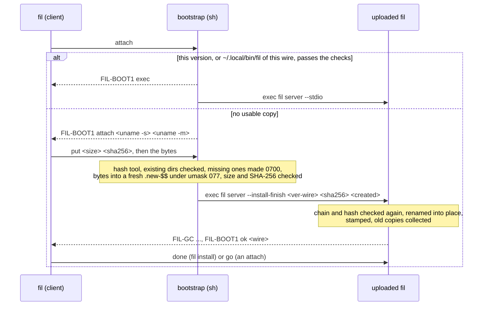

# Getting fil onto a remote host

> **Status: M4 package U1** (`docs/m4/plan.md` §3 U1). fil gets onto a host by hand (section 1) or through fil: with `fil install HOST`, or when the first attach finds no fil and the user says yes (section 3). The owner approved the second fixed remote command, the constant install bootstrap, and the install directory `~/.local/share/fil` (M4 OQ-1, 2026-11-04), and every build carries them. The user guide (DOC, `docs/user/`) will take the user-facing parts of this page.

## 1. By hand

fil runs on the remote host as `fil server --stdio`, which ssh hands to your login shell on the host. That shell looks the command up on its `PATH`, and the `PATH` of a non-interactive ssh login is often shorter than the one you see when you log in.

1. Download the release archive for the host (`fil-<ver>-x86_64-linux-musl.tar.gz` or `fil-<ver>-aarch64-linux-musl.tar.gz`; a Mac takes the universal archive), check it against `SHA256SUMS` and its signature (`docs/m4/release.md` §4), and unpack it. Or take `libexec/fil/remote/<arch>-linux/fil` from the archive you installed locally: every archive carries both Linux binaries.
2. Copy `bin/fil` to the host, **as a file, not a symbolic link**, into a directory on the non-interactive `PATH`:

   ```sh
   ssh devbox 'echo $PATH'            # the PATH that fil's remote command will see
   scp fil devbox:/usr/local/bin/fil  # or any directory in that list
   ```

   To use `~/.local/bin` instead, add it to the `PATH` that your shell sets for non-interactive logins: in `~/.bashrc` above its "if not interactive, return" line, in `~/.zshenv`, or in `~/.config/fish/config.fish`.
3. Check: `ssh devbox fil --version` prints `fil <ver> (wire <major>.<rev>)`, the same wire as your local `fil --version`.

With `remote = "plain"` (section 2), if the host has no usable `fil`, the first `fil devbox` (or `fil ls devbox`) ends with:

```
fil: fil is not installed on the remote host: the remote command `fil server --stdio` found no `fil` on the PATH of a non-interactive ssh login there (`ssh HOST 'echo $PATH'` shows that PATH). Copy a release's bin/fil into a directory on it, such as /usr/local/bin, or add its directory to the PATH that your shell sets for non-interactive logins (~/.bashrc above its interactive check, ~/.zshenv, ~/.config/fish/config.fish), then run fil again
```

The login shells say a missing command differently (status 127 from sh, bash, zsh, dash, ksh and fish; status 1 and "Command not found." from csh and tcsh); fil recognizes both, and only when the pipe ended before fil's preamble (a relay that exits 127 after it is not "not installed"). With the default `remote = "auto"` the bootstrap looks next (section 3.3), and its words name `fil install` as well.

A host whose fil speaks another wire says so instead, and which side to upgrade (`DESIGN.md` §5.3).

## 2. The config keys

In `~/.config/fil/config.toml`, per host or under `[defaults]` (`DESIGN.md` §14):

| Key | Values | What it does |
|---|---|---|
| `remote` | `auto` (default), `plain`, `installed` | `auto`: `fil server --stdio` first, the bootstrap once if the run's first connection finds no fil of this wire; `plain`: only `fil server --stdio` (for hosts behind a forced-command gate); `installed`: the bootstrap from the first connection (one ssh login instead of two on a host that has only a fil-installed copy) |
| `install` | `ask` (default), `never`, `always` | what an interactive first attach does when the bootstrap finds no usable fil: ask once, before the terminal goes raw; only say how to install; install without asking |

The defaults are U1's, set with OQ-1's yes (`docs/m4/plan.md` §7, the proposed calls), not CFG's. A custom `pipe` is never rewritten: it runs as configured, whatever `remote` says, and is never offered an install.

## 3. Through fil

What exists, and what holds it to the approved text:

- **The bootstrap** is `fil_transport::pipe::PipeCommand::BOOTSTRAP`, a compile-time constant (`crates/fil-transport/src/pipe/command.rs`). Compile-time checks refuse a build whose bootstrap is not one line of printable ASCII, has a `'`, `\` or `!` inside its quotes, or holds a version or wire outside the install directory's name pattern. `crates/fil-transport/src/pipe/remote-commands.txt` pins its bytes (for the example 0.1.0 on wire 1.12), and a test keeps it equal, byte for byte, to the text in `docs/m4/plan.md` §7 that the owner approved (M4 OQ-1, 2026-11-04, with the dash fix).
- **In every build, and nothing else.** The one function that puts it on a command line is `PipeCommand::bootstrap`, which takes a host and nothing else; its callers are `fil install` (`crates/fil/src/install/{boot,client}.rs`) and the run's connector (`crates/fil/src/connect.rs`), which builds it once per run beside the plain command. A background run's ssh options are fixed in `PipeCommand::for_background` (`BatchMode=yes`, `ConnectTimeout=10`, `LogLevel=ERROR`, each unless the command line's own options set it) and go in front of the host, never into the remote part; no caller can add other words to a bootstrap command. What each check proves:
  - the golden and `the_bootstrap_is_the_text_the_owner_approved` pin the script's text;
  - `crates/fil/tests/remote_commands.rs` runs every subcommand that reaches ssh (the attach, `ls`, `kill`, `detach`, `ports`, `forward`, `install`, `--check`, `--remove`) with a recording fake `ssh` first on `PATH`, and requires each remote part to be exactly `fil server --stdio` or this build's bootstrap: the behavioral check, whatever way a command line is built. Against a live fake host (this build's own `fil`, run as the host's login shell would run the remote part) it also covers a live session: a background reconnect after the relay is killed, a takeover and its taking back, `fil ports` and `~#`; and it allows exactly fil's ssh options (`-T`, `-o ServerAlive*=<digits>`, and a background run's `BatchMode=yes`, `ConnectTimeout=10`, `LogLevel=ERROR`, all three or none);
  - `just release-check` requires every `sh -c` in a release binary to be the start of this exact text, for that release's version and wire (`tests/release/check.sh`, with mutations in `tests/release/selftest.sh`): a tripwire for a second shell-wrapped literal, which cannot see a command built from separate argv words.
- **In the run.** `crates/fil/src/install/fallback.rs` (`Run`, one per run, in memory) picks each connection's command; the pipe (`fil_transport::pipe::PipeLink::start`) writes the bootstrap's mode line, `attach`, a constant, and stops at its greeting; `crates/fil/src/install/attach.rs` makes the offer and the upload (section 3.3).
- **What runs nothing new on a host, and is built regardless:** `fil server --install-finish` and `fil server --install-gc` (only the bootstrap runs them), garbage collection by the FROZEN contract of `docs/m4/release.md` §6 (`crates/fil/tests/golden/install-gc.txt`), the three-state lock probe, the choice and checks of the binary to send (the bundle and its `SHA256SUMS`, the release-build mark `FIL_RELEASE_BUILD=1` at compile time, the scan for `FIL_TEST_` and builder home paths).

### 3.1 The exchange



A preamble with no `FIL-BOOT1 exec` before it means a forced command ran `fil server --stdio` in place of the bootstrap: the client ends the run at once. `check` lists the installed copies, the `fil` on `PATH` and `~/.local/bin/fil` (all shown sanitized), and ends with `FIL-CHECK-END`; `remove` hands over to `fil server --install-gc` of this exact version only, or answers `FIL-BOOT1 none`.

### 3.2 `fil install`

```
fil install HOST                 install this version into ~/.local/share/fil on HOST
fil install --binary FILE HOST   send FILE (it must fit the host and pass the scan)
fil install --check HOST         what is installed, and the fil on PATH
fil install --remove HOST        remove what fil installed, except a running daemon's copy
```

**Refused before any login:** a host whose config names its own `pipe` (a custom pipe is never rewritten), and a host with `remote = "plain"` (there fil runs only `fil server --stdio`, DESIGN §8.2).

**Time limits, the login included** (a login may wait for a password, and the client cannot tell when it ends): `--check` and `--remove` 120 s, an install 30 minutes (the upload is at most 128 MiB, about 18 minutes at 1 Mbit/s). A run that ends with ssh's exit status other than 0 is a failure, even when its output looked complete. `--check`'s report ends with one fixed line, `FIL-CHECK-END` (the owner's N6, 2026-11-04): a report without it is "no answer from the host", an error, never "nothing installed". So a forced command (`ForceCommand`, or `command=` in `authorized_keys`) that prints nothing and exits 0, such as `/bin/true`, fails `--check` with that message.

**A home mounted `noexec`:** the upload arrives and passes its checks, but the script cannot run it (`exec` fails, and POSIX `sh` exits there, before `undo`). The client says the home may be read-only or mounted noexec; the `.new-*` directory stays until garbage collection removes it after 24 hours, with any parents this run made (`tests/realnet/install.sh` `i_noexec`).

**A host or ssh alias named `install`** is attached with `fil -- install` now that `install` is a subcommand, as for the other subcommand names.

After an install it prints, as a condition (it did not try the plain command), the one config line that saves the plain command's login on later runs: `remote = "installed"` under the host's `[host.…]` table, if `fil server --stdio` finds no fil of this version there. An attach that installed prints it plainly, since the plain command had just found none. fil keeps no state about the host.

Which binary is sent: `--binary FILE` if given (the plan lists it last; a file named on the command line is what the user means), otherwise the bundle beside this executable for the host's OS and architecture (`docs/m4/release.md` §4.3), checked against its `SHA256SUMS`, otherwise this executable if it is a marked release build. Each must fit the host (an ELF of its Linux architecture, or a Mach-O with its CPU) and pass the scan. A host whose config names its own `pipe` is refused: a custom pipe is never rewritten.

### 3.3 In an attach and the other commands

Every run starts with `fil server --stdio`. With `remote = "auto"`, the run's **first** connection falls back to the bootstrap once:

- when the plain command's pipe ended before fil's preamble with a nonzero exit (127 from sh and the others, 1 from csh and tcsh; not ssh's own 255, a host it cannot reach or a refused login, where a second login would fail the same way); the pipe reports "ended before the preamble" exactly (`PipeError::ended_before_preamble`);
- or when the relay is of another wire with no daemon of this one: the hello says so, before the terminal goes raw (`app::fallback_outcome`; the management commands see it in their answer).

The run then uses whichever command worked for its later connections, background reconnects included. Nothing about the host is written to disk.

What the bootstrap's answer means for the run:

- **`FIL-BOOT1 exec`**: an installed copy (or `~/.local/bin/fil` of this wire) starts; the run goes on as on the plain command.
- **The greeting** (no usable copy): only the **interactive first attach** may install (one pure decision, `install::attach::decide`, unit-tested over every combination). With `install = "ask"` it asks once on the terminal, before raw mode (`fil: fil is not installed on HOST. Install fil <ver> (wire <w>) into ~/.local/share/fil there? [y/N]`), and only if stdin is a terminal; `always` installs without asking; `never` says how to install. A background reconnect never installs, nor does `fil ls` or another management command: they answer `end` and say how to install. The upload is `fil install`'s (section 3.2's binary choice, without `--binary`), answered with `go`, so the install login becomes the attach; then the client prints the `remote = "installed"` line.
- **An unmarked preamble** (a forced command ran `fil server --stdio` in place of the bootstrap): the run ends at once, with nothing more sent. With `remote = "installed"` it says to use `"auto"` or `"plain"` for that host; with `auto` (the plain command ran through the gate and found no fil of this version) it says to install one by hand on the PATH the gate uses. When the fallback came from a fil of another wire, the failure says that first.

## 4. Tests

| Where | What |
|---|---|
| `crates/fil-transport/src/pipe/command.rs` | the golden, the equality with the approved text, the line rules, the umask, `LC_ALL`, `echo` and `--version </dev/null` checks |
| `crates/fil/tests/install_gc.rs` | the FROZEN contract of `docs/m4/release.md` §6.5, items 1 to 6, with its golden |
| `crates/fil/tests/install_shells.rs` | the constant itself under every login shell found (sh, bash, zsh, dash, ksh, mksh, tcsh, csh, fish, busybox), each with `/bin/sh` and dash as the inner `sh`, in a scratch `HOME`, against a fake fil: 25 cases each |
| `crates/fil/tests/remote_commands.rs` | every subcommand that reaches ssh, run as a process against a recording fake `ssh`: each remote part is exactly `fil server --stdio` or this build's bootstrap, with fil's own options only; `remote = "plain"` refuses `fil install` before any login; a failed login (ssh exits 255, nothing printed) fails every install mode. Against a live fake host: a session's background reconnect, takeover and take-back, `fil ports` and `~#`; the bootstrap after a plain command that finds no fil (once, at the first connection, remembered for the reconnect), `remote = "plain"` and `"installed"`; a forced command with `remote = "installed"`; the offer (no, and yes with a development build, which is never sent), `install = "never"`, none of which change the host; `fil ls` on a terminal under `ask` and `always` (never asks or installs); a reconnect that finds the copy gone under `always` (never installs); a fil of another wire on `PATH`, a major apart (the preamble) and a revision apart (the hello): the bootstrap once, for an attach and for `fil ls`, and no third login when the bootstrap's fil is of that wire too; the session's umask on the plain command and the fast path; a silent host (`/bin/true`) for every install mode |
| `crates/fil-transport/src/pipe.rs`, `pipe/answer.rs`, `pipe/command.rs` (tests) | the bootstrap's run: the mode line first and only for the bootstrap, the greeting handed over and `end` on a decline, an unmarked preamble, the fast path on to the preamble, "ended before the preamble" exactly, the noise bound; the one classifier of the answer (markers end their line, rc noise without a newline before one is skipped, the greeting's names cut to 64 characters), shared with `fil install`; a background run's fixed options, before the host only |
| `crates/fil/tests/install.rs` | the real fil of the build as the upload: install, the fast path, `go`, `check`, `remove`, two installs at once with a collection during an upload, a client killed during an upload (the script sees a short upload and removes what it made), a development build refused; the trigger under sh and tcsh |
| `tests/realnet/install.sh` | real OpenSSH, with bash, dash, zsh, fish and tcsh logins and a stock Alpine host (busybox): the manual-install message, install, check and remove per shell, a forced-command gate, the bundle end to end and a tampered bundle; and the real client on a terminal: the offer answered yes (the install login becomes the session, the next attach takes the fast path), the session's umask the same (027) from the plain command, the fast path and an install, the forced-command gate with `remote = "installed"`, a `noexec` home |
