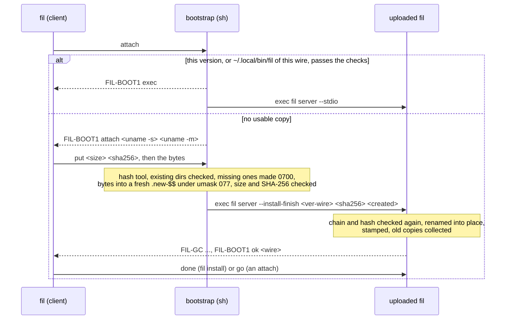

# Getting fil onto a remote host

> **Status: M4 package U1** (`docs/m4/plan.md` §3 U1). fil gets onto a host by hand (section 1) or through fil with `fil install HOST` (section 3). The owner approved the second fixed remote command, the constant install bootstrap, and the install directory `~/.local/share/fil` (M4 OQ-1, 2026-11-04), and every build carries them. An attach does not yet fall back to the bootstrap or offer an install: that comes with the attach wiring (section 2). The user guide (DOC, `docs/user/`) will take the user-facing parts of this page.

## 1. By hand

fil runs on the remote host as `fil server --stdio`, which ssh hands to your login shell on the host. That shell looks the command up on its `PATH`, and the `PATH` of a non-interactive ssh login is often shorter than the one you see when you log in.

1. Download the release archive for the host (`fil-<ver>-x86_64-linux-musl.tar.gz` or `fil-<ver>-aarch64-linux-musl.tar.gz`; a Mac takes the universal archive), check it against `SHA256SUMS` and its signature (`docs/m4/release.md` §4), and unpack it. Or take `libexec/fil/remote/<arch>-linux/fil` from the archive you installed locally: every archive carries both Linux binaries.
2. Copy `bin/fil` to the host, **as a file, not a symbolic link**, into a directory on the non-interactive `PATH`:

   ```sh
   ssh devbox 'echo $PATH'            # the PATH that fil's remote command will see
   scp fil devbox:/usr/local/bin/fil  # or any directory in that list
   ```

   To use `~/.local/bin` instead, add it to the `PATH` that your shell sets for non-interactive logins: in `~/.bashrc` above its "if not interactive, return" line, in `~/.zshenv`, or in `~/.config/fish/config.fish`.
3. Check: `ssh devbox fil --version` prints `fil <ver> (wire <major>.<rev>)`, the same wire as your local `fil --version`.

If the host has no usable `fil`, the first `fil devbox` (or `fil ls devbox`) ends with:

```
fil: fil is not installed on the remote host: the remote command `fil server --stdio` found no `fil` on the PATH of a non-interactive ssh login there (`ssh HOST 'echo $PATH'` shows that PATH). Copy a release's bin/fil into a directory on it, such as /usr/local/bin, or add its directory to the PATH that your shell sets for non-interactive logins (~/.bashrc above its interactive check, ~/.zshenv, ~/.config/fish/config.fish), then run fil again
```

The login shells say a missing command differently (status 127 from sh, bash, zsh, dash, ksh and fish; status 1 and "Command not found." from csh and tcsh); fil recognizes both.

A host whose fil speaks another wire says so instead, and which side to upgrade (`DESIGN.md` §5.3).

## 2. The config keys

In `~/.config/fil/config.toml`, per host or under `[defaults]` (`DESIGN.md` §14):

| Key | Values | Today |
|---|---|---|
| `remote` | `auto` (default), `plain`, `installed` | every attach and management connection runs `fil server --stdio`; `installed` is refused, since no attach can run the bootstrap yet |
| `install` | `ask` (default), `never`, `always` | no effect yet: `fil install HOST` is the way to install through fil |

The defaults are U1's, set with OQ-1's yes (`docs/m4/plan.md` §7, the proposed calls), not CFG's. Once the attach wiring lands: `auto` tries the plain command first and the bootstrap only when the run's first connection finds no fil of this wire; `plain` never runs the bootstrap (for hosts behind a forced-command gate); `installed` uses the bootstrap from the start (one ssh login instead of two on a host that has only a fil-installed copy). `install = "ask"` asks once before the terminal goes raw, on an interactive first attach only.

## 3. Through fil

What exists, and what holds it to the approved text:

- **The bootstrap** is `fil_transport::pipe::PipeCommand::BOOTSTRAP`, a compile-time constant (`crates/fil-transport/src/pipe/command.rs`). Compile-time checks refuse a build whose bootstrap is not one line of printable ASCII, has a `'`, `\` or `!` inside its quotes, or holds a version or wire outside the install directory's name pattern. `crates/fil-transport/src/pipe/remote-commands.txt` pins its bytes (for the example 0.1.0 on wire 1.12), and a test keeps it equal, byte for byte, to the text in `docs/m4/plan.md` §7 that the owner approved (M4 OQ-1, 2026-11-04, with the dash fix).
- **In every build, and nothing else.** The one function that puts it on a command line is `PipeCommand::bootstrap`, which takes a host and nothing else; `fil install` (`crates/fil/src/install/{boot,client}.rs`) is its one caller. What each check proves:
  - the golden and `the_bootstrap_is_the_text_the_owner_approved` pin the script's text;
  - `crates/fil/tests/remote_commands.rs` runs every subcommand that reaches ssh (the attach, `ls`, `kill`, `detach`, `ports`, `forward`, `install`, `--check`, `--remove`) with a recording fake `ssh` first on `PATH`, and requires each remote part to be exactly `fil server --stdio` or this build's bootstrap: the behavioral check, whatever way a command line is built;
  - `just release-check` requires every `sh -c` in a release binary to be the start of this exact text, for that release's version and wire (`tests/release/check.sh`, with mutations in `tests/release/selftest.sh`): a tripwire for a second shell-wrapped literal, which cannot see a command built from separate argv words.
- **Not wired into an attach yet.** `fil HOST`, `fil ls` and the other commands run only `fil server --stdio`: `remote = "auto"`'s fallback (`crates/fil/src/install/fallback.rs`) and the install offer are a tested state machine that nothing calls yet.
- **What runs nothing new on a host, and is built regardless:** `fil server --install-finish` and `fil server --install-gc` (only the bootstrap runs them), garbage collection by the FROZEN contract of `docs/m4/release.md` §6 (`crates/fil/tests/golden/install-gc.txt`), the three-state lock probe, the choice and checks of the binary to send (the bundle and its `SHA256SUMS`, the release-build mark `FIL_RELEASE_BUILD=1` at compile time, the scan for `FIL_TEST_` and builder home paths).

### 3.1 The exchange



A preamble with no `FIL-BOOT1 exec` before it means a forced command ran `fil server --stdio` in place of the bootstrap: the client ends the run at once. `check` lists the installed copies, the `fil` on `PATH` and `~/.local/bin/fil` (all shown sanitized); `remove` hands over to `fil server --install-gc` of this exact version only, or answers `FIL-BOOT1 none`.

### 3.2 `fil install`

```
fil install HOST                 install this version into ~/.local/share/fil on HOST
fil install --binary FILE HOST   send FILE (it must fit the host and pass the scan)
fil install --check HOST         what is installed, and the fil on PATH
fil install --remove HOST        remove what fil installed, except a running daemon's copy
```

**Refused before any login:** a host whose config names its own `pipe` (a custom pipe is never rewritten), and a host with `remote = "plain"` (there fil runs only `fil server --stdio`, DESIGN §8.2).

**Time limits, the login included** (a login may wait for a password, and the client cannot tell when it ends): `--check` and `--remove` 120 s, an install 30 minutes (the upload is at most 128 MiB, about 18 minutes at 1 Mbit/s). A run that ends with ssh's exit status other than 0 is a failure, even when its output looked complete: `--check`'s output has no end marker, so a failed login would otherwise read as "nothing installed". **A known gap:** a forced command (`ForceCommand`, or `command=` in `authorized_keys`) that prints nothing and exits 0 makes `--check` report nothing installed, since the approved script prints no end marker. Adding one changes the script, so the owner is being asked.

**A host or ssh alias named `install`** is attached with `fil -- install` now that `install` is a subcommand, as for the other subcommand names.

Which binary is sent: `--binary FILE` if given (the plan lists it last; a file named on the command line is what the user means), otherwise the bundle beside this executable for the host's OS and architecture (`docs/m4/release.md` §4.3), checked against its `SHA256SUMS`, otherwise this executable if it is a marked release build. Each must fit the host (an ELF of its Linux architecture, or a Mach-O with its CPU) and pass the scan. A host whose config names its own `pipe` is refused: a custom pipe is never rewritten.

## 4. Tests

| Where | What |
|---|---|
| `crates/fil-transport/src/pipe/command.rs` | the golden, the equality with the approved text, the line rules, the umask, `LC_ALL`, `echo` and `--version </dev/null` checks |
| `crates/fil/tests/install_gc.rs` | the FROZEN contract of `docs/m4/release.md` §6.5, items 1 to 6, with its golden |
| `crates/fil/tests/install_shells.rs` | the constant itself under every login shell found (sh, bash, zsh, dash, ksh, mksh, tcsh, csh, fish, busybox), each with `/bin/sh` and dash as the inner `sh`, in a scratch `HOME`, against a fake fil: 25 cases each |
| `crates/fil/tests/remote_commands.rs` | every subcommand that reaches ssh, run as a process against a recording fake `ssh`: each remote part is exactly `fil server --stdio` or this build's bootstrap; `remote = "plain"` refuses `fil install` before any login; a failed login (ssh exits 255, nothing printed) fails every install mode |
| `crates/fil/tests/install.rs` | the real fil of the build as the upload: install, the fast path, `go`, `check`, `remove`, two installs at once with a collection during an upload, a development build refused; the trigger under sh and tcsh |
| `tests/realnet/install.sh` | real OpenSSH, with bash, dash, zsh, fish and tcsh logins and a stock Alpine host (busybox): the manual-install message, install, check and remove per shell, a forced-command gate, the bundle end to end and a tampered bundle |
