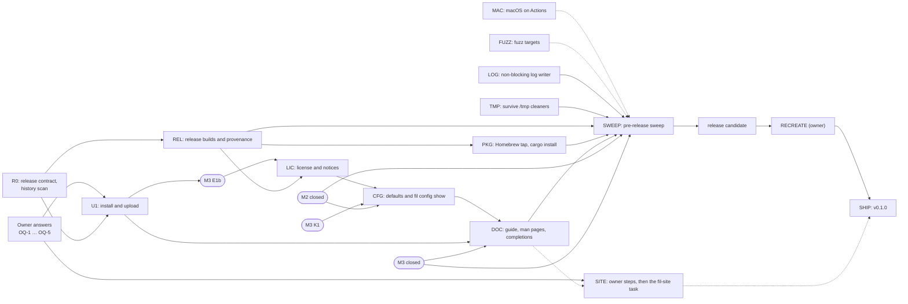

# M4 plan: release

> **Status: proposed by the coordinator on 2026-11-04 and revised after its review; nothing here is built yet.** The owner asked (2026-11-04) for M4 to start now, in parallel with M3 (prediction, planned separately in `docs/m3/plan.md`) and with M2's last sweep PRs. `DESIGN.md` stays the source of truth; when a package changes a decision, it updates `DESIGN.md` in the same PR. Items marked **proposed** are the coordinator's calls, which review and the owner may change. Items marked **OWNER** wait for the owner (§7). Written on `origin/main` at `12f974d`.

M4 in `DESIGN.md` §15: install or upload, config, docs, packaging, license; the deeper pre-release sweep; the project site at fil.anthonywertz.com; macOS target tests on GitHub's macOS runners. It is done when **the pre-release sweep is closed before the first release**.

## 0. Preconditions and boundaries

- **The M2 fence.** M2 is in its sweep. No M4 package touches **any file of an open M2 PR** until that PR merges. Today that means #88 and #91:
  - `crates/fil-forward/src/{endpoint.rs, lib.rs, pace.rs, pace/tests.rs}` and `crates/fil-forward/tests/*`;
  - `crates/fil-proto/src/{mux.rs, mux/tests.rs, ring.rs}` and `crates/fil-proto/tests/mux_model.rs`.

  The coordinator updates this list as M2 PRs open and close.
- **The M3 fence.** M3 owns prediction and the files its packages name (`docs/m3/plan.md`). M4 does not edit any of these:
  - `crates/fil-predict/**`, `crates/fil-client/**`, `crates/fil-term/src/**`;
  - `crates/fil-proto/src/{msg.rs, limits.rs, log.rs}` and the wire golden, while M3's W1 or K1 is open;
  - `crates/fil-session/src/{core.rs, serve.rs}`;
  - `crates/fil/examples/dropin/**`.

  A fix M4 finds in one of them (for example, on macOS) goes to the M3 coordinator as a finding, not as an M4 PR. The files both milestones need are **serialized**, in the order given in §3, "File-ownership hot spots".
- **The wire.** M4 changes no message encoding. Some of the defaults that CFG reviews are pinned in the wire golden's `[limits]`, though: `DEFAULT_WINDOW`, `DEFAULT_FORWARD_BUFFER`, `FORWARD_BUDGET`, `CONNECT_TIMEOUT_MS`, `OPEN_WAIT_MS`, `LINGER_MS` and `AGENT_WAIT_MS`. Changing one of them **is a wire change**. Any such change is either listed as a wire change, with its own `PROTOCOL_REVISION` bump made after M3's W1 merges (W1 holds `limits.rs` and the golden while it is open), or deferred. Defaults that the golden does not pin change without a bump. The install bootstrap (§3, U1) runs before the preamble and is not part of the protocol.
- **The repository recreate** (decided, owner 2026-11-03 and 2026-11-04: a new public `anthonytw/fil` with one initial commit, the old repository kept as a private archive, "when it's time"). It must happen **before the first release tag**. Tags, GitHub Releases and attestations live in the repository and would not move with a recreate.

## 1. Scope

### Goals

1. **Getting fil onto a remote host**, by hand or with the client's help (U1, §16.5 of DESIGN).
2. **Release builds with provenance:** reproducible static Linux binaries and archives, a macOS binary, checksums, signatures and build attestations (REL).
3. **Packaging channels** for v1: GitHub Releases, a Homebrew tap and `cargo install --git` (PKG).
4. **Versioning** that relates the package version to the wire (`PROTOCOL_MAJOR`.`PROTOCOL_REVISION`) (R0).
5. **Config finished and documented:** reviewed defaults, a reference that tests keep in step with the code, and `fil config show` (CFG, DOC).
6. **Docs:** a user guide, man pages, shell completions, a changelog and an install-first README (DOC).
7. **License and third-party notices** that meet GPL-3.0's terms for binary distribution (LIC).
8. **macOS on GitHub's runners:** the suites on Apple silicon and Intel, and macOS as a *remote* host (MAC, §16.9 of DESIGN).
9. **Daemon hardening before the sweep:** a non-blocking log writer (LOG) and a daemon that survives temporary-file cleaners (TMP).
10. **The pre-release sweep** (SWEEP), then the recreate, then v0.1.0 (SHIP).
11. **The project site** at fil.anthonywertz.com, in its own repositories (SITE: owner steps, then a later task in that repository).

### Non-goals for M4 (proposed)

- **Windows**, as a client or a remote (decided, §2 of DESIGN). WSL counts as Linux.
- **Runtime downloads.** fil never fetches anything from the internet, not even its own binary for a remote (§11.1.1, decided). Whatever the client uploads, it already has on disk.
- **A `curl | sh` installer.** It would run code the user has not seen. Install instructions are a download, a checksum check and a copy.
- **Distro packages** (Debian, RPM, AUR, Nix) and **crates.io** in v1 (OQ-3).
- **`-N` tunnel-only mode** (M2 OD-12) and **desktop notifications for new listeners** (§7.4 of DESIGN, moved out of M2). Both are features, and adding them now would put new code in front of the sweep. They move to after v0.1.0, unless the owner pulls them in. R0 updates DESIGN §7.4's notification sentence and points it at OD-12, so that DESIGN says "after v0.1.0".
- **The two items M3 hands to M4** (M3 plan §1, PC-10), both after v0.1.0:
  - **the final output tail of an ended session.** There is no emulator after exit, it needs a new bounded memory policy, ssh and ET do no better, and the value is low;
  - **Unix-socket forwards** (`-L 5432:/run/…sock`). This is a feature: a new `OpenKind` (a wire change), the policy mirror's `AllowStreamLocalForwarding`, and new consent and `fil ports` rows. It belongs in its own milestone-sized change, not in front of the pre-release sweep. It stays in §16.8 of DESIGN.
- **File-descriptor handover between daemons** (§16.6 of DESIGN). Daemons of different builds keep running side by side, as built.
- **`fil ports` listener discovery on a macOS remote** (libproc). A macOS daemon shows forwards only, as in M2.
- **The daemon's package version in `fil ls`** (§2.1). It would need a new field on the wire, and M4 changes no wire. It can ride along with a later bump.

### Carried items, verified against the code

| Item | Verified | Decision |
|---|---|---|
| **M1-A2: synchronous log writes.** `fil_daemon::logging::RotatingLog` writes each line behind one `Mutex`, and rotation (rename, reopen, prune) runs inside that lock (`crates/fil-daemon/src/logging.rs`: the `State` mutex, `maintain` and `rotate`). The client uses the same module (`crates/fil/src/logging.rs`). There is no M2 regression at `info`, but a log directory on a hung NFS home would freeze every thread that logs, the daemon's included. | yes | **Include, LOG**: a non-blocking writer with a bounded queue, drop and count on overflow, rotation off the hot path, and a test with a writer that blocks. |
| **§16.5: manual install or upload.** | open | **U1**, under OQ-1. |
| **§16.9: macOS as a remote host.** | open | **Proposed: supported**, with sessions, forwards and the agent; `fil ports` shows forwards only. MAC tests it on every release candidate. |
| **The macOS trampoline after an in-place upgrade.** On Linux, a session's child starts through `/proc/self/exe`, which stays the daemon's own image after the file is replaced (`fil_session::nofile::own_executable`). On macOS it starts through `current_exe()`, which is a *path*: after a package upgrade replaces the file, a running old daemon starts its new sessions through the *new* binary's `__fil-exec-nofile` trampoline. | yes (found while reading) | **MAC tests it** (the upgrade-in-place scenario, §6.2). Proposed remedy if it fails: freeze the trampoline's argument contract within a `PROTOCOL_MAJOR`, pinned by a test. That remedy lands in `fil-session` after M3 closes. U1's versioned install directories avoid the case for fil-installed copies, because those are never replaced in place. |
| **Temporary-file cleaners and a long-lived daemon.** `/tmp/fil-$UID/` holds the socket, the lock and start files and the agent sockets. Some systems age `/tmp`: systemd-tmpfiles' `10d` rule on Fedora-like hosts, and macOS's periodic `clean-tmps`. Both look at access, modification **and change** times (the last cannot be set back), so a test that only sets the cleaner's age to zero deletes nothing and passes whatever the daemon does. The failure that matters: once the lock and start files are aged out, the next relay takes a fresh lock, believes no daemon runs, and the new daemon removes the old one's "stale" socket. That strands every live session. U1's garbage collection reads the same lock files. | the mechanism yes; the cleaners' effect on a live daemon unverified | **Include, TMP** (Wave 1): design the remedy now and test the mechanism (§3). |
| **`DESIGN.md` §13 "Builds"** names macOS aarch64 only. | yes | **REL adds macOS x86_64** in a universal binary (§2.2) and updates §13. |
| **M3's hand-offs:** an ended session's output tail, and Unix-socket forwards. | from the M3 plan | Non-goals for v0.1.0, with reasons (above). |

### Done when

1. **The pre-release sweep is closed** (§6.4): five whole-tree audits plus the release audits, every finding fixed or accepted by the owner, and a verification pass **on the release-candidate artifacts themselves**, not on a development build.
2. **The release candidate passes:**
   - `linux-check -f suite=all`;
   - `macos-check`, on both architectures, with the macOS-remote job;
   - the drop-in suite on both Pis, with the candidate's aarch64 binary;
   - the realnet `install` part.
3. **The Linux binaries and archives are reproducible:** the two CI builds of the candidate give identical SHA-256s, and the owner's independent rebuild (`just release-verify`, in the VM) reproduces the binaries.
4. **The docs are complete,** and the tests that tie the config reference and the man page to the code pass.
5. **The notices are complete:** every crate in the release graph, plus Rust's standard library and musl.
6. **The repository has been recreated** (owner). **v0.1.0 is published:** a signed tag, a GitHub Release with signed checksums and attestations, and the Homebrew formula. The site launches with it if the owner has done the site steps by then. The site does not gate the release.

## 2. Contracts first (R0)

R0 is one coordinator PR in Wave 0, with three parts:

- `docs/m4/release.md`, holding the decisions below as the reference that the code and the workflows then follow;
- the DESIGN §7.4 and OD-12 pointers (§1);
- a one-line pointer in DESIGN §15.

U1, REL, PKG, LIC and DOC all build on it.

### 2.1 Versioning (proposed)

- **The package version.** It is SemVer, in `[workspace.package] version` in the root `Cargo.toml`, and it is the one version of every crate. The first release is **0.1.0**: fil is new, and 0.x tells users that the config and the CLI may still change.
- **The wire.** It is `PROTOCOL_MAJOR`.`PROTOCOL_REVISION`, already printed by `fil --version` (`fil 0.1.0 (wire 1.12)`). The two numbers are independent.
  - **A patch release never changes the wire.** REL's release check compares the last line of the golden's `[history]` with that of the previous tag of the same minor.
  - **A release that changes the wire bumps the minor version** (0.1 to 0.2 before 1.0, 1.2 to 1.3 after). Its release notes say "upgrade fil on both ends". Because daemons of different wires coexist (§5.3 of DESIGN), that is an upgrade, not a breakage.
  - **A change of `PROTOCOL_MAJOR`** changes the frozen opening. It is rare by design, and after 1.0 it bumps the package's major.
- **Patch releases and running daemons.** A patch keeps the wire, so its relay finds the older daemon of the same wire through the same socket name and uses it. A patch's daemon-side fixes therefore take effect only once the old daemon exits: when it has no sessions left, it exits after its idle time. The release notes of a patch with daemon-side fixes say "end your sessions (or `fil kill` them) on each host to pick up these fixes". Showing the daemon's package version in `fil ls` would make this visible. It needs a wire field, so it is deferred (§1).
- **What 1.0 will mean** (the config, CLI and exit statuses stable within the major, while cross-revision wire compatibility is still not promised) is decided at 1.0, not in M4.
- **`rust-version`** in the root `Cargo.toml` is set to the pinned toolchain, so that `cargo install --git` says what is needed. That command does not read `rust-toolchain.toml`.

### 2.2 Targets (proposed)

| Target | Artifact | Role |
|---|---|---|
| `x86_64-unknown-linux-musl` | static | client and remote |
| `aarch64-unknown-linux-musl` | static | client and remote (Raspberry Pi 4 and later, ARM servers) |
| `aarch64-apple-darwin` + `x86_64-apple-darwin` | **one universal binary** (`lipo`) | client and remote |

- **Why one macOS file:** it keeps Homebrew simple, and a Mac can upload itself to a Mac of either architecture (§3, U1). It is about twice the size of one architecture, which is acceptable.
- **The Intel half has a limited test life.** GitHub is retiring its Intel macOS images, and Rust moved `x86_64-apple-darwin` to tier 2 in 2025. MAC tests Intel for as long as a hosted Intel image exists. After that, the Intel half is built but not tested, and the release notes say so. Dropping it is a later decision.
- **Not v1 targets:** 32-bit ARM, FreeBSD and the other BSDs. Nothing stops a user from building them.

### 2.3 Release artifacts and layout

Each release carries:

- `fil-<ver>-x86_64-linux-musl.tar.gz`, `fil-<ver>-aarch64-linux-musl.tar.gz` and `fil-<ver>-universal-apple-darwin.tar.gz`;
- `fil-<ver>-source.tar.gz`: the tagged tree **with every dependency vendored** (`cargo vendor`), which builds offline. It is the Corresponding Source for the binaries (LIC);
- `SHA256SUMS`, over every file above;
- `SHA256SUMS.sig`: an SSH signature (`ssh-keygen -Y sign -n fil-release`) by the release identity (OQ-2);
- the GitHub build-provenance attestation for each archive.

Every archive has the same layout, relative to the directory it unpacks to:

```
bin/fil
libexec/fil/remote/x86_64-linux/fil
libexec/fil/remote/aarch64-linux/fil
libexec/fil/remote/SHA256SUMS
share/man/man1/fil.1
share/man/man5/fil-config.5
share/man/man5/fil-policy.5
share/bash-completion/completions/fil
share/zsh/site-functions/_fil
share/fish/vendor_completions.d/fil.fish
share/doc/fil/{README.md,CHANGELOG.md,LICENSE,THIRD-PARTY-NOTICES.md,config.example.toml,daemon.example.toml,policy.example.toml}
```

- **The bundle.** Every archive carries the static Linux binaries in `libexec/fil/remote/`, so any client can install fil on either Linux architecture (U1). Each copy there is byte-identical to the standalone binary of its target, and REL checks that.
- **How the client finds it:** relative to its own canonical executable path, so the layout survives Homebrew's Cellar and its symbolic links.
- **A client installed any other way** (`cargo install`) has no bundle. It can upload only itself, if it is eligible (U1), or a file named with `--binary`.
- **Reproducible archives.** They are built with one recipe:
  - entries sorted by name;
  - every mtime set to `SOURCE_DATE_EPOCH`;
  - `--owner=0 --group=0 --numeric-owner` and fixed modes;
  - `gzip -n`.

  The tools that generate content are pinned by version and installed the way `linux-check` installs its tools (install-action with a version): `cargo-about` (LIC) and pandoc (DOC).

### 2.4 The remote install layout

- **The directory:** `$HOME/.local/share/fil/<ver>-w<major>.<rev>/fil`, for example `~/.local/share/fil/0.1.0-w1.12/fil`. The directory is 0700 and the file 0700.
  - The name carries the wire, so garbage collection can tell which daemons still need a copy without running any binary.
  - It is `$HOME`-based, not `$XDG_DATA_HOME`, because a non-interactive login may see a different environment from an interactive one, and the path must not move between them. The state directory `~/.local/state/fil` already follows the same rule.
- **A new place where fil writes.** §11.1.5 of DESIGN is **decided** (owner, 2026-11-02): fil writes nothing on the remote beyond its state directory and its socket directory. `~/.local/share/fil` is a third place, so it is part of what the owner approves in OQ-1, not a doc edit that U1 makes on its own.
- **Never replaced in place.** A version is installed once, by a rename from a fresh directory (§3, U1). A new version gets a new directory. fil never modifies, replaces or removes a `fil` it did not install, such as one on `PATH` or one from a package manager.
- **Garbage collection.** An install removes the other fil-installed directories, except:
  - the current one;
  - any whose wire still has a running daemon, found through the lock files, as `fil ls` finds other daemons (§5.3 of DESIGN);
  - any whose wire's `.start` lock is held, so GC never races a relay that is starting a daemon from that directory.

  Because these rules rest on the lock files, they depend on TMP keeping those files alive. `fil install --remove HOST` runs the same collection over every fil-installed directory and installs nothing.

### 2.5 The constant remote command

The bootstrap command (§3, U1) is a compile-time constant. A const check in `crates/fil-transport` refuses to compile it if any of these fails:

- it is one line;
- the quoted body contains no `'`, `\` or `!`;
- the version and wire it embeds use only `[0-9A-Za-z.+-]`.

The reason: fish and tcsh parse the outer `sh -c '…'` before `sh` sees it. fish honors `\'` and `\\` inside single quotes, and csh refuses a newline inside quotes and may expand `!`. A golden file pins the exact bytes, as the wire golden pins messages.

## 3. Packages



**Riskiest first:** U1 (a new remote command, new attack surface, shell portability), MAC (unknown platform bugs; it decides §16.9), REL (the supply chain), TMP (a design gap that could strand sessions), then FUZZ and LOG (hardening against hostile input and for liveness before the sweep), then LIC, PKG, CFG and DOC.

Every package keeps M2's rules:

- one PR from its own branch, in its own worktree;
- `just ci` on its exit status;
- an independent review that always covers privacy and security;
- the author fixes, the reviewer re-checks once, and the coordinator merges;
- **a mutation table:** each important check is mutated by hand, and the named test must fail;
- each package updates its own `DESIGN.md` sections.

### Wave 0 (now)

**R0: the release contract and the history scan** (coordinator)
- **Owns:** `docs/m4/release.md` (new); the DESIGN §7.4 and §15 pointers.
- **Builds:**
  - §2, as the reference.
  - **A scan of what is public today.** The repository and its PR refs are public already, and the recreate removes the history from the new repository but not from clones or forks made before it. So gitleaks (or trufflehog) runs over the full history and every `refs/pull/*/head` (fetched with `+refs/pull/*/head:refs/remotes/pr/*`), in addition to the tree. Its findings go straight to the owner, as part of the questions for the owner, not to SWEEP.
- **Done when:** merged, with REL and U1 able to cite it, and the scan's result in the owner's hands.

**Questions for the owner** (coordinator): OQ-1 to OQ-5 (§7), on one page, as with M2.

### Wave 1 (in parallel, now)

**U1: install and upload** (riskiest; its remote half waits for OQ-1)
- **Owns:**
  - `crates/fil-transport/src/pipe/command.rs`: `REMOTE_COMMAND`, `PipeCommand::ssh`, the new constant and its compile-time check (§2.5); the remote-command golden and its test sit beside it;
  - `crates/fil/src/install/**` (new);
  - `crates/fil/src/{connect.rs, dialer.rs, cmds.rs, mgmt.rs, server.rs}` (`fil server --install-finish` and `--install-gc`);
  - the serialized files: `crates/fil/src/{cli.rs, config.rs, app.rs}`, `crates/fil/tests/*` and DESIGN §14, first in the order of the hot-spot table;
  - realnet: `tests/realnet/install.sh` (new) and `tests/realnet/docker/Dockerfile.shells` (new), plus one line each in `tests/realnet/run.sh`'s part list and in the realnet matrix and timeout map of `linux-check.yml`;
  - DESIGN §8.2, §11, §11.1.5 (as OQ-1 decides it) and §16.5;
  - if OQ-1 is yes, the line of `CLAUDE.md` that names "the fixed remote command".
- **The manual path, always.** A user can install by hand, by copying `bin/fil` to the host. If the default `fil server --stdio` cannot find it, the first-attach error says where fil looks and what to do. Without OQ-1, that and the docs are all U1 builds.
- **One bootstrap command** (OQ-1; the exact text is in §7):
  - **What it is:** a compile-time constant POSIX `sh -c '…'` one-liner that holds the build's version and wire and nothing else.
  - **Modes travel on stdin, not in the command line.** The client writes one line before anything else: `attach`, `check` or `remove`.
  - **`attach`:**
    1. It `exec`s the exact-version copy in `~/.local/share/fil`, once the script has checked the directory chain.
    2. Otherwise it `exec`s `~/.local/bin/fil`, if that file's `--version` names the client's wire. That is where the manual instructions put the binary, and it fixes the usual "not on the `PATH` of a non-interactive login" failure that mosh and ET users hit.
    3. Otherwise it greets the client (`FIL-BOOT1 attach <uname -s> <uname -m>`) and waits for either an upload or `end`.

    `PATH` is not tried, because the plain command has already tried it. That order also keeps an old system-wide fil from hiding a newer manual install.
  - **`check`:** it reports the fil-installed copies and the `--version` of the fils on `PATH` and in `~/.local/bin` (`fil install --check HOST`). The client sanitizes all of that text, which is untrusted, before showing it.
  - **`remove`:** it hands over to the exact-version copy's `--install-gc` (`fil install --remove HOST`).
- **When the bootstrap runs: `remote = "auto"`** (proposed default).
  - **The first try.** Every connection of a run (attach, `fil ls`, `kill`, `ports`, `forward` and `detach HOST`) first uses the plain `fil server --stdio`, as today. An admin's `ForceCommand` or `authorized_keys` `command=` gate that allows only that exact command keeps working.
  - **The fallback.** The client tries the bootstrap once, if the plain command fails at the run's first connection in one of two ways:
    - **the pipe ends with no preamble and a nonzero exit** (`PipeErrorKind::NoPreamble`). Not exit status 127 alone: csh and tcsh report a missing command with status 1;
    - **a `VersionMismatch` with no daemon of the client's wire.** `ClientError::VersionMismatch` already reaches `crates/fil/src/app.rs` as a typed error. U1 confirms that it arrives before the terminal goes raw. If it does not, the seam it needs in `fil-client` is a request to M3's E1, not an M4 edit (§0).
  - **The run remembers,** in memory only, which command worked, for its later connections. Nothing about the host is written to disk.
  - **Other settings:** `remote = "plain"` never runs the bootstrap, so the remote command is exactly `fil server --stdio`, as before M4. `remote = "installed"` uses the bootstrap from the first connection, and is not for hosts behind a gate. A custom `pipe` is never rewritten.
  - **The cost in logins** (with a password or a second factor, each one is a prompt):
    - on first contact with a host that has no usable fil: two logins (the plain try, then the bootstrap, which uploads and becomes the attach);
    - on every later run against a host that has only a fil-installed copy: two logins, unless the user sets `remote = "installed"` for that host. `fil install` and the offer print that one config line, for the user to add to their own config; fil keeps no state about the host.
- **The upload** (OQ-1), in `attach` mode after the greeting, or by `fil install HOST`:
  1. **The greeting first.** The client sends nothing but its one mode line until it has read the exact `FIL-BOOT1` greeting, scanning past noise from rc files the way the preamble scanner does. If a preamble comes back instead, a forced command ran the relay: the client ends that run and says so. It never writes the binary anywhere but to the script.
  2. **The request.** The client sends `put <size> <sha256>`. The script checks the size (digits only, at most 128 MiB) and the hash (exactly 64 lowercase hex characters) with `tr` and `test`, with every expansion quoted. Anything else ends it.
  3. **The directory chain, checked before a byte is written** (B1). For `$HOME`, `~/.local`, `~/.local/share` and `~/.local/share/fil`, the script uses `ls -ldn` and `id -u` (both POSIX): each must be a real directory, not a symbolic link, owned by the user (or by root, for the parents), and not group- or world-writable. `~/.local/share/fil` must be the user's own, with mode `drwx------`. A missing one is created with `mkdir -m 700`.
  4. **A fresh directory per upload.** `mkdir -m 700 ~/.local/share/fil/.new-$$`, which fails if it exists.
  5. **The bytes.** They arrive with `head -c <size>` (present in GNU, busybox, the BSDs and macOS), and the count is checked with `wc -c`.
  6. **The hash.** It is checked with `sha256sum` or `shasum -a 256`, whichever is present. If neither is present, the script refuses, removes the directory, and the client points the user at the manual install.
  7. **Only then is anything run.** The script `exec`s the new binary as `fil server --install-finish <ver-wire> <sha256> <mode>`. That Rust code:
     - checks the chain again with `lstat`;
     - renames the fresh directory into place (a copy of the same version that is already there is kept, and the new one is discarded);
     - collects old copies (§2.4);
     - prints `FIL-BOOT1 ok <wire>`, which the client compares with its own wire, and reads one more line. `go` `exec`s the installed `fil server --stdio`, so the install login is also the first attach. `done` ends the run (`fil install`).

     The exchange is in lockstep: the client sends nothing after the bytes until it has read that result line, so `head` cannot read past them.

  **The rule, as §4 states it: nothing in the target path is executed until the script has checked the path and the hash.**
- **Which binary is sent:**
  1. the bundled one in `libexec/fil/remote/` for the remote's OS and architecture, checked against that directory's `SHA256SUMS` before sending;
  2. otherwise the client's own executable, **only if it is a release build**: the release workflow marks its builds at compile time, and the client also scans the file for `FIL_TEST_` and for builder home paths (`/Users/`, `/home/`);
  3. otherwise the file named with `--binary FILE`, which must pass the same scan.

  So a development build, or a `cargo install` build that still carries its builder's paths, is never uploaded. Its user's name and home directory would otherwise reach the remote host (§11.1).
- **The offer** (OQ-1). With `install = "ask"` (proposed default), when the first attach of a run finds no usable fil, the client asks once, before the terminal goes raw: *install fil 0.1.0 (wire 1.12) into ~/.local/share/fil on HOST? [y/N]*. It asks only on an interactive first attach: never in a background reconnect, never for `fil ls` and the other management commands, and never when stdin is not a terminal. `install = "never"` only prints the error. `install = "always"` installs without asking; that is the user's explicit consent in their own config, and never the default.
- **Security and privacy (§11, §11.1):**
  - the bootstrap contains no user input;
  - the binary travels only over the authenticated pipe, and nothing is downloaded;
  - the path and the bytes are verified before anything in the path runs;
  - no secret is written, and nothing about the host is kept on the laptop;
  - logs carry the architecture and the outcome at `info`, and the host at `debug` only;
  - the remote host learns the binary and its version, which the hello already tells it, and a release binary carries no builder path (REL's `release-check`);
  - code running as the same user on the remote can replace the installed copy afterward. That is out of scope, as it is today for `~/.bashrc` (§11 of DESIGN).
- **Tests:**
  - **Unit tests:** the header and greeting parsers, the binary choice, the eligibility scan (a development build is refused), the GC selection, and the fallback state machine for each subcommand, over a fake pipe.
  - **The golden** of the remote command.
  - **realnet `install`** (x86_64 containers whose login shell is each of `bash`, `dash`, `zsh`, `fish`, `tcsh` and busybox `ash`):
    - an install and an attach with each shell;
    - the trigger under `tcsh` (status 1, not 127);
    - a host with neither hash tool: refused, nothing left behind;
    - **a group-writable `~/.local/share`** and **a symbolic link in place of `~/.local/share/fil`**: both refused before anything runs; a canary binary in the link's target is never executed;
    - a `noexec` home and a read-only home: clean errors;
    - an interrupted upload: no binary under the final name, and the fresh directory is collected next time;
    - two clients installing at once: one rename wins, and both attach;
    - an old wire's `fil` on `PATH`: the exact version wins, and the old daemon keeps its sessions;
    - a `ForceCommand` gate that allows only `fil server --stdio`: the plain first try still works, and `remote = "installed"` is refused cleanly without writing the binary to the relay;
    - GC keeps a directory whose wire has a running daemon, or whose `.start` lock is held.
  - **The bundle, end to end** (in realnet): a development-build client placed as `bin/fil` in an unpacked dry-run archive, so its own executable is not eligible and the bundle is chosen and checked. A tampered bundle (one byte changed) is refused before any byte is sent.
  - **On macOS** (MAC's remote job): `fil install` to the runner itself.
- **Mutation:**

  | Mutation | The test that fails |
  |---|---|
  | interpolate the host into the bootstrap | the golden and const-check tests |
  | **move the chain check after the `exec` of the new binary** | the canary in the symbolic-link test runs, and the test fails |
  | create the fresh directory with `mkdir -p` | the pre-existing-directory test |
  | skip the hash check | the corrupted-upload test |
  | trigger on status 127 only | the `tcsh` test |
  | try the bootstrap first in `auto` | the `ForceCommand` test |
  | write the working command to disk | the no-state test |
  | let a development build be uploaded | the eligibility test |
- **Done when:** the above passes, DESIGN §16.5 is resolved (as OQ-1 decides), and §8.2, §11 and `CLAUDE.md` say exactly which remote commands exist.

**MAC: macOS on GitHub's runners**
- **Owns:** `.github/workflows/macos-check.yml` (new, manual, like `linux-check`), `tests/macos/**` (new), the `macos-remote` recipe in the `justfile`, and DESIGN §16.9.
- **Builds:** a `workflow_dispatch` workflow with `ref` and `suite` inputs. Every action is pinned by SHA and every checkout drops its token, as in `linux-check`. Its jobs:
  - **`check`**, on Apple silicon and on Intel (a matrix over the hosted labels; the Intel label is checked when the workflow is written, §2.2):
    - `just ci`;
    - `just client-pty` (real macOS PTYs);
    - `just fidelity --no-perf`;
    - `just predict-harness --seeds 2 --keys 60`, M3's harness, which MAC runs and M3 keeps working;
    - a reduced `just forward-soak 32 2000`, because macOS's socket limits differ (`somaxconn` 128);
    - `dropin --local`: the daemon on macOS, real PTYs, no ssh.
  - **`remote`** (macOS as the remote host). An sshd runs on the runner: either a user-mode sshd on a high loopback port, with a throwaway host key and an `authorized_keys` holding a key made for the job, or the system sshd under the runner's sudo, whichever works on the image. The package documents which. A smoke suite of the real binary then runs over real ssh to `localhost` (`tests/macos/remote.sh`):
    - attach, and type;
    - `kill -9` the ssh, then resume;
    - detach and reattach;
    - **the daemon survives the end of the ssh login** (macOS has no logind);
    - a takeover;
    - `-L`, `-R` and `-D` through a reconnect;
    - the agent, with a throwaway `ssh-agent`;
    - the QUIC upgrade on loopback;
    - `fil install` to itself (after U1);
    - **an upgrade in place:** replace the binary while a daemon runs, reconnect, then start a new session in the old daemon (the trampoline item in §1);
    - TMP's mechanism checks on macOS (§3, TMP).
- **Findings:** a bug MAC finds in a file M4 may edit gets its own fix PR. One in M3's files goes to M3 as a finding (§0).
- **Done when:** both jobs are green on main, or each red one is a filed finding with an owner, and §16.9 says "supported; `fil ports` shows forwards only" (proposed).

**REL: release builds and provenance**
- **Owns:** `.github/workflows/release.yml` (new), the `[profile.release]` table and `rust-version` in the root `Cargo.toml`, `Cross.toml` (an x86_64 image, pinned by digest), `tests/release/**` (new), the `justfile` recipes `release-build`, `release-check` and `release-verify`, and DESIGN §13 ("Builds").
- **Triggers:** `workflow_dispatch` (a dry run from any ref: artifacts uploaded to the run, nothing published, no attestation) and a push of a `v*` tag.
- **Permissions:**
  - every job: `contents: read`;
  - only the final job, `publish`, gets `contents: write` (to create the **draft** release), `id-token: write` and `attestations: write`, and it runs only when `github.event_name == 'push'` on a `v*` tag;
  - no `pull_request_target`, no secret, no cache in any release job (as in `linux-check`'s aarch64 job), and `--locked` everywhere.

  A workflow file on some other branch could still ask for an `id-token`. So the attestation's real check is the narrow verification below: it pins the tag and the workflow, and the tag ruleset keeps anyone else from creating a `v*` tag.
- **Builds:**
  - **Linux:** both targets through `cross`, in digest-pinned images. For releases, that replaces the native musl-tools build, because the Ubuntu package's compiler version would drift and break reproducibility. `just release-deps` runs on the tree (it checks the dependency graph). `just no-test-hooks` runs on every artifact binary, including the macOS universal one, and `file` checks that the Linux binaries are static.
  - **macOS:** on the Apple-silicon runner, for both architectures, then `lipo`. The Xcode version is selected explicitly and recorded in the log.
  - **Reproducibility:**
    - `[profile.release]`: `codegen-units = 1`, `lto = "fat"`, `strip = "symbols"`, `debug = 0`, `panic` as today, and **`trim-paths = "all"`**. If the pinned toolchain does not have `trim-paths` stable, `release.yml` passes `--remap-path-prefix` for the workspace, `CARGO_HOME` and the rustup home instead. A `cargo install` build is then not trimmed, and U1's scan refuses to upload it;
    - `SOURCE_DATE_EPOCH` set from the tag's commit;
    - the archive recipe of §2.3.

    The workflow builds each Linux target **twice, in two jobs, and fails if the binaries or the archives differ**. Two runs on the same hosted image are not independent builds, though. The independent rebuild is `release-verify` (below). macOS is best effort: the workflow records whether two builds match and does not gate on it.
- **`just release-check`:**
  - the release binaries contain no builder path (`/Users/`, `/home/`, the runner's workspace), no `FIL_TEST_` string, and no host name or address from the tree's test fixtures;
  - every `libexec/fil/remote/*` copy is byte-identical to its standalone binary;
  - the tag equals `Cargo.toml`'s version;
  - `CHANGELOG.md` has a section for the version;
  - the golden's `[history]` ends at this revision;
  - a patch release has its minor's wire (§2.1).
- **Tag checks:**
  - **What the workflow checks, and why it is not the gate.** On a tag push, Actions runs the workflow file of the tagged commit, which also holds `.github/release-signers`. Whoever can push a `v*` tag therefore controls both, so the in-workflow `git verify-tag` only catches mistakes. The real gates are:
    - the tag ruleset (OQ-2);
    - the draft that a person publishes;
    - the owner's `release-verify` and their signature on `SHA256SUMS`.
  - **The workflow also checks** that the tagged commit is on `main` (`git merge-base --is-ancestor`).
- **The `publish` job:**
  - it builds the archives in R0's layout; LIC's notices and DOC's man pages and completions come in as build steps once those packages land;
  - it builds the vendored source archive and `SHA256SUMS`;
  - it creates the attestations, with `actions/attest-build-provenance` pinned by SHA;
  - it opens a **draft** GitHub Release, which the owner publishes after signing (§5, SHIP).
- **`just release-verify VERSION`,** the owner's check before signing and anyone's afterward:
  - It downloads a release.
  - It checks the tag with `git verify-tag` against the allowed-signers file **from `main` (or the verifier's own copy), never from the tag**, and checks that the tag is on `main`.
  - It checks `SHA256SUMS.sig` with `ssh-keygen -Y verify`, then the checksums.
  - It checks the attestations narrowly: `gh attestation verify --repo anthonytw/fil --signer-workflow anthonytw/fil/.github/workflows/release.yml --source-ref refs/tags/vX.Y.Z`. The repository alone is not enough. The install page gives the same command.
  - It rebuilds the Linux targets in the same `cross` images and compares. The images are linux/amd64 and the VM (`docs/dev/vm.md`) is aarch64, so the rebuild runs under amd64 emulation (Rosetta for Linux in the Lima VM, or qemu binfmt). REL sets that up and runs it once against a dry run, so that the owner's check is known to work before the first tag.
- **Tests:**
  - a dry run on main whose artifacts unpack to the layout, run `fil --version` on Linux and macOS runners, and pass `release-check`;
  - the two builds' comparison holds;
  - `release-verify` reproduces the dry run's Linux binaries in the VM;
  - a deliberately dirtied build (an absolute path left in) fails `release-check`.
- **Mutation:**
  - drop the path trimming, and `release-check` fails;
  - give the dry-run job `id-token: write`, and a workflow lint test fails;
  - take the signers file from the tag in `release-verify`, and its test (a tag signed by a key that only the tag's own file lists) passes when it must fail;
  - leave the tar mtimes alone, and the archive comparison fails;
  - change the version without a changelog section, and the release check refuses.
- **Done when:** a dry run from main produces complete, reproducible artifacts on the run, `release-verify` reproduces them in the VM, and nothing is published.

**TMP: survive temporary-file cleaners**
- **Owns:** `crates/fil-daemon/src/{paths.rs, daemon.rs}` (the hourly maintenance hook and the directory lock), `crates/fil-daemon/tests/tmp_clean.rs` (new), and the socket-directory paragraph of DESIGN §5.3.
- **Builds (proposed):**
  - **Fresh times.** Every hour, on the wake it already has for log maintenance, the daemon sets fresh times on its socket directory, its socket, its lock and start files, and its agent directory and sockets. Setting the times also renews the change time, so neither cleaner sees an old entry.
  - **A shared lock.** The daemon holds a shared `flock` on the socket directory for its whole life, which systemd-tmpfiles honors by skipping the directory.
  - **The order at start.** A relay never removes a socket while any daemon's lock is held. The existing order stays: try the socket, take the start lock, try again. TMP adds a check that a daemon whose lock file is gone, but whose socket still answers, is found by connecting before any cleanup.
- **Tests:**
  - **The mechanism:** with a short interval under `test-hooks`, the times stay fresh and the lock is held;
  - **the cleaners:** systemd-tmpfiles, in realnet's `sysd` image, given an age rule shorter than the test's wait; and macOS's `clean-tmps` on the runner, with the runner's clock moved forward (the runner is throwaway). In each, a live daemon keeps its files and its sessions;
  - **the failure:** remove the lock file of a live daemon by hand. The next relay still reaches the old daemon, and no second daemon removes its socket.
- **Mutation:** skip the refresh, and the cleaner test loses the socket; drop the directory lock, and the tmpfiles test fails.
- **Done when:** merged, with DESIGN §5.3 saying how the daemon stays alive under `/tmp` cleaners. GC (§2.4) relies on it.

**FUZZ: fuzz targets** (hardening, before the sweep)
- **Owns:** new fuzz crates (`crates/fil-proto/fuzz/**`, `crates/fil-session/fuzz/**`, `crates/fil-term/fuzz/**` and `crates/fil/fuzz/**`), the `fuzz` recipe in the `justfile`, and DESIGN §12's fuzzing line.
- **Builds:** cargo-fuzz targets for everything DESIGN §12 lists, beside fil-forward's SOCKS target:
  - the preamble scanner, the frame decoder, `ControlMsg` and `Hello`, the opening, and `InputRecord`;
  - MUX records, by decoding `MuxMsg` through fil-proto's public API, with no edit to `mux.rs`;
  - **the emulator's input path,** by feeding bytes through fil-term's public `Emulator` trait to the shipped backend, then resizing and taking a snapshot. It edits no file of `fil-term/src`, which is M3's;
  - the sshd_config mirror and the `policy.toml` parser (`fil-session`);
  - the client's `config.toml` parser (`crates/fil/fuzz`).

  Each target has a seed corpus taken from the wire golden or the doc examples. `just fuzz TARGET SECONDS` runs one target.
- **Done when:** every target runs. A campaign (each target for an hour, in the VM or on a runner) finds no crash, or each crash becomes a fix PR. The campaign is part of SWEEP's security audit.

**LOG: a non-blocking log writer** (M1-A2)
- **Owns:** `crates/fil-daemon/src/logging.rs`, `crates/fil/src/logging.rs` (if its glue changes), `crates/fil-daemon/tests/log_content.rs` and `crates/fil-daemon/tests/log_blocking.rs` (new), and the logging sentence of DESIGN §5.3 (after TMP's edit to that section, or merged with it by the coordinator).
- **Builds:**
  - **A bounded queue.** The tracing layer hands each formatted line to a queue (proposed: 1,024 lines or 1 MiB, whichever comes first) and returns at once.
  - **One writer thread** does every write, rotation, reopen and prune. `maintain` becomes a message to that thread instead of a lock taken by another one.
  - **Drop and count.** On overflow, a line is dropped and counted. When the queue drains, the writer writes one `dropped N lines` line, so a gap is visible.
  - **A bounded exit.** The writer gets a bounded flush at exit (1 s), so a hung file system cannot keep a process from exiting.
  - **The rules are unchanged:** files 0600 and the directory 0700, the size and age limits, and nothing older than two weeks.
  - `tracing-appender`'s lossy `non_blocking` writer (MIT) may be used in front of `RotatingLog`, if it gives the drop count. Otherwise the queue is fil's own.
- **Tests:**
  - **A writer that blocks:** an injected `Write` that parks on a barrier, standing in for a hung NFS file.
    - While it is stuck, the daemon still answers a `ListSessions`, and a session still echoes, each within 100 ms.
    - Log calls stay under 10 ms at the 99th percentile. That bound is generous on purpose, for shared runners.
    - When the writer is released, the next line written is the drop count.
  - Rotation under load loses no line below the queue bound.
  - The existing `log_content` tests are unchanged.
- **Mutation:** write inline in the layer, and the blocking test fails; rotate on the caller's thread, and it fails; drop without counting, and the drop-line test fails.
- **Done when:** merged. It blocks SWEEP, because the sweep's efficiency and bug audits must see the final writer.

### Wave 2 (after their inputs)

**LIC: license and notices** (after REL's layout; `cli.rs` after M3's E1b, per the hot-spot table)
- **Owns:**
  - `about.toml` and `about.hbs` (new): cargo-about's config and template;
  - `deny.toml`: any `[[licenses.clarify]]` that cargo-about needs too;
  - the version text in `crates/fil/src/cli.rs`;
  - the `notices` recipe;
  - a `notices` step in `release.yml`;
  - `docs/m4/release.md` § Notices.
- **Builds:**
  - **`THIRD-PARTY-NOTICES.md`,** generated by cargo-about for the release graph: `-p fil`, normal and build edges, every target. cargo-about is MIT or Apache-2.0, a build tool that is not in the binary, pinned by version. It accepts the same licenses as `deny.toml`. Two notices that cargo-about does not see are added by hand:
    - **Rust's standard library** (MIT or Apache-2.0);
    - **musl** (MIT), statically linked into the Linux binaries.
  - **`fil --version`** keeps its first line, `fil 0.1.0 (wire 1.12)`, which tests parse. It adds GNU-style lines, which are GPLv3's "Appropriate Legal Notices" for an interactive program:
    - the copyright holder (OQ-2);
    - "License GPL-3.0-or-later <https://gnu.org/licenses/gpl.html>";
    - "This is free software: you are free to change and redistribute it. There is NO WARRANTY, to the extent permitted by law."
  - **Corresponding Source:** REL's vendored source archive, with each release. The release notes and the man page point at it.
  - **No SPDX header in every source file** (proposed). The root `LICENSE`, every crate's `license` field and the notices are enough. REUSE compliance can come later.
- **Tests:** `just notices` fails when a crate in the release graph has a license outside the allowed list, or when the generated file is stale. The `--version` test keeps its first line.
- **Done when:** the archives carry the notices, and `--version` carries the legal lines.

**PKG: packaging channels** (after REL; the tap waits for OQ-3)
- **Owns:**
  - `packaging/homebrew/fil.rb.in` (new, a template);
  - the `brew-formula` recipe, which fills the template from a release's `SHA256SUMS`;
  - a `brew` step in MAC's `macos-check.yml`;
  - the install section of `docs/user/install.md`, after DOC's skeleton of that page.
- **Builds:**
  - **The Homebrew formula.** Binary downloads from the GitHub Release, one URL for each OS and architecture. It installs `bin/fil`, `libexec/fil/remote/` (so that `fil install` works), the man pages and the completions, plus a `test do` block that runs `fil --version` and a local pipe attach in a temporary `HOME`. For each release, the coordinator opens the tap PR with `gh`, so there is no token in CI.
  - **`cargo install --locked --git https://github.com/anthonytw/fil --tag vX.Y.Z fil`,** documented with its limits:
    - it installs a client and a remote for the same machine only;
    - there is no bundle for `fil install`, and `--binary` with a release binary stands in for it;
    - there are no man pages and no completions.
  - **GitHub Releases,** for everyone else: download, check `SHA256SUMS` and its signature (and the attestation, with the narrow command of REL), unpack, and copy `bin/fil` into `~/.local/bin`.
- **Tests:**
  - on the macOS runner, against a dry run's artifacts: `brew install --formula ./fil.rb`, then `brew test` and `brew audit --strict`;
  - a `cargo install --git` of the branch, in a clean container.
- **Done when:** the formula installs and passes its test from a dry run, and the tap repository exists (owner step).

**CFG: defaults and config** (last on the serialized files; after M3's K1 and after M2 closes)
- **Owns:**
  - `crates/fil/src/config.rs` and `cli.rs` (`fil config show`), in their turn;
  - the §16.7 defaults that the wire golden does not pin, where they live:
    - fil-transport's `PathConfig`;
    - `HEARTBEAT_INTERVAL` and `DEAD_AFTER` in `limits.rs`, once M3's W1 has merged;
  - `docs/user/examples/*.toml` (the shipped examples);
  - DESIGN §14 (in its turn) and §16.7.

  **Not CFG's:**
  - the catch-up rule, which is M3's K1;
  - fil-forward's pacing and buffer defaults while any M2 PR holds those files;
  - any golden-pinned default (§0). A change to one goes out as a wire change of its own, or is deferred.
- **Builds:**
  - **A defaults review,** from the data that exists: realnet, `docs/m2/latency.md`, the Pi runs. Each §16.7 default in CFG's scope is kept or changed, and the PR gives the number behind each choice. The prediction threshold is M3's.
  - **`fil config show HOST`:** the effective settings for HOST, with each value's source (the default, `[defaults]` or `[host.NAME]`), like `ssh -G`. It never contacts the host.
  - **Example config files** (client, daemon, policy) that the tests parse with the real parsers.
- **Tests:**
  - the example files parse;
  - `config show` over the DESIGN §14 sketch;
  - a test that every key the parsers accept appears in `docs/user/config.md`. A list kept beside the parser is checked both ways.
- **Done when:** §16.7 is resolved for v1 within CFG's scope, and the examples ship.

### Wave 3 (after M3 closes)

**DOC: the guide, man pages, completions and README**
- **Owns:**
  - `docs/user/**` (new), with the install section that PKG fills;
  - `README.md` and `CHANGELOG.md` (new);
  - `crates/fil/examples/gen_docs.rs` (new). It generates the man pages and completions with `clap_mangen` and `clap_complete`, MIT or Apache-2.0, as dev-dependencies only, so they are not in the release graph (`just release-deps` keeps checking);
  - `crates/fil/tests/docs_sync.rs` (new), which is in the serialized `crates/fil/tests/*`. It lands after CFG, or is merged into CFG's turn by the coordinator;
  - the `docs` recipe, and a `docs` step in `release.yml`.
- **Starts early:** the skeleton (with `install.md`'s outline) and the manual-install page can be written in Wave 1. The pages on prediction, install and config are finished after U1, CFG and M3 merge.
- **Builds:**
  - **The guide** (`docs/user/`): plain Markdown that renders on GitHub, with relative links only and nothing GitHub-only besides Mermaid, so that SITE's sync script can copy it. It has these pages:
    - install;
    - quick start;
    - sessions, detach and takeover;
    - reconnects and transports, with UDP and firewall notes;
    - forwards and `fil ports`;
    - the agent;
    - prediction;
    - the config reference (`config.toml`);
    - `daemon.toml`;
    - **for host admins:** `/etc/fil/policy.toml` and the sshd mirror;
    - security and privacy, in plain words, from §11 and §11.1;
    - troubleshooting: `fil install --check`, `FIL_LOG`, the logout warning, version mismatches, and patch releases with running daemons (§2.1);
    - fil compared with ssh, ET and mosh.
  - **Man pages:**
    - `fil(1)`, generated from the clap definitions;
    - `fil-config(5)` and `fil-policy(5)`, generated from `docs/user/config.md` and `policy.md` by pandoc. Pandoc is a build tool, not a dependency, and is pinned by version in the release workflow.
  - **Completions** for bash, zsh and fish.
  - **The README:** what fil is, then install, then the quick start. The development status moves to the end.
  - **The changelog** starts at 0.1.0. Earlier work is summarized as "development history (archived)", in line with the README's note on the old PR numbers.
- **Tests:**
  - the committed `fil.1` matches the generator's output (`docs_sync`);
  - every subcommand and flag in `fil --help` appears in the guide;
  - every TOML example in `docs/user/` parses with the real parser;
  - no host names or addresses other than documentation examples (`devbox`, `example.net`, the documentation address ranges) appear in `docs/user/`.
- **Done when:** the guide is complete for 0.1.0, and the man pages and completions are in the archives.

**SITE: the project site** (owner steps, then a task in another repository)
- **Not code in this repository.** The site source lives in its own private repository, `fil-site`, set up like Sempere's site: Astro, static output, built in the private repository. Its `deploy.sh` pushes the build output to the public GitHub Pages repository `anthonytw/fil-site`, served at fil.anthonywertz.com. Making those repositories is the owner's job (OQ-5). The site's code is a separate task in that repository, run once they exist.
- **The later task (proposed scope):**
  - pages: home, install, docs (the guide, copied from a fil **tag** by a sync script, so the site never documents unreleased behavior), security and privacy, changelog and release notes, license;
  - the same rules as Sempere's site: no third-party requests, a CSP meta tag, self-hosted fonts, no analytics, checked at build time;
  - the privacy page also says that GitHub Pages, which serves the site, sees visitors' IP addresses.
- **In fil:** DOC keeps `docs/user/` plain enough to sync. Nothing else.

### Wave 4: the sweep, the candidate, the recreate, the release

SWEEP, RC, RECREATE and SHIP are in §5 and §6.4.

### File-ownership hot spots

**Serialized across M3 and M4** (coordinator resolution). Never two packages in flight on these files at once; the coordinator gates each start, and each later package merges main first:

| Files | Order |
|---|---|
| `crates/fil/src/{cli.rs, config.rs, app.rs}`, `crates/fil/tests/*`, DESIGN §14 | **U1** (M4, Wave 1, now) → **E1b** (M3's small config-and-flag PR, which waits for M3's W1 anyway) → **LIC** (the version text in `cli.rs`) → **CFG** (also after M3's **K1**). DOC's `docs_sync.rs` comes after CFG. |
| `crates/fil-proto/src/limits.rs` and the wire golden | M3's **W1** while it is open; CFG edits only defaults the golden does not pin, after W1 merges; a golden-pinned default is a wire change of its own (§0). |
| The catch-up rule (`crates/fil-proto/src/log.rs`, `crates/fil-session/src/core.rs` `on_catch_up`), DESIGN §6.2 | M3's **K1** only. |
| `.github/workflows/linux-check.yml` | Each package adds its own suite or part (U1: the realnet `install` part and its timeout; M3's T2: a `terminals` suite). Each addition to the suite list, matrix or timeout map is one line, and whoever lands second merges it. |
| `tests/realnet/**` | Each package adds its own part file (U1: `install.sh` and `docker/Dockerfile.shells`; M3's V1 and T3: their scenarios and `latency.sh`). `run.sh`'s part list takes one-line additions, merged by whoever lands second. `lib.sh` changes go through the coordinator. |
| `just predict-harness` (run by MAC) | M3's; M3 keeps `--seeds 2 --keys 60` working. MAC only runs it. |

**Within M4:**

- `crates/fil/src/{connect.rs, dialer.rs, cmds.rs, mgmt.rs, server.rs}` and `crates/fil-transport/src/pipe/command.rs`: U1 only.
- The root `Cargo.toml`: REL (`[profile.release]`, `rust-version`).
- `.github/workflows/release.yml`: REL, with step additions by LIC (notices) and DOC (man pages, completions) after REL merges.
- `.github/workflows/macos-check.yml`: MAC, with PKG's `brew` step after MAC merges.
- `docs/user/install.md`: DOC's skeleton, then PKG's install section.
- DESIGN §5.3: TMP, then LOG, or both merged by the coordinator.
- The `justfile`: REL, MAC, FUZZ, LIC, PKG and DOC each add recipes in a section of their own. The conflicts are append-only, and the coordinator resolves them.
- `DESIGN.md` otherwise: each package edits its own sections (listed above), and the coordinator resolves overlaps.

**Fenced** (§0): every file of an open M2 PR, and M3's files.

## 4. Security and privacy design

- **The remote command** (OQ-1).
  - Today it is exactly `fil server --stdio`, because ssh hands its command to the remote shell as a string (§8.2 of DESIGN). U1 keeps that as the first and default try.
  - It adds exactly one more command: a compile-time constant that holds only the build's version and wire, checked character by character at compile time (§2.5) and pinned by a golden. Its modes travel on stdin.
  - No session name, host name, path or config value is ever part of a remote command. A user's own `pipe` stays theirs, untouched.
- **The upload.** **Nothing in the target path is executed until the script has checked the path and the hash**:
  1. the directory chain is checked before a byte is written;
  2. the bytes go into a fresh `mkdir -m 700` directory;
  3. the size and the SHA-256 are verified;
  4. only then is the new binary run, and it checks the chain again before it renames itself into place.

  An installed version is never replaced in place. What is sent:
  - a bundled binary is checked against its archive's `SHA256SUMS` before it is sent;
  - the client's own executable is sent only if it is a release build.

  On the laptop, both are protected by whatever protects `bin/fil` itself. So these checks guard against corruption, mix-ups and builds that would leak the builder's paths, not against a compromised laptop, which is out of scope (§11 of DESIGN).
- **No secrets at rest.** The upload creates no key, token or cache. The command that worked for a host is remembered in memory only.
- **Never silent.** An install happens only on `fil install`, after a `y` at the offer, or with `install = "always"` written by the user. It never happens in a background reconnect.
- **The release pipeline:**
  - SHA-pinned actions and digest-pinned images;
  - no caches, no secrets, least-privilege tokens, and the attestation permissions on the tag-push job only;
  - a draft release that a person publishes;
  - a tag ruleset, so only the release identity creates `v*` tags;
  - narrowly verified attestations, the owner's SSH signature on `SHA256SUMS`, and Linux builds that anyone can reproduce.
- **Privacy (§11.1):**
  - At run time, fil makes no network call beyond the hosts the user names.
  - Neither the release, the Homebrew formula nor the site adds telemetry. Homebrew's own analytics are Homebrew's, and the install page says how to turn them off.
  - Release binaries carry no builder path, and nothing that does is uploaded.
  - The site makes no third-party requests, and says that its host sees visitors' addresses.

## 5. Owner steps and release sequence

**RECREATE** (decided, owner 2026-11-03 and 2026-11-04; timing at the owner's call, "when it's time").

Prerequisites:

1. **The work is closed.** M2, M3 and the pre-release sweep are closed and their fixes are merged. Proposed: the recreate comes after SWEEP's verification pass, so that the initial commit is the audited tree.
2. **No open PRs.** Their branches and `refs/pull/*` stay with the old repository.
3. **The tree scan is clean** (§6.4, audit 6). R0's history scan has already gone to the owner (Wave 0).
4. **The workflows work.** REL's dry run passes on main, so the workflows are known to work before they move.

Steps:

1. **The new repository.** The coordinator exports the tree. The owner commits it as one signed "Initial commit" and pushes it as the new public `anthonytw/fil`, with the old repository renamed to a private `fil-archive`, as was done for Sempere.
2. **The settings that do not move.** The owner re-creates:
   - the collaborator invitation for the bot account;
   - the `main` ruleset (PR required, no force-push or delete);
   - **a tag ruleset for `v*`**, which only the release identity passes;
   - Actions' default token, set to read-only;
   - GitHub's **immutable releases** setting, so that a published release's assets and tag cannot be changed afterward.

   Pages is not enabled here, because the site is another repository.
3. **The coordinator checks the new repository.** It re-clones, removes stale worktrees, and runs a REL dry run and `linux-check -f suite=check` there.

**SHIP** (v0.1.0):

1. **A release-candidate dry run** from main, and the RC checks of §1, "Done when".
2. **The tag.** The owner tags `v0.1.0` (annotated, SSH-signed) and pushes it, and the workflow builds the draft.
3. **The owner's check.** The owner runs `just release-verify 0.1.0` (the narrow checks and the rebuild comparison), signs `SHA256SUMS` (`ssh-keygen -Y sign -n fil-release`), attaches `SHA256SUMS.sig` and publishes the draft.
4. **The tap.** The coordinator opens the tap PR (PKG). The owner merges it, or the bot does if the owner allows it.
5. **The site.** If SITE is ready, the site task deploys with the release notes.

## 6. Verification

### 6.1 Per PR

Each PR runs `just ci` and the package's tests with its mutation table, and gets an independent review covering security and privacy. Agents do not dispatch `linux-check` or `macos-check`; the coordinator batches them (§6.3).

### 6.2 Suites that M4 adds

| Suite | Where | What |
|---|---|---|
| realnet `install` | `linux-check -f suite=realnet` and the VM | U1's shell matrix, the directory and failure cases, the end-to-end bundle |
| realnet `sysd` additions | the same | TMP's systemd-tmpfiles case |
| `macos-check` `check` | GitHub, Apple silicon and Intel | the gate, PTYs, harnesses, the reduced forward soak, `dropin --local` |
| `macos-check` `remote` | GitHub, Apple silicon | macOS as the remote, with the upgrade in place and TMP's `clean-tmps` case |
| `release.yml` dry run | GitHub | the archives, the layout, reproducibility of binaries and archives, `release-check` |
| `just release-verify` | the VM (amd64 emulation) | the independent rebuild |
| `just fuzz` campaign | the VM or a runner | FUZZ's targets, one hour each, during SWEEP |
| `log_blocking`, `tmp_clean` | `just ci` | LOG's blocked writer; TMP's mechanism |
| Pi drop-in with the release bits | the Pis | the M1 and M2 suites on the RC's own aarch64 binary |

The Pis' test gate is a real forced command that allows only `fil server --stdio` and fixed verbs. So the RC's drop-in run there is also evidence that `remote = "auto"` keeps such gates working. For the same reason, `fil install` is tested in realnet and on macOS, not on the Pis.

### 6.3 CI budget

The repository is public, so the hosted runners cost nothing. Runs are still batched, for wall-clock time and the queue (the free plan runs at most five macOS jobs at once):

| Run | When | Suites |
|---|---|---|
| A | after MAC and REL merge | `macos-check` (all), a REL dry run |
| B | after U1 and TMP merge | `linux-check -f suite=realnet` (with `install`), `macos-check -f suite=remote` |
| C | the release candidate | `linux-check -f suite=all`, `macos-check` (all), a REL dry run, `release-verify`, the Pis |
| D | after RECREATE | a REL dry run, `linux-check -f suite=check` |
| E | the tag | `release.yml` |

### 6.4 SWEEP: the pre-release sweep (§15 of DESIGN)

It starts when M2 and M3 are closed and every M4 package (U1, MAC, REL, TMP, FUZZ, LOG, LIC, PKG, CFG and DOC) is merged. **Independent, read-only auditors** cover the whole tree, each with one question in mind:

1. **Redundancy:** code and docs, now that three milestones' plans are history. Historical plans are labeled as such, as `docs/m2/plan.md` is.
2. **Efficiency:** as in M2, plus the release binary's size and start-up time, and the idle cost of a daemon left for days.
3. **User privacy:** §11.1 against the code, the logs at every level, the installer and the eligibility scan, the release artifacts (no builder paths), and the docs' examples.
4. **Security:** §11 against the code, plus the new surfaces:
   - the bootstrap script;
   - the release workflow: permissions, pins, triggers, and injection through inputs;
   - the FUZZ campaign;
   - the dependency tree: every crate in the release graph listed, with whether it has build scripts, proc macros or `unsafe`, and why it is there; anything unused removed;
   - `cargo deny` clean, with no ignored advisory.
5. **Bugs:**
   - lifecycle edge cases across upgrades;
   - version mismatches in both directions;
   - the macOS findings;
   - a long-idle daemon, and the `/tmp` cleaners.

And the release audits:

6. **The tree that becomes the initial commit:** a secret scan of the tree; addresses, host names, user names and e-mail addresses beyond the intended identity; the recorded emulator fixtures (`just record` warns that they can hold personal data); the golden files; the docs. The history was scanned in Wave 0, and the recreate removes it from the new repository.
7. **The docs against the code:**
   - DESIGN against the code: every "(decided)" item is still true;
   - the guide against the CLI;
   - the man pages and the examples: the DOC tests, plus a reading by the auditor.
8. **CI and the workflows:** every action pinned and every token dropped; nothing runs a fork's code with write access; the attestation permissions are on the tag-push job only; the privileged realnet containers run only on hosted runners.

Fix PRs follow, reviewed as usual. **A verification pass on the release-candidate artifacts** (Run C) closes the sweep.

## 7. Owner questions

Only the questions that are truly the owner's: accounts, identity, the site, and anything that touches a §11 invariant. Each comes with a recommendation.

**OQ-1. May fil run one more fixed remote command, and write a binary to a new directory on the remote?** This changes three decided or invariant texts, so the owner's approval covers exactly the following.

1. **The commands.** There would be exactly two remote commands, and no others:
   - **A, unchanged:** `fil server --stdio`. It stays the first try on every run, and the only command when the user's config says `remote = "plain"`.
   - **B, new:** the bootstrap. It is one compile-time constant line, holding only the build's version and wire (`<ver>` and `<w>` below, checked at compile time to be `[0-9A-Za-z.+-]`), with no `'`, `\` or `!` in its body, and pinned by a golden. Its mode (`attach`, `check` or `remove`) is the first line the client writes on stdin, never part of the command. For 0.1.0 on wire 1.12 it is:

     ```sh
     sh -c 'umask 077; v=0.1.0-w1.12; w="(wire 1.12)"; u=$(id -u); b="$HOME/.local/share/fil"; ok() { [ -d "$1" ] || return 1; [ -h "$1" ] && return 1; set -- $(ls -ldn "$1"); case $1 in d????-??-?*) ;; *) return 1;; esac; [ "$3" = "$u" ] || [ "$3" = 0 ]; }; own() { ok "$1" || return 1; set -- $(ls -ldn "$1"); case $1 in drwx------*) ;; *) return 1;; esac; [ "$3" = "$u" ]; }; chain() { ok "$HOME" && ok "$HOME/.local" && ok "$HOME/.local/share" && own "$b"; }; IFS= read -r m || exit 1; if [ "$m" = check ]; then for d in "$b"/*; do [ -x "$d/fil" ] && echo "FIL-HAVE ${d##*/}"; done; command -v fil >/dev/null && echo "FIL-PATH $(fil --version | head -n 1)"; [ -x "$HOME/.local/bin/fil" ] && echo "FIL-LOCAL $("$HOME/.local/bin/fil" --version | head -n 1)"; exit 0; fi; if [ "$m" = remove ]; then chain && own "$b/$v" && [ -x "$b/$v/fil" ] && exec "$b/$v/fil" server --install-gc; echo "FIL-BOOT1 none"; exit 1; fi; [ "$m" = attach ] || exit 1; if chain && own "$b/$v" && [ -x "$b/$v/fil" ]; then exec "$b/$v/fil" server --stdio; fi; f="$HOME/.local/bin/fil"; if [ -x "$f" ] && "$f" --version | grep -qF "$w"; then exec "$f" server --stdio; fi; echo "FIL-BOOT1 attach $(uname -s) $(uname -m)"; IFS=" " read -r c s h || exit 1; [ "$c" = put ] || exit 0; [ -n "$s" ] && [ -z "$(echo "$s" | tr -d 0-9)" ] && [ "$s" -le 134217728 ] && [ ${#h} -eq 64 ] && [ -z "$(echo "$h" | tr -d 0-9a-f)" ] || exit 1; for p in "$HOME/.local" "$HOME/.local/share" "$b"; do [ -e "$p" ] || mkdir -m 700 "$p" || exit 1; done; chain || { echo "FIL-BOOT1 baddir"; exit 1; }; n="$b/.new-$$"; mkdir -m 700 "$n" || exit 1; head -c "$s" > "$n/fil" || { rm -rf "$n"; exit 1; }; [ $(($(wc -c < "$n/fil"))) -eq "$s" ] || { rm -rf "$n"; exit 1; }; if command -v sha256sum >/dev/null; then x=$(sha256sum < "$n/fil"); elif command -v shasum >/dev/null; then x=$(shasum -a 256 < "$n/fil"); else echo "FIL-BOOT1 nohash"; rm -rf "$n"; exit 1; fi; [ "${x%% *}" = "$h" ] || { rm -rf "$n"; exit 1; }; chmod 700 "$n/fil" && exec "$n/fil" server --install-finish "$v" "$h" attach'
     ```

     U1 may change this text only to fix a bug that its tests find. Any change of behavior goes back to the owner, and U1's PR shows the final string next to this one.
   - **`fil install HOST`** uses command B in `attach` mode. After the upload, the installed fil reports its wire, and the client answers `done` instead of `go`, so nothing attaches. **`fil install --check`** and **`--remove`** use B's `check` and `remove` modes. No third command exists.
2. **The directory.** `~/.local/share/fil/<ver>-w<major>.<rev>/` becomes the one place on the remote, besides the state directory and the socket directory, where fil writes. That changes **§11.1.5 of DESIGN (decided, owner 2026-11-02)**, which would read: "fil creates no shell history, dotfiles or configuration on the host beyond its own state directory, its socket directory and, when the user installs fil through fil, its install directory `~/.local/share/fil`."
3. **The invariant lines.** In `CLAUDE.md`, "the fixed remote command" (among the §11 invariants) would become "the fixed remote commands: `fil server --stdio`, and the constant bootstrap pinned by its golden (DESIGN §8.2)". In DESIGN §8.2, "the remote command is always exactly `fil server --stdio`" would become "the remote command is `fil server --stdio`, or, when that fails at a run's first connection or the user's config asks for it, the constant bootstrap; neither is ever assembled from user input". DESIGN §11's "Server binary distribution" paragraph would describe the upload as built.
4. **The costs the owner accepts:**
   - On a host that has only a fil-installed copy, each run takes two ssh logins (two prompts, with a password or a second factor), unless the user adds the printed `remote = "installed"` line for that host.
   - Command B runs `ls`, `id`, `uname`, `head`, `wc`, `tr` and `sha256sum` or `shasum` on the remote.

**Recommendation: yes.** The guards are in §3 (U1) and §4:
- the plain command stays the first try;
- `install = "ask"` is the default, and an install never happens in a background reconnect;
- nothing is downloaded, and nothing about a host is written to disk;
- nothing in the target path runs until the path and the hash are checked;
- only release builds are uploaded.

**If no:** v1 ships manual install only (U1's manual path, plus the docs), and §16.5 is resolved as "manual".

| # | Question | Recommendation |
|---|---|---|
| **OQ-2** | **The release identity:** who signs release tags and `SHA256SUMS`, who may create `v*` tags (the tag ruleset), and the copyright holder named in `fil --version` and the notices. | **The owner's own SSH signing key** for tags and checksums (the bot account signs commits, never releases). A tag ruleset that only the owner passes, and GitHub attestations on. The owner's legal name as the copyright holder (the domain already carries it), or "the fil authors" if the owner prefers. |
| **OQ-3** | **Distribution channels that need accounts:** a Homebrew tap repository, crates.io, distro packages. | **A tap at `anthonytw/homebrew-tap`** (`brew install anthonytw/tap/fil`), a general name that leaves room for other tools. **No crates.io in v1:** publishing would mean about a dozen internal crates, each a permanent public API, and `cargo install --git` covers Rust users. The name `fil` is unclaimed today, so the risk of waiting is a squatter, which is accepted. **No distro packages in v1:** the static binaries make them easy for packagers later. |
| **OQ-4** | **macOS signing and notarization** with the Apple Developer membership. Gatekeeper quarantines a browser download of an unsigned binary. Homebrew formulae and `curl` downloads are not quarantined. | **Not in v1.** Homebrew is the main macOS channel, the install page explains `xattr -d com.apple.quarantine` for a browser download, and the release stays fully automated, with no Apple secret in CI. Signing would also put the Developer ID name in the binary and break the bit-for-bit comparison. Revisit if users ask. |
| **OQ-5** | **The site:** create the private `fil-site` repository (Astro source, like Sempere's site) and the public `anthonytw/fil-site` repository for GitHub Pages; point `fil.anthonywertz.com` at GitHub Pages in DNS; set the custom domain with HTTPS enforced; and say when it launches. | **Yes, launch with v0.1.0.** Until then the domain can stay unpointed, so that it shows no "coming soon" page. The site task (scope in §3, SITE) runs as soon as the repositories exist, and shows the docs from a release tag only. |

**Proposed calls** (no owner input needed; the owner may veto any):

- 0.1.0, and the versioning rule (§2.1);
- the targets, with the universal macOS binary (§2.2);
- macOS supported as a remote, with `fil ports` showing forwards only (§16.9);
- no runtime downloads, and no `curl | sh`;
- `-N`, notifications and M3's two hand-offs deferred until after v0.1.0;
- `remote = "auto"` and `install = "ask"` as defaults (if OQ-1 is yes);
- TMP's refresh-and-lock remedy;
- man pages from clap and pandoc;
- no SPDX headers;
- M4 changes no encoding, and a golden-pinned default is changed only as a wire change;
- the recreate after the sweep and before the tag.

## 8. Risks, ranked

1. **The install path widens the remote surface:**
   - shell portability (fish, tcsh and busybox, quoting, a restricted shell);
   - forced-command gates;
   - homes that are `noexec`, read-only or group-writable;
   - the extra login on hosts with only a fil-installed copy;
   - the new command itself (OQ-1).

   *Mitigations:* the plain command first and by default; a constant pinned by a golden, with a compile-time character check; path and hash checks before anything runs; the realnet shell matrix and failure cases; the printed `remote = "installed"` line; the owner's sign-off.
2. **The release supply chain:** a compromised action, image or dependency; a tag pushed by someone else; attestations minted from a branch. *Mitigations:* pins; no caches or secrets; attestation permissions on the tag job only, and narrow verification; a draft that a person publishes; a tag ruleset and immutable releases; reproducible Linux builds checked by an independent rebuild; `cargo deny`; the vendored source.
3. **Temporary-file cleaners could strand every session** on a long-lived daemon (§1, carried items). *Mitigation:* TMP in Wave 1, tested against both real cleaners.
4. **macOS as a remote is untested until MAC runs:** the trampoline after an in-place upgrade, launchd and login-session behavior. *Mitigation:* MAC early (Wave 1), with those exact scenarios. Its findings may need fixes in files M3 holds until it closes.
5. **The release date depends on M3.** The sweep cannot start before M3 closes, and the serialized files tie U1, E1b, LIC and CFG together. *Mitigation:* everything but DOC's last pages, LIC's and CFG's turns, and SWEEP runs now, so M4's own work stays off the critical path.
6. **Reproducibility may not hold** for C code (ring) or macOS's linker, and the independent rebuild depends on amd64 emulation in the VM. *Mitigation:* Linux only is guaranteed (digest-pinned images); macOS is best effort, with the build environment recorded; REL runs `release-verify` once before the first tag.
7. **GPL compliance gaps:** a missing notice (the standard library, musl) or missing Corresponding Source. *Mitigation:* LIC's generated notices with a staleness check, and the vendored source archive in every release.
8. **The recreate disrupts work:** PR links, Actions history, rulesets, the collaborator. *Mitigation:* §5's prerequisites and checklist, and no release tag before it.
9. **The LOG change touches every process's logging** late in the project. *Mitigation:* a small, isolated module with a blocking-writer test, merged before the sweep so that the sweep audits it.
10. **Unsigned macOS binaries** confuse users who download them in a browser (OQ-4). *Mitigation:* Homebrew first, and clear install docs.

## 9. Critical files

- `crates/fil-transport/src/pipe/command.rs`: the remote commands and their golden.
- `crates/fil/src/{connect.rs, dialer.rs, app.rs, server.rs}` and `crates/fil/src/install/` (new): the fallback, the offer, the upload.
- `crates/fil-daemon/src/{logging.rs, paths.rs, daemon.rs}`: LOG and TMP.
- `crates/fil-session/src/nofile.rs`: the trampoline on macOS (a finding for after M3, if MAC's test fails).
- `.github/workflows/release.yml` and `macos-check.yml` (new); `linux-check.yml` (one-line additions).
- The root `Cargo.toml` (`[profile.release]`, `rust-version`), `Cross.toml`, `deny.toml`, and `about.toml` (new).
- `docs/m4/release.md` (new, R0) and `docs/user/` (new, DOC).
