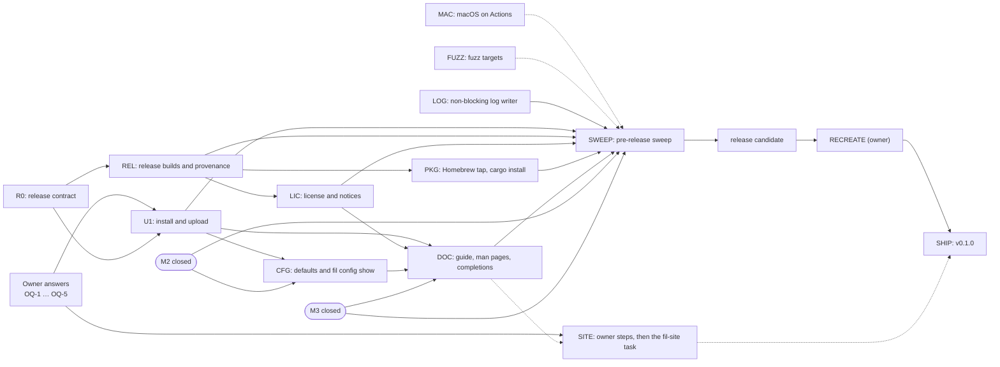

# M4 plan: release

> **Status: proposed by the coordinator on 2026-11-04; nothing here is built yet.** The owner asked (2026-11-04) for M4 to start now, in parallel with M3 (prediction, planned separately in `docs/m3/plan.md`) and with M2's last sweep PRs. `DESIGN.md` stays the source of truth; when a package changes a decision, it updates `DESIGN.md` in the same PR. Items marked **proposed** are the coordinator's calls, which review and the owner may change. Items marked **OWNER** wait for the owner (§7). Written on `origin/main` at `12f974d`.

M4 in `DESIGN.md` §15: install or upload, config, docs, packaging, license; the deeper pre-release sweep; the project site at fil.anthonywertz.com; macOS target tests on GitHub's macOS runners. It is done when **the pre-release sweep is closed before the first release**.

## 0. Preconditions and boundaries

- **M2 is in its sweep.** SW6 (efficiency, #88) edits `crates/fil-forward/src/endpoint.rs` and `crates/fil-proto/src/mux.rs`. No M4 package touches those two files until M2 closes.
- **M3 owns prediction.** No M4 package touches `crates/fil-predict/**` or the client's prediction path. Until M3 closes, M4 does not edit `crates/fil-client/**` at all: a fix there that M4 finds (for example on macOS) goes to the M3 coordinator as a finding, not as an M4 PR.
- **M4 changes no wire (proposed).** No package changes a message encoding, so `PROTOCOL_REVISION` belongs to M2 and M3. The install bootstrap (§3, U1) runs before the preamble and is not part of the protocol. If a wire change turns out to be needed, it becomes a small coordinator PR with its own bump, as in M2.
- **The repository recreate** (§5, RECREATE) is the owner's, at a quiet point. It must happen **before the first release tag**: tags, GitHub Releases and attestations live in the repository and would not move with a recreate.

## 1. Scope

### Goals

1. **Getting fil onto a remote host**, by hand or with the client's help (U1, §16.5 of DESIGN).
2. **Release builds with provenance:** reproducible static Linux binaries, a macOS binary, checksums, signatures and build attestations (REL).
3. **Packaging channels** for v1: GitHub Releases, a Homebrew tap and `cargo install --git` (PKG).
4. **Versioning** that relates the package version to the wire (`PROTOCOL_MAJOR`.`PROTOCOL_REVISION`) (R0).
5. **Config finished and documented:** reviewed defaults, a reference that tests keep in step with the code, `fil config show` (CFG, DOC).
6. **Docs:** a user guide, man pages, shell completions, a changelog and an install-first README (DOC).
7. **License and third-party notices** that meet GPL-3.0's terms for binary distribution (LIC).
8. **macOS on GitHub's runners:** the suites on Apple silicon and Intel, and macOS as a *remote* host (MAC, §16.9 of DESIGN).
9. **The pre-release sweep** (SWEEP), then the recreate, then v0.1.0 (SHIP).
10. **The project site** at fil.anthonywertz.com, in its own repositories (SITE: owner steps and a later task in that repository).

### Non-goals for M4 (proposed)

- **Windows**, as a client or a remote (decided, §2 of DESIGN). WSL counts as Linux.
- **Runtime downloads.** fil never fetches anything from the internet, not even its own binary for a remote (§11.1.1, decided). Whatever the client uploads, it already has on disk.
- **A `curl | sh` installer.** It would run code the user has not seen. Install instructions are a download, a checksum check and a copy.
- **Distro packages** (Debian, RPM, AUR, Nix) and **crates.io** in v1. See OQ-3.
- **`-N` tunnel-only mode** (M2 OD-12) and **desktop notifications for new listeners** (§7.4 of DESIGN, moved out of M2). Both are features. Adding them now would put new code in front of the sweep. They move to after v0.1.0, unless the owner pulls them in.
- **File-descriptor handover between daemons** (§16.6 of DESIGN). Daemons of different builds keep running side by side, as built.
- **`fil ports` listener discovery on a macOS remote** (libproc). A macOS daemon shows forwards only, as in M2.

### Carried items, verified against the code

| Item | Verified | Decision |
|---|---|---|
| **M1-A2: synchronous log writes.** `fil_daemon::logging::RotatingLog` writes each line behind one `Mutex`, and rotation (rename, reopen, prune) runs inside that lock (`crates/fil-daemon/src/logging.rs`, the `State` mutex, `maintain` and `rotate`). The client uses the same module (`crates/fil/src/logging.rs`). There is no M2 regression at `info`, but a log directory on a hung NFS home would freeze every thread that logs, the daemon's included. | yes | **Include, LOG.** A non-blocking writer: a bounded queue, drop and count on overflow, rotation off the hot path, and a test with a writer that blocks. |
| **§16.5: manual install or upload.** | open | **U1**, under OQ-1. |
| **§16.9: macOS as a remote host.** | open | **Proposed: supported**, with sessions, forwards and the agent, and `fil ports` showing forwards only. MAC tests it on every release candidate. |
| **The macOS trampoline after an in-place upgrade.** On Linux a session's child starts through `/proc/self/exe`, which stays the daemon's own image after the file is replaced (`fil_session::nofile::own_executable`). On macOS it is `current_exe()`, a *path*: after a package upgrade replaces the file, a running old daemon starts new sessions through the *new* binary's `__fil-exec-nofile` trampoline. | yes (found while reading) | **MAC tests it** (the upgrade-in-place scenario, §6.3). Proposed remedy, if it fails: freeze the trampoline's argument contract within a `PROTOCOL_MAJOR` and pin it with a test. U1's versioned install directories avoid the case for fil-installed copies, because they are never replaced in place. |
| **Temporary-file cleaners and a long-lived daemon.** `/tmp/fil-$UID/` holds the socket, the lock and start files, and the agent sockets. Some systems age `/tmp`: systemd-tmpfiles' `10d` rule on Fedora-like hosts, and macOS's periodic `clean-tmps`. tmux has the same problem with its socket. | unverified | **To check in MAC and the sweep's bug audit:** a daemon left for longer than the cleaner's age, on a host that ages `/tmp`. If its files go, the remedy is a design change in the sweep (for example, refreshing the socket's times, or taking a `flock` on the directory, which systemd-tmpfiles honors). |
| **`DESIGN.md` §13 "Builds"** names macOS aarch64 only. | yes | **REL adds macOS x86_64** as part of a universal binary (§2.2), and updates §13. |

### Done when

1. **The pre-release sweep is closed** (§6.4): five whole-tree audits plus the release audits, every finding fixed or accepted by the owner, and a verification pass **on the release-candidate artifacts themselves**, not on a development build.
2. **The release candidate passes:** `linux-check -f suite=all`, `macos-check` (both architectures and the macOS-remote job), the drop-in suite on both Pis with the candidate's aarch64 binary, and the realnet `install` part.
3. **The Linux artifacts are reproducible.** Two independent builds of the candidate give identical SHA-256s.
4. **The docs are complete,** and the tests that tie the config reference and the man page to the code pass.
5. **The notices are complete:** every crate in the release graph, plus Rust's standard library and musl.
6. **The repository has been recreated** (owner), and **v0.1.0 is published:** a signed tag, a GitHub Release with signed checksums and attestations, and the Homebrew formula. The site launches with it, if the owner has done the site steps by then; the site does not gate the release.

## 2. Contracts first (R0)

R0 is one coordinator PR: `docs/m4/release.md`, plus a `DESIGN.md` §15 note that points to it. U1, REL, PKG, LIC and DOC all build on it. It holds the decisions below, written as the reference that the code and the workflows then follow.

### 2.1 Versioning (proposed)

- **The package version** is SemVer, kept in `[workspace.package] version` in the root `Cargo.toml`. It is the one version of every crate. The first release is **0.1.0**: fil is new, and 0.x tells users that the config and CLI may still change.
- **The wire** is `PROTOCOL_MAJOR`.`PROTOCOL_REVISION`, already printed by `fil --version` (`fil 0.1.0 (wire 1.12)`). The two numbers are independent.
  - A **patch release never changes the wire.** REL's release check compares the last line of the golden's `[history]` with that of the previous tag of the same minor.
  - A release that changes the wire bumps the **minor** version (0.1 to 0.2 before 1.0, 1.2 to 1.3 after), and its release notes say "upgrade fil on both ends". The coexisting daemons (§5.3 of DESIGN) make that an upgrade, not a breakage.
  - A change of `PROTOCOL_MAJOR` changes the frozen opening. It is rare by design, and it bumps the package's major after 1.0.
- **What 1.0 will mean** (the config, CLI and exit statuses stable within the major; cross-revision wire compatibility still not promised) is decided at 1.0, not in M4.
- **`rust-version`** in the root `Cargo.toml` is set to the pinned toolchain, so that `cargo install --git` says what is needed. That command does not read `rust-toolchain.toml`.

### 2.2 Targets (proposed)

| Target | Artifact | Role |
|---|---|---|
| `x86_64-unknown-linux-musl` | static | client and remote |
| `aarch64-unknown-linux-musl` | static | client and remote (Raspberry Pi 4 and later, ARM servers) |
| `aarch64-apple-darwin` + `x86_64-apple-darwin` | **one universal binary** (`lipo`) | client and remote |

One universal macOS file keeps Homebrew simple, and it lets a Mac upload itself to a Mac of either architecture (§3, U1). Its size is about twice that of one architecture, which is acceptable. 32-bit ARM, FreeBSD and the other BSDs are not v1 targets. Nothing stops a user from building them.

### 2.3 Release artifacts and layout

Each release carries:

- `fil-<ver>-x86_64-linux-musl.tar.gz`, `fil-<ver>-aarch64-linux-musl.tar.gz` and `fil-<ver>-universal-apple-darwin.tar.gz`;
- `fil-<ver>-source.tar.gz`: the tagged tree **with every dependency vendored** (`cargo vendor`). It is the Corresponding Source for the binaries (LIC), and it builds offline;
- `SHA256SUMS`, over every file above;
- `SHA256SUMS.sig`: an SSH signature (`ssh-keygen -Y sign -n fil-release`) made by the release identity (OQ-2);
- the GitHub build-provenance attestation for each archive.

Every archive has the same layout, relative to the directory it unpacks to:

```
bin/fil
libexec/fil/remote/x86_64-linux/fil
libexec/fil/remote/aarch64-linux/fil
libexec/fil/remote/SHA256SUMS
share/man/man1/fil.1
share/man/man5/fil-config.5
share/man/man5/fil-policy.5
share/bash-completion/completions/fil
share/zsh/site-functions/_fil
share/fish/vendor_completions.d/fil.fish
share/doc/fil/{README.md,CHANGELOG.md,LICENSE,THIRD-PARTY-NOTICES.md,config.example.toml,daemon.example.toml,policy.example.toml}
```

`libexec/fil/remote/` carries the static Linux binaries for U1's upload in every archive, so any client can install fil on either Linux architecture. The client finds the directory relative to its own canonical executable path, so the layout survives Homebrew's Cellar and its symbolic links. A client installed any other way (`cargo install`) has no bundle and can only upload itself, or a file named with `--binary` (U1).

### 2.4 The remote install layout

- **The directory:** `$HOME/.local/share/fil/<ver>-w<major>.<rev>/fil`, for example `~/.local/share/fil/0.1.0-w1.12/fil`. The directory is 0700 and the file 0700. The name carries the wire, so garbage collection can tell which daemons still need a copy without running any binary. It is `$HOME`-based, not `$XDG_DATA_HOME`, because a non-interactive login may see a different environment than an interactive one, and the path must not move between them (the state directory `~/.local/state/fil` already follows the same rule).
- **Never replaced in place.** A version is installed once, by an atomic rename. A new version gets a new directory. fil never modifies, replaces or removes a `fil` it did not install (one on `PATH`, one from a package manager).
- **Garbage collection:** an install removes the other fil-installed directories, except the current one and any whose wire still has a running daemon (found through the lock files, as `fil ls` finds other daemons, §5.3 of DESIGN). `fil install --remove HOST` does the same and installs nothing.
- **§11.1.5 of DESIGN** ("no surprises on the remote host") gains this directory as the one place, besides the state and socket directories, where fil writes. U1 updates that text.

### 2.5 The version string

The version string goes into the bootstrap command (§3, U1). A const check in `crates/fil` refuses at compile time any `CARGO_PKG_VERSION` with a character outside `[0-9A-Za-z.+-]`, so that the remote command can never hold anything a shell would interpret.

## 3. Packages



**Riskiest first:** U1 (a new remote command, new attack surface, shell portability), MAC (unknown platform bugs; it decides §16.9), REL (the supply chain), then FUZZ and LOG (hostile-input and liveness hardening before the sweep), then LIC, PKG, CFG and DOC.

Every package keeps M2's rules:

- one PR from its own branch, in its own worktree;
- `just ci` on its exit status;
- an independent review that always covers privacy and security;
- the author fixes, the reviewer re-checks once, and the coordinator merges;
- **a mutation table** for every important check: each one is mutated by hand, and the named test must fail;
- each package updates its own `DESIGN.md` sections.

### Wave 0 (now)

**R0: the release contract** (coordinator)
- **Owns:** `docs/m4/release.md` (new), and a one-line pointer in `DESIGN.md` §15.
- **Builds:** §2 as the reference: versioning, targets, artifacts and their layout, the remote install layout, and the version-string rule.
- **Done when:** merged, with REL and U1 able to cite it.

**The owner's asks page** (coordinator). OQ-1 to OQ-5 (§7) go on one page for the owner, as with M2.

### Wave 1 (in parallel, now)

**U1: install and upload** (riskiest; its remote half waits for OQ-1)
- **Owns:** `crates/fil/src/install/**` (new), `crates/fil/src/connect.rs` (the remote command), `crates/fil/src/dialer.rs` (the first-attach fallback and the offer), `crates/fil/src/cli.rs` (`fil install`), `crates/fil/src/config.rs` (the `install` and `remote` keys), `crates/fil/src/app.rs` (dispatch), `crates/fil/tests/install*.rs` and `crates/fil/tests/golden/remote-command.txt` (new), `tests/realnet/install.sh` (new) with its line in the `linux-check.yml` realnet matrix, and `DESIGN.md` §8.2, §11, §11.1.5, §14 and §16.5.
- **Builds (proposed; the parts that need a second remote command wait for OQ-1):**
  1. **The manual path, always.** A user can install by hand, by copying `bin/fil` to the host. If the default `fil server --stdio` cannot find it (exit status 127, or no preamble), the first-attach error says where fil looks and what to do. Without OQ-1 that is all U1 builds, plus the docs.
  2. **The bootstrap command** (OQ-1). This is a second *fixed* remote command: a compile-time constant POSIX `sh -c '…'` one-liner that holds the build's version and nothing else. It runs, in order, the exact-version copy `$HOME/.local/share/fil/<ver>-w<major>.<rev>/fil server --stdio`, then `fil` on `PATH`, then `$HOME/.local/bin/fil`. The last of these is where the manual instructions put the binary. That fixes the usual "not on the `PATH` of a non-interactive login" failure that mosh and ET users hit.
     - The constant is pinned by a golden file, like the wire. A test proves that the command has no format arguments, and that the host travels only as ssh's destination, after `--`.
  3. **When the bootstrap runs: `remote = "auto"` (proposed default).** The first attach of a run uses the plain `fil server --stdio`, as today, so an admin's `ForceCommand` or an `authorized_keys` `command=` gate that allows only that exact command keeps working. Only if the plain command fails at the first attach, with exit status 127 (not found) or a `VersionMismatch` and no daemon of the client's wire, does the client try the bootstrap once. The run then remembers, **in memory only**, which command worked, for its reconnects. Nothing about the host is written to disk.
     - `remote = "plain"` never runs the bootstrap: the remote command is then exactly `fil server --stdio`, as before M4.
     - `remote = "installed"` uses the bootstrap from the first attach, which saves a login on hosts that always need it.
     - A custom `pipe` command is never rewritten.
  4. **`fil install HOST`** (OQ-1), an upload over one ssh login of its own:
     - The remote command is a second constant script. It prints `FIL-INSTALL1 <uname -s> <uname -m>`, then reads one header line (`<size> <sha256>`) and the bytes that follow, with `cat`, into a temporary file in the 0700 target directory, created under `umask 077`.
     - It checks the size with `wc -c`, and the hash with the first of `sha256sum`, `shasum -a 256` and `openssl dgst -sha256` that is present. If none is present, it refuses and points the user at the manual install.
     - It then runs the new binary once, as `fil server --install-check <sha256>`. That Rust code checks the directory with `lstat` (a real directory, owned by the user, mode 0700), renames the file into place, collects old copies (§2.4) and prints the wire, which the client compares with its own.
     - The binary sent is chosen from the remote's OS and architecture: the client's own executable if they match, otherwise the bundled one in `libexec/fil/remote/`, checked against that directory's `SHA256SUMS` before sending. `--binary FILE` names another file.
     - The client shows progress on the terminal; this is an interactive command, before raw mode. `fil install --check HOST` reports what the host has (OS, architecture, the fil on `PATH` and its wire, the fil-installed copies) and installs nothing.
  5. **The offer** (OQ-1). With `install = "ask"` (proposed default), when the first attach of a run finds no usable fil, the client asks once, before the terminal goes raw: *install fil 0.1.0 (wire 1.12) into ~/.local/share/fil on HOST? [y/N]*. It asks only on an interactive first attach, never during background reconnects and never when stdin is not a terminal.
     - `install = "never"` only prints the error.
     - `install = "always"` installs without asking. That is the user's explicit consent in their own config, never the default.
- **Security and privacy (§11, §11.1):**
  - Both constant commands contain no user input.
  - The binary travels only over the authenticated pipe. Nothing is downloaded.
  - The bytes are verified on the remote before the file can be executed under its final name, and the file is only ever made executable in a 0700 directory of the user's own.
  - No secret is written, and nothing about the host is kept on the laptop.
  - Logs carry the architecture and the outcome at `info`, and the host at `debug` only.
  - What the remote host learns is the binary and its version, which the hello already tells it.
  - Same-uid code on the remote can replace the installed copy afterward; that is out of scope, as it is today for `~/.bashrc` (§11 of DESIGN, "root on the remote host").
- **Tests:**
  - unit tests for the header parser, the binary choice, the GC selection and the first-attach fallback state machine, over a fake pipe;
  - the remote-command golden;
  - **realnet `install`**: containers whose login shell is each of `bash`, `dash`, `zsh`, `fish`, `tcsh` and busybox `ash`. Asserted:
    - an install and an attach with each;
    - a host with no hash tool (refused, nothing left behind);
    - a `noexec` home (a clean error);
    - a read-only home;
    - an interrupted upload (no partial binary under the final name; the temporary file is collected next time);
    - two clients installing at once (one rename wins, and both attach);
    - an old wire's `fil` on `PATH` (the exact version wins, and the old daemon keeps its sessions);
    - a `ForceCommand` gate that allows only `fil server --stdio` (the plain first attach still works);
    - GC keeping a directory whose wire has a running daemon.
  - **On macOS** (MAC's remote job): `fil install` to the runner itself.
- **Mutation:**
  - interpolate the host into the bootstrap, and the golden test fails;
  - skip the hash check, and the corrupted-upload test fails;
  - rename before the `lstat` check, and the hostile-directory test fails;
  - try the bootstrap first in `auto`, and the `ForceCommand` test fails;
  - write the working command to disk, and the no-state test fails.
- **Done when:** the above passes, `DESIGN.md` §16.5 is resolved (decided by OQ-1), and §8.2 and §11 say exactly which remote commands exist.

**MAC: macOS on GitHub's runners**
- **Owns:** `.github/workflows/macos-check.yml` (new, manual, like `linux-check`), `tests/macos/**` (new), the `macos-remote` recipe in the `justfile`, and `DESIGN.md` §16.9.
- **Builds:** a `workflow_dispatch` workflow with `ref` and `suite` inputs. Every action is pinned by SHA and every checkout drops its token, as in `linux-check`. Its jobs:
  - **`check`**, on Apple silicon and on Intel (a matrix over the hosted labels; the Intel label is checked when the workflow is written): `just ci`, `just client-pty` (real macOS PTYs), `just fidelity --no-perf`, `just predict-harness --seeds 2 --keys 60` (M3's harness, run, not edited), a reduced `just forward-soak 32 2000` (macOS's socket limits differ: `somaxconn` 128) and `dropin --local` (the daemon on macOS, real PTYs, no ssh).
  - **`remote`** (macOS as the remote host): an sshd on the runner, either a user-mode sshd on a high loopback port with a throwaway host key and an `authorized_keys` of a key made for the job, or the system sshd under the runner's sudo, whichever works on the image (the package documents which). Then a smoke suite of the real binary over real ssh to `localhost` (`tests/macos/remote.sh`):
    - attach, and type;
    - `kill -9` the ssh, then resume;
    - detach and reattach;
    - **the daemon survives the end of the ssh login** (no logind on macOS);
    - a takeover;
    - `-L`, `-R` and `-D` through a reconnect;
    - the agent, with a throwaway `ssh-agent`;
    - the QUIC upgrade on loopback;
    - `fil install` to itself (after U1);
    - **an upgrade in place:** replace the binary while a daemon runs, reconnect, then start a new session in the old daemon (the trampoline item in §1);
    - the `/tmp` cleaner check: run `clean-tmps` with its age set to 0, and the daemon must still answer.
- **Findings:** a bug MAC finds in a crate M4 may edit gets its own fix PR. One in `crates/fil-client/**` or `crates/fil-predict/**` goes to M3 as a finding (§0).
- **Done when:** both jobs are green on main, or each red is a filed finding with an owner, and §16.9 says "supported, `fil ports` shows forwards only" (proposed).

**REL: release builds and provenance**
- **Owns:** `.github/workflows/release.yml` (new), the `[profile.release]` table in the root `Cargo.toml`, `Cross.toml` (an x86_64 image, pinned by digest), `tests/release/**` (new), the `justfile` recipes `release-build`, `release-check` and `release-verify`, and `DESIGN.md` §13 ("Builds").
- **Builds:**
  - **Triggers:** `workflow_dispatch` (a dry run from any ref: artifacts uploaded to the run, nothing published) and a push of a `v*` tag.
  - **Permissions:** every job `contents: read`. Only the final job has `contents: write` (to create the **draft** release), `id-token: write` and `attestations: write`. There is no `pull_request_target`, no secret, no cache in any release job (as in `linux-check`'s aarch64 job), and `--locked` everywhere.
  - **Linux builds:** both targets through `cross`, with digest-pinned images. That replaces the native musl-tools build for releases, because the Ubuntu package's compiler version would drift and break reproducibility. `just no-test-hooks` and `just release-deps` run on the artifacts, and `file` checks that they are static.
  - **The macOS build:** on the Apple-silicon runner, for both architectures, then `lipo`. The Xcode version is selected explicitly and recorded in the build log.
  - **Reproducibility:**
    - `[profile.release]`: `codegen-units = 1`, `lto = "fat"`, `strip = "symbols"`, `debug = 0`, `panic` as today;
    - `SOURCE_DATE_EPOCH` set from the tag's commit;
    - paths trimmed (`trim-paths` if the pinned toolchain has it stable, `--remap-path-prefix` for the workspace, `CARGO_HOME` and the rustup home otherwise).

    The workflow builds each Linux target **twice, on two runners, and fails if the SHA-256s differ**. macOS is best effort: the workflow records whether two builds match, and does not gate on it.
  - **Privacy check (`just release-check`):** the release binaries contain no builder path (`/Users/`, `/home/`, the runner's workspace), no `FIL_TEST_` string, and no host name or address from the tree's test fixtures.
  - **The release check:** the tag equals `Cargo.toml`'s version, `CHANGELOG.md` has a section for it, the golden's `[history]` ends at this revision, and a patch release has its minor's wire (§2.1). The tag's signature is checked with `git verify-tag` against the allowed-signers file in the repository (`.github/release-signers`), and refused if it is unsigned or signed by anyone else. That is defense in depth behind the tag ruleset (OQ-2).
  - **The release job** builds the archives in R0's layout (LIC's notices and DOC's man pages and completions come in as build steps once those packages land), the vendored source archive and `SHA256SUMS`, creates the attestations (`actions/attest-build-provenance`, pinned by SHA), and opens a **draft** GitHub Release. The owner publishes it after signing (§5, SHIP).
  - **`just release-verify VERSION`** downloads a release, checks `SHA256SUMS.sig` with `ssh-keygen -Y verify`, the checksums and the attestations (`gh attestation verify`), and rebuilds the Linux targets locally in the same `cross` images (in the VM, `docs/dev/vm.md`) to compare. That is the owner's check before signing, and anyone's afterward.
- **Tests:** a dry run on main whose artifacts unpack to the layout, run `fil --version` (on Linux and macOS runners), and pass `release-check`. The two-build comparison holds. A deliberately dirtied build (an absolute path left in) fails `release-check`.
- **Mutation:** drop the path remap, and `release-check` fails; push an unsigned test tag in a fork, and the workflow refuses; change the version without a changelog section, and it refuses.
- **Done when:** a dry run from main produces a complete, reproducible draft and nothing is published.

**FUZZ: fuzz targets** (hardening, before the sweep)
- **Owns:** `crates/fil-proto/fuzz/**` (new), `crates/fil-session/fuzz/**` (new), the `fuzz` recipe in the `justfile`, and DESIGN §12's fuzzing line.
- **Builds:** cargo-fuzz targets, as DESIGN §12 lists, beside fil-forward's SOCKS target:
  - the preamble scanner;
  - the frame decoder;
  - `ControlMsg` and `Hello`;
  - the opening;
  - `InputRecord`;
  - MUX records, by decoding `MuxMsg` through fil-proto's public API (no edit to `mux.rs`);
  - the sshd_config mirror and `policy.toml` parser;
  - the client's `config.toml` parser.

  Each target has a seed corpus taken from the wire golden. `just fuzz TARGET SECONDS` runs one target.
- **Done when:** every target runs, and a campaign (each target for an hour, in the VM or on a runner) has no crash, or each crash is a fix PR. The campaign is part of SWEEP's security audit.

**LOG: a non-blocking log writer** (M1-A2)
- **Owns:** `crates/fil-daemon/src/logging.rs`, `crates/fil/src/logging.rs` (if its glue changes), `crates/fil-daemon/tests/log_content.rs` and a new `crates/fil-daemon/tests/log_blocking.rs`, and the logging sentence in DESIGN §5.3.
- **Builds:**
  - The tracing layer hands each formatted line to a **bounded queue** (proposed: 1,024 lines or 1 MiB, whichever comes first), and returns at once.
  - **One writer thread** does every write, rotation, reopen and prune. `maintain` becomes a message to that thread instead of a lock taken by another one.
  - **On overflow,** a line is dropped and counted. When the queue drains, the writer writes one `dropped N lines` line, so a gap is visible.
  - **At exit,** the writer gets a bounded flush (1 s), so a hung file system cannot keep a process from exiting.
  - The log's rules (0600 and 0700, size and age, nothing older than two weeks) are unchanged. `tracing-appender`'s lossy `non_blocking` writer (MIT) may be used in front of `RotatingLog` if it gives the drop count; otherwise the queue is fil's own.
- **Tests:**
  - **a writer that blocks:** an injected `Write` that parks on a barrier, standing in for a hung NFS file. While it is stuck, the daemon still answers a `ListSessions` and a session still echoes, each within 100 ms, and log calls return in microseconds. When the writer is released, the next line written is the drop count;
  - rotation under load, with no line lost below the queue bound;
  - the existing `log_content` tests are unchanged.
- **Mutation:** write inline in the layer, and the blocking test fails; rotate on the caller's thread, and it fails; drop without counting, and the drop-line test fails.
- **Done when:** merged. This blocks SWEEP, because the sweep's efficiency and bug audits must see the final writer.

### Wave 2 (after their inputs)

**LIC: license and notices** (after REL's layout)
- **Owns:** `about.toml` and `about.hbs` (new, cargo-about's config and template), `deny.toml` (any `[[licenses.clarify]]` that cargo-about needs too), the version text in `crates/fil/src/cli.rs` (**after U1's `cli.rs` edits are merged**), the `notices` recipe, and `docs/m4/release.md` § Notices.
- **Builds:**
  - **`THIRD-PARTY-NOTICES.md`**, generated by cargo-about (MIT or Apache-2.0, a build tool, not in the binary) for the release graph (`-p fil`, normal and build edges, every target), with the same accepted licenses as `deny.toml`. Two notices that cargo-about does not see are added by hand: **Rust's standard library** (MIT or Apache-2.0) and **musl** (MIT, statically linked into the Linux binaries).
  - **`fil --version`** keeps its first line (`fil 0.1.0 (wire 1.12)`, which tests parse) and adds the GNU-style lines: the copyright holder (OQ-2), "License GPL-3.0-or-later <https://gnu.org/licenses/gpl.html>", and "This is free software: you are free to change and redistribute it. There is NO WARRANTY, to the extent permitted by law." Those are GPLv3's "Appropriate Legal Notices" for an interactive program.
  - **Corresponding Source:** REL's vendored source archive, with each release. The release notes and the man page point at it.
  - **Proposed: no SPDX header in every source file.** The root `LICENSE`, the `license` field of every crate and the notices are enough. REUSE compliance can come later.
- **Tests:** `just notices` fails when a crate in the release graph has a license outside the allowed list, or when the generated file is stale; the `--version` test keeps its first line.
- **Done when:** the archives carry the notices, and `--version` carries the legal lines.

**PKG: packaging channels** (after REL; the tap waits for OQ-3)
- **Owns:** `packaging/homebrew/fil.rb.in` (new, a template), the `brew-formula` recipe (it fills the template from a release's `SHA256SUMS`), and the install section of `docs/user/install.md` (DOC owns the rest of the guide).
- **Builds:**
  - **The Homebrew formula:** binary downloads from the GitHub Release, one URL per OS. It installs `bin/fil`, `libexec/fil/remote/` (so that `fil install` works), the man pages and the completions, and a `test do` block that runs `fil --version` and a local pipe attach in a temporary `HOME`. The coordinator opens the tap PR from the seat with `gh` for each release, so there is no token in CI.
  - **`cargo install --locked --git https://github.com/anthonytw/fil --tag vX.Y.Z fil`**, documented with its limits: it installs the client and the remote for the same machine only, with no bundle for `fil install` (use `--binary`), no man pages and no completions.
  - **GitHub Releases** for everyone else: download, check `SHA256SUMS` (and its signature), unpack, copy `bin/fil` into `~/.local/bin`.
- **Tests:** `brew install --formula ./fil.rb` against a dry-run's artifacts on the macOS runner, plus `brew test` and `brew audit --strict` (in MAC's workflow, as one step); a `cargo install --git` of the branch in a clean container.
- **Done when:** the formula installs and tests from a dry run, and the tap repository exists (owner step).

**CFG: defaults and config** (after M2 closes; `cli.rs` and `config.rs` after U1)
- **Owns:** `crates/fil/src/config.rs`, `crates/fil/src/cli.rs` (`fil config show`), the default constants of each tunable named in §16.7 of DESIGN (in the crate that holds it: fil-transport's `PathConfig`, fil-session's catch-up rule, and fil-forward's defaults, **except `endpoint.rs` until M2 closes**), `share/doc/fil/*.example.toml` sources under `docs/user/examples/`, and `DESIGN.md` §14 and §16.7.
- **Builds:**
  - **A defaults review** from the data that exists: realnet, `docs/m2/latency.md`, the Pi runs. Each §16.7 default is kept or changed, with the number behind the choice, in the PR. The prediction threshold is M3's.
  - **`fil config show HOST`:** the effective settings for HOST, with each value's source (default, `[defaults]` or `[host.NAME]`), like `ssh -G`. It works without a connection, so it never contacts the host.
  - **Example config files** (client, daemon, policy) that the tests parse with the real parsers.
- **Tests:** the example files parse; `config show` over the DESIGN §14 sketch; a test that every key the parsers accept appears in `docs/user/config.md` (a list kept beside the parser, checked both ways).
- **Done when:** §16.7 is resolved for v1, except the prediction threshold, and the examples ship.

### Wave 3 (after M3 closes)

**DOC: the guide, man pages, completions and README**
- **Owns:** `docs/user/**` (new), `README.md`, `CHANGELOG.md` (new), `crates/fil/examples/gen_docs.rs` (new: man page and completion generation with `clap_mangen` and `clap_complete`, MIT or Apache-2.0, as dev-dependencies only, so not in the release graph, which `just release-deps` keeps checking), `crates/fil/tests/docs_sync.rs` (new), and the `docs` recipe.
- **Starts early:** the skeleton and the manual-install page can be written in Wave 1. The pages that describe prediction, install and config are finished after U1, CFG and M3 merge.
- **Builds:**
  - **The guide** (`docs/user/`), plain Markdown that renders on GitHub and that SITE's sync script copies:
    - install;
    - quick start;
    - sessions, detach and takeover;
    - reconnects and transports (with UDP and firewall notes);
    - forwards and `fil ports`;
    - the agent;
    - prediction;
    - the config reference (`config.toml`);
    - `daemon.toml`;
    - **for host admins:** `/etc/fil/policy.toml` and the sshd mirror;
    - security and privacy, in plain words, from §11 and §11.1;
    - troubleshooting (`fil install --check`, `FIL_LOG`, the logout warning, version mismatches);
    - fil compared with ssh, ET and mosh.
  - **Man pages:** `fil(1)`, generated from the clap definitions; `fil-config(5)` and `fil-policy(5)`, from `docs/user/config.md` and `policy.md` with pandoc, pinned in the release workflow. Pandoc is a build tool, not a dependency.
  - **Completions** for bash, zsh and fish.
  - **The README:** what fil is, then install, then the quick start. The development status moves to the end.
  - **The changelog** starts at 0.1.0. Earlier work is summarized as "development history (archived)", in line with the README's note on the old PR numbers.
- **Tests:**
  - `docs_sync`: the committed `fil.1` matches the generator's output;
  - every subcommand and flag in `fil --help` appears in the guide;
  - every TOML example in `docs/user/` parses with the real parser;
  - no lab host names or addresses appear in `docs/user/`.
- **Done when:** the guide is complete for 0.1.0, and the man pages and completions are in the archives.

**SITE: the project site** (owner steps, then a task in another repository)
- **Not code in this repository.** The site source lives in its own private repository, `fil-site`, set up like Sempere's: Astro, static output, built in the private repository, with a `deploy.sh` that pushes the build output to the public GitHub Pages repository `anthonytw/fil-site`, served at fil.anthonywertz.com. Making those repositories is the owner's (OQ-5). The site's code is a separate task, in that repository, run once they exist.
- **The later task (proposed scope):**
  - pages: home, install, docs (the guide, copied from a fil **tag** by a sync script, so the site never documents unreleased behavior), security and privacy, changelog and release notes, license;
  - **the same rules as Sempere's site:** no third-party requests, a CSP meta tag, self-hosted fonts and no analytics, checked at build time.
- **In fil:** DOC keeps `docs/user/` plain enough to sync (relative links only, no GitHub-only syntax beyond Mermaid). Nothing else.

### Wave 4: the sweep, the candidate, the recreate, the release

SWEEP, RC, RECREATE and SHIP are in §5 and §6.4.

### File-ownership hot spots

Owned in sequence, never in parallel:

- `crates/fil/src/cli.rs`: U1, then LIC (the version text), then CFG (`fil config show`).
- `crates/fil/src/config.rs`: U1 (`install`, `remote`), then CFG.
- `crates/fil/src/connect.rs` and `dialer.rs`: U1 only.
- The root `Cargo.toml`: REL (`[profile.release]`, `rust-version`).
- The `justfile`: REL, MAC, FUZZ, LIC, PKG and DOC each add recipes in a section of their own. The conflicts are append-only, and the coordinator resolves them.
- `.github/workflows/linux-check.yml`: only U1's one realnet-matrix entry. `release.yml` is REL's, and `macos-check.yml` is MAC's.
- `DESIGN.md`: each package edits its own sections (listed above), and the coordinator resolves overlaps.
- **Off limits until M2 closes:** `crates/fil-forward/src/endpoint.rs` and `crates/fil-proto/src/mux.rs`.
- **Off limits until M3 closes:** `crates/fil-predict/**` and `crates/fil-client/**`.

## 4. Security and privacy design

- **The remote command** (OQ-1). Today it is exactly `fil server --stdio`, because ssh hands its command to the remote shell as a string (§8.2 of DESIGN). U1 keeps that the first and default try. It adds at most two more commands, both compile-time constants that hold only the build's version (checked character by character at compile time, §2.5) and are pinned by a golden. No session name, host name, path or config value is ever part of a remote command. A user's own `pipe` stays theirs, untouched.
- **The upload** is verified by size and SHA-256 on the remote before the file can be run under its final name. It is placed by a rename in a 0700 directory the binary itself checks, and is never replaced in place. The client checks a bundled binary against its archive's `SHA256SUMS` before sending it. The client's own executable is uploaded as it is. Both are protected on the laptop by whatever protects `bin/fil` itself, so the check guards against corruption and mix-ups, not against a compromised laptop (out of scope, §11 of DESIGN).
- **No secrets at rest:** the upload creates no key, token or cache. The command that worked for a host is remembered in memory only.
- **Never silent:** an install happens only on `fil install`, after a `y` at the offer, or with `install = "always"` written by the user. It never happens in a background reconnect.
- **The release pipeline:**
  - SHA-pinned actions and digest-pinned images;
  - no caches, no secrets, and least-privilege tokens;
  - a draft release that a person publishes;
  - a tag ruleset (only the release identity creates `v*` tags), a verified tag signature, Sigstore attestations, the owner's SSH signature on `SHA256SUMS`, and Linux builds that anyone can reproduce.
- **Privacy (§11.1):** fil makes no network call at run time beyond the hosts the user names. Neither the release, Homebrew's formula nor the site adds telemetry. Homebrew's own analytics are Homebrew's, and the install page says how to turn them off. Release binaries carry no builder path. The site makes no third-party requests.

## 5. Owner steps and release sequence

**RECREATE** (the owner's, decided 2026-11-03; timing per the owner's "when it's time"). Prerequisites:

1. M2, M3 and the pre-release sweep are closed and their fixes merged. Proposed: the recreate comes after SWEEP's verification pass, so that the initial commit is the audited tree.
2. No open PRs. Their branches and `refs/pull/*` stay with the old repository.
3. The sweep's tree scan is clean (§6.4: secrets, addresses, host names, personal data, recorded fixtures).
4. REL's dry run passes on main, so the workflows are known to work before they move.

Steps:

1. The coordinator exports the tree, and the owner commits it as one signed "Initial commit" and pushes it as the new public `anthonytw/fil`, with the old repository renamed to a private `fil-archive`, as was done for Sempere.
2. The owner re-creates the settings that do not move: the collaborator invitation for the bot, the `main` ruleset (PR required, no force-push or delete), a **tag ruleset for `v*`** (only the release identity), Actions' default token set to read-only, and Pages not enabled (the site is another repository).
3. The coordinator re-clones, removes stale worktrees, and runs a REL dry run and `linux-check -f suite=check` on the new repository.

**SHIP** (v0.1.0):

1. A release-candidate dry run from main, and the RC checks of §1 "Done when".
2. The owner tags `v0.1.0` (annotated, SSH-signed) and pushes it. The workflow builds the draft.
3. The owner runs `just release-verify 0.1.0` (the rebuild comparison), signs `SHA256SUMS` (`ssh-keygen -Y sign -n fil-release`), attaches `SHA256SUMS.sig` and publishes the draft.
4. The coordinator opens the tap PR (PKG), and the owner merges it, or the bot does if the owner allows it.
5. If SITE is ready, the site task deploys with the release notes.

## 6. Verification

### 6.1 Per PR

`just ci`, the package's tests with its mutation table, and an independent review covering security and privacy. Agents do not dispatch `linux-check` or `macos-check`; the coordinator batches them (§6.3).

### 6.2 Suites that M4 adds

| Suite | Where | What |
|---|---|---|
| realnet `install` | `linux-check -f suite=realnet` and the VM | U1's shell matrix and failure cases |
| `macos-check` `check` | GitHub, Apple silicon and Intel | the gate, PTYs, harnesses, reduced forward soak, `dropin --local` |
| `macos-check` `remote` | GitHub, Apple silicon | macOS as the remote, including the upgrade-in-place and `/tmp`-cleaner checks |
| `release.yml` dry run | GitHub | the archives, the layout, reproducibility, `release-check` |
| `just fuzz` campaign | the VM or a runner | FUZZ's targets, one hour each, during SWEEP |
| `log_blocking` | `just ci` | LOG's writer that blocks |
| Pi drop-in with release bits | the Pis | the M1 and M2 suites on the RC's own aarch64 binary. The Pis' test gate allows only fixed verbs, so `fil install` is tested in realnet and on macOS, not on the Pis |

### 6.3 CI budget

The repository is public, so the hosted runners cost nothing. They still run batched, for wall-clock time and the queue (the free plan runs at most five macOS jobs at once):

| Run | When | Suites |
|---|---|---|
| A | after MAC and REL merge | `macos-check` (all), REL dry run |
| B | after U1 merges | `linux-check -f suite=realnet` (with `install`), `macos-check -f suite=remote` |
| C | the release candidate | `linux-check -f suite=all`, `macos-check` (all), REL dry run, Pis |
| D | after RECREATE | REL dry run, `linux-check -f suite=check` |
| E | the tag | `release.yml` |

### 6.4 SWEEP: the pre-release sweep (§15 of DESIGN)

It starts when M2 and M3 are closed and every M4 package (U1, MAC, REL, FUZZ, LOG, LIC, PKG, CFG, DOC) is merged. **Independent, read-only auditors** cover the whole tree, each with one question in mind:

1. **Redundancy:** code and docs, now that three milestones' plans are history. Historical plans are labeled as such, as `docs/m2/plan.md` is.
2. **Efficiency:** as in M2, plus the release binary's size and start-up time, and the idle cost of a daemon left for days.
3. **User privacy:** §11.1 against the code, the logs at every level, the installer, the release artifacts (no builder paths) and the docs' examples.
4. **Security:** §11 against the code, plus the new surfaces:
   - the bootstrap and install scripts;
   - the release workflow (permissions, pins, triggers, injection through inputs);
   - the FUZZ campaign;
   - the dependency tree: every crate in the release graph listed, with whether it has build scripts, proc macros or `unsafe`, and why it is there; anything unused removed;
   - `cargo deny` clean with no ignored advisory.
5. **Bugs:** lifecycle edge cases across upgrades, both directions of version mismatch, the macOS findings, a long-idle daemon and the `/tmp` cleaners.

And the release audits:

6. **The tree that becomes the initial commit:** a secret scan (gitleaks or trufflehog, on the tree), addresses, host names, user names and e-mail addresses beyond the intended identity, the recorded emulator fixtures (`just record` warns that they can hold personal data), the golden files, and the docs. The history itself goes away with RECREATE. Until then, everything already pushed is public, and the scan says if anything there needs the owner's attention sooner.
7. **The docs against the code:** DESIGN against the code (every "(decided)" still true), the guide against the CLI, and the man pages and examples (the DOC tests, read by a person).
8. **CI and the workflows:** every action pinned, tokens dropped, nothing that runs a fork's code with write access, and the privileged realnet containers only on hosted runners.

Fix PRs follow, reviewed as usual. **A verification pass on the release-candidate artifacts** (Run C) closes the sweep.

## 7. Owner questions

Only those that are truly the owner's: accounts, identity, the site, and anything that touches a §11 invariant. Each comes with a recommendation.

| # | Question | Recommendation |
|---|---|---|
| **OQ-1** | **May fil run a second fixed remote command?** Today the remote command is always exactly `fil server --stdio` (§8.2, §11, a CLAUDE.md invariant). U1's bootstrap (find a fil-installed copy, or `~/.local/bin/fil`) and `fil install` (upload a binary) each need one more command over ssh. Each would be a compile-time constant POSIX `sh -c` string holding only the build's version, pinned by a golden. | **Yes**, with the guards in §3 (U1) and §4: the plain command stays the first try and the only one with `remote = "plain"`; an install never happens silently (`install = "ask"` by default, and never in a background reconnect); nothing is downloaded; the upload is verified before it can run. **If no:** v1 ships manual install only (U1 part 1, plus docs), and §16.5 is resolved as "manual". |
| **OQ-2** | **The release identity:** who signs release tags and `SHA256SUMS`, who may create `v*` tags (the tag ruleset), and the copyright holder named in `fil --version` and the notices. | **The owner's own SSH signing key** for tags and checksums (the bot signs commits, never releases), a tag ruleset that only the owner passes, GitHub attestations on, and the owner's legal name as the copyright holder (the domain already carries it), or "the fil authors" if the owner prefers not to. |
| **OQ-3** | **Distribution channels with accounts:** a Homebrew tap repository, crates.io, distro packages. | **A tap at `anthonytw/homebrew-tap`** (`brew install anthonytw/tap/fil`), a general name that leaves room for other tools; **no crates.io in v1** (publishing would mean about a dozen internal crates, each a permanent public API; `cargo install --git` covers Rust users; the name `fil` is unclaimed today, so the risk of waiting is a squatter, which is accepted); **no distro packages in v1** (the static binaries make them easy for packagers later). |
| **OQ-4** | **macOS signing and notarization** with the Apple Developer membership. A browser download of an unsigned binary is quarantined by Gatekeeper; Homebrew formulae and `curl` downloads are not. | **Not in v1.** Homebrew is the main macOS channel, the install page explains `xattr -d com.apple.quarantine` for a browser download, and the release stays fully automated with no Apple secret in CI. Signing would also put the Developer ID name in the binary and break the bit-for-bit comparison. Revisit if users ask. |
| **OQ-5** | **The site:** create the private `fil-site` repository (Astro source, like Sempere's) and the public `anthonytw/fil-site` repository for GitHub Pages, point `fil.anthonywertz.com` at GitHub Pages in DNS, set the custom domain with HTTPS enforced, and say when it launches. | **Yes, launch with v0.1.0.** Until then the domain can stay unpointed, so that it shows no "coming soon" page. The site task (scope in §3, SITE) runs as soon as the repositories exist, and shows the docs from a release tag only. |

**Proposed calls (no owner input needed; the owner may veto any):** 0.1.0 and the versioning rule (§2.1); the targets and the universal macOS binary (§2.2); macOS supported as a remote, with `fil ports` showing forwards only (§16.9); no runtime downloads and no `curl | sh`; `-N` and notifications deferred; `remote = "auto"` and `install = "ask"` as defaults (if OQ-1 is yes); man pages from clap and pandoc; no SPDX headers; M4 changes no wire; the recreate after the sweep and before the tag.

## 8. Risks, ranked

1. **The install path widens the remote surface.**
   - Shell portability: fish, tcsh and busybox, quoting, a restricted shell.
   - Forced-command gates.
   - `noexec` or read-only homes.
   - The second command itself (OQ-1).

   *Mitigations:* the plain command first and by default; constants pinned by a golden; the realnet shell matrix and failure cases; the owner's sign-off.
2. **The release supply chain:** a compromised action, image or dependency, or a tag pushed by someone else. *Mitigations:* pins, no caches or secrets, a draft that a person publishes, a tag ruleset, signature checks, attestations, reproducible Linux builds checked by an independent rebuild, `cargo deny`, the vendored source.
3. **macOS as a remote is untested until MAC runs:** the trampoline after an in-place upgrade, `/tmp` cleaning, launchd and login-session behavior. *Mitigation:* MAC early (Wave 1), with those exact scenarios. Its findings may need fixes in crates that M3 holds until it closes.
4. **The release date depends on M3.** The sweep cannot start before M3 closes. *Mitigation:* everything but DOC's last pages and SWEEP runs now, so that M4's own work is not on the critical path.
5. **Long-lived daemons against temporary-file cleaners** (§1, carried items). If their files can be deleted, that is a design change found late. *Mitigation:* check it in MAC (Wave 1), and on Linux in the realnet `sysd` image during SWEEP.
6. **Reproducibility may not hold** for C code (ring) or macOS's linker. *Mitigation:* guarantee it for Linux only (digest-pinned images); macOS best effort, with the build environment recorded.
7. **GPL compliance gaps:** a missing notice (the standard library, musl) or missing Corresponding Source. *Mitigation:* LIC's generated notices with a staleness check, and the vendored source archive with every release.
8. **The recreate disrupts work:** PR links, Actions history, rulesets and the collaborator. *Mitigation:* §5's prerequisites and checklist, and no release tag before it.
9. **The LOG change touches every process's logging** late in the project. *Mitigation:* a small, isolated module with a blocking-writer test, merged before the sweep so that the sweep audits it.
10. **Unsigned macOS binaries** confuse browser-download users (OQ-4). *Mitigation:* Homebrew first, and clear install docs.

## 9. Critical files

- `crates/fil/src/connect.rs`, `crates/fil/src/dialer.rs` and `crates/fil/src/install/` (new): the remote command, the first-attach fallback, the upload.
- `crates/fil-daemon/src/logging.rs`: LOG.
- `crates/fil-session/src/nofile.rs`: the trampoline on macOS.
- `.github/workflows/release.yml` and `macos-check.yml` (new); `linux-check.yml` (one matrix entry).
- The root `Cargo.toml` (`[profile.release]`, `rust-version`), `Cross.toml`, `deny.toml`, and `about.toml` (new).
- `docs/m4/release.md` (new, R0) and `docs/user/` (new, DOC).
