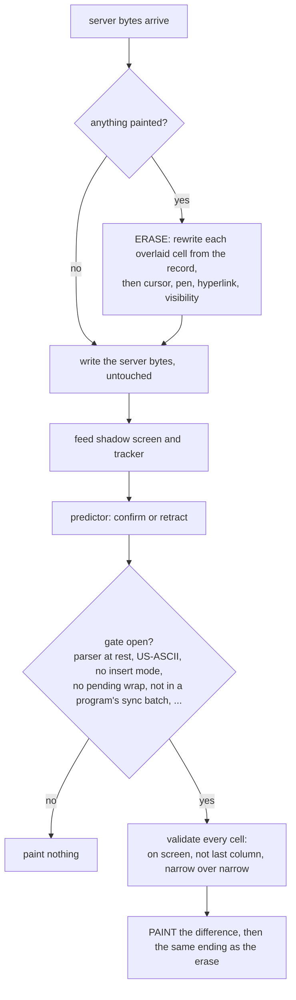

# Spike C: the prediction overlay with erase-before-write

> **Historical: the M0 spike record.** Written while the spike was run; the code has moved on since (the crates, the numbers and some names differ). The current design is `DESIGN.md`; take the findings below as history, not as a description of today's code.

Question (DESIGN.md §9, §15 M0): can the client paint predicted characters into the user's real
terminal, and take them out again before the server's bytes arrive, **without ever corrupting
the screen**? M0's exit criterion is that the overlay never corrupts the screen in the harness.
Predictor quality is M3; the predictor here is minimal on purpose.

## Result

**Yes, with a lot of small rules, and the rules are the design.** The painted bytes are not the
hard part. The hard part is that painting changes the user's terminal in ways the screen model
cannot see (the pending-wrap flag, the soft-wrap flag of a line, the character set, the open
hyperlink, the saved cursor, the parser state), and that the shadow screen can disagree with the
user's terminal (a different emulator, a program's synchronized-output batch). `fil-predict`
handles or avoids every hazard I found (table below) and a test fails if any one of its guards is
removed. Nothing in `DESIGN.md` has to change.

Numbers are in "Harness results". In short:

- `just ci`: 15 scripted scenarios × 2 backends × 2 predictors, plus one deterministic trace per
  hazard: no violations. The guard-off sweep runs on demand (`just predict-mutants`).
- Soak (`just predict-soak 1000`, release): 60,000 scripted sessions, no violations.
- 13 of 13 testable guards are each shown necessary: switching the guard off makes the harness
  fail (12 in the randomized sweep, 1 in a deterministic trace), and the failure shrinks to 1 to 20
  events.
- The harness found **six bugs in the first version of the overlay**: the sync bracket around a
  partial sequence; DECSTR (alacritty keeps the charset, xterm resets it); `vt100` as a shadow
  with origin mode or autowrap off; a reset (RIS) inside a program's synchronized batch; the open
  hyperlink after `ESC 8` (alacritty saves it with the cursor); `?1049 l` with nothing saved
  (alacritty ignores it). It also found two behaviors that were not bugs of mine but are
  hazards to know: overwriting the last cell of a soft-wrapped line loses the line's wrap flag,
  and alacritty's shadow holds a program's synchronized update back (so it is stale). And one
  bug in the oracle itself (link ids copied between states). All are fixed and kept as
  regression traces.
- PTY sessions with real programs: see the table.

## Design of the core



`crates/fil-predict`:

| Module | Role |
|---|---|
| `overlay.rs` | `Overlay`: the core. Sans-IO: `on_server`, `on_input`, `on_tick`, `set_pty_mode`, `resize` take bytes and a time and return a `Flush` (`erase`, `server`, `paint` kept apart so the harness can check between them). Owns the shadow `Box<dyn Emulator>`, the wanted cells, and a record of what is painted. |
| `predictor.rs` | The `Predictor` trait and `OverlayEdit`. Untrusted. |
| `mosh.rs` | The default predictor. |
| `tracker.rs` | What the byte stream did that `TermState` does not say (see below). |
| `keys.rs` | Splits raw input into keys; carries a half-received sequence. |
| `oracle.rs`, `driver.rs`, `sim.rs` | The oracle, the trace recorder and shrinker, the scripted fake remote. |
| `pty.rs` (feature `harness`) | Programs on a PTY behind `fil-netsim`; the termios sampler. |

**Everything painted is recorded with what it replaced** (the shadow's cell at that moment,
with its attributes and link), together with the shadow cursor, pen, visibility, link and origin
state. The erase therefore needs no screen read and no knowledge of what the server has sent
since. A paint is a *delta* from what is on screen, and every paint and every erase ends the same
way: cursor placed with an absolute `CUP` (never `DECSC`/`DECRC`, which would clobber the
program's saved cursor), pen reset to the shadow's, the program's hyperlink reopened, cursor
shown again if it was visible. That identical ending is what makes the strong invariant below
hold after every flush and not only at quiet moments.

**The tracker** (`tracker.rs`) is a second parser over the same bytes, for things neither backend
reports:

- whether the terminal's parser is at rest (a conservative scanner: it may say "busy" when the
  terminal is idle, never the reverse): after a chunk that ends inside `ESC [ 3`, an OSC string or a
  UTF-8 character, nothing may be written;
- charsets G0-G3 and the invoked one, with DECSC/DECRC, `CSI s/u`, `?1048/?1049` and a pending single
  shift;
- IRM, DECOM, DECAWM, DECLRMM, DECNRCM, synchronized output;
- the open OSC 8 hyperlink;
- sixel / kitty / iTerm2 images and double-size lines (sticky until `ED 2/3` or `RIS`).

**Synchronized output** (`CSI ? 2026 h/l`) brackets the erase+paint so a terminal that supports it
never shows a half state. It is not needed for correctness (the oracle runs without it, and a second
oracle with it). It is placed with care: an end marker after server bytes that stop inside an escape
sequence would cancel that sequence, so the server bytes are only inside a bracket when the stream
is at rest on both sides (`Bracket::Whole`); otherwise the erase and the paint get their own
brackets (`Bracket::Parts`); and never when the program has a batch open itself.

**Rules enforced on every predictor** (DESIGN.md §9), each with a switch in `Guards` so the
harness can show it is needed:

1. no prediction while the daemon reports canonical mode with echo off (retracts anything shown);
2. off on the alternate screen unless `Predictor::wants_alt_screen`;
3. never paint anything that would scroll or wrap: only cells in columns 0 to cols-2, the cursor may
   reach the last column but a character is never drawn into it, and `Enter` is never predicted;
4. plus the hazard rules below.

### Trait changes (DESIGN.md §9 sketch)

`on_key(key, screen, rtt)` became `on_key(key, &Ctx{screen: &TermState, rtt, now})`; `on_output` takes
the same context; `on_tick` and `next_deadline` are new (timeouts need to fire with no input);
`has_outstanding` (lets the core skip reading the shadow on `cat bigfile`) and `wants_alt_screen`
(the opt-in) are new. `reset` is as sketched. `DESIGN.md` is not edited: these are details of the
sketch, not changes of design.

## Hazard table

"Test" names are in `crates/fil-predict/tests/`. `hazards.rs` has one deterministic trace per
hazard that must pass with all guards on and fail with that guard off. `mutants.rs` sweeps the
scripted scenarios with each guard off. `sim.rs` is the randomized sweep with everything on.

| # | Hazard | How it is handled | Test |
|---|---|---|---|
| 1 | **Pending wrap**: a `CUP` to restore the cursor clears it in the real terminal | Refuse to paint while the shadow cursor has `pending_wrap` (cheaper and safer than re-printing the last cell) | `pending_wrap_is_not_cleared_by_painting`, mutant `pending_wrap` |
| 2 | **Pen / SGR**: painting changes the current attributes | Paint with the pen plus underline; every ending resets to the shadow's `Cursor.pen` with the same SGR writer as the snapshot (`fil_term::snapshot::sgr`: styles, colors, underline style and color) | `pen_is_restored`, mutant `pen` |
| 3 | **Hyperlink (OSC 8) state**: the model has links on cells, not the one open for the next character | Tracker keeps the program's open link verbatim; painting closes it, restoring a linked cell reopens that cell's link, every ending reopens the program's | `hyperlink_stays_open_across_a_paint`, mutant `link` |
| 4 | **Insert mode (IRM)** | Block (model `insert` and tracker); unknown after DECSTR counts as on | `insert_mode_is_not_painted_into`, mutant `insert` |
| 5 | **Origin mode / scroll region** | Leave DECOM with `?6 l` for the paint (absolute addressing reaches every row), end with `?6 h` and a region-relative `CUP`; the target must be inside the region. A backend that cannot model DECOM (`vt100`) blocks painting while it is on | `origin_mode_is_addressed_absolutely`, mutant `origin` |
| 6 | **Charsets** (DEC graphics turns `a` into a glyph): neither backend reports them | Tracker follows `ESC ( ) * +`, SO/SI, `ESC n o`, single shifts, DECSC/DECRC, `CSI s/u`, `?1048/?1049`; paint only if the invoked set is US-ASCII | `dec_graphics_is_not_painted_into`, mutant `charset` |
| 7 | **Terminals disagree about resets and restores** (all found by the harness): DECSTR (`CSI ! p`) resets the charsets in xterm, not in alacritty; `?1049 l` outside the alternate screen restores in xterm, is ignored by alacritty; `ESC 8` brings back the open hyperlink in alacritty (it saves it with the cursor), xterm has no links | The tracker does not guess. After DECSTR the charsets, insert, origin and the scroll region are *unknown* until set explicitly (alacritty keeps its own region while reporting none: found by the status-line fuzz, seed 39); a restore with nothing saved makes the charset unknown; a restore after the program has used OSC 8 makes the open link unknown (until its next OSC 8). Unknown blocks painting | `soft_reset_leaves_the_charset_unknown`, `restore_without_a_save_leaves_the_charset_unknown`, `a_cursor_restore_may_drop_the_open_hyperlink` |
| 8 | **Wide characters and combining marks** | The target cell must be width 1 (never a wide head or its spacer, so half a wide character is never overwritten); predicted characters are only printable ASCII and Latin letters (U+00A1-024F), never combining marks, CJK or emoji | `wide_characters_are_never_split`, mutant `wide` |
| 9 | **Cursor visibility and shape** | Hide during paint, show again only if the shadow cursor is visible; shape is never touched | `cursor_visibility_is_restored`, mutant `cursor_visibility` |
| 10 | **Autowrap off / writing at the last column** | Never paint in the last column. Besides the wrap, overwriting the last cell of a soft-wrapped line **loses the line's wrap flag** (found by the harness; reflow and snapshots need it). `vt100` has no DECAWM, so a shadow from it is wrong once a program turns it off: block | `last_column_cell_keeps_the_line_wrap_flag`, mutant `last_column` |
| 11 | **Parser state**: a chunk ending inside an escape sequence, an OSC string, a DCS/APC string or a UTF-8 character | The tracker's scanner defers painting until at rest; nothing is ever written between a server chunk's start and end of sequence | `nothing_is_painted_inside_an_escape_sequence`, mutant `mid_sequence` |
| 12 | **The sync bracket itself** around partial sequences (found by the harness: an end marker after a lone `ESC` cancelled the sequence) | `Bracket::Whole` only if at rest before and after; else `Parts`; none inside a program's batch | `synchronized_output_never_wraps_a_partial_sequence`, `overlay.rs` bracket tests |
| 13 | **Program's own synchronized output**: alacritty's shadow *buffers* the update until `?2026 l`, so the shadow is stale, and anything restored from it would be wrong (found by the harness) | Block painting while the program has `?2026` on, until its explicit `?2026 l` (not a reset: alacritty's processor keeps the batch through RIS); no bracket of ours inside it | `programs_own_synchronized_output_is_not_painted_into`, `a_reset_does_not_end_the_programs_synchronized_batch` (deterministic traces; the scripted scenarios rarely reach it) |
| 14 | **DECSC saved cursor** | Never used by the overlay | `saved_cursor_is_untouched`, and the final probe |
| 15 | **Password prompt**, including the race before the daemon's report arrives | Core: no prediction and retract on the report (canonical and not echo). Predictor: mosh-style epochs, so the first guess after Enter, Ctrl-x, arrows is tentative and never shown until one is confirmed; a password that is never echoed is never shown | `password_prompt_is_not_predicted`, mutant `password`, and `Kind::Secret` in `sim.rs` |
| 16 | **Alternate screen** | Off unless the predictor opts in; retracts on entry | `alternate_screen_is_not_predicted`, mutant `alt_screen` |
| 17 | **Scrolling** | Nothing is drawn where a write could scroll (rule 3); `Enter` is not predicted; the oracle compares history, so a push into scrollback is a violation | `sim.rs` (history is in I1) |
| 18 | **Terminal queries**: the shadow answers `DA`/`CPR` | The shadow's replies are drained and dropped; the user's terminal answers | `sim.rs` (Exotic) |
| 19 | **Resize with predictions showing** | Erase against the old geometry, reset the predictor, resize the shadow. Only right if the terminal has not reflowed yet | `resize_with_predictions_showing` (emulator-to-emulator, which reflows in step) |
| 20 | **Images (sixel, kitty, iTerm2), double-size lines, left/right margins, single shifts, NRCS** | Policy: the tracker flags them and painting stops (sticky for images and double-size lines until `ED 2/3` or `RIS`) | Tracker unit tests only. **Not provable in the harness**: neither backend implements them |
| 21 | **Width disagreements** (VS16, ambiguous width) between the shadow and the user's terminal | Not solvable here (Spike A row 10). Predicted characters avoid them; a restored cell is rewritten with the shadow's text and may not match the terminal's idea of its width | None |
| 22 | **Kitty keyboard protocol**: keys arrive as `CSI ... u`, not characters | The decoder yields `Sequence`, which the predictor treats as an unknown key: no prediction | `keys.rs` unit tests |
| 23 | **A backend whose shadow is wrong** (`vt100`: no origin mode, no DECAWM) | Block while those modes are on (see 5, 10). Alacritty is the default | `origin_mode_is_addressed_absolutely` on both backends |

## Harness

### The oracle

Everything the client writes to "the terminal" goes into a second emulator of the same backend (the
`vt100` oracle shares `vt100`'s blind spots, so I did not mix them). After every flush
(`oracle.rs`):

- **I1**, every flush: the user terminal equals the shadow in everything except the overlay cells and
  the cursor position, compared with `fil_term::compare` across all 30 fields (cell text, width, colors,
  attributes, hyperlinks, wrap flags, history, pen, modes, visibility, shape), within each backend's
  declared capabilities. The overlay cells must hold exactly what the overlay says it painted
  (text, underline), and the cursor must be where it says; the cursor must not be in a pending-wrap
  state.
- **I2**, whenever nothing is painted, and **at the erase point of every flush**: the terminal equals
  the shadow *as it was before the server bytes*, complete, cursor and pending wrap included. Checking
  between the erase and the server bytes is stronger than checking afterwards: it fails even if
  the server's bytes would have hidden the damage.
- **Probe**, at the end of a session: a fixed follow-up (`CUP`, text through the charset and link, `ESC 8`,
  last column, a line feed at the bottom) is fed to the terminal and to a *reference* that only ever saw
  the server's bytes. It reveals what `TermState` cannot show: charset, saved cursor, open link.
- Also: no predictions painted after a password report (`Kind::Secret`), none on the alternate screen
  (`Kind::Policy`), none left after the timeouts (`Kind::Leftover`), and characters typed at a hidden
  prompt never appear anywhere on screen.
- **Synchronized output**: alacritty implements `?2026`, holding state back inside a bracket. One
  oracle receives the parts without brackets (for the erase-point check); a second receives the exact
  bracketed bytes and is checked between flushes.

A failure is shrunk (`driver::shrink`: cut after the failing event, drop all ticks, delta-debug the
events, then the bytes) to a trace printed as Rust builder calls. Those became `hazards.rs`.

### Scripted scenarios (in `just ci`)

`sim.rs`: a seeded typist (letters, backspace, Enter, arrows, Ctrl-U/C, wide characters) types into a fake
remote behind a virtual-time link with jitter, whose server output is **cut at random byte positions**
(so sequences and UTF-8 arrive split). The remote is a tty line discipline (echo, backspace, line editing,
a password mode that turns echo off) plus a pool of disturbances per scenario. Scenarios: echo with delay,
password (typed ahead of the prompt), async output, clear screen mid-typing (`ED 2`, `ED 3`, `RIS`), scroll
region changes, writes at the last column (with autowrap on and off), insert mode, DEC graphics (G0, G1
with SO/SI, DECSC around it, DECSTR), origin mode, alt screen (`1049`, `47`), wide chars and combining
marks, styles with an open link, saved cursor, exotic (sixel, kitty graphics, DECDWL, single shift,
margins, sync, NRCS, OSC 1337), and all of them mixed. Each runs on both backends with the default
predictor and with a **hostile** one (shows every guess at once, guesses at the cursor whatever is
there, invents cells out of range and over wide characters, moves the cursor): the core must hold
whatever the predictor does. Counts in CI are small (2 seeds × 50 keys); `SEEDS` in `tests/sim.rs` is the
knob.

### On-demand PTY harness: `just predict-harness`

Real programs on a PTY, behind `fil-netsim`'s stream link with latency and jitter in both directions, real
time. The termios of the PTY master is sampled every 5 ms and shipped in order with the output, standing
in for the daemon's report. Programs (all in a scratch `HOME` and directory, with a `PATH` of symlinks to
`ls cat date sleep seq head vim less stty`): an interactive `bash` with `PS1='$ '`; `cat`; `vim -u NONE`;
`less`; `read -s` in a loop (canonical, echo off) typed ahead of; an *adversary* (a script in raw mode that
echoes keys itself and emits random escape sequences from a pool of 29: IRM, charsets, DECOM and regions,
pens, links, DECSC, `ED 2`, alt screen, a cursor jump to column 40, wide text, sync, DECSTR, `RIS`);
and `cat` with a background job printing every 400 ms. Output is also cut at random points (1/3 of reads,
pieces of 1 to 9 bytes). Flags: `--seeds`, `--keys`, `--latency`, `--only`, `--backend`, `--hostile`
(a predictor with no manners, so vim, less and the password prompt are painted into too), `--guard-off
NAME` (shows the harness catching a switched-off rule on real programs), `--jobs`, `--split`, `--dump`.

### Harness results

**Scripted scenarios.** `just ci` runs 2 seeds × 50 keys of each of the 15 scenarios, on both
backends, with both predictors (120 sessions, about 3 s). `just predict-soak 1000` ran 1000 seeds of
the same (**60,000 sessions**, 182 s release): no violation after the fixes listed above. Before them,
the soak and the PTY runs each found one of the bugs, within the first few hundred sessions.

**Guards are needed** (`tests/mutants.rs`, run with `--nocapture`). Each guard switched off, hostile
predictor, first failing scenario, and the failure shrunk by `driver::shrink`:

| Guard off | Caught by | Violation | Shrunk to |
|---|---|---|---|
| `password` | password, seed 0 | `Secret` | 2 events |
| `alt_screen` | alt-screen, seed 0 | `Policy` | 4 |
| `pending_wrap` | last-column, seed 0 | `Erase` (pending wrap lost) | 4 |
| `last_column` | last-column, seed 3 | `Flush` (soft-wrap flag lost) | 20 |
| `wide` | wide-chars, seed 0 | `Painted` | 17 |
| `origin` | origin-mode, seed 0 | `Painted` | 3 |
| `pen` | styles, seed 0 | `Flush` (pen) | 1 |
| `link` | styles, seed 0 | `Erase` (hyperlink) | 3 |
| `cursor_visibility` | echo, seed 0 | `Flush` (cursor hidden) | 1 |
| `insert` | insert-mode, seed 0 | `Painted` | 6 |
| `charset` | dec-graphics, seed 0 | `Painted` (`k` shows as `┐`) | 2 |
| `mid_sequence` | echo, seed 1 | `Flush` | 3 |
| `program_sync` | a deterministic trace (`hazards.rs`); the scenarios rarely reach it | `Flush` | 4 |

The same on real programs: `just predict-harness --hostile --only read-s --guard-off password`
fails 3 sessions of 3 with a two-event trace (the PTY report, then one key); `--only adversary
--guard-off charset` fails with `ESC ( 0` and five keys.

**PTY harness**, both backends, 8 seeds × 80 keys, 40 ms each way (80 ms RTT), output cut at random
points. Events are everything the client did (keys, output chunks, mode reports, ticks); "painted" is
the number of flushes that left predictions on screen, "erases" the flushes that took some off. Every
one of those flushes was checked by the oracle. **112 sessions, 0 failures** (319 s):

| Program | Backend | Sessions | Events | Painted | Erases | Failures |
|---|---|---|---|---|---|---|
| bash (`PS1='$ '`) | alacritty | 8 | 5062 | 1131 | 297 | 0 |
| cat | alacritty | 8 | 4583 | 1012 | 221 | 0 |
| vim | alacritty | 8 | 5325 | 0 | 0 | 0 |
| less | alacritty | 8 | 6560 | 0 | 0 | 0 |
| `read -s` | alacritty | 8 | 2769 | 0 | 0 | 0 |
| adversary | alacritty | 8 | 5042 | 744 | 191 | 0 |
| cat + background job | alacritty | 8 | 5059 | 1435 | 315 | 0 |
| bash | vt100 | 8 | 5067 | 1230 | 331 | 0 |
| cat | vt100 | 8 | 4583 | 1007 | 222 | 0 |
| vim | vt100 | 8 | 5309 | 0 | 0 | 0 |
| less | vt100 | 8 | 5374 | 0 | 0 | 0 |
| `read -s` | vt100 | 8 | 10980 | 0 | 0 | 0 |
| adversary | vt100 | 8 | 5048 | 541 | 143 | 0 |
| cat + background job | vt100 | 8 | 5060 | 1580 | 337 | 0 |

vim and less are never painted into (alternate screen), and `read -s` is never painted into (the
mosh-style epochs hide the first guess after Enter, and no guess is ever echoed): that is the
intended behavior, and with `--hostile` (a predictor that guesses wildly, 56 sessions, 0 failures) the
core is what keeps vim and less clean (0 painted) while the password prompt is painted into only
during the race before the report (160 flushes on alacritty, all retracted when the report arrived).
The first version of the overlay failed the PTY harness twice (a `vt100` shadow with origin mode on; RIS
inside a program's sync batch) and the scripted soak twice (the open hyperlink after `ESC 8`; `?1049 l` with
nothing saved). The traces are in `hazards.rs`.

What this harness does **not** show: a human looking at it, a real terminal, a slow link with loss
(the pipe is lossless and ordered), more than one window size (60x16 on PTY, 40x12 scripted), resizing
while predictions are showing on a real terminal, bracketed paste, mouse input, or programs that use the
kitty keyboard protocol.

## What the default predictor does and does not do

Does (`mosh.rs`, about 300 lines): printable characters (ASCII and Latin letters) and backspace at the
cursor on the normal screen; underlined until the shadow shows the character; epochs; confirms by content
(a guess is confirmed when the cell shows it, contradicted when the cell shows something that is neither the
guess nor anything this cell was predicted to hold nor what was there, expired after 1.5 s); a guess that
equals what was there is confirmed when the cursor arrives or when a later key was echoed (keys are handled
in order); stops before the last column and at any key it cannot predict; no guess below an RTT
threshold, a constant (20 ms) to be tuned in M3.

Does not (M3): cursor-movement prediction, mid-line insert and delete, wrapping at the line end, an
adaptive threshold, flagging glitches, per-row epochs. There is no input acknowledgement from the daemon,
so "not echoed yet" cannot be told from "will never be echoed": a guess whose cell never changes lives
until the timeout (that is the visible cost: a stray underlined blank for 1.5 s in the case of backspace at
the start of a line). **Recommendation: have the daemon acknowledge the input sequence it has written to
the PTY, as mosh's echo ack does.** The overlay core does not need it; the predictor's quality does.

## Demo: `just predict-demo 200ms`

```
just predict-demo 200ms                  # 200 ms each way, 400 ms round trip; your $SHELL
just predict-demo 100 --no-predict       # the same link, no prediction, for comparison
just predict-demo 200ms --plain          # no underline
just predict-demo 200ms --backend vt100  # the other emulator
```

Runs your shell on a local PTY behind `fil-netsim` with the latency injected in both directions, with the
overlay and predictor live in the real terminal (raw mode via `rustix::termios`; restored on exit and from a
panic hook). Exit the shell to quit. Resizing the window while it runs is not handled. Smoke-tested through
`script(1)`, not felt by me: please try it in your own terminal, and in more than one (Terminal.app,
iTerm2, kitty, a Linux terminal) since only emulators have been checked.

## Recommendations

**M1**

- Daemon: report `ICANON` and `ECHO` in order with the output (the harness sends a mode frame before any output
  read after a change), and the input acknowledgement above.
- `fil-term` additions this spike needed or would use (nothing was changed in the model):
  - `Modes.charsets` (G0-G3 designations and the invoked set) and the DECSC-saved charsets. The tracker
    reimplements this; a snapshot needs it too (Spike A: "charset designation not restored"). With it, the
    tracker's charset code can go.
  - A "parser at rest" accessor on `Emulator` (or the unparsed tail), for painting and for snapshotting at
    a sequence boundary (Spike A: "a snapshot taken mid-sequence loses the pending bytes").
  - The adapters should **not buffer synchronized output**: alacritty's processor holds a program's
    `?2026` batch (up to 2 MiB or until `l`, with a timeout nobody calls), so `state()` is stale during it,
    for snapshots as well as for the overlay. Apply the bytes immediately (the real terminal buffers the
    *display*, not its state).
  - `Modes.insert/origin/autowrap` and DECSTR behavior for `vt100` (see the hazard table); the
    overlay blocks on `vt100` rather than relying on it.
  - `Emulator::state` as `&mut self` (already noted in Spike A).
  - Small additions made in this PR: `fil_term::snapshot::sgr` (the SGR writer, factored out of the
    snapshot writer, same output) and `snapshot::sanitize` made public, so the overlay and the snapshot
    write a pen the same way.
- Answer terminal queries from the user's terminal only; the shadow's replies are dropped.

**M3**

- Tune the predictor with the input acknowledgement; add cursor-movement and mid-line prediction; the
  adaptive RTT threshold; show the disconnect status line (DESIGN.md §4.2) through the same core (it is a set of
  cells with a style; it needs only the same validity rules and a different style).
- Real terminals: check which ones support `?2026`, how they render `4` (underline) next to a color pen,
  and whether VS16 and emoji widths match the shadow.
- A fuzzing target for the tracker's scanner against the emulators' parsers: it must say "busy" whenever
  they are mid-sequence.

## What is verified and what is assumed

Verified, in the harness: every row of the table marked with a test, on both backends (`alacritty`
0.26.0, `vt100` 0.18.1), against an oracle of the same backend; and that the harness fails when a guard
is removed.

Assumed, not verified:

- **Real terminals behave like the emulators.** None was tried. In particular: that `?2026` is ignored where
  unsupported, that a `CUP` clears pending wrap and overwriting the last cell clears the wrap flag (both are
  what alacritty does; xterm documents the first), that DECSTR resets what xterm says it resets, that an
  unknown private mode is ignored.
- The oracle shares the shadow's backend, so a behavior both emulators get wrong the same way would not be
  seen. Where the shadow and the real terminal disagree (a width table, DECSTR), only the rules in rows 7, 21
  and 23 apply.
- Sixel, kitty graphics, DECDWL, DECLRMM: the guards exist and are unit-tested in the tracker, but the harness
  cannot show damage because neither backend implements them.
- Nothing here was measured for cost. The shadow is only read when something is predicted
  (`has_outstanding`), but a `state(0)` per key and per output chunk while typing is a copy of the grid
  (about 2 ms at 200x50 with history; less without). Fine for typing, worth checking under heavy output
  with a prediction outstanding.
- Windows are not covered (the PTY code is Unix; `nix` and `rustix` termios).

## Reproduce

```
just ci                                      # includes the scripted scenarios and hazard traces (adds about 3 s)
just predict-mutants                         # guard-off sweep: every guard is needed (on demand, after changing a guard)
just predict-soak 1000                       # 60,000 scripted sessions, release (about 3 minutes)
cargo test -p fil-predict -- --nocapture     # the mutants test prints what each guard-off run caught
just predict-harness --seeds 8               # real programs on a PTY, both backends
just predict-harness --hostile --seeds 4     # the same with a predictor that guesses wildly
just predict-harness --guard-off pending_wrap --only adversary
just predict-demo 200ms
```

Code: `crates/fil-predict/src/{overlay,predictor,mosh,tracker,keys,oracle,driver,sim,pty}.rs`,
`examples/{predict_harness,predict_demo}.rs`, `tests/{overlay,hazards,mutants,sim}.rs`.

## Addendum: the pinned status (M1, `fil-client`)

The overlay core also draws lines of text for the client itself: the disconnect status line, the
`~?` help and the questions it asks (`Overlay::set_status`, `Status`, `Placement`). They go
through the same plan, the same cell validation and the same gates as predictions, with two
differences: they ignore the password and alternate-screen rules (those are about guessing what
a program will echo), and they are drawn in inverse video (`CellStyle::Reverse`). Placement is
the edge of the screen farthest from the cursor; the cursor's row is never covered, and if a
cell cannot be drawn safely there (a wide character) the other edge, then the first line alone,
is tried, and then nothing. `crates/fil-predict/tests/status.rs` checks them against the oracle
after every flush, on both backends, with scripted cases and seeded random sessions
(`just status-soak`). The random sessions found one more hazard (row 7, the scroll region after
DECSTR), and review of the client found another: DECSC saves origin mode in xterm but not in
the shadow backends, so after a restore that would change it the tracker treats origin mode as
unknown (vt100 seed 79; both backends now run the full byte pool). Alacritty seed 77 found that
the tracker kept a single cursor save where terminals keep one per screen: leaving the alternate
screen compared the mode against a DECSC made on it, the tracker kept origin mode on while the
terminal turned it off, and the paint ended with a `CSI ? 6 h` that left it on. The tracker now
keeps a save per screen, plus the single save tmux keeps for both screens (measured on 3.8), and a
restore brings back only what the two models agree on; the rest is unknown and blocks painting.
`?47` and `?1047` (which the shadow ignores) leave the screen unknown, and since what a program
draws there lands on the shadow's primary screen but the terminal's alternate one, both screens
count as tainted until cleared (`CSI 2 J` on a known screen, or entering the `?1049` screen, which
every terminal clears). The tracker follows the shadow's own screen apart from the terminal's (only
`?1049` and RIS move alacritty), and a RIS sent from the alternate screen leaves the screen unknown
and the primary screen tainted, since tmux stays on the alternate screen and keeps the old primary
one. Images and double-size lines taint only their own screen. A restore that kitty would use to
bring back DECAWM leaves autowrap unknown, and one of a saved shift other than G0 leaves the
charsets unknown (WezTerm always invokes G0).

Known limit: a resize erases against the old geometry, as for predictions. For a pinned status
this matters when the window gets *narrower* while something is drawn: a reflowing terminal re-wraps
the drawn cells and the program's rows under them, which pushes lines into the scrollback and leaves
fragments the erase cannot reach. The
client therefore keeps status lines short (40 columns, unpadded), `Display::resize` reports when
the window narrowed while something was drawn, and the client then starts the next attach from a
snapshot (the scrollback keeps the re-wrapped fragments; the screen is repaired).

Known limit: `?47` and `?1047`. The `alacritty_terminal` shadow does not switch screens on them, so
after a program uses them the shadow's screen differs from the terminal's, and the tracker blocks
painting (status line and predictions) until a clear on a known screen. Modern `TERM`s use `?1049`
for smcup/rmcup, but `TERM=putty`, `rxvt`, `Eterm` and `xterm-r6` use `?47`: under those, every
full-screen program (`less`, `vim`) leaves fil without a status line or predictions until the next
`clear` (their rmcup's own `CSI 2 J` runs while the screen is still unknown, so it does not count).
The real fix, modeling `?47`/`?1047` in `fil-term`'s alacritty backend as `be_vt100` does, is a
follow-up.
