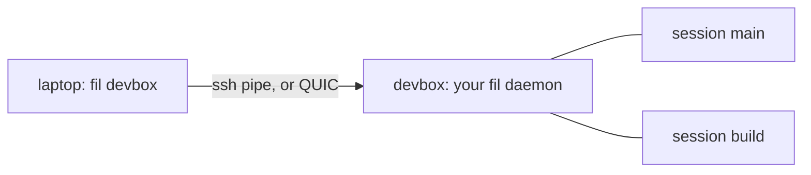

# Sessions, detach and takeover

A session is a shell on the host, with its terminal, its scrollback and its port forwards. It belongs to a daemon fil starts for you on the host, not to your client, so it outlives the client.



## Names and lifetime

- A session name is `[A-Za-z0-9._-]`, 1 to 64 characters. `fil HOST` with no name is the session `main`.
- Attaching to a name that does not exist creates it.
- A session lives until its shell exits or you end it with `fil kill`. Detached sessions stay as long as the daemon does. The daemon exits by itself when it has no sessions and no connections for five minutes (`idle_exit_secs` in [`daemon.toml`](daemon.md)); it does not exit while a session exists.
- The daemon keeps each session's recent output (1,000 lines by default; `history_lines` in `daemon.toml`) in memory, so you can resume or reattach. It is never written to disk.
- If the host reboots, or something kills the daemon, the sessions are gone. A host that kills your processes at logout also does: see [troubleshooting](troubleshooting.md).

## Listing and ending

```sh
fil ls devbox                 # NAME, TERM, FORWARDS, ATTACHED, LAST OUTPUT, CREATED
fil kill devbox build         # end "build"
```

`fil kill` hangs up the session's shell and everything it started, as closing a terminal would, then kills whatever is left after a short grace. The client attached to it sees the session end.

## Detach

Three ways, which keep the session running:

- Type `~.` after Enter, in the session.
- `fil detach devbox build` from anywhere, which detaches whoever is attached to `build`.
- Inside a session, `fil detach` with no arguments detaches this session.

When you detach, fil hands your terminal back at once and resets the modes the session had set (the alternate screen, mouse reporting, bracketed paste, a hidden cursor) without clearing your scrollback.

## The escapes

Typed right after Enter, as in ssh:

| Keys | What |
|---|---|
| `~.` | detach |
| `~#` | show the forwards and the agent |
| `~?` | list these |
| `~~` | a literal `~` |

Pasted text is never read as an escape.

## One client at a time: takeover

At most one client is attached to a session. If you attach to a session that is attached elsewhere, you **take it over**: the other client is told that the session was taken over by your machine's label at a time, and drops. You get the screen sized to your terminal.

A laptop that wakes up later does not steal the session back. Its client is refused with the takeover message and asked, on its own terminal, whether to take the session back (`y` or `n`). The label shown is `host_label` from your [config](config.md), by default your machine's short host name. It is shown only to your own other clients.

## Resuming and catching up

When a link drops and comes back, the client says where it stopped and the daemon sends the rest: no gap, and the scrollback is the terminal's own. If the daemon's log has wrapped past that point, or the client is new, the daemon sends a snapshot of the recent lines, then the live stream. A client that falls far behind on a slow link may be sent a jump to the current screen instead of every line.

## Exit status

`fil HOST` exits like ssh:

- `0` when you detach or the session ends with nothing to report;
- the shell's own status if it exited with one, or `128+N` if it was killed by signal N (or fil was stopped by signal N);
- `1` on an error, or if the session was taken over, replaced or detached elsewhere;
- `2` on a usage error.

A host or session named like a subcommand (`ls`, `kill`, `detach`, `forward`, `ports`, `server`, `install`) is attached with `--`: `fil -- ls`, `fil devbox -- ls`.
