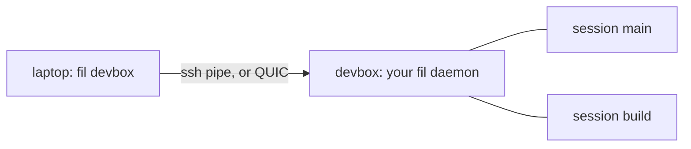

# Sessions, detach and takeover

A session is a shell on the host, with its terminal, its scrollback and its port forwards. It belongs to a daemon fil starts for you on the host, not to your client, so it outlives the client.



## Names and lifetime

- A session name is `[A-Za-z0-9._-]`, 1 to 64 characters. `fil HOST` with no name is the session `main`; `fil -N HOST` (forwards only, no terminal: see [forwards](forwards.md)) is the session `tunnel`.
- Attaching to a name that does not exist creates it.
- A session lives until its shell exits or you end it with `fil kill`. Detached sessions stay as long as the daemon does. The daemon exits by itself when it has no sessions and no connections for five minutes (`idle_exit_secs` in [`daemon.toml`](daemon.md)); it does not exit while a session exists.
- The daemon keeps each session's recent output (1,000 lines by default; `history_lines` in `daemon.toml`) in memory, so you can resume or reattach. It is never written to disk.
- If the host reboots, or something kills the daemon, the sessions are gone. A host that kills your processes at logout also does: see [troubleshooting](troubleshooting.md).

## Listing and ending

```sh
fil ls devbox                 # NAME, TERM, FORWARDS, ATTACHED, LAST OUTPUT, CREATED, FIL
fil kill devbox build         # end "build"
fil kill --outdated devbox    # end the sessions on daemons older than this fil, after asking
```

`fil kill` hangs up the session's shell and everything it started, as closing a terminal would, then kills whatever is left after a short grace. The client attached to it sees the session end.

## After an upgrade: daemons of several versions

Each version of fil runs its own daemon on a host. After you upgrade, your next connection starts the new version's daemon beside the old one, and the old daemon keeps its sessions until they end, then exits. Nothing is lost, and nothing has to be ended first:

- `fil ls devbox` lists the sessions of every daemon, in one table; the FIL column says which version's daemon holds each. (It asks each daemon over a connection of its own, so an older daemon costs one more ssh connection while it runs.)
- `fil devbox build`, and `fil kill`, `fil detach`, `fil forward` and `fil ports` with a session name, reach that session on whichever daemon holds it. A name no daemon has is a new session on the newest daemon.
- `fil kill --outdated devbox` ends the sessions on daemons older than your fil, for when the new version fixes something in the daemon (a security fix, say) and the old sessions should not wait to end on their own. It lists them first, with the jobs still running in each, then asks:

  ```text
  sessions on devbox whose daemon is older than this fil (1.1.0):
    SESSION  FIL    JOBS
    main     1.0.2  2 running
    notes    1.0.2  none
  fil: end these 2 sessions and everything running in them? [y/N]
  ```

  `y` ends them, each on its own daemon; anything else ends nothing (status 1). With stdin not a terminal it ends nothing unless you pass `--yes` (`-y`). A daemon from 1.0.0 has no jobs check: its sessions are listed with `not checked (fil 1.0.0 cannot report them)` and are still ended on `y`.

This works when the fil that runs on the host is this version or later, which the install command makes sure of (it runs your own version there). With `remote = "plain"` and an older fil installed on the host, connections go where that fil sends them: the newest daemon.

## Detach

Three ways, which keep the session running:

- Type `~.` after Enter, in the session.
- `fil detach devbox build` from anywhere, which detaches whoever is attached to `build`.
- Inside a session, `fil detach` with no arguments detaches this session.

When you detach, fil hands your terminal back at once and resets the modes the session had set (the alternate screen, mouse reporting, bracketed paste, a hidden cursor) without clearing your scrollback.

## The escapes

Typed right after Enter, as in ssh:

| Keys | What |
|---|---|
| `~.` | detach |
| `~#` | show the forwards and the agent |
| `~?` | list these |
| `~~` | a literal `~` |

Pasted text is never read as an escape.

## One client at a time: takeover

At most one client is attached to a session. If you attach to a session that is attached elsewhere, fil first asks whether to take it over (new in 0.3.0; before, the attach took it over at once):

```
fil: "build" is attached from laptop since 2026-11-13 14:02:00. Take it over?  y = yes, n = no
```

The time is in your local time. A client whose link is down (a laptop asleep in a bag) still holds the session, and the question then says `(disconnected)` after the time. Nothing has changed yet: the other client keeps the session while you decide. `n` leaves it alone, and fil exits with status 1. If the session changes hands while you decide, your `y` does not take it from the new holder: fil asks again, naming who has it now.

`y` **takes it over**: the other client is told that the session was taken over by your machine's label at a time, and drops. You get the screen sized to your terminal.

To take sessions over without the question, pass `--take-over` for one run, or set [`takeover = "always"`](config.md#takeover) for a host or for all of them. A session nobody is attached to (a new one, or one you detached from) never asks.

A laptop that wakes up later does not steal the session back. Its client is refused with the takeover message and asked, on its own terminal, whether to take the session back (`y` or `n`); that `y` takes it without a second question. The label shown is `host_label` from your [config](config.md), by default your machine's short host name. It is shown only to your own other clients.

## Resuming and catching up

When a link drops and comes back, the client says where it stopped and the daemon sends the rest: no gap, and the scrollback is the terminal's own. If the daemon's log has wrapped past that point, or the client is new, the daemon sends a snapshot of the recent lines, then the live stream. A client that falls far behind on a slow link may be sent a jump to the current screen instead of every line.

## Exit status

`fil HOST` exits like ssh:

- `0` when you detach or the session ends with nothing to report;
- the shell's own status if it exited with one, or `128+N` if it was killed by signal N (or fil was stopped by signal N);
- `1` on an error, if the session was taken over, replaced or detached elsewhere, or if it is attached elsewhere and you did not take it over;
- `2` on a usage error;
- `255` if a forward failed and `forward_failure = "exit"`.

`fil -N HOST` exits the same way, except that Ctrl-C (or SIGTERM, SIGHUP, SIGQUIT) is how a tunnel is stopped: it detaches, and the status is `0` (`255` if it came before the tunnel was attached, as with `ssh -N`). A tunnel takes over a session whose holder is disconnected without asking, and leaves a connected holder alone (status `1`) unless you give `--take-over`, which an unattended tunnel should.

A host or session named like a subcommand (`ls`, `kill`, `detach`, `forward`, `ports`, `server`, `install`, `config`) is attached with `--`: `fil -- ls`, `fil devbox -- ls`.
