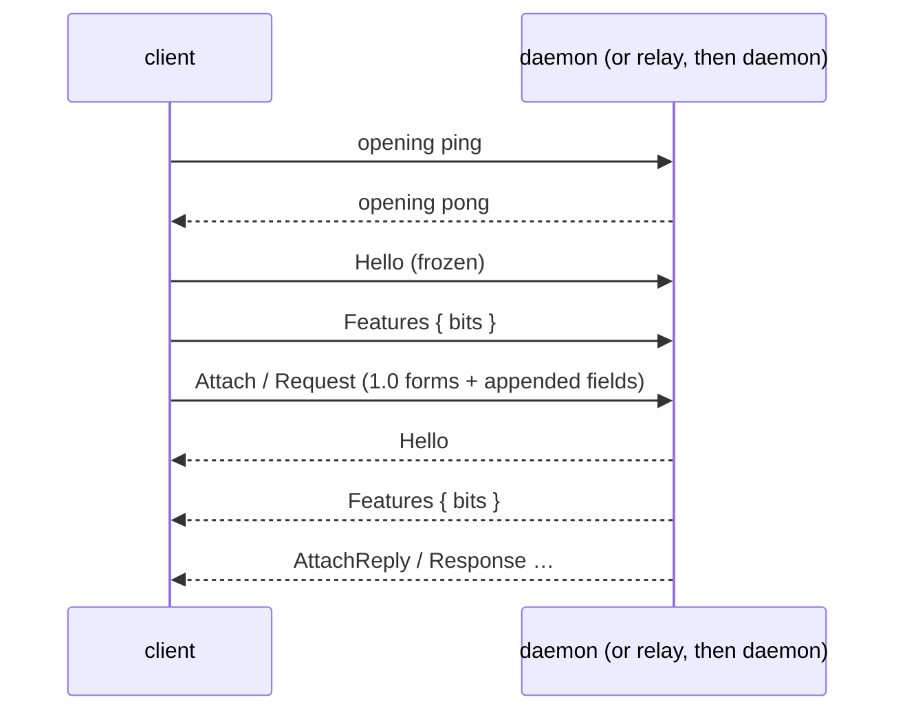

# The 1.x wire: extensible, then frozen

Decision D1 (owner, 2026-11-11, `1.0-decisions.md` item 1): one last in-place change before 1.0
makes the wire extensible. After that it is frozen for 1.x: every 1.x client and daemon work
together, a new feature is used only when both sides have it, and only 2.0 breaks compatibility.
This note is the contract. `DESIGN.md` §8.5 ("Versioning") points here and follows it.

## Decisions for the owner to confirm

1. **No new envelope.** Every message already has a type and a length, so no bytes are added:
   - a control message is one postcard value per frame: its type is the variant index, and its
     length is the frame's;
   - a MUX record has its own length prefix;
   - an in-band input record is a whole payload.
2. **Unknown message types are skipped, not refused.** This holds for control messages, MUX
   records and input records. A message that the receiver must understand is sent only when the
   receiver has negotiated its feature. HTTP/2 handles unknown frame types the same way.
3. **New fields are appended, not tagged.** A 1.x field goes at the end of a message, and only
   there. An older receiver ignores the bytes after the fields it knows, and a newer receiver
   fills in a default when they are missing. No TLV encoding.
4. **An unknown variant of an enum inside a message is still a protocol error.** The sender must
   not send it unless the receiver negotiated the feature. Where a value enum grows, the sender
   falls back to a 1.0 value for a peer that lacks the feature.
5. **Features are negotiated with a new `Features` message.** Each side sends it once, before
   its first request or reply, right after its `Hello` by convention. A receiver accepts it
   anywhere before the request, so a message the receiver does not know (a relay's `Route`) may
   come first. The `Hello` itself stays frozen. A feature is a bit in a bitmap of up to 256
   bits, and it is in use only when both sides set it. 1.0 defines none.
6. **The revision no longer gates within 1.x.** `PROTOCOL_REVISION` still goes up on every
   encoding change, because the golden needs it. But any two revisions from 16 (the 1.0 wire)
   on, under major 1, work together. Revisions 1 to 15 (pre-1.0 development builds) are still
   refused at the hello, as now.
7. **The QUIC ALPN becomes `fil/1`** (`fil/<major>`). It was `fil/1.<revision>`, and is frozen
   for 1.x from now on.
8. **Limits are frozen for 1.x.** A 1.x build may raise one only behind a feature. The client's
   first message after its `Hello` and `Features` (its `Attach` or `Request`) uses only 1.0
   forms, plus appended fields.
9. **Routing is D2's job (PR #8), and for routing "the wire" is the 1.x family.** For deciding
   which daemon a relay connects a client to, and which daemon retires, "the client's wire"
   means every revision from `FIRST_STABLE_REVISION` (16) on under major 1, not one revision.
   That is implemented with D2 (PR #8): see *The revision's new role*. The wire lock stays per
   revision (DESIGN §5.3, *Upgrades*).
10. **The freeze starts now, and is final at the v1.0.0 tag.** The rest of the 1.0 work (D2,
    `-N`) follows the 1.x rules: it only adds. Until the tag, an in-place change is still
    possible if it is really needed: move `FIRST_STABLE_REVISION` to the new revision and run
    `just wire-golden-1-0` to take the baseline again. After the tag, never. The `compat` job
    fails if `golden/wire-1.0.txt` differs from the one at `v1.0.0`.
11. **Daemons are keyed by build (D2: owner, option 2; PR #8).** This is information, not a
    question. Each build's daemon has its own socket, `fil-<major>-<rev>-v<ver>.sock`. The
    per-revision wire lock of `docs/m4/release.md` §6.4.4 (`fil-<major>-<rev>.lock`) is held by
    every daemon of that revision, through a shared open file description passed over
    `…-v<ver>.lend`. The wire depends on none of these names.
12. **D2's wire needs.**
    - `SessionSummary.daemon_version` and `OtherDaemon.version` (`FilVersion`,
      `[A-Za-z0-9.+-]{1,32}`) are in the 1.0 encoding. They sit inside lists, where nothing can
      be appended once the wire is frozen. They are filled from the daemon's build version
      (`Paths::version`, PR #8), and `fil ls` shows the first as its FIL column and the second
      in its "also running" note.
    - Reaching a particular daemon and a kill pre-check need no 1.0 support (see *D2 under the
      frozen wire*).
13. **List rows get room to grow.** `SessionSummary` and `OtherDaemon` end in a `RowExt`, a
    byte string of at most 64 bytes that is empty in 1.0. A later release puts a row's new
    fields there as one tail struct, which costs one byte per row. Without it, a new per-row
    field would need a new request and response behind a feature. `PortsRow` gets none: `fil
    ports` answers already come in parts, so a new kind of row is a new part kind behind a
    feature.
14. **`TakeOver::EpochIfDisconnected(epoch)` is in the 1.0 encoding.** It is for `fil -N`, from
    the review of PR #5. It behaves like `Epoch`, but only while that holder's link is down, so
    a holder that reconnects while the tunnel is re-dialing keeps its session. As a variant of
    an enum nested inside `Attach`, a 1.x release could only have added it behind a feature.
    `-N` uses it.
15. **Non-canonical varints stay accepted, frozen so for 1.x.** An example is a variant index
    written in more bytes than it needs (`85 00` is `Detach`). No honest sender writes one, and
    the skip decision and the decoder read the same varint, so no misparse follows. A golden
    probe pins the behavior. The one reader that does not take them is the relay's hello reader
    (`opening::hello_of`), which is byte-exact by design: it matches the frozen `Hello` line,
    variant index `00`, so a hello written as `80 00 …` is "not a hello" to the relay and takes
    the documented fallback for an unknown opening (`Want::Own`: the relay's own build's
    daemon, with no `Route` read), while that daemon's decoder accepts it as a `Hello`. Only
    the user's own client writes there, no honest sender writes it, and nothing after it is
    misparsed, so this is accepted for 1.x.
16. **Old-against-new CI.** A `compat` job runs in `linux-check`'s `extended` and `all` suites,
    with a bounded set of tags: `v1.0.0`, plus the newest patch of each of the two newest
    minors listed in `tests/compat/tags.txt`, so at most three tags. Each one is built
    `--locked` and run with the drop-in quick set in both directions. The list is empty until
    1.0 is tagged, and while it is empty the job reports that it skipped.
17. **Install GC under one 1.x wire (information).** `release.md` §6.3 rule 2.2 keeps every
    installed copy of a wire while any daemon of that wire runs. Under D2's keying, "a wire" is
    one revision, and many 1.x releases share a revision. A host with long-lived sessions
    therefore keeps every installed copy of that revision, about 15 MB per release, until its
    last session ends. **Proposed: accept it for 1.x.** Each release's copy is collected once
    no daemon of its revision runs. A later 1.x may narrow rule 2.2 to "this build's daemon
    runs" (one socket per build, from D2); §6.4 allows that extension because an older copy's
    own rules stay safe. Nothing here touches the wire.

## What stays frozen (forever within major 1)

These things are pinned in the golden's `[frozen]` section, and changing any of them needs
major 2:

- the preamble, and the opening ping and pong (`ff 7f 00`, `ff 7f 01`)
- the `Hello` (variant 0, `major`, `revision`, `agent`). A hello with trailing bytes is still not
  a hello, because the relay reads it with `opening::hello_of`.
- `Error(VersionMismatch)` (`0b 00`)
- the frame layout

From 1.0 on, `[limits]` is frozen as well, and so is everything in `[revisioned]`: the 1.0
encoding of every message, and every decoder probe. A 1.x revision may add lines, but may not
change any.

The golden test enforces this from revision 16 on against a committed copy of the 1.0 golden
(`golden/wire-1.0.txt`). Every line of the copy must still be in the current golden with the
same value, with two exceptions:

- the probes of "the first variant past an enum's last" (`PAST_THE_END` in the test) may go from
  a refusal to an accept, when 1.x adds that variant;
- the probes of "a type no build has yet" (`FIRST_UNKNOWN`) may change.

These are also fixed for 1.x, with no golden line:

- the ALPN `fil/1`
- **`Heartbeat`**: never append to it. The QUIC transport matches its accept proof byte for
  byte, and takes any short `Heartbeat { reply: true }` with a non-zero nonce as a flush
  answer. A heartbeat with more in it is a new message.
- the data segment and the record mark
- channel numbering: 0 control, 1 terminal, 2 snapshot, 3 MUX, 16 and up dynamic. 4 to 15 are
  reserved, and the QUIC stream layout is fixed.

  **A new channel (4 to 15) or a new kind of stream is still a valid 1.x addition behind a
  feature.** Both sides ignore data on a channel they do not use, and both have tests for it.
  Each such stream takes one of the peer's 1,024 concurrent streams and one inbox place until
  it ends.

## Framing and skipping

| What | Type | Length | Unknown type | Bytes after the known fields |
|---|---|---|---|---|
| control message (channel 0) | postcard variant index | the frame (pipe) or the QUIC length prefix | skipped (counted, logged by number only) | ignored, except after a `Hello` |
| MUX record (channel 3) | `MuxMsg` variant index | the record's varint length (1 to 1024) | skipped | ignored |
| input record (terminal channel, after `RECORD_MARK`) | `InputRecord` variant index | the payload | skipped (takes no space in the input stream, like every record) | ignored |
| enum inside a message | variant index | none | **malformed**: protocol error, as before | (not applicable) |

The receiver tells a known type from an unknown one by the variant index alone: an index at or
past its last known variant is unknown. The counts (`CONTROL_VARIANTS`, `MUX_KINDS`,
`RECORD_KINDS`) are tied to the golden, which decodes every instance it pins. A variant added
without raising its count therefore fails there, instead of being skipped by its own build.

A retired slot (`ControlMsg::Retired`, index 10) is known and has no values, so it is still
malformed. A known type whose fields fail to decode is still malformed, exactly as before. Every
check that validates while decoding (names, sizes, keys, caps) is unchanged.

The two directions behave the same way. Whatever a client may skip, the daemon may skip too,
because the sender's rule protects both.

**The sender's rule.** A message, variant or field that a 1.0 receiver would misread is sent
only when the receiver advertised the feature that introduced it. Three kinds of change may be
sent to any 1.x peer without a feature:

- a new message type whose loss changes nothing (a notice, a hint)
- an appended field whose absence means "as 1.0 did"
- a new value that the sender downgrades to a 1.0 value for a peer without the feature

### Appending a field (how 1.1 does it)

Fields can be appended in two places:

- at the end of the encoded message: the last struct of a top-level `ControlMsg` variant, or of
  a `MuxMsg` or `InputRecord` variant;
- in a list row's `RowExt`.

An enum or struct that sits in the middle of a message cannot grow, because postcard has no
field boundaries. A 1.x change that needs to grow one adds a new message or variant behind a
feature instead.

The new fields go into one struct whose every field has a default, for example
`AttachExt1 { … }`. That struct is decoded with `fil_proto::ext::tail` from the bytes left
after the 1.0 fields, or from the row's `RowExt`. `tail` returns the default when no bytes are
left and ignores anything past what it knows. A later release appends `AttachExt2` after
`AttachExt1` in the same way. Each tail struct is itself frozen once released.

**The tails count against the 1.0 caps** (4 KiB control message, 1 KiB MUX record, 64-byte row
extension), which a 1.0 receiver enforces. Packers measure with the tail included:

- `Response::sessions` cuts its list to fit one control message and marks it `truncated`;
- `fil ports` answers come in parts, each one control message.

Both encode the rows they are given, tails included, so the cut and the paging still hold.

## Feature negotiation

- `ControlMsg::Features(FeatureSet)` is index 17; since revision 17, `ControlMsg::Route`
  (index 18) is the last variant. A `FeatureSet` is a byte string of 0
  to 32 bytes, where bit `n` is feature `n`, least significant bit first. A longer one does not
  decode.
- Each side sends it once per connection, right after its `Hello` by convention, on every hop
  that speaks control messages. The relay does not read it. It passes it through unchanged,
  like everything after the hello.
- **The daemon accepts the client's `Features` once, anywhere before the `Attach` or
  `Request`.** Messages it does not know may come first: a later client may put a relay's
  `Route` ahead of it. A second `Features` is a protocol error. The client takes the daemon's
  `Features` once per link and ignores another.
- **If no `Features` arrives, the set is empty.** Every 1.x build sends one, so this costs
  nothing, and it keeps test peers that speak only 1.0 messages valid.
- The features in use are the intersection of the two sets. Bits a side does not know are
  ignored. A bit's meaning is never reused, and a retired feature keeps its number.
- The client does not wait for the daemon's features before its first request, because that
  would add a round trip to every attach. That is why the first request uses only 1.0 forms plus
  appended fields (decision 8). A 1.x client that wants to send a message gated on a feature,
  such as a new `Request` kind, waits for the daemon's `Hello` and `Features` first. Only that
  request pays the round trip.
- 1.0 defines no feature. Revision 17 defines bit 0, `Feature::JOBS` (the `fil kill --outdated`
  pre-check, *D2 under the frozen wire*). Tests use bits that no build defines.
- There is no way to *require* a feature. A daemon that must refuse a peer without one does so
  with a 1.0 `ErrorCode` after reading its `Features`.

## The revision's new role

- `PROTOCOL_REVISION` still changes with every encoding change, and the golden still enforces
  it. It now names an encoding for the golden and for diagnostics. It is no longer a
  compatibility key.
- `Hello::check` accepts the peer when the majors are equal and either the revisions are equal
  or both are at least `FIRST_STABLE_REVISION` (16). Everything else is a `VersionMismatch`, with
  the same direction and wording as before: another major, revision 0 (from before revisions)
  and revisions 1 to 15.
- Within 1.x, features gate behavior. A build never infers a capability from a revision number,
  because features can be backported or dropped, and numbers cannot.
- **Routing and retiring daemons follow the 1.x family** (decision 9), with D2 (PR #8):
  - the relay sends a client of any 1.x revision to the newest running daemon of the family,
    or else starts its own build's daemon;
  - an older 1.x daemon counts as superseded by a newer one of any 1.x revision.

  The wire itself depends on none of this: any 1.x client may talk to any 1.x daemon.
- `fil --version` still prints `(wire 1.<revision>)`.

## What a 1.x change may and may not do (checklist for a wire PR)

- [ ] Bump `PROTOCOL_REVISION` and run `just wire-golden`. Every line of `golden/wire-1.0.txt`
      is unchanged, apart from the past-the-end probes. The test checks this.
- [ ] Only additions:
      - a new `ControlMsg`, `MuxMsg` or `InputRecord` variant at the end, with its count
        (`CONTROL_VARIANTS`, `MUX_KINDS`, `RECORD_KINDS`) raised and an instance in the golden;
      - a new tail struct at the end of a message, or in a row's `RowExt`;
      - a new variant at the end of a nested enum.

      Nothing is renumbered, removed, reordered, narrowed or retyped.
- [ ] Anything a 1.0 peer would misread is behind a new feature bit, added to `Feature`,
      `FeatureSet::ours()` and the golden. The sender checks the negotiated set before sending
      it. This covers a new channel or stream too.
- [ ] The receiver keeps working when the feature is missing on the other side (an older peer).
      It works without the new message, and with the default value of a new field.
- [ ] No 1.0 limit is raised unless a feature gates it, and no limit is lowered.
- [ ] Appended fields fit the 1.0 caps. Whatever packs a message to its cap measures with the
      tail included.
- [ ] Nothing new reaches the first request except appended fields.
- [ ] Nothing is appended to `Heartbeat`.
- [ ] A test with a "1.0 peer" (no feature, no tail) and one with a "future peer" (unknown
      types, unknown bits, a longer tail) both pass. See `crates/fil-proto/tests/compat.rs`.
- [ ] Any security invariant in `DESIGN.md` §11 still holds. A skipped message must never be
      what enforces one.

**Not a 1.x change:** anything in the frozen list above, a new required handshake step, or
making an unknown type fatal. Each of these needs 2.0.

## D2 under the frozen wire

D2 (daemons of several versions on one host, `fil kill --outdated`) needs three things from the
wire. All three are in (the last two as revision 17, a 1.x addition: the 1.0 baseline is untouched,
and the golden only gains lines and the past-the-end probes of `Request` and `Response`; DESIGN §5.3
*Reaching a particular daemon* has the behavior):

- **Each daemon's version.** `SessionSummary.daemon_version` (the daemon that holds the
  session) and `OtherDaemon.version` (`None` for a daemon known only by its revision) are in the
  1.0 encoding. Either row can grow later through its `RowExt`.
- **Reaching a particular daemon.** The relay is always the client's own build (the bootstrap
  runs the client's exact version). A 1.x client can therefore tell its relay which daemon it
  wants with a new control message, a `Route`, sent between its `Hello` and its request. The
  relay reads it and does not pass it on.

  A relay too old to know `Route` (a `remote = "plain"` host running an older installed fil)
  passes it to its daemon. That daemon skips it as an unknown type, still accepts the
  `Features` that follows (decision 5), and the client reaches that relay's default daemon.
  This needs nothing from 1.0 beyond "unknown types are skipped" and the `Features` rule, and
  it is what lifts #8's interim limitation (an older daemon's sessions cannot be reached once a
  newer build runs).
- **A kill pre-check** (the jobs a session has left behind, reported before killing it). This
  is a new `Request` variant behind a feature bit. The client waits for the daemon's `Features`
  before sending it (the one round trip a gated request pays). An older daemon never sees the
  request.

  It must not be an appended field on `KillSession` (such as a "check only" flag): a 1.0 daemon
  would ignore the flag and kill the session, which is exactly the kind of field the sender's
  rule forbids sending without a feature.

As built in revision 17:

- `ControlMsg::Route(Route { to: RouteTo })` is index 18 (`CONTROL_VARIANTS` is 19), with
  `RouteTo::Newest`, `RouteTo::Build { version, revision }` and `RouteTo::Session(name)`. It needs
  no feature: nothing that skips it misreads anything. The relay reads it only from a client whose
  hello names a 1.x revision of its own family, takes it out of the stream whether or not it can
  decode it (a `RouteTo` variant of a later release routes as if there were none), and starts
  nothing for it. A daemon that receives one (behind an older relay, or on QUIC) skips it within
  `MAX_SKIPPED_HANDSHAKE`, by its index alone (`msg::is_route`): it never decodes a `Route`, so
  one with a `RouteTo` variant of a later release is skipped too, by every daemon from revision
  17 on (a revision-16 daemon skips index 18 as an unknown type anyway). A later release may
  therefore add a `RouteTo` variant without a feature.
- `Request::Jobs { session: Option<SessionName> }` (index 5) and
  `Response::Jobs { list: Vec<JobsRow>, truncated }` (index 6), with
  `JobsRow { name, jobs: Option<u16>, ext: RowExt }`, behind `Feature::JOBS` (bit 0).
- The daemon's `Hello` agent carries its build's version (`fil-daemon <version>`), which a client
  that routed to a build reads before it sends a kill there. The agent is free-form and was
  already the package version; nothing in the encoding changed.

## Limits for skipped data

A skipped message costs no more than a known one: the frame (16,416 bytes), the control payload
(4 KiB), the MUX record (1 KiB) and the input payload keep their limits. The decoder looks only
at the variant index and allocates nothing more. Skipping adds no state.

During the daemon's handshake (from `Hello` to the `Attach` or `Request`, which has a 10 s
deadline) at most `MAX_SKIPPED_HANDSHAKE` (16) unknown messages are skipped. One more is a
protocol error, so a client cannot keep a connection in the handshake with messages it knows
the daemon ignores.

After the handshake, a skipped message is just another frame. It is bounded by the same flow
control and inbox budgets as a heartbeat, which a peer could already send at the same rate. The
log records only the type number, never the contents (§11.1).

## Test plan

- **`crates/fil-proto/tests/compat.rs`** (the "1.1 peer", in fil-proto):
  - unknown control, MUX and input-record types decode as "unknown" and are skipped
  - an appended tail on every top-level message decodes to the same 1.0 value
  - `ext::tail` returns its default when the tail is empty and ignores any bytes past it
  - a `FeatureSet` with unknown bits intersects to only the known ones, and a 33-byte set is
    refused
  - a hello with a tail is still not a hello
  - nested unknown variants stay errors
  - revisions 16 and 17 check OK, while 15 against 16, and another major, do not
- **Golden** (`wire_golden.rs`):
  - every pinned instance decodes as itself (the variant counts);
  - the 1.0 baseline, as described above;
  - probes for unknown types, tails, `RowExt` and non-canonical varints.
- **Daemon** (`fil-daemon` `revision.rs`), straight to the socket:
  - a client of another 1.x revision lists and attaches;
  - mid-session, an unknown input record, an unknown control message and data on an unused
    channel are skipped;
  - a later client puts an unknown message *before* `Features`, then more unknown messages, then
    an `Attach` with a tail, and attaches;
  - a second `Features` is refused;
  - a seventeenth unknown message in the handshake is refused.
- **Client:** in every `fil-client` test, the fake daemon sends unknown feature bits, an
  unknown control message and data on an unused channel.
- **Real binaries** (`crates/fil/tests/revision.rs`):
  - the refusal tests use pre-1.0 revisions;
  - `two_1x_revisions_talk_both_ways` (revisions 16 and 17, through the relay, both ways) names
    no socket, and runs since D2 routes by the 1.x family (PR #8).
- **CI** (`compat` in `linux-check`, suites `extended` and `all`):
  - it checks the tag-anchored baseline;
  - it builds the bounded set of tags `--locked`, and runs `dropin --local --set quick` twice
    per tag: the old `fil` with the new daemon, then the new `fil` with the old daemon;
  - with no tags (now), it prints why it skipped and passes, and the fake-future-peer tests
    above stand in;
  - `--local` drives `fil-daemon-dev` as both relay and daemon. A relay of one build in front
    of a daemon of another (the real `remote = "plain"` case) is left to D2's routing tests.
