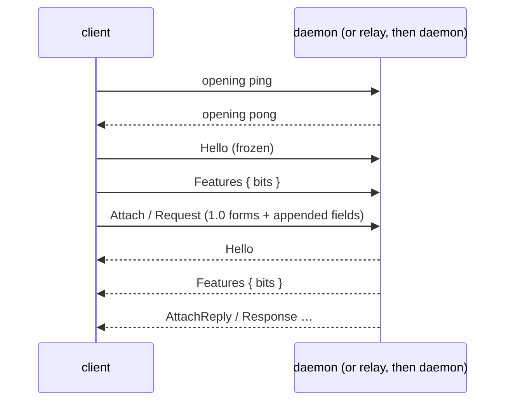

# The 1.x wire: extensible, then frozen

Decision D1 (owner, 2026-11-11, `1.0-decisions.md` item 1): one last in-place change before 1.0
makes the wire extensible. After that it is frozen for 1.x: every 1.x client and daemon work
together, a new feature is used only when both sides have it, and only 2.0 breaks compatibility.
This note is the contract. `DESIGN.md` §8.5 ("Versioning") points here and follows it.

## Decisions for the owner to confirm

1. **No new envelope.** Every message already has a type and a length, so no bytes are added:
   a control message is one postcard value per frame (its type is the variant index, its length
   is the frame's), a MUX record has its own length prefix, and an in-band input record is a
   whole payload.
2. **Unknown message types are skipped, not refused.** This holds for control messages, MUX
   records and input records. A message that the receiver must understand is sent only when the
   receiver has negotiated its feature. HTTP/2 handles unknown frame types the same way.
3. **New fields are appended, not tagged.** A 1.x field goes at the end of a message (only
   there). An older receiver ignores the bytes after the fields it knows, and a newer receiver
   fills in a default when they are missing. No TLV encoding.
4. **An unknown variant of an enum inside a message is still a protocol error.** The sender must
   not send it unless the receiver negotiated the feature. Where a value enum grows, the sender
   falls back to a 1.0 value for a peer that lacks the feature.
5. **Features are negotiated with a new `Features` message**, which each side sends right after
   its `Hello`. The `Hello` itself stays frozen. A feature is a bit in a bitmap of up to 256
   bits, and it is in use only when both sides set it. 1.0 defines none.
6. **The revision no longer gates within 1.x.** `PROTOCOL_REVISION` still goes up on every
   encoding change, because the golden needs it. But any two revisions from 16 (the 1.0 wire)
   on, under major 1, work together. Revisions 1 to 15 (pre-1.0 development builds) are still
   refused at the hello, as now.
7. **The QUIC ALPN becomes `fil/1`** (`fil/<major>`). It was `fil/1.<revision>`, and is frozen
   for 1.x from now on.
8. **Limits are frozen for 1.x.** A 1.x build may raise one only behind a feature. The client's
   first message after its `Hello` and `Features` (its `Attach` or `Request`) uses only 1.0
   forms, plus appended fields.
9. **The daemon socket name is not a wire question.** It stays keyed by revision until D2 (the
   socket keyed by version) replaces it. The relay changes in one respect: a 1.x client whose
   own revision has no running daemon goes to the relay's own daemon instead of being refused.
10. **Old-against-new CI**: a `compat` job in `linux-check`'s `extended` and `all` suites. It
    builds every tag listed in `tests/compat/tags.txt` and runs the drop-in quick set in both
    directions (old client against the new daemon, then new against old). The list is empty
    until 1.0 is tagged, and while it is empty the job reports that it skipped. Until then a
    fake-future-peer test stands in.

## What stays frozen (forever within major 1)

These things are pinned in the golden's `[frozen]` section, and changing any of them needs
major 2:

- the preamble, the opening ping and pong (`ff 7f 00`, `ff 7f 01`)
- the `Hello` (variant 0, `major`, `revision`, `agent`). A hello with trailing bytes is still not
  a hello, because the relay reads it with `opening::hello_of`.
- `Error(VersionMismatch)` (`0b 00`)
- the frame layout

From 1.0 on, `[limits]` is frozen as well, and so is the 1.0 encoding of every message in
`[revisioned]`. A 1.x revision may add lines to `[revisioned]` but may not change any. The
golden test enforces this from revision 16 on against a committed copy of the 1.0 golden
(`golden/wire-1.0.txt`): every line of it, except the `decode/` probes, must still be in the
current golden with the same value. The `decode/` probes are left out because some of them, such
as "the first variant past the last one", change by design when 1.x adds a variant.

These are also fixed for 1.x, with no golden line:

- the ALPN `fil/1`
- channel numbering (0 control, 1 terminal, 2 snapshot, 3 MUX, 16 and up dynamic, 4 to 15
  reserved)
- the data segment and the record mark
- the QUIC stream layout

## Framing and skipping

| What | Type | Length | Unknown type | Bytes after the known fields |
|---|---|---|---|---|
| control message (channel 0) | postcard variant index | the frame (pipe) or the QUIC length prefix | skipped (counted, logged by number only) | ignored, except after a `Hello` |
| MUX record (channel 3) | `MuxMsg` variant index | the record's varint length (1 to 1024) | skipped | ignored |
| input record (terminal channel, after `RECORD_MARK`) | `InputRecord` variant index | the payload | skipped (takes no space in the input stream, like every record) | ignored |
| enum inside a message | variant index | none | **malformed**: protocol error, as before | (not applicable) |

The receiver tells a known type from an unknown one by the variant index alone: an index at or
past its last known variant is unknown. A retired slot (`ControlMsg::Retired`, index 10) is
known and has no values, so it is still malformed. A known type whose fields fail to decode is
still malformed, exactly as before. Every check that validates while decoding (names, sizes,
keys, caps) is unchanged.

The two directions behave the same way. Whatever a client may skip, the daemon may skip too,
because the sender's rule protects both.

**The sender's rule.** A message, variant or field that a 1.0 receiver would misread is sent
only when the receiver advertised the feature that introduced it. Three kinds of change may be
sent to any 1.x peer without a feature:

- a new message type whose loss changes nothing (a notice, a hint)
- an appended field whose absence means "as 1.0 did"
- a new value that the sender downgrades to a 1.0 value for a peer without the feature

### Appending a field (how 1.1 does it)

Fields can only be appended at the end of the encoded message: the last struct of a top-level
`ControlMsg` variant, or of a `MuxMsg` or `InputRecord` variant. An enum or struct that sits in
the middle of a message cannot grow, because postcard has no field boundaries. A 1.x change that
needs to grow one adds a new message or variant behind a feature instead.

The new fields go into one struct whose every field has a default, for example
`AttachExt1 { … }`. That struct is decoded from the bytes left after the 1.0 fields with
`fil_proto::ext::tail`, which returns the default when no bytes are left and ignores anything
past what it knows. A later release appends `AttachExt2` after `AttachExt1` in the same way.
Each tail struct is itself frozen once released.

## Feature negotiation

- `ControlMsg::Features(FeatureSet)` is the last variant. A `FeatureSet` is a byte string of 0
  to 32 bytes, where bit `n` is feature `n`, least significant bit first. A longer one does not
  decode.
- Each side sends it as its second message, right after its `Hello`, on every hop that speaks
  control messages. The relay does not read it. It passes it through unchanged, like everything
  after the hello.
- The features in use are the intersection of the two sets. Bits a side does not know are
  ignored. A bit's meaning is never reused, and a retired feature keeps its number.
- **If no `Features` arrives, the set is empty.** A receiver takes the message right after the
  peer's `Hello` as its features when it is a `Features`. Anything else there means the peer
  has none. Every 1.x build sends `Features`, so this costs nothing, and it keeps test peers that
  speak only 1.0 messages valid.
- The client does not wait for the daemon's features before its first request, because that
  would add a round trip to every attach. That is why the first request uses only 1.0 forms plus
  appended fields (decision 8). A 1.x client that wants to send a message gated on a feature,
  such as a new `Request` kind, waits for the daemon's `Hello` and `Features` first. Only that
  request pays the round trip.
- 1.0 defines no feature. `FeatureSet::ours()` is empty. Tests use bits that no build defines.

## The revision's new role

- `PROTOCOL_REVISION` still changes with every encoding change, and the golden still enforces
  it. It now names an encoding for the golden and for diagnostics. It is no longer a
  compatibility key.
- `Hello::check` accepts the peer when the majors are equal and either the revisions are equal
  or both are at least `FIRST_STABLE_REVISION` (16). Everything else is a `VersionMismatch`, with
  the same direction and wording as before: another major, revision 0 (from before revisions)
  and revisions 1 to 15.
- Within 1.x, features gate behavior. A build never infers a capability from a revision number,
  because features can be backported or dropped, and numbers cannot.
- Socket keying (D2) is host-local and not part of the wire. The wire depends on it for nothing:
  a 1.x client may be connected to any 1.x daemon. Until D2 lands, the relay keeps its
  exact-revision routing when that revision's daemon is running. When none is running, it
  serves a compatible client with its own daemon instead of refusing it.
- `fil --version` still prints `(wire 1.<revision>)`.

## What a 1.x change may and may not do (checklist for a wire PR)

- [ ] Bump `PROTOCOL_REVISION` and run `just wire-golden`. Lines in `[frozen]`, `[limits]` and
      the 1.0 `[revisioned]` lines are unchanged. The test checks this.
- [ ] Only additions: a new `ControlMsg`, `MuxMsg` or `InputRecord` variant at the end, a new
      tail struct at the end of a message, or a new variant at the end of a nested enum.
      Nothing is renumbered, removed, reordered, narrowed or retyped.
- [ ] Anything a 1.0 peer would misread is behind a new feature bit, added to `Feature`,
      `FeatureSet::ours()` and the golden. The sender checks the negotiated set before sending
      it.
- [ ] The receiver keeps working when the feature is missing on the other side (an older peer).
      It works without the new message, and with the default value of a new field.
- [ ] No 1.0 limit is raised unless a feature gates it, and no limit is lowered.
- [ ] Nothing new reaches the first request except appended fields.
- [ ] A test with a "1.0 peer" (no feature, no tail) and one with a "future peer" (unknown
      types, unknown bits, a longer tail) both pass. See `crates/fil-proto/tests/compat.rs`.
- [ ] Any security invariant in `DESIGN.md` §11 still holds. A skipped message must never be
      what enforces one.

**Not a 1.x change:** anything in the frozen list above, a new required handshake step, or
making an unknown type fatal. Each of these needs 2.0.

## Limits for skipped data

A skipped message costs no more than a known one: the frame (16,416 bytes), the control payload
(4 KiB), the MUX record (1 KiB) and the input payload keep their limits. The decoder looks only
at the variant index and allocates nothing more. Skipping adds no state.

During the daemon's handshake (from `Hello` to the `Attach` or `Request`, which has a 10 s
deadline) at most `MAX_SKIPPED_HANDSHAKE` (16) unknown messages are skipped. One more is a
protocol error, so a client cannot keep a connection in the handshake with messages it knows
the daemon ignores. After the handshake, a skipped message is just another frame. It is bounded
by the same flow control and inbox budgets as a heartbeat, which a peer could already send at
the same rate. The log records only the type number, never the contents (§11.1).

## Test plan

- **`crates/fil-proto/tests/compat.rs`** (the "1.1 peer", in fil-proto):
  - unknown control, MUX and input-record types decode as "unknown" and are skipped
  - an appended tail on every top-level message decodes to the same 1.0 value (each canonical
    golden instance with junk appended)
  - `ext::tail` returns its default when the tail is empty and ignores any bytes past it
  - a `FeatureSet` with unknown bits intersects to only the known ones, and a 33-byte set is
    refused
  - a hello with a tail is still not a hello
  - nested unknown variants stay errors
  - revisions 16 and 17 check OK, while 15 and 16 and another major do not
- **Daemon:** a client sends `Hello`, a `Features` with unknown bits, unknown message types and
  an `Attach` with a tail, and it attaches and works. A seventeenth unknown message in the
  handshake is refused.
- **Session and client:** an unknown control message, MUX record and input record in mid-session
  are skipped without dropping the link.
- **Real binaries** (`crates/fil/tests/revision.rs`): two builds of revisions 16 and 17 (the
  `FIL_TEST_WIRE_REVISION` hook) list sessions and attach in both directions. The refusal tests
  now use pre-1.0 revisions.
- **Golden:** the new probes record that unknown types are skipped and tails ignored. From
  revision 16 on, the test checks the current golden against `golden/wire-1.0.txt` (above).
- **CI** (`compat` in `linux-check`, suites `extended` and `all`): for each tag in
  `tests/compat/tags.txt`, the job builds that tag's `fil` and `fil-daemon-dev` and runs
  `dropin --local --set quick` twice: the old `fil` with the new daemon, then the new `fil` with
  the old daemon. With no tags (now), the job prints why it skipped and passes, and the
  fake-future-peer tests above stand in.
